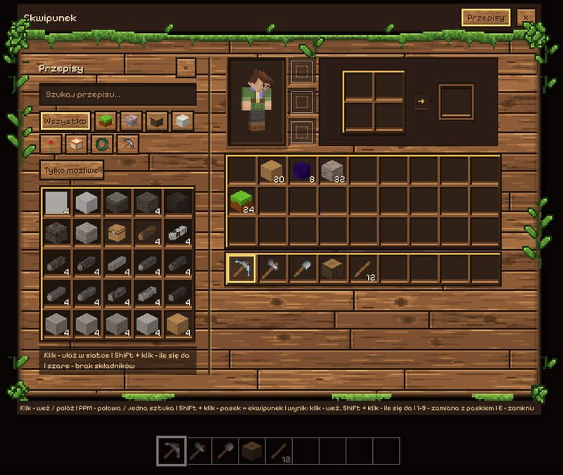

# Voxel Game

Gra voxelowa w przeglądarce, jako aplikacja na komputer (Windows) i na
telefon (Android), napisana w JavaScripcie z użyciem three.js.

> Nazwa robocza - do zmiany, gdy gra dostanie prawdziwą nazwę.

**Wiki gry** (dla graczy - jak grać, wszystkie bloki, przedmioty,
przepisy i osiągnięcia z ikonkami): [`docs/wiki/`](docs/wiki/README.md),
całe wiki jako jedna strona: `docs/wiki/index.html`. **Historia
zmian** - wszystko, co weszło do gry, wersja po wersji:
[`CHANGELOG.md`](CHANGELOG.md). Ten plik (README) opisuje grę od środka -
dla tych, którzy ją rozwijają.

## Jak uruchomić

**Aplikacja na komputer (Windows):** instalator z wydań -
<https://github.com/kamilstefaniak12321-pixel/voxel-game-wydania/releases/latest>
(plik `Voxel-Game-...-instalator.exe`). Gra sama sprawdza aktualizacje
przy starcie, pobiera je w tle i instaluje po zamknięciu (albo od razu
- *Zainstaluj teraz* na ekranie tytułowym). Wszystko o aplikacji -
instalacja, zapisy, wydawanie nowych wersji: `docs/aplikacja.md`.

**W przeglądarce:** gra używa modułów JavaScript, więc nie zadziała po
dwukliku w `index.html`. Trzeba ją otworzyć przez lokalny serwer, na
przykład:

- **VS Code:** rozszerzenie *Live Server* -> prawy przycisk na `index.html` -> *Open with Live Server*
- **Node.js:** w folderze gry `npx serve`, potem adres podany w konsoli

Internet nie jest potrzebny - three.js jest w `lib/three/`. Światy
z przeglądarki i z aplikacji są zapisywane osobno.

**Aplikacja na telefon (Android):** na telefonie z wydań (link wyżej)
pobierz `Voxel-Game-...-android.apk` i otwórz - Android zapyta, czy
zezwolić na instalację z przeglądarki (zezwól). Gra ma ikonkę na
ekranie, działa bez internetu, zawsze poziomo i na cały ekran. Nowa
wersja = nowy `.apk` zainstalowany na starym (światy zostają).

**W przeglądarce telefonu / tabletu:** na komputerze w folderze
gry `npx serve`, a na telefonie (w tej samej sieci Wi-Fi) adres
**Network** z konsoli, np. `http://192.168.1.23:3000`.

Na ekranie dotykowym gra sama włącza **sterowanie dotykowe** - joystick,
rozglądanie palcem i przyciski (sterowanie poniżej). Wymuszenie na
komputerze: `?dotyk` w adresie albo `/dotyk wl` (`?dotyk=0`, `/dotyk wyl`
wyłącza). Instalacja, aktualizacje, klucz do podpisu aplikacji,
ustawienia na telefonie i co jeszcze nie działa: `docs/telefon.md`.

## Sterowanie

| Klawisz | Akcja |
|---|---|
| WASD | ruch |
| Spacja | skok; w wodzie - płyń w górę (przy brzegu - wyjście z wody) |
| 2× Spacja | latanie (tryb kreatywny): Spacja - w górę, Shift - w dół (wysoko coraz szybciej), lądowanie kończy lot |
| Shift | kucanie (wolniej, niżej, nie spada się z krawędzi); w wodzie - nurkuj |
| 2× W albo R | bieg |
| F5 | widok: z oczu / zza pleców / z przodu |
| Mysz | rozglądanie się |
| LPM | zniszcz blok (w trybie przygody trzymaj - kopanie trwa chwilę, blok pęka; w kreatywnym trzymany LPM niszczy blok za blokiem) |
| PPM | postaw blok / zbierz owoce z krzaka (żywicę, kwiaty lipy) / posadź owoc, szyszkę, żołądź / siekierą - okoruj pień |
| 1-9 / kółko myszy | wybór miejsca na pasku bloków |
| Środkowy przycisk myszy | weź blok, na który patrzysz, na pasek |
| E | ekwipunek (w trybie kreatywnym też wszystkie bloki gry i owoce) |
| ESC | pauza (wróć do gry, ustawienia, zapisz i wyjdź do menu) |
| F3 | informacje debugowania w lewym górnym rogu |
| [ / ] (z F3) | cofnij / przesuń czas o godzinę |
| T, / | czat i komendy (`/pomoc`) |
| M | mapa terenu z góry (to samo co `/mapa`) |
| L | księga osiągnięć |

**Na telefonie** (sterowanie dotykowe, `docs/telefon.md`):

| Dotyk | Akcja |
|---|---|
| lewa część ekranu | joystick - chodzenie (do samego brzegu w przód - bieg) |
| reszta ekranu - przesuń palec | rozglądanie się |
| stuknięcie / przytrzymanie palca | postaw blok (zbierz owoce) / kop |
| ▲ / ▼ (prawy dół) | skok (2× - latanie) / kucanie, w locie w dół |
| kilof, kostka | kop / postaw tam, gdzie celownik |
| pasek bloków | stuknięcie - wybór miejsca |
| przyciski u góry | pauza, ekwipunek, czat, osiągnięcia, widok (F5), mapa, pełny ekran |
| "wstecz" w telefonie | pauza (nie wychodzi z gry) |

## Osiągnięcia

Za ciekawe rzeczy w grze dostajesz **osiągnięcia** w czterech rangach:
**zwykłe** (10 pkt), **rzadkie** (25), **bardzo rzadkie** (50)
i **legendarne** (100). Zdobyte osiągnięcie wyjeżdża na górze ekranu
z żartobliwym komentarzem i melodyjką (im rzadsze, tym bogatszą)
i trafia do **księgi osiągnięć** (klawisz **L**, przycisk *Osiągnięcia*
w pauzie i na ekranie tytułowym) - z datą i nazwą świata. Księga jest
wspólna dla wszystkich światów. Niektóre osiągnięcia są sekretne -
przed zdobyciem widać tylko znak zapytania.

Jest 29 osiągnięć (od pierwszego zniszczonego bloku po
legendarne *Problem spadł z nieba*). Nowa rzecz w grze = nowe
osiągnięcie - jak je dopisać, zdarzenia z gry i pełna lista (spoilery):
`docs/osiagniecia.md`. Test: `/osiagniecia` (lista), `/osiagniecia pokaz
legendarne` (samo powiadomienie), `/osiagniecia daj <id>`.

## Tryby gry i ekwipunek

Tryb wybiera się przy tworzeniu świata (przycisk *Tryb gry*, domyślnie
przygoda - `DEFAULT_GAME_MODE` w `src/config.js`) i można go zmienić
w grze komendą `/tryb przygoda` albo `/tryb kreatywny`.

- **Przygoda** - zaczynasz z pustym ekwipunkiem. Blok się **kopie**:
  trzymasz LPM, ręka uderza, z bloku lecą odłamki, blok pęka (10 etapów
  pęknięć) i po chwili znika - ziemia i piasek w pół sekundy, liście
  w 0,35 s, drewno w 2 s (siekierą 3 razy szybciej), kamień 2,2 s, granit
  i bazalt 2,8 s, meteoryt 4,5 s, rośliny od razu (`/kopanie lista`).
  **Narzędzia** kopią swoje bloki 3 razy szybciej: siekiera - drewno,
  kilof - skały, łopata - ziemię, piasek, żwir i błoto.
  Puszczony LPM albo inny blok pod celownikiem - kopanie od nowa.
  Zniszczony blok trafia do ekwipunku (blok trawy daje ziemię, a roślina,
  która na nim rosła, też wpada do ekwipunku), a postawienie bloku zużywa
  jedną sztukę ze stosu. Gdy ekwipunek jest pełny, blok się nie kopie
  (napis *Ekwipunek pełny*). Bez latania.
- **Kreatywny** - bloki znikają od razu (trzymany LPM - kolejny co
  ćwierć sekundy), nie zużywają się, pod **E** są wszystkie bloki
  gry, a **dwa razy Spacja** włącza latanie (Spacja - w górę, Shift -
  w dół; po wylądowaniu lot sam się wyłącza, dwa razy Spacja w locie
  też go kończy).

Czas kopania ustawia się w `src/config.js` (`BREAK_SECONDS` dla
materiałów, `LEAVES_BREAK_SECONDS`, narzędzia: `TOOL_MATERIALS`
i `TOOL_SPEED`) albo przy bloku (`hardness` w
`src/blocks/BlockRegistry.js`). Test: `/kopanie` (blok, na który
patrzysz), `/kopanie granit`, `/kopanie lista`.

**Ekwipunek** (klawisz **E**) ma 36 miejsc: 9 na pasku na dole ekranu
(klawisze 1-9) i 27 w trzech rzędach. Stos to najwyżej 64 sztuki.
W trybie kreatywnym okno ma zakładki: *Wszystkie bloki* (ułożone
w kategorie - Ziemia, Skały, Drewno, Rośliny, Owoce i nasiona,
Światło, Ozdoby, Narzędzia i surowce - z przyciskami kategorii
i wyszukiwaniem po polsku i po nazwie bloku, np. „ziem” albo „humus”)
i *Ekwipunek*. W zakładce ekwipunku widać postać gracza - głowa patrzy
za myszką - i **wytwarzanie** (niżej).

| W oknie ekwipunku | Akcja |
|---|---|
| klik | weź stos / połóż / zamień / dołóż do takiego samego |
| prawy przycisk | weź połowę stosu / połóż jedną sztukę (na bloku z listy kreatywnej: +1 sztuka) |
| Shift + klik | pasek ↔ reszta ekwipunku (blok z listy kreatywnej - prosto na pasek; w zakładce *Wszystkie bloki* Shift + klik na pasku czyści miejsce) |
| 1-9 nad miejscem | zamiana z tym miejscem paska |
| klik na wyniku wytwarzania | wyrób pod kursor (kolejny klik dokłada) |
| Shift + klik na wyniku | wytwórz, ile się da, prosto do ekwipunku |
| kosz (kreatywny) | usuwa trzymany blok |
| E | zamknij i wróć do gry (ESC - menu pauzy) |

Blok trzymany pod kursorem po zamknięciu okna wraca do ekwipunku.
Najechanie na blok pokazuje jego polską nazwę i nazwę do komend.

**Pasek bloków** - ikonki rysują się same z tekstur w atlasie (nowy
blok od razu ma ikonkę), liczba w rogu to ilość w stosie.

- Co jest na pasku w nowym świecie kreatywnym - `HOTBAR_DEFAULT`
  w `src/config.js`.
- Środkowy przycisk myszy na bloku w świecie: jeśli blok jest na pasku,
  wybiera jego miejsce; jeśli jest w reszcie ekwipunku - zamienia go
  z wybranym miejscem paska; jeśli go nie ma - w trybie kreatywnym
  wkłada go do pierwszego pustego miejsca (albo zastępuje wybrany).
- Ekwipunek, tryb gry i wybrane miejsce zapisują się razem ze światem.
  Światy sprzed ekwipunku dostają w nim to, co miały na pasku.
- Wygląd paska (kolory ramek, rozmiar miejsc, nazwa bloku nad paskiem)
  jest w motywie - wartości `--hotbar-...` w `theme.css`.
- Kod: `src/game/Inventory.js` (ekwipunek), `src/ui/InventoryScreen.js`
  (okno), `src/ui/Hotbar.js` (pasek), `src/items/categories.js`
  (kategorie).

### Wytwarzanie (crafting)



W zakładce ekwipunku, obok miejsc, jest **siatka 2 x 2** i **wynik**
ze strzałką - jak w Minecrafcie. Składniki kładzie się w siatce,
a gdy pasują do przepisu, w wyniku pojawia się wyrób: klik bierze go
pod kursor (składniki ubywają po jednej sztuce), Shift + klik
wytwarza, ile się da, prosto do ekwipunku. Przepisy **z kształtem**
(np. patyki - dwie deski jedna nad drugą) można przesuwać po siatce
i odbijać w poziomie; przepisy **bez kształtu** (np. deski z pnia) -
obojętne, gdzie leżą składniki. Po zamknięciu okna składniki z siatki
wracają do ekwipunku (co się nie zmieści - czeka w siatce, także
w zapisie świata).

**Księga przepisów** - przycisk 📖 *Przepisy* obok siatki: wszystkie
przepisy z kategoriami, wyszukiwaniem i filtrem *Tylko możliwe*.
Szare - brakuje składników. Klik na przepisie sam układa składniki
z ekwipunku w siatce (kolejny klik - jeszcze jeden komplet, Shift -
ile się da); gdy czegoś brakuje, siatka pokazuje przepis
półprzezroczyście, a podpowiedź mówi, czego brakuje. Na wąskim
ekranie (telefon) księga otwiera się w miejscu ekwipunku - pasek
i siatka zostają.

Co jest teraz (22 przepisy, pełna lista z obrazkami:
[`docs/wiki/przepisy.md`](docs/wiki/przepisy.md)):

| Wyrób | Z czego |
|---|---|
| deski x4 (6 gatunków) | pień tego drzewa (też okorowany) |
| patyki x4 | 2 deski jedna nad drugą |
| siekiera / kilof / łopata | skała (kamień, granit, wapień, piaskowiec, łupek, bazalt) i patyk |
| lampa x2 | lepidolit + żywica + kora brzozowa |
| kolorowa lampa | lampa + mak / truskawki / chili (czerwona), koniczyna / pokrzywa / paproć (zielona), chaber (niebieska), jeżyny (fioletowa) |
| wieniec świerkowy | 3 x igliwie świerka + szyszka |
| opadłe liście x2 | liście buka albo dębu |
| piaskowiec | 4 x piasek |
| ziemia kamienista x4 | 2 x ziemia + 2 x żwir |
| czarnoziem / ściółka leśna | ziemia + opadłe liście / igliwie |

Komendy: `/przepisy` (lista, `/przepisy kilof` - jak zrobić i do czego
się przydaje, `/przepisy moge` - na co masz składniki), `/wytworz
<przepis> [ile]` - wytwarzanie z ekwipunku na skróty.

**Nowy przepis** = wpis w `src/crafting/recipes.js` (opis pól na
początku pliku): wynik, kształt z literami (`pattern` + `key`) albo
lista składników (`ingredients`); zamiast konkretnego bloku może być
grupa, np. `'#planks'` - dowolne deski (`GROUPS` w tym samym pliku).
Przepis sam trafia do księgi, `/przepisy` i wiki; literówka w nazwie
= błąd od razu przy starcie gry. Czy nowy przepis nie gryzie się
z innym (ten sam układ w siatce): `node tools/sprawdz_przepisy.mjs`.
Logika: `src/crafting/Crafting.js`.

## Bloki naturalne i rośliny

Oprócz trawy, ziemi, piasku i skał są:

- **ziemie:** czarnoziem (`humus`), ziemia kamienista (`coarse_dirt`),
  ściółka leśna (`forest_floor`), błoto (`mud`), glina (`clay`)
  i żwir (`gravel`) - na razie tylko w trybie kreatywnym (na ziemiach
  rosną rośliny, na żwirze nie),
- **rośliny:** krótka i wysoka trawa, paproć, koniczyna, pokrzywa,
  babka zwyczajna oraz kwiaty: mak, chaber, rumianek, mniszek,
- **krzaki owocowe:** truskawka, jeżyna, papryczka chili i leszczyna
  (orzechy laskowe) - opis niżej,
- **drzewa:** świerk, sosna, buk, lipa, dąb i brzoza - pnie, deski,
  liście, sadzonki i dodatki; w terenie realistycznym rosną lasy - opis
  niżej i w `docs/drzewa.md`.

Rośliny są skrzyżowanymi płaszczyznami z teksturą (model `cross`),
nie mają kolizji, nie zasłaniają światła i lekko kołyszą się na wietrze
(tylko górne końce - korzenie stoją w miejscu). Każda jest trochę
przesunięta, obrócona i ma inną wysokość, więc łąka nie wygląda jak
siatka. Rosną tylko na ziemi (bloki z `soil: true`); gdy zniszczysz
blok pod rośliną, roślina też znika. Trawę i paproć można zastąpić
stawianym blokiem (jak w Minecrafcie). Celownik trafia w roślinę, więc
żeby rozkopać ziemię pod nią, najpierw niszczysz roślinę.

W terenie realistycznym na trawie rośnie trawa (od rzadkiej do gęstych
łąk), kępy kwiatów zwykle jednego gatunku, paprocie w wilgotnym
klimacie i na wyżynach, a pojedynczo zioła i mniszki - liczby do
strojenia: `PLANTS` w `src/world/terrain/TerrainShape.js`. Rośliny
rysują się do `PLANT_VIEW_DISTANCE` bloków od gracza (`src/config.js`).

### Krzaki owocowe i orzechy

Cztery gatunki: **truskawka**, **jeżyna**, **papryczka chili**
i **leszczyna** (orzechy laskowe). Każdy rośnie w czterech etapach:

| Etap | Blok (np. truskawka) | Wygląd |
|---|---|---|
| sadzonka | `strawberry_sapling` | mała roślinka |
| krzak | `strawberry_bush` | sam krzak, bez owoców |
| kilka owoców | `strawberry_bush_few` | pierwsze owoce |
| pełen owoców | `strawberry_bush_full` | krzak obsypany owocami |

(jeżyna - `blackberry_...`, papryczka chili - `chili_...`, leszczyna -
`hazel_...`)

- **Wzrost:** krzaki same przechodzą do następnego etapu - średnio co
  `BUSH_GROWTH_SECONDS` sekund (`src/config.js`, teraz 150 s), każdy
  w swoim, losowym czasie. Rosną posadzone krzaki i te, z których
  zbierałeś owoce (w chunkach wczytanych wokół gracza i zmienionych
  przez niego); dzikie krzaki w nietkniętym terenie czekają w swoim
  etapie - dzięki temu nie trzeba zapisywać całej okolicy, a meteoryty
  dalej mają gdzie spadać. Kod: `src/game/PlantGrowth.js`.
- **Zbiór:** PPM na krzaku z owocami - owoce trafiają do ekwipunku
  (kilka owoców: 1-2, pełen: 2-4, orzechy 2-3), a krzak wraca do etapu
  bez owoców i owocuje od nowa. Z **Shiftem** i blokiem w ręce PPM
  zwyczajnie stawia blok obok. Działa w obu trybach.
- **Sadzenie:** owoc w ręce + PPM na ziemi = sadzonka tego gatunku
  (w przygodzie zużywa jeden owoc). Orzech daje leszczynę.
- **Niszczenie:** zniszczony krzak (przygoda) daje sadzonkę - można go
  przesadzić - i owoce, które na nim były.
- **W świecie:** w terenie realistycznym na trawie rosną dzikie zarośla
  (zwykle jednego gatunku) - w różnych etapach, najczęściej z owocami.
  Liczby do strojenia: `bush...` w `PLANTS` (`TerrainShape.js`).
- **Owoce** to pierwsze **przedmioty**, które nie są blokami: truskawki,
  jeżyny, papryczki chili, orzech laskowy (`src/items/ItemRegistry.js`). Leżą
  w ekwipunku jak bloki (stosy po 64), w ręce postaci widać je jako
  płaski obrazek. Na razie służą do sadzenia - jedzenie przyjdzie
  z głodem.
- **Tekstury:** wiersz 3 atlasu (krzaki - sadzonka i krzak bez owoców są
  wspólne dla gatunków) i wiersz 4 (ikonki owoców).
- **Test:** `/krzaki ogrod` (przed tobą wszystkie gatunki i etapy),
  `/krzaki znajdz` (najbliższy dziki krzak z owocami), `/krzaki tempo 60`
  (rosną 60 razy szybciej), `/krzaki rosnij 3`, `/daj truskawki 10`.

### Drzewa i lasy

Sześć gatunków z koncepcji Kamila: **świerk pospolity**, **sosna
zwyczajna**, **buk zwyczajny**, **lipa drobnolistna**, **dąb szypułkowy**
i **brzoza brodawkowata**. Wszystko o nich: `docs/drzewa.md`.

- **Bloki** każdego gatunku: pień (`oak_log`), okorowany pień
  (`oak_log_stripped`), deski (`oak_planks`), liście albo igliwie
  (`oak_leaves`), sadzonka (`oak_sapling`) - świerk `spruce_`, sosna
  `pine_`, buk `beech_`, lipa `linden_`, brzoza `birch_`.
- **Dodatki:** szyszki świerka i sosny, wieniec świerkowy (na ścianę),
  górny (rudy) pień sosny i pień z żywicą, żywica, orzeszki bukowe,
  opadłe liście buka i dębu, kwitnące liście lipy i kwiat lipy,
  żołędzie, kora brzozowa, a do tego **siekiera** (PPM na pniu -
  okorowany pień; z brzozy kora).
- **W świecie** (teren realistyczny): lasy na ok. 1/3 lądu - gatunek
  zależy od klimatu: świerki w górach i w chłodzie, sosny tam, gdzie
  sucho, buki na wyżynach, lipy i dęby w cieple na nizinach, brzozy
  nisko i wilgotno. Każdy gatunek ma swój kształt (stożek świerka,
  parasol sosny, szeroka korona dębu z konarami...), drzewa są różnej
  wielkości i pasują na granicach chunków. Liście mają prześwity, a pod
  koroną jest cień. Z daleka las widać jako korony drzew.
- **Sadzonki** (i szyszki, orzeszki, żołędzie, kwiat lipy posadzone na
  ziemi) wyrastają w całe drzewo średnio po 5 minutach
  (`TREE_GROWTH_SECONDS`), jeśli mają nad sobą miejsce.
- **Przygoda:** z liści czasem wypada sadzonka i nasiono gatunku.
- **Test:** `/drzewa aleja` (wszystkie gatunki przed tobą), `/drzewa
  dab` (jedno drzewo), `/drzewa znajdz sosna tp`, `/mapa lasy`,
  `/drzewa tempo 60`, `/daj axe`.

**Nowe drzewa bez programowania - paczki drzew.** Każdy folder
w `assets/drzewa/` to jeden gatunek: tekstury PNG 16 x 16, opis
`drzewo.json` (nazwy, bloki, odmiany liści - np. z owocami, które się
zbiera i które odrastają - przedmioty, gdzie rośnie, przepisy) i kształt
drzewa narysowany literkami w pliku `.txt`. Gra sama robi z tego bloki,
przedmioty, ikonki, przepisy, drzewa w lesie i z sadzonek. Przykład:
**jabłoń** (`assets/drzewa/jablon/`, `/drzewa posadz jablon`) - jabłka
zbiera się PPM i odrastają po 10 minutach. Nowa paczka: `python
tools/nowe_drzewo.py grusza`, sprawdzenie: `node tools/drzewa.mjs`,
w grze: `/drzewa paczki`. Folder wgrany na GitHuba dopisuje do gry akcja
*Drzewa (paczki)*. **Instrukcja krok po kroku: `docs/drzewa-paczki.md`.**

## Woda

Woda (morze w terenie realistycznym i postawiona przez gracza) jest
**półprzezroczysta**: z góry widać dno, które ciemnieje z głębokością,
a pod małym kątem woda wydaje się gęstsza (jak prawdziwa). Górny blok
wody jest trochę niższy od pełnego, powierzchnia lekko **faluje**,
a tekstura powoli **płynie** (dwie warstwy w różne strony).

**Pływanie:**

- w wodzie ruch jest wolniejszy (od kolan w górę - im głębiej, tym
  wolniej; w pełni od piersi - połowa zwykłej prędkości, z biegiem
  trochę szybciej),
- bez klawiszy powoli opadasz na dno, **Spacja** - płyniesz w górę,
  a przy powierzchni unosisz się z oczami tuż nad wodą,
- **Shift** - nurkujesz,
- **Spacja przy brzegu** (oparty o ścianę brzegu) - wybijasz się
  z wody na brzeg,
- wpadnięcie do wody wyhamowuje (upadek do wody nie boli).

**Pod wodą** jest niebieska mgła (nocą ciemna) i poświata na brzegach
ekranu, a dźwięki gry są głuche. **Dźwięki:** plusk przy wpadnięciu
(tym głośniejszy, im szybciej), ruchy ramion przy pływaniu, chlupanie
przy chodzeniu w płytkiej wodzie, krople przy wychodzeniu, szum pod
wodą i fale przy brzegu (z miejsca, gdzie jest woda). Postać pływa
żabką (z trzeciej osoby - F5): płynąc pochyla się prawie poziomo,
w miejscu utrzymuje się na wodzie.

Woda na razie **się nie rozlewa** - stoi tam, gdzie ją postawiono.

- **Test:** `/woda basen` (basen przed tobą: brodzik i głęboka część),
  `/woda znajdz` (najbliższa woda i komenda `/tp`), `/woda` (jak głęboko
  jesteś), `/woda fale 0-3` (wysokość fal), `/animacja plywanie`.
- **Liczby do strojenia:** `WATER_...`, `SWIM_...` i `UNDERWATER_...`
  w `src/config.js` (przezroczystość, fale, prędkość i opór, mgła pod
  wodą, ciemnienie dna).
- **Kod:** `src/player/Player.js` (pływanie), `src/rendering/ChunkMesher.js`
  (woda w osobnej grupie meshu, obniżona powierzchnia, ciemniejące dno),
  `src/rendering/BlockRenderData.js` (`waterMaterial` - przezroczystość,
  fale, płynąca tekstura), `src/game/WaterEffects.js` (widok spod wody,
  dźwięki).

## Ustawienia

W menu (z ekranu tytułowego i z pauzy) są zakładki:

**Obraz**

- **tryb ziemniaka** - patrz niżej,
- **zasięg widzenia** (24-384 bloków) - jak daleko widać prawdziwe bloki,
- **daleki teren** (do 4096 bloków albo wyłączony) - uproszczony,
  rozmyty teren za zasięgiem widzenia, aż po horyzont,
- **pole widzenia** (50-110°),
- **jasność** - od *Nastrojowej* (zwykłej) do *Jasnej*: rozjaśnia półmrok
  i noc, pełnego światła nie zmienia,
- **rozdzielczość** (25-100%) - mniej = szybciej, ale mniej ostro,
- **limit FPS** (bez limitu, 30, 60, 120, 144),
- **cienie w kątach** (0-100%),
- **liście drzew** - *ładne* (z prześwitami, widać głąb korony) albo
  *szybkie* (pełne, bez ścian w środku korony - las mniej spowalnia
  grę; na telefonie domyślnie),
- **dynamiczne światło** (lampa w ręce, meteoryty),
- **wczytywanie** (1-16 ms na klatkę) - ile czasu w każdej
  klatce gra poświęca na nowe chunki: więcej = świat dogrywa się
  szybciej (przy dużym zasięgu), ale mogą być przycięcia.

**Sterowanie** - czułość myszy (10-200%), odwrócona mysz (góra/dół).

**Gracz** - skórka (wczytanie własnego pliku PNG albo domyślna), druga
warstwa skórki, ręka w widoku z oczu (wł./wył.), kołysanie widoku przy
chodzeniu (wł./wył.), zgięcia rąk i nóg (gładkie albo klocki), odległość
kamery z trzeciej osoby.

**Dźwięk** - głośność całej gry, osobno bloków i kroków, otoczenia
(woda, meteoryty) oraz menu i ekwipunku; 0 = wyłączone.

**Inne** - motyw menu, rozmiar interfejsu w grze (pasek, czat, napisy),
informacje debugowania (to samo co F3), licznik FPS w rogu ekranu,
spadające meteoryty (wł./wył. - te, które robią kratery).

Zmiany działają od razu, także w grze pod pauzą, i zapisują się
w przeglądarce. Wartości domyślne są w `src/config.js`, a lista ustawień
z zakresami w `src/settings/Settings.js`. Wszystko da się też zmienić
z czatu: `/ustaw` (lista), np. `/ustaw zasieg 256`.

## Tekstury

Bloki mają tekstury 16 x 16 pikseli (atlas `assets/textures/blocks/terrain.png`)
w stylu pikselowym, ale **wygładzone i wycieniowane**: każda pokazuje
fakturę swojego bloku - grudki ziemi, kamyki w żwirze, warstwy piaskowca
i łupka, słupy bazaltu, kryształy granitu, łuski miki w lepidolicie,
liście na ściółce, mokry połysk błota, żarzące się żyłki meteorytu.
Światło pada z lewej góry: to, co wystaje, jest jaśniejsze z lewej i od
góry, a szczeliny są ciemne. Kolory przechodzą płynnie, bez
przypadkowego "szumu", a każda tekstura łączy się bez szwów z sąsiednim
blokiem. Średni kolor każdej tekstury jest taki jak dawniej (z daleka
świat wygląda tak samo - daleki teren liczy kolory ze średniej).

Tekstury rysuje skrypt **`tools/tekstury.py`** (Python z numpy i Pillow):
`python tools/tekstury.py` wkleja je do atlasu, `python tools/tekstury.py
podglad.png` dodatkowo zapisuje powiększony podgląd. Każdy blok to jedna
funkcja (np. `stone()`, `gravel()`), z własnym numerem losowania - ten
sam numer, ta sama tekstura. Trawa z wierzchu, woda, rośliny, krzaki
i owoce są rysowane ręcznie - skrypt ich nie zmienia (bok trawy dostaje
tylko nową ziemię pod tą samą trawą).

Drzewa (pnie, słoje, deski, liście, sadzonki i dodatki - wiersze 5-8
atlasu) rysuje osobny skrypt **`tools/tekstury_drzew.py`**, w tym samym
stylu: `python tools/tekstury_drzew.py [podglad.png]`.

Ikonki narzędzi i surowców (patyk, kilof, łopata - wiersz 9 atlasu)
rysuje **`tools/tekstury_narzedzi.py`** w tym samym stylu co siekiera:
`python tools/tekstury_narzedzi.py [podglad.png]`.

Tekstury drzew z paczek (`assets/drzewa/<drzewo>/*.png`) **nie są**
w `terrain.png` - gra dokłada je do atlasu sama przy starcie, od
wiersza 10 (`docs/drzewa-paczki.md`). Wiersze 10-15 pliku zostają więc
wolne dla nich.

Pęknięcia kopanego bloku (10 etapów w pasku
`assets/textures/blocks/cracks.png`) rysuje **`tools/pekniecia.py`**:
`python tools/pekniecia.py [podglad.png]` (podgląd - etapy na kamieniu).

## Dźwięki

Dźwięki bloków są **miękkie i ciche** - mają być tłem, a nie zwracać na
siebie uwagę: trawa lekko szeleści pod stopami, ziemia głucho stuka,
kamień krótko puka, piasek cicho szumi, żwir chrzęści, błoto mlaszcze,
liście szeleszczą, drewno (pnie, deski) ciepło i głucho puka, a szkło
lamp cicho dzwoni. Bez trzasków na początku
i bez syczących wysokich tonów; każdy krok ma 6 wersji (gra losuje
jedną i lekko zmienia wysokość), żeby się nie powtarzały.

- **Kroki** - co krok dźwięk bloku pod stopami (trawa, ziemia, kamień,
  piasek, żwir, błoto, szkło lamp); kucanie - ciszej i rzadziej, bieg -
  głośniej, a przez trawę i kwiaty jeszcze szelest. Po skoku i upadku
  stuk przy lądowaniu (tym głośniejszy, im mocniej).
- **Bloki** - każde postawienie i zniszczenie ma dźwięk swojego
  materiału, słychać go z miejsca bloku (z lewej, z prawej, z daleka).
- **Zbieranie owoców** - szelest liści i miękkie "pyknięcia" zrywanych
  owoców (z miejsca krzaka).
- **Woda** - plusk, pływanie, chlupanie w płytkiej wodzie, krople przy
  wychodzeniu, szum pod wodą (reszta dźwięków jest wtedy głucha) i fale
  przy brzegu (opis wyżej: *Woda*).
- **Kosmos** - cichy pomruk wysoko w kosmosie, a przy spadaniu jak
  meteoryt zapłon, ryk ognia i pęd powietrza (`docs/kosmos.md`).
- **Meteoryt** - huk lecącej kuli ognia narasta i robi się coraz
  wyższy, a uderzenie słychać trochę po błysku (dźwięk leci 343 bloki na
  sekundę - jak grzmot po błyskawicy). Potem grad odłamków i trzaskający,
  gasnący żar w kraterze. Dźwięki meteorytu są przestrzenne.
- **Osiągnięcia** - melodyjka przy zdobyciu: dwa dźwięki dla zwykłych,
  arpeggio z dzwoneczkami dla rzadszych, fanfara dla legendarnych.
- **Menu** - każdy przycisk cicho "klika" (przyciski powrotu - *Wróć*,
  *Anuluj*, *Gotowe*, ESC - niżej), suwaki tykają przy każdym kroku
  (tym wyżej, im dalej w prawo; suwak głośności od razu gra nową
  głośnością), wybór świata na liście - lżejsze kliknięcie.
- **Ekwipunek** - otwarcie i zamknięcie (szelest torby), wzięcie
  i odłożenie stosu, kosz. Zła komenda na czacie - krótkie, niskie
  "bum".

Dźwięk zaczyna grać po pierwszym kliknięciu albo klawiszu (tak chce
przeglądarka). Dźwięki gry w pauzie i w menu milkną i zatrzymują się
w miejscu (po powrocie grają dalej), a dźwięki menu grają zawsze.
Głośność: *Ustawienia* → *Dźwięk* albo `/ustaw glosnosc 60`
(`glosnosc-menu` - samo menu). Test: `/dzwiek pokaz` (wszystkie
materiały po kolei), `/dzwiek menu` (dźwięki menu i ekwipunku),
`/dzwiek meteor_impact` (jeden dźwięk).

Pliki są w `assets/sounds/` (`.ogg`) - każdy można podmienić własnym
nagraniem o tej samej nazwie. Lista dźwięków, ich głośność i zasięg:
`src/audio/sounds.js`; materiał dźwięków bloku: pole `sound`
w `src/blocks/BlockRegistry.js`; dźwięki menu gra `src/audio/ui.js`.
Obecne dźwięki są syntetyczne - policzył je skrypt `tools/dzwieki.py`
(Python z numpy i scipy + ffmpeg).

## Gracz

Postać gracza jest klockowa jak w Minecrafcie, ale ma **11 stawów**:
ręce zginają się w łokciach, nogi w kolanach, a tułów w talii. Widać ją
z trzeciej osoby (**F5**). Animacje: stanie (oddech), chód, bieg,
kucanie, skradanie, skok, spadanie, lądowanie, machnięcie ręką przy
niszczeniu i stawianiu, latanie; głowa patrzy tam, gdzie kamera.
W prawej ręce jest blok wybrany na pasku (owoc - jako płaski obrazek).

**Skórka** to obrazek 64 x 64 w układzie skórek Minecrafta (z drugą
warstwą). Domyślna: `assets/textures/player/skin.png`; własną wczytuje
się w *Ustawienia → Gracz* albo `/skorka plik`.

**Z oczu** widać prawą rękę (ze skórki, z rękawem) albo to, co
trzymasz: blok (obrócony, widać dwa boki i wierzch), przedmiot (np.
siekierę - głowicą w głąb ekranu, jak w Minecrafcie) albo roślinę.
Ręka macha przy kopaniu i stawianiu, chowa się i wraca przy zmianie
przedmiotu, kołysze się przy chodzeniu i lekko spóźnia za obrotem
kamery. Przy chodzeniu kołysze się też widok (do wyłączenia
w ustawieniach), a po upadku z wysoka kamera na chwilę się ugina.
Z rozbijanych bloków sypią się odłamki w kolorach ich tekstury.

Do oglądania: `/animacja chodzenie` (podgląd w miejscu), `/model tempo 0.25`
(zwolnione), `/kamera przod`. Opis modelu, układ skórki, liczby animacji,
widok z oczu i plan: `docs/gracz.md`.

## Tryb ziemniaka

Dla bardzo słabych komputerów (i komputerów bez karty graficznej).
Wszystko w grze działa tak samo - niebo, zaćmienia, daleki teren,
światło - tylko prościej:

- rozdzielczość najwyżej 50%, bez wygładzania krawędzi,
- zasięg widzenia najwyżej 32 bloki,
- daleki teren z rzadszą siatką (~9 razy mniej trójkątów),
- bez Drogi Mlecznej i galaktyk, 30% najjaśniejszych gwiazd,
- kolor mgły liczony w rogach ścian, a nie w każdym pikselu,
- szybkie liście drzew (bez prześwitów).

Włącza się go w *Ustawienia → Obraz → Tryb ziemniaka*, komendą
`/ziemniak` albo otwierając grę z dopiskiem `?ziemniak` w adresie
(np. `http://localhost:5500/index.html?ziemniak`; `?ziemniak=0`
wyłącza). Twoje własne ustawienia zostają - po wyłączeniu trybu
wszystko wraca. Wygładzanie krawędzi zmienia się dopiero po
odświeżeniu strony. Liczby da się zmienić w `src/config.js`
(`POTATO_...`). Bez karty graficznej gra w trybie ziemniaka rysuje
się 5-10 razy szybciej.

## Wydajność

- **Licznik FPS** - ustawienie *Inne → Licznik FPS*; z F3 klatki na
  sekundę widać też w debugu.
- `/wydajnosc` - klatki na sekundę, czasy klatki (średnia, najdłuższa,
  najwolniejsze 1%), ile czasu zajmuje gra, a ile rysowanie, liczba
  rysowań i trójkątów, chunki, daleki teren, pamięć.
- `/wydajnosc test [sekundy]` - kamera obraca się raz dookoła, a na
  koniec na czacie pojawia się wynik. Dobre do porównań: ten sam
  test przy różnym zasięgu widzenia, dalekim terenie, rozdzielczości.

Przy dużym zasięgu widzenia od razu (pod ekranem wczytywania) wczytują
się tylko najbliższe chunki (`START_LOAD_RADIUS`), reszta dogrywa się
w trakcie gry.

## Świat

Świat nie ma stałego rozmiaru - teren generuje się wokół gracza, gdy
ten idzie dalej, a chunki daleko za plecami znikają z pamięci (zmiany
gracza w nich zostają). Jak daleko wokół gracza wczytuje się teren,
zależy od ustawienia *Zasięg widzenia*. Świat ma **128 bloków
wysokości** (`CHUNK_HEIGHT`; dawniej 64 - stare zapisy wczytują się
bez zmian, wyżej jest po prostu powietrze).

**Typ terenu** wybiera się przy tworzeniu świata (przycisk *Teren*):

- **Realistyczny (w budowie)** - morza i wybrzeża z plażami, niziny,
  wyżyny i góry z płynnymi przejściami, a w nich formy terenu: grzbiety,
  turnie, wzgórza, pagórki, doliny, kotliny, wąwozy, żleby, depresje,
  równiny, płaskowyże. Poziom morza to `SEA_LEVEL` (48).
  Pod ziemią są różne skały: granit (pod górami tuż pod powierzchnią),
  wapień na wyżynach, piaskowiec na nizinach i wybrzeżach, łupek
  w górach, bazalt na dnie świata i pod głębokim morzem, a lepidolit
  tylko jako rzadkie żyły w granicie (na wierzch wychodzi rzadko). To dopiero
  początek - kolejne aktualizacje będą ten teren zmieniać (rzeki,
  biomy...), więc w takim świecie nowe chunki mogą wyglądać inaczej niż
  wcześniej (Twoje budowle zostają). Woda jest półprzezroczysta i da
  się w niej pływać (niżej: *Woda*); na razie się nie rozlewa.
- **Klasyczny** - pierwszy generator gry (wzgórza i góry, bez morza).
  Już się nie zmienia. Wszystkie światy sprzed tej aktualizacji są
  klasyczne.

Plan rozdziału o terenie (etapy, formy terenu, rzeki, biomy) i jak
działa generator: `docs/generator-terenu.md`. Teren najłatwiej
oglądać na **mapie** (klawisz **M** albo `/mapa formy 16`) i komendą
`/teren` (co jest pod graczem; `/teren znajdz turnia tp` - teleport
do najbliższej turni). Skały pod ziemią: `/skaly`, `/mapa skaly`,
`/mapa przekroj` (przekrój pionowy) i `/demo skaly` (odkrywka).

**Daleki teren (horyzont):** za zasięgiem widzenia widać uproszczony
teren - te same wzgórza i góry, które wygenerowałyby się tam naprawdę,
ale bez bloków i tekstur, w rozmytych kolorach trawy, ziemi i skały.
Im dalej, tym bardziej ginie w powietrzu (mgiełka w kolorze nieba):
w dzień jest jasny i niebieskawy, wieczorem i w nocy ciemny, a słońce
i księżyc zachodzą za dalekimi górami. Bliskie bloki z odległością
płynnie zlewają się w średni kolor swoich tekstur, więc przejście jest
prawie niewidoczne. Pokazuje też chunki zmienione przez gracza (np.
krater po meteorycie). Zasięg - ustawienie *Daleki teren*; mgiełka -
`FAR_HAZE_...` w `src/config.js`; kod - `src/world/FarTerrain.js`.

Świat kończy się na **granicy** - `WORLD_BORDER` w `src/config.js`
(domyślnie 30 000 bloków od środka w każdą stronę; `Infinity` = bez
granicy). Szum klasycznego terenu powtarza się mniej więcej co 61 000
bloków, a kontynenty realistycznego - co kilkaset tysięcy, więc przy
tej granicy nikt nie trafi na powtórkę. Nowe światy zaczynają się
w pobliżu punktu `WORLD_SPAWN_X` / `WORLD_SPAWN_Z` (w terenie
realistycznym gra szuka tam najbliższego płaskiego lądu).

Wczytywanie chunków ma limit czasu na klatkę (ustawienie *Wczytywanie*,
domyślnie `CHUNK_LOAD_BUDGET_MS`), żeby gra nie przycinała przy
szybkim ruchu. Chunk pojawia się na
ekranie dopiero wtedy, gdy wczytali się wszyscy jego sąsiedzi (bez nich
nie da się policzyć światła i cieni na jego krawędziach).

## Oświetlenie

Światło działa jak w Minecrafcie - każde miejsce ma poziom od 0
(ciemno) do 15:

- **światło nieba** - 15 wszędzie, skąd widać niebo; w głąb tunelu albo
  pod nawis słabnie o 1 z każdym blokiem,
- **światło bloków (kolorowe)** - lampy świecą na 15 bloków. Zwykła lampa
  ciepłym, żółtawym światłem, a kolorowe (czerwona, zielona, niebieska,
  fioletowa) swoim kolorem. Kolor nie blednie z odległością, a światła
  różnych lamp się mieszają (czerwona + niebieska = fioletowo). W dzień
  pod gołym niebem lampy niczego nie rozjaśniają (liczy się jaśniejsze
  z dwóch świateł).

Jak jasne jest światło nieba, zależy od pory dnia (patrz niżej) -
w nocy świat ciemnieje, a lampy świecą tak samo jak w dzień.

Do tego **gładkie przejścia** światła i **cienie w kątach** (ambient
occlusion), a mgła w ciemnym tunelu ciemnieje razem z nim. Poziom
światła w miejscu gracza widać w debugu (F3).

**Dynamiczne światło:** świecący blok wybrany na pasku świeci w ręce
(w swoim kolorze) i oświetla okolicę w czasie ruchu. Tak samo świeci
lecący meteoryt i błysk jego uderzenia. To światło też nie przechodzi
przez ściany. Wyłącza się je w ustawieniach. Kula ognia meteorytu
oświetla dodatkowo cały teren w zasięgu wzroku, także daleki
(`src/rendering/meteorLight.js` - bez cieni, za to z każdej odległości).

Ustawienia w `src/config.js` (sekcja OŚWIETLENIE): jak szybko ciemnieje
półmrok (`LIGHT_CURVE`), jak jasno jest w zupełnej ciemności
(`LIGHT_MIN_BRIGHTNESS`), domyślny kolor światła lamp (`BLOCK_LIGHT_COLOR`)
i siła cieni w kątach (`AMBIENT_OCCLUSION`). Własny kolor lampy:
`lightColor` w definicji bloku (`src/blocks/BlockRegistry.js`).

Barwa światła na świecie pochodzi z nieba: w dzień jest lekko
niebieskawa, o zachodzie ciepła, w nocy chłodna. Inny kolor łuny
zachodu albo księżyca (np. `/ksiezyc kolor krwawy`) też lekko
zabarwia świat.

Światło nie jest zapisywane - po wczytaniu świata liczy się od nowa
(`src/world/Light.js`).

## Czat i komendy

**T** otwiera czat, **/** otwiera czat od razu z ukośnikiem do komendy.
Enter wysyła, ESC zamyka, strzałki ↑ ↓ przywołują poprzednie wpisy.

**Podpowiedzi:** w trakcie pisania komendy nad czatem pojawia się
lista pasujących komend (z opisem) albo słów do wpisania dalej (bloki,
godziny, kolory, warstwy mapy...), a w polu tekstowym szarym kolorem
dopisuje się pierwsza z nich. **Tab** ją zatwierdza, strzałki ↑ ↓
wybierają inną z listy. Gdy komenda jest już wpisana, nad czatem widać,
jak jej użyć.

Komendy służą do sprawdzania nowości w grze, np.:

```
/pomoc                     lista komend (/pomoc czas - opis jednej)
/czas ustaw zachod         godzina albo pora: rano, poludnie, noc...
/ksiezyc faza pelnia       faza księżyca (i o której jest najwyżej)
/ksiezyc kolor krwawy      kolor księżyca (zabarwia światło nocą)
/niebo zachod zielony      kolor łuny wschodu i zachodu
/demo swiatlo              pokój z kolorowymi lampami
/demo kula zielony         krążąca kula dynamicznego światła
/meteor pokaz              meteoryt spada przed tobą (/meteor tu - tam, gdzie patrzysz)
/meteor tempo 0.25         meteoryty cztery razy wolniej (1 - normalnie)
/dzwiek pokaz              dźwięki bloków po kolei (/dzwiek lista, /dzwiek meteor_impact)
/meteory deszcz wl         deszcz meteorów (/meteory pokaz - kilka od razu)
/zacmienie pokaz pelne     pełne zaćmienie słońca (albo czesciowe, 50...)
/zacmienie                 kiedy następne zaćmienie (/zacmienie lista)
/horyzont 2048             daleki teren (/horyzont lod - dokładność kafelków)
/teren                     forma terenu pod graczem (niziny, wyżyny, góry...)
/teren znajdz kotlina tp   teleport do najbliższej kotliny (/teren formy - lista)
/mapa formy 16             mapa terenu (klawisz M; warstwy: teren, formy, pasy, skaly...)
/mapa przekroj             przekrój pionowy terenu w kierunku patrzenia
/drzewa aleja              wszystkie gatunki drzew przed tobą (/drzewa dab - jedno)
/drzewa znajdz sosna tp    teleport pod najbliższą sosnę (/mapa lasy - mapa lasów)
/skaly                     skały pod tobą (/skaly zyla tp - żyła lepidolitu)
/demo skaly                odkrywka - na ścianach widać warstwy skał
/ustaw zasieg 256          dowolne ustawienie (/ustaw - lista)
/kamera przod              widok z trzeciej osoby (oczy, tyl, przod; jak F5)
/animacja bieg             podgląd animacji gracza (chodzenie, kucanie, skok...)
/model tempo 0.25          zwolnione animacje (/model klocki - inne zgięcia)
/skorka plik               własna skórka gracza (PNG 64 x 64)
/wydajnosc test            test wydajności z obrotem kamery
/tryb kreatywny            tryb gry: przygoda albo kreatywny (/gm k, /gm p)
/ekwipunek                 co jest w ekwipunku (/ekwipunek wyczysc)
/latanie                   latanie w każdym trybie (Spacja w górę, Shift w dół)
/tp 100 30 -50             teleport (~ = względem gracza)
/daj lamp_blue             blok na pasek (też po polsku: /daj granit)
/daj poppy 32              32 maki do ekwipunku (bez ilości w przygodzie - stos 64)
/wypelnij ~ ~ ~ ~5 ~3 ~5 stone
```

Pełna lista i jak dodać własną komendę: `docs/komendy.md`.

## Dzień i noc

Doba w grze trwa 20 minut (`DAY_LENGTH_MINUTES` w `src/config.js`),
nowy świat zaczyna się rano. Czas zapisuje się razem ze światem;
w debugu (F3) widać godzinę, numer dnia i fazę księżyca, a klawisze
`[` i `]` przestawiają zegar o godzinę.

- **Słońce** wschodzi o 6:00 na wschodzie i zachodzi o 18:00 na
  zachodzie, w południe świeci z południowej strony nieba. Przy
  wschodzie i zachodzie niebo robi się pomarańczowo-różowe, a cienie
  na ścianach bloków zmieniają się w ciągu dnia razem ze słońcem.
- **Księżyc** ma własny cykl (`MOON_CYCLE_DAYS`, domyślnie 8 dni) i fazy
  jak prawdziwy: w pełni świeci całą noc, kwadry - pół nocy i pół dnia,
  sierp widać w dzień blisko słońca.
- **Noc zależy od księżyca:** w pełni jest na tyle jasno, że dobrze
  widać okolicę, ale w srebrnych, księżycowych barwach. W nowiu jest
  ciemno, za to na niebie widać dużo więcej gwiazd, Drogę Mleczną
  i odległe galaktyki.
- **Gwiazdy** wychodzą o zmierzchu, migoczą i obracają się razem
  z niebem.
- **Spadające gwiazdy** - najwięcej w ciemne noce; mniej więcej co
  siódma noc to deszcz meteorów.
- **Meteoryty** - co kilka nocy (`METEORITES_PER_NIGHT`) w pobliżu spada
  kula ognia. Przez 8 sekund zbliża się z daleka: rozżarzona bryła
  w poświacie, długi świecący warkocz, sypiące się kanciaste iskry,
  smuga dymu i odpadające płonące odłamki, a niebo wokół niej i teren,
  do którego leci, jaśnieją coraz mocniej. Uderzenie to błysk (ekran,
  niebo i cała okolica), wstrząs kamery, kula ognia, fala iskier po
  ziemi, deszcz odłamków w kolorach rozbitych bloków, słup iskier i pył,
  a potem długo dymiący, żarzący się krater z wałem wyrzuconej ziemi,
  osmaloną okolicą i blokiem meteorytu na dnie (na czacie - gdzie spadł).
  Nie spada w chunki, które zmieniałeś. Można je wyłączyć w ustawieniach.
  Pokaz: `/meteor pokaz` (przed tobą), zwolnione: `/meteor tempo 0.25`.
- **Zaćmienia słońca** - mniej więcej co trzeci nów (`ECLIPSE_CHANCE`)
  księżyc przechodzi przed słońcem, koło południa. Zwykle zasłania tylko
  część tarczy - im większą, tym ciemniej robi się na świecie. Czasem
  (`ECLIPSE_TOTAL_SHARE`) zaćmienie jest pełne: na pół minuty robi się
  zmrok, niebo ciemnieje, dookoła horyzontu świeci łuna, wokół czarnej
  tarczy widać koronę, a na niebie najjaśniejsze gwiazdy. Kiedy
  następne - `/zacmienie`.
- **Mgła** ma zawsze kolor nieba za terenem, także o zachodzie.

Kolory nieba i światła o każdej porze dnia są w `src/sky/SkyColors.js`
(jedna tabela), tekstura księżyca w `assets/textures/sky/moon.png`
(32x32, poza tarczą przezroczysta).

Jak jest zbudowane niebo i jak dokładać kolejne rzeczy (kolorowe
i dynamiczne światło, meteoryty, chmury...) - `docs/niebo-i-swiatlo.md`.

## Sekret: kosmos

*(spoiler)* Kto w locie poleci naprawdę wysoko, ten trafi w kosmos:
świat zagina się w kulę z kontynentami, morzami, chmurami i czapami
lodowymi, niebo robi się czarne, a wśród gwiazd widać planety. Powrót -
wyłączyć latanie i spadać jak meteoryt, w powłoce ognia, aż do
uderzenia, które robi krater. Wszystko o tym (i ukryta komenda
`/kosmos`) - `docs/kosmos.md`.

## Zapis świata

Świat zapisuje się sam w przeglądarce (IndexedDB): zmienione bloki
2 sekundy po zmianie, pozycja gracza co 10 sekund, a całość także przy
przełączeniu albo zamknięciu karty i przy każdej pauzie. Światy wybiera
się, tworzy i usuwa w menu.

Zapisy są przypisane do adresu, pod którym otwierasz grę
(np. `http://localhost:5500`). Inny adres albo port = inne zapisy.

## Menu i motywy

Wygląd menu jest w **motywie**: jeden folder w `assets/ui/themes/`
z plikiem `theme.css` (kolory, czcionka, rozmiary) i teksturą tła
`background.png`. W grze są dwa motywy: `default` (ziemia) i
`lepidolit` (fioletowy).

**Zmiana motywu:** w grze: *Ustawienia → Motyw*. Motyw domyślny
(przed pierwszym wyborem) ustawia `UI_THEME` w `src/config.js`.

**Własny motyw:**

1. Skopiuj folder `assets/ui/themes/default` i nazwij go po swojemu.
2. Podmień `background.png` na swoją teksturę (np. 16x16).
3. Zmień kolory i rozmiary w `theme.css` - każda wartość ma opis.
4. Dopisz go do `UI_THEMES` w `src/config.js` (nazwa folderu i nazwa
   widoczna w grze) - pojawi się w *Ustawienia → Motyw*.

Inne rzeczy do zmiany:

- **nazwa gry** - `GAME_TITLE` w `src/config.js`,
- **napisy w menu** - `src/ui/texts.js`,
- **rozmieszczenie elementów** - `src/ui/menu.css`,
- **czcionka** - `--ui-font` w motywie; dołączona czcionka
  Pixelify Sans jest na licencji SIL OFL (`assets/fonts/pixelify-sans/OFL.txt`).

## Struktura projektu

```
index.html                  strona gry
package.json                aplikacja na komputer: wersja, biblioteki, ustawienia instalatora
desktop/                    aplikacja na komputer (okno, aktualizacje, ikonka)
android/                    aplikacja na telefon (Android, Capacitor): pełny ekran, ikonki
capacitor.config.json       aplikacja na telefon: nazwa, identyfikator
lib/three/                  three.js 0.160.0 (biblioteka 3D)
.github/workflows/          automatyczne budowanie instalatora i wydań, sprawdzanie paczek drzew
assets/textures/blocks/     tekstury bloków (terrain.png = atlas)
assets/textures/sky/        tekstury nieba (księżyc)
assets/textures/player/     skórka gracza i szablon skórki
assets/ui/themes/           motywy menu (kolory, czcionka, tło)
assets/fonts/               czcionki
assets/sounds/              dźwięki (.ogg): bloki, kroki, zbieranie, meteoryt, menu (ui/), woda, kosmos
assets/drzewa/              paczki drzew: folder = gatunek (drzewo.json, tekstury, kształt), lista.json (docs/drzewa-paczki.md)
tools/                      skrypty pomocnicze (tekstury, tekstury drzew i narzędzi, nowe drzewo i sprawdzanie paczek, pęknięcia, dźwięki, wiki, ikonki i pliki aplikacji na Androida)
docs/                       opisy, jak działają większe części gry
docs/wiki/                  wiki gry dla graczy (strony generuje tools/wiki.py)
CHANGELOG.md                historia zmian - wszystkie wersje gry
src/
  main.js                   start aplikacji, menu, pauza, pętla
  config.js                 ustawienia: chunki, teren, światło, dzień i noc, gracz, menu
  game/                     jeden uruchomiony świat (Game), ekwipunek, meteoryty, wzrost roślin, woda (obraz i dźwięk)
  ui/                       ekrany menu, pasek bloków, ikonki, napisy
  settings/                 ustawienia gracza (zapis w przeglądarce)
  blocks/                   lista bloków (BlockRegistry), krzaki owocowe, drzewa (trees.js), paczki drzew (treePacks.js)
  items/                    przedmioty, które nie są blokami (owoce, szyszki, narzędzia...), kategorie
  crafting/                 wytwarzanie: przepisy (recipes.js) i siatka 2 x 2 (Crafting.js)
  world/                    świat, chunki, szum, światło, daleki teren
  world/terrain/            generatory terenu (realistyczny, lista typów, formy terenu, skały)
  world/trees/              drzewa: kształty gatunków, lasy w terenie, sadzenie drzewa
  sky/                      czas, słońce, księżyc, gwiazdy, planety, kolory nieba
  space/                    sekret: kosmos - kula Ziemi, spadanie jak meteoryt
  achievements/             osiągnięcia: lista (list.js) i księga (zapis, powiadomienia)
  storage/                  zapis i wczytywanie światów
  rendering/                atlas tekstur, budowanie meshy chunków
  player/                   ruch i kolizje gracza, model, animacje, skórka
  input/                    klawiatura i mysz, sterowanie dotykowe (telefon)
  audio/                    dźwięk (lista dźwięków, odtwarzanie, dźwięki menu)
  commands/                 komendy czatu (do testowania)
  interaction/              raycast, niszczenie, stawianie, podświetlenie
```

## Dodawanie nowego bloku

**Nowe drzewo** (pień, deski, liście, odmiany liści z owocami,
sadzonka, kształt, gdzie rośnie) nie wymaga kodu - to paczka drzewa
w `assets/drzewa/`: `docs/drzewa-paczki.md`. Poniżej - każdy inny blok.

1. Narysuj teksturę 16x16 i wklej ją do wolnego kafelka w `assets/textures/blocks/terrain.png`
   (albo dopisz jej funkcję w `tools/tekstury.py` - patrz *Tekstury*).
2. Dopisz pozycję kafelka w `ATLAS_TILES` w `src/rendering/TextureAtlas.js`.
3. Dopisz blok w `BLOCK_TYPES` w `src/blocks/BlockRegistry.js` (nowe, unikalne `id`,
   polska nazwa w `label`). Opis wszystkich pól jest na początku pliku.
   Blok, który ma świecić, dostaje `light: 1-15` (jak lampa: `light: 15`)
   i opcjonalnie kolor światła, np. `lightColor: '#ff3020'`.
   Roślina: `solid: false`, `model: 'cross'`, `plant: { planes, height, width }`
   (tekstura z przezroczystym tłem - każda roślina kołysze się na wietrze).
   Roślina, która rośnie etapami: `grows: { into: 'następny_etap', seconds }`,
   a taka, z której zbiera się owoce: `harvest: { item, count: [min, max],
   becomes }` (przykład - krzaki owocowe na początku `BlockRegistry.js`).
   Liście: `model: 'leaves'` (sześcian z przezroczystymi prześwitami),
   płaska dekoracja przy ścianie sąsiada (opadłe liście, wieniec):
   `model: 'flat'`, `flat: { attach: 'down' }` - przykłady w
   `src/blocks/trees.js`.
   Dźwięki kroków, stawiania i niszczenia: `sound: 'grass'` (albo `dirt`,
   `stone`, `sand`, `gravel`, `mud`, `plant`, `glass`, `wood`). Od tego
   materiału zależy też czas kopania w trybie przygody (`BREAK_SECONDS`
   w `src/config.js`); inny czas - pole `hardness` (sekundy, np. granit
   `hardness: 2.8`). Sprawdzisz: `/kopanie <nazwa>`.
4. Blok sam trafia do zakładki *Wszystkie bloki* w trybie kreatywnym
   (chyba że ma `creative: false`). Szybki test: `/daj <nazwa>`.

**Nowy przedmiot** (coś, czego nie da się postawić jak bloku - np. owoc):
ikonka 16x16 w wolnym kafelku atlasu (wiersze 4, 8 i 9) + wpis w `ATLAS_TILES`,
potem wpis w `ITEM_TYPES` w `src/items/ItemRegistry.js` (polska nazwa,
ikonka, opcjonalnie `plants` - jaka roślina wyrasta po posadzeniu,
`tool` - narzędzie). Kategoria (ekwipunek kreatywny, księga przepisów,
wiki) dobiera się sama (`src/items/categories.js`), a inną podaje
pole `category`. Przepis na nową rzecz: `src/crafting/recipes.js`.

**Po każdej zmianie bloków, przedmiotów, przepisów albo osiągnięć**
odśwież wiki: `python tools/wiki.py` (potrzebny Node.js i Python
z numpy, Pillow i markdown) - przerysuje ikonki i strony w
`docs/wiki/`. Nową wersję gry dopisz też do `CHANGELOG.md`.
