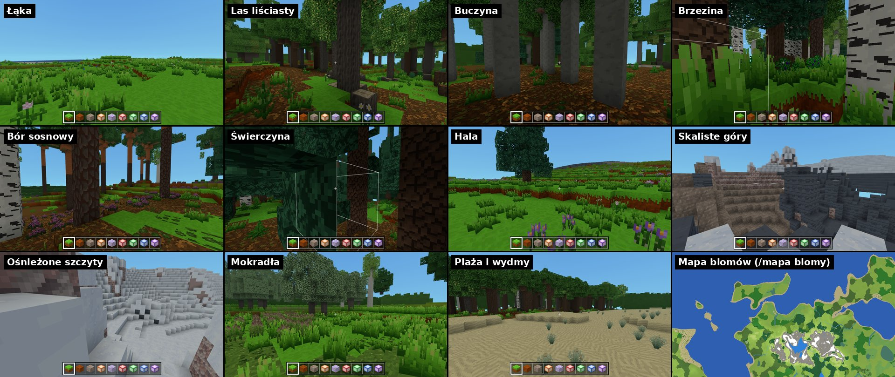

# Biomy

Biomy to krajobrazy terenu **realistycznego**: łąki, różne lasy, hale,
skaliste i ośnieżone szczyty, mokradła, plaże z wydmami. Każdy ma swój
wierzch ziemi, rośliny, krzaki owocowe i drzewa. Teren klasyczny biomów
nie ma (już się nie zmienia).

## Lista

| biom | słowo w komendach | gdzie | co tam jest |
|---|---|---|---|
| **Łąka** | `laka` | niziny i wyżyny poza lasami | trawa (od rzadkiej do gęstej), kępy maków, chabrów, rumianku i mniszków, koniczyna, babka, dzikie truskawki, papryczki i jeżyny, pojedyncze dęby, lipy, brzozy, sosny i jabłonie |
| **Las liściasty** | `lisciasty` | ciepłe niziny | dęby i lipy, ściółka i opadłe liście, leszczyna i jeżyny, pokrzywy, paprocie, kępki mchu |
| **Buczyna** | `buczyna` | wyżyny i pogórza, wilgotniej | prawie same buki, gruba ściółka, pod koronami mało roślin |
| **Brzezina** | `brzezina` | nisko, chłodniej i wilgotno | brzozy, wysoka trawa, paprocie, mech, jeżyny i borówki |
| **Bór sosnowy** | `bor` | sucho, piaszczyste niziny | sosny, ściółka i mech, **wrzos**, **borówki** |
| **Świerczyna** | `swierczyna` | góry i chłód | gęste świerki, ściółka, **mech**, paprocie, borówki |
| **Hala** | `hala` | góry nad granicą lasu i polany w górach | krótka trawa, **krokusy**, rumianek, pojedyncze świerki |
| **Skaliste góry** | `skaly` | ponad granicą gołej skały | skała, piargi (żwir, ziemia kamienista), pod szczytami **płaty śniegu** |
| **Ośnieżone szczyty** | `snieg` | najwyżej (w cieplejszym klimacie granica śniegu wyżej) | **śnieg** |
| **Mokradła** | `mokradla` | przy rzekach i jeziorach na nizinach, w depresjach, w wilgotnych obniżeniach | **błoto** przy wodzie, mech, **trzcina**, wysoka trawa, pokrzywy, **olchy**, **wierzby** i brzozy, dno rzek z błota i gliny |
| **Plaża i wydmy** | `plaza` | wybrzeża | piasek, na niektórych płaskich wybrzeżach **wydmy** porośnięte **piaskownicą**, za wydmami pojedyncze sosny |
| Morze, Jezioro, Rzeka | `morze`, `jezioro`, `rzeka` | woda | (biomy wodne) |

Pogrubione - nowe bloki (niżej).

## Jak powstają

Biom wynika z tego, co już jest w terenie (`src/world/terrain/Biomes.js`,
liczby: `BIOME_SHAPE` w `src/world/terrain/TerrainShape.js`). Sprawdzane
po kolei, pierwszy pasujący wygrywa:

1. **woda** - morze, jezioro, rzeka,
2. **plaża i wydmy** - pas piasku przy morzu i pas wydm,
3. **ośnieżone szczyty** - ponad granicą śniegu (ok. 58 bloków nad
   morzem, w cieple wyżej, pofalowana),
4. **skaliste góry** - ponad granicą gołej skały,
5. **góry** (od 30 bloków nad morzem): **hala** nad granicą lasu i na
   polanach, niżej **świerczyna** (w ciepłym klimacie też buczyna),
6. **mokradła** - na nizinach blisko rzeki i jeziora (im wilgotniej, tym
   szerszy pas), w depresjach i w wilgotnych plamach,
7. **las** tam, gdzie pole lasów (plamy ~190 bloków) jest wysokie - w
   wilgotnym klimacie las łatwiej; rodzaj lasu z klimatu: świerczyna
   (zimno, wysoko), bór (sucho), buczyna (wyżyny), brzezina (chłodno
   i wilgotno), las liściasty (ciepło); rodzaje lasu przeplatają się
   w dużych plamach,
8. **łąka** - wszystko inne.

Klimat (temperatura - wyżej chłodniej - i wilgotność) zmienia się
wolno (plamy kilku tysięcy bloków), więc biomy to duże krainy.

**Granice:** miejsce sprawdzania klimatu i lasów jest lekko przesunięte
szumem (do 10 bloków), więc granice są poszarpane, a nie proste. Drzewa
na granicy biomów się przeplatają (każde drzewo sprawdza biom trochę
obok siebie), wierzch ziemi zmienia się plamami.

**Szybkość:** klimat i pola biomów liczą się dokładnie co 4 bloki
(i są pamiętane), a między nimi płynnie - chunk z biomami liczy się
niewiele dłużej niż przedtem (`/wydajnosc`).

## Wierzch ziemi i rośliny

Każdy biom w `BIOMES` (`Biomes.js`) ma:

- `ground` - wierzch ziemi zamiast trawy, w plamach: np. buczyna -
  ściółka na 3/4 powierzchni, bór - ściółka i mech, mokradła - mech
  i błoto (tuż przy wodzie zawsze błoto), skaliste góry - żwir i ziemia
  kamienista; w gęstym lesie ściółki jest więcej,
- `plants` - rośliny: ile trawy (i jaka część wysoka), jakie kwiaty
  w kępach, paprocie, zioła, rośliny w plamach (wrzos, krokusy, kępki
  mchu, trzcina) i krzaki owocowe (gatunki i gęstość zarośli),
- `trees` - gatunki drzew i ich udział (np. buczyna: buki 84%), `density`
  - mnożnik gęstości lasu, `lone` - najmniejsza gęstość (w lasach las
  jest gęsty w całym biomie, na łąkach - pojedyncze drzewa).

Do tego: **trzcina** przy samej wodzie (na mokradłach gęsto, na innych
nizinach rzadziej), **piaskownica** na wydmach, **płaty śniegu**
(warstwa śniegu) kilka bloków pod granicą śniegu, **śnieg** na szczytach
(na skale - 1-2 bloki).

## Kolor trawy

Trawa (blok trawy z wierzchu i z boku, krótka i wysoka trawa, paproć,
koniczyna, mech) lekko zmienia kolor z klimatem: w cieple i suchu jest
żółtsza, w chłodzie i wilgoci - chłodniejsza, sinawa, wysoko w górach
bledsza. Zmienia się płynnie (bez granic) - to ten sam klimat, który
decyduje o biomach.

- Generator liczy kolor w każdym rogu kolumny chunka (`chunk.tint`,
  17 x 17 rogów), także dla chunków wczytanych z zapisu.
- `ChunkMesher.js` daje go ścianom bloków z polem `tint: true`
  (`BlockRegistry.js`) w atrybucie `tint`.
- Shader (`BlockRenderData.js`) zmienia tylko **zielone piksele**
  tekstury - ziemia na boku trawy, kwiaty i paczki tekstur zostają
  bez zmian.
- Daleki teren ma trawę w czterech odcieniach (zwykła, ciepła, chłodna,
  górska) i biały śnieg na szczytach.
- Liczby: `GRASS_TINT` w `Biomes.js`.

## Nowe bloki

| blok | gdzie | uwagi |
|---|---|---|
| Śnieg (`snow`) | ośnieżone szczyty | materiał dźwięków **śnieg** (miękkie skrzypnięcie), łopata kopie szybciej |
| Warstwa śniegu (`snow_layer`) | płaty pod szczytami | płaska, jak opadłe liście; 1 śnieg = 4 warstwy (i z powrotem) |
| Mech (`moss`) | lasy, mokradła | ziemia - rosną na nim rośliny; kolor z klimatu |
| Kępki mchu (`moss_carpet`) | lasy, mokradła | płaskie, na ziemi; 1 mech = 4 kępki |
| Trzcina (`reed`) | przy wodzie | rośnie też na piasku |
| Wrzos (`heather`) | bór sosnowy | rośnie też na piasku; do fioletowej lampy |
| Krokus (`crocus`) | hala, skały | do fioletowej lampy |
| Piaskownica (`dune_grass`) | wydmy | trawa wydmowa, rośnie na piasku |
| Borówka (`blueberry_...`) | bory, świerczyny, brzeziny, hale | krzak owocowy (4 etapy jak truskawka), owoce **borówki** - do niebieskiej lampy, posadzone dają krzak |

Drzewa z mokradeł to **paczki drzew** (`assets/drzewa/`, bez kodu):
**olcha czarna** (`olcha` - ciemna kora, rude drewno, okrągłe liście,
szyszeczki) i **wierzba biała** (`wierzba` - szeroka korona ze
zwisającymi liśćmi, srebrzyste liście, bazie). Rosną same tylko na
mokradłach - nowe pole paczek drzew `"biomy"` w `gdzieRosnie`
(`docs/drzewa-paczki.md`). Jabłonie rosną teraz na łąkach i w lasach
liściastych.

Tekstury: `python tools/tekstury_biomow.py` (bloki w atlasie i tekstury
olchy i wierzby), kształty drzew - szablony `ksztalt_*.txt` w paczkach.

**Numery bloków:** 1-99 się skończyły - bloki gry mają teraz też numery
240-255, a paczki drzew 100-239.

## Komendy

| komenda | co robi |
|---|---|
| `/biom` | biom pod graczem: co tam jest, temperatura, wilgotność, ile biomów odwiedzone |
| `/biom lista` | wszystkie biomy (✔ - odwiedzone) i słowa do szukania |
| `/biom znajdz <biom> [promien] [tp]` | najbliższy biom (kawałek w głąb, nie na granicy); `tp` - od razu teleport |
| `/mapa biomy` | mapa biomów z legendą (klawisz **M**, potem `/mapa biomy 16`) |
| `/teren` | też mówi, jaki to biom |

## Osiągnięcia

- **Borówkowy język** (zwykłe) - zbierz borówki z krzaka,
- **Turysta** (rzadkie) - odwiedź każdy z 11 biomów lądowych (postęp
  w księdze i w `/biom lista`),
- **Dach świata** (rzadkie) - stań na śniegu na ośnieżonym szczycie,
- **Pełne kosze** - teraz pięć rodzajów owoców (z borówkami).

## Istniejące światy

Jak przy każdym etapie generatora: w światach realistycznych nietknięte
chunki dostaną nowy wygląd (biomy, nowe drzewa i rośliny), a chunki
zmienione przez gracza zostają, jakie były (na ich brzegach mogą być
uskoki).

## Do zrobienia później

- więcej biomów (np. sady, torfowiska, stepy), przejścia między
  biomami także w kolorze liści,
- śnieg na świerkach i pory roku,
- dno jezior na mokradłach z błota, lilie wodne.
