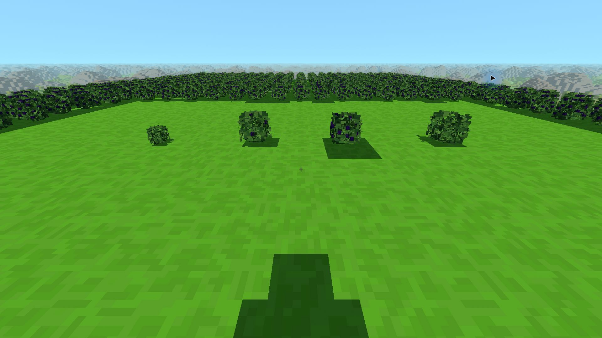
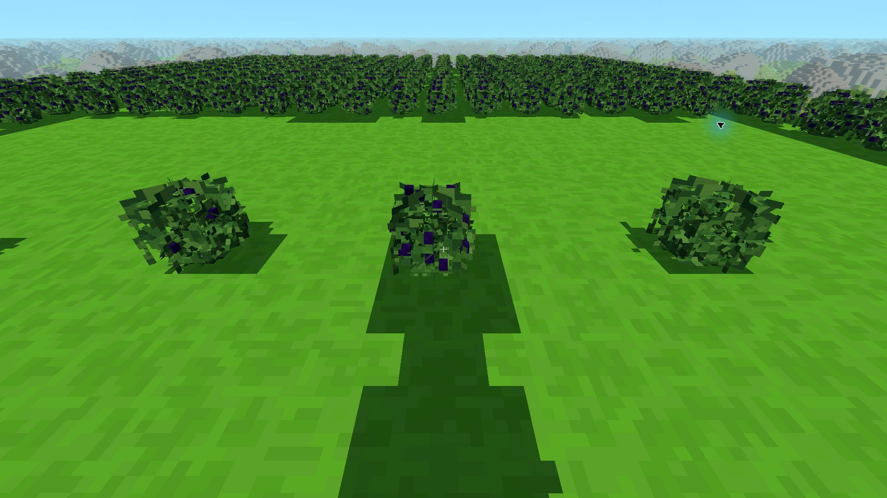

# Borówka — modele v1.2 w wersji 0.42.0

PR #71.

Borówka korzysta z czterech modeli dostarczonych przez Kamila w paczce
`Borowka-cztery-etapy-v1.2.zip`. To podmiana istniejącej rośliny, aktywna
również w zapisanych światach. Nie wymaga dodatku eksperymentalnego,
regeneracji terenu ani zmiany biomów.

| Blok / ID zapisu | Model | Dalszy wzrost |
|---|---|---|
| `blueberry_sapling` / 94 | młody, 55% dorosłego | kilka owoców, średnio 300 s |
| `blueberry_bush` / 95 | dorosły po zbiorze | kilka owoców, średnio 150 s |
| `blueberry_bush_few` / 96 | dorosły, 6 kostek owoców | pełny, średnio 150 s |
| `blueberry_bush_full` / 97 | dorosły, 24 kostki owoców | zbiór → dorosły pusty |

Gra nadal losuje wzrost co sekundę. Pierwszy pełny plon wymaga średnio
450 s, jak wcześniej. Dzikie, nietknięte krzaki zachowują dotychczasowe
zasady wzrostu. PPM daje **1–3 / 3–5 borówek**, a nie liczbę kostek
widocznych na modelu. Pełny ekwipunek zachowuje owoce na krzaku.
Przepisy, sadzenie owoców, sadzonki z niszczenia i osiągnięcia pozostają
zgodne z istniejącą grą.

Dorosłe liście są identyczne w trzech stanach. Modele mają podane
w paczce wymiary, właściwe prześwity i spokojną zieleń. Bryła, UV
i kostki owoców pochodzą z danych źródłowych; wiatr jest wspólny
z grą. Nowe modele są też w ręce, nowe ikony w ekwipunku i wiki.
Celownik oraz ramka obejmują model danego etapu z marginesem na wiatr.

Szczegóły importu i odtwarzania danych:
[`assets/models/blueberry/README.md`](../assets/models/blueberry/README.md).
Modele są buforowane i dopisywane do istniejącej geometrii roślin
chunka, z jednym wspólnym atlasem. Maksimum 348 trójkątów na pełny
krzak. Brak dodatkowych obiektów sceny i materiałów na krzak.

## Sprawdzenie

- `npm test`: wszystkie sprawdzenia przeszły, w tym nowy
  `sprawdz_borowke.mjs` i testy zbierania borówki w `sprawdz_lupy.mjs`.
- Zgodność starych bloków 94–97 w zapisach 8- i 16-bitowych, faktyczny
  wzrost przez `PlantGrowth`, zbiór przez `Game.harvestTarget`.
- Wymiary i podstawy czterech modeli, UV, kierunek ścian/normalnych,
  wspólne dorosłe liście, pozycje owoców, kostki 1/16, ograniczony wiatr,
  mesher chunka, celowanie i geometria przedmiotu w ręce.
- Natywna gra: cztery etapy z przodu i boku; zbiór przy pełnym ekwipunku
  (brak utraty owoców), po zwolnieniu miejsca (3 owoce i dorosły pusty
  krzak), odrastanie do kilku i pełnego plonu; zapis i ponowne wczytanie
  zachowują krzaki oraz owoce. Osiągnięcie „Borówkowy język” przyznane.
- Kontrola materiałów GPU: 34 programy, warianty WebGL1/2 — passed.
- Wiki wygenerowana istniejącym narzędziem; zachowano bajty plików PNG,
  których zdekodowane piksele nie zmieniły się (inna wersja Pillow).
- Kompilacje Windowsa i Androida: wyniki końcowego commita w PR.

## Pomiar na komputerze Kamila

RTX 3050 Laptop na zasilaczu, natywny Electron 44.4.5 / ANGLE D3D11,
1920 × 1080, skala 100%, cienie 3, pełne bloki 48, daleki teren 8192.
Klasyczny teren, seed `2138286349`, testowa platforma na Y=60.
400 dodatkowych pełnych krzaków i cztery krzaki kontrolne; nieruchoma
kamera `(0.5,62,4)`, yaw 0, pitch −0.35. 10 s rozgrzewki + 30 s próby.
Panel diagnostyczny pozostawał widoczny. Monitor ogranicza wynik do 144 Hz.

- Średnio **144,0 FPS**, 1% najwolniejszych **113,2 FPS**.
- GPU średnio **5,04 ms**, maksymalny czas klatki **11,2 ms**.
- **246 wywołań rysowania**, 852 362 trójkąty całej sceny.
- Brak klatek dłuższych niż 33,34 ms w tej próbie.

To statyczna scena obciążeniowa, bez porównania z dawnym modelem;
nie mierzy kosztu samej podmiany ani generowania terenu podczas lotu.
Nie oznacza gwarancji 60 FPS w dowolnym miejscu i przy każdych ustawieniach.

[Pełne wyniki JSON](pomiary/borowka-0.42.0/rtx3050.json).
[Lokalny panel QA](pomiary/borowka-0.42.0/qa.js) działał zamiast importu
`src/main.js` na lokalnym serwerze, w oddzielnym profilu. Nie jest
importowany przez zwykłą grę; jego polecenia modyfikują wyłącznie świat
testowy. Zainstalowanej gry i osobistych zapisów nie zmieniano.

Wersja przygotowana w PR; publikacja w `voxel-game-wydania` następuje
dopiero przez workflow po scaleniu do `main`.
