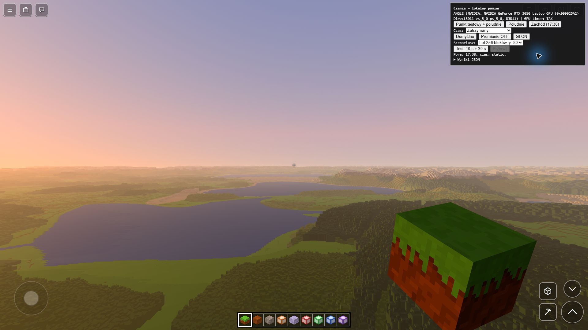

# Cienie i szczegóły terenu do 800 bloków — 0.25.0

Etap 2 rozszerza wspólny model światła z 0.24.0 o gęstszy daleki teren
i trzy mapy cieni. Celem jest spójny widok i cieniowanie do około 800 bloków,
przy rozłożeniu pracy na kolejne klatki. Nie oznacza to 800 bloków pełnych
chunków ani obietnicy stałych 60 FPS na każdym urządzeniu.

## Trzy mapy cieni

Przy jakości „Dalekie” kontroler `src/rendering/Shadows.js` używa:

| Mapa | Promień kamery światła | Rozdzielczość | Rozmiar piksela w poprzek mapy |
| --- | ---: | ---: | ---: |
| Bliska | 64 bloki | 2048×2048 | 1/16 bloku |
| Pośrednia (`far`) | 256 bloków | 1024×1024 | 1/2 bloku |
| Zewnętrzna (`distant`) | 1024 bloki | 2048×2048 | 1 blok |

Dwie większe mapy mają kwadratowy obszar w przestrzeni światła, również
przy niskim Słońcu. Kamera obejmuje odcinek w stronę źródła, z którego góra
może rzucić cień na obserwowany teren. Dobór przeszkód zależy od kamery
światła, nie od kierunku patrzenia gracza.

Odbiorcy cienia — bloki, daleki teren oraz model/ręka — korzystają ze
wspólnego zestawu map. Pusta bliska mapa nie rozjaśnia cienia góry widocznej
tylko w dalszej mapie. Przesłonięcie jest ważone raz, bez ponownego
mnożenia przez tę samą wagę przejścia. Promienie światła w powietrzu
korzystają z tych samych większych map.

Porównanie głębi uwzględnia płaszczyznę odbiorcy: przenosi jego głębię
na środek odczytywanego teksela mapy. Mały dodatkowy zapas rośnie wraz
z gradientem głębi i dokładnością rasteryzacji zgłoszoną przez WebGL:
pół jednostki siatki `SUBPIXEL_BITS` (przy 4 bitach: 1/32 teksela).
Dodajemy do niego mały zapas transformacji. Ogranicza to samocień bez stałego,
wieloblokowego odsuwania cienia. Dla płaszczyzny niemal równoległej
do promienia test pomija cień, aby uniknąć niestabilnego dzielenia przez zero.

Zewnętrzna mapa daje zapas poza 800 bloków. Wygaszanie zaczyna się przy
82% jej szerokości od środka, czyli około 840 bloków w osiach mapy światła,
i kończy na jej brzegu. Jest też przejście przy płaszczyznach głębi.
To obszar zależny od kierunku światła i wysokości, nie twarda granica koła
w odległości 800. Niższe jakości nadal mają tylko dotychczasową mapę
bliską; tryb ziemniaka nie uruchamia tych map cieni.

## Teren widoczny i teren rzucający cień

Przy ustawieniach porównawczych pełne chunki nadal sięgają 48 bloków,
a horyzont 8192. `TARGET_DETAIL_DISTANCE = 800` w `FarTerrain.js` zagęszcza
wyłącznie uproszczoną siatkę dalekiego terenu:

- Średnie i wysokie szczegóły: krok najwyżej 4 bloki w docelowym obszarze;
  bliżej pozostają dotychczasowe drobniejsze kroki 1 i 2.
- Niskie szczegóły: krok najwyżej 8 bloków do tej odległości.
- Tryb ziemniaka zachowuje wcześniejszy, tańszy profil.

Progi podziału mają 12% histerezy: drobniejszy podział utrzymuje się nieco
dłużej podczas oddalania, żeby ruch przy granicy nie przełączał kafelków
w obie strony. Stary komplet pozostaje widoczny, dopóki potrzebne kafelki
nowego podziału nie są gotowe. Na starcie oraz podczas doczytywania może
jeszcze być widoczny wcześniejszy poziom szczegółów; `stats().lodWithinTarget`
podaje histogram faktycznie pokazanych kroków do 800, a nie samą deklarację ustawienia.

W pozycji scenariusza pomiarowego profil średni wybiera 511 kafelków zamiast
439: 590 716 próbek zamiast 507 484, czyli wzrost o 16,4%. Nie jest to wynik
pomiaru czasu GPU — koszt rysowania zależy również od wygenerowanej geometrii.

Daleki cień wykorzystuje te same pozycje i normalne co widoczny teren.
Osobny indeks `shadowIndices` pomija wodę i kurtyny zasłaniające szczeliny
LOD. Nieużywana wcześniej składowa `position.w` przechowuje rzeczywisty
dół ściany: shader głębi obcina sztuczne przedłużenie fartucha, zachowując
rzeczywisty uskok. Maska pełnych chunków jest taka sama jak przy rysowaniu
koloru, wraz z wyborem właściwej strony pionowej ściany.

## Budowa map po kawałku

Pośrednia i zewnętrzna mapa mają po dwie tekstury: opublikowaną oraz
budowaną. Dopiero kompletny wynik podmienia jednocześnie teksturę i macierz
przeliczającą współrzędne. Nie pokazujemy częściowo wyczyszczonej mapy.
Obie kaskady dostają pracę naprzemiennie, bez końcowej paczki rysującej cały horyzont.

Wspólny limit ich paczki wynosi **24 wywołania rysowania i 120 000 trójkątów
na klatkę**. Limit **1,5 ms** dotyczy CPU składającego paczkę; nie ogranicza
czasu GPU, całego `renderer.render`, zbierania snapshotu ani osobnej mapy
bliskiej i cienia modelu. `stats()` pokazuje przygotowanie i wysłanie paczki
osobno. Duże geometrie są dzielone na zakresy indeksów bez kopiowania
buforów wierzchołków i bez zmiany `drawRange` widocznego źródła.

`collectShadowCasters(frustum)` dostarcza niezmienny zestaw proxy, rewizję
i `dispose()`. Snapshot kopiuje maskę chunków oraz podtrzymuje geometrię far,
gdy streaming wymieni lub usunie jej kafelek. Aktywny snapshot rezerwuje
własny materiał i maskę z puli; widoczna scena nie dostaje tymczasowego
`overrideMaterial`. Zakończenie albo anulowanie budowy zwraca te zasoby
do ponownego użycia. Zwykle wystarczają dwa sloty, po jednym na budowaną mapę.
Pula zachowuje program shadera i teksturę do końca życia `FarTerrain`,
unikając ponownej kompilacji po każdej mapie. Niezmieniona maska nie jest
ponownie wysyłana do GPU. Widoki dużych geometrii
nie zwalniają współdzielonych buforów należących nadal do żywego źródła.

Zwykła zmiana terenu podczas budowy nie restartuje jej bez końca: kończymy
spójny snapshot, zachowujemy jego prawdziwą rewizję i planujemy odświeżenie.
Duży skok kierunku światła lub teleport unieważnia stare mapy; zmiana
Słońce/Księżyc również nie używa mapy poprzedniego źródła. Częstotliwość
odświeżania uwzględnia większą wrażliwość długich cieni przy horyzoncie.

## Pierwsze pojawienie się wody

Profilowanie lotu wykazało zatrzymanie głównej sceny przy pierwszej wodzie:
powstawały wtedy dwa programy, dla przedniej i tylnej strony przezroczystego
materiału. `WaterMaterialWarmup.js` przygotowuje obydwa podczas ładowania
świata, z rzeczywistymi światłami, mgłą i atrybutem koloru RGBA chunków.
Nie rysuje pomocniczej geometrii. Po zmianie ustawień wpływających na kod
wody przygotowuje nowy wariant podczas obsługi ustawień. Sam ruch oraz
zmiany uniformów nie ponawiają kompilacji.

Helper uwzględnia zachowanie dostarczonej wersji Three: `compileAsync`
czeka tylko na ostatnią stronę materiału, więc osobno czekamy na obydwa
programy i kończymy odroczoną inicjalizację lokalizacji uniformów/atrybutów.
To przenosi koszt do wczytywania, nie usuwa kosztu kompilacji ze sterownika.

## Ograniczenia i sprawdzanie

Daleki teren nadal jest kolumnową siatką wysokości. Korony drzew są
uproszczoną powierzchnią, a wnętrza budynków i kolejne warstwy pionowe nie
mają dokładności pełnych chunków. Woda nie rzuca nieprzezroczystego cienia.
Etap nie dodaje dalekiego GI, miękkich półcieni ani nowych materiałów PBR.
Rozłożona budowa map oznacza opóźnienie odświeżania przy ruchu i streamingu.

Kontrole CPU działają na rzeczywistych metodach:

- `tools/sprawdz_cienie.mjs`: wspólny budżet, postęp obu kaskad, atomowa
  publikacja, zmiana rewizji podczas budowy, jakość 0/1/2/3, teleport,
  zmiana czasu i źródła, kosmos, zwalnianie zasobów oraz kamery przy niskim Słońcu.
- `tools/sprawdz_materialy_far.mjs`: zgodność dotychczasowej geometrii XYZ,
  cienie bez wody i sztucznych kurtyn, rzeczywista podstawa ścian,
  maska i życie snapshotu oraz detal 800 przy zachowanym horyzoncie 8192.
- Pozostają wcześniejsze testy światła, ciemności i wspólnych materiałów.

`tools/sprawdz_swiatlo_webgl.mjs` wywołuje `shadow_render_checks.js`.
Prawdziwe shadery i mapy głębi renderują kontrolowaną przeszkodę 800 bloków
dalej przy elewacji Słońca 0,5°, 2° i 5°. Test porównuje blok, model i far,
przejścia przy granicach map oraz dodatnią próbę bez przeszkody. Kontrola
małej sceny nie zastępuje obejrzenia gry, przejazdu przez LOD i pomiaru GPU.

## Porównanie wydajności

Scenariusz dla 0.24.0 i 0.25.0: realistyczny świat kreatywny, seed
`lighting-rtx3050-0231`, pozycja startowa `(-28.5, 80, 66.5)`, yaw/pitch 0.
Po 10 s nieruchomej rozgrzewki następuje 30 s lotu o 256 bloków w stronę −Z
przy y=80. **Zegar działa z prędkością 1×** przez rozgrzewkę i pomiar.
Początkowa pora dnia to 0.5 dla południa lub 0.735 dla zachodu;
nie utrzymujemy stałego kąta Słońca. Przykładowo południowa próba bazowa
zaczynała właściwy pomiar przy około 0.50834 i kończyła go przy 0.53334.
Wcześniejsze próby z zatrzymanym zegarem nie są bezpośrednią bazą tego porównania.

Sprzęt: RTX 3050 Laptop 4 GB, i5-12500H, zasilacz podłączony, Chromium 156
przez ANGLE/D3D11. Full HD 1920×1080, DPR 1, antyaliasing włączony;
48/8192 bloków, średnie szczegóły far, cienie 3, atmosfera,
promienie włączone, światło odbite wyłączone, jasność 0%, limit FPS 0.
Bieżący tryb ekranu odczytany z Windows to 1920×1080 przy 144 Hz.
Odstępy wywołań renderowania opisują przepustowość gry, nie są pomiarem
fizycznego czasu wyświetlania obrazu na panelu.

FPS liczymy z odstępów między początkami `Game.render`; 1% low to odwrotność
średniej najwolniejszego 1% tych odstępów. Osobny timer GPU obejmuje całe
`Game.render`, w tym mapy cieni. Nie obejmuje UI ani pracy GPU zlecanej
poza tą metodą. CPU update/render pomijają osobną pracę UI/audio.

### Baza 0.24.0 — zegar 1×, lot 256 bloków

Wartości z `baseline-0240.json`, zaokrąglone; wszystkie cztery próby ważne.
Zapytania GPU nie zgłosiły disjoint ani pominiętych próbek.

| Próba | FPS | 1% low | p99 odstępu [ms] | Maks. odstęp [ms] | Śr. GPU render [ms] | Śr. CPU update/render [ms] |
| --- | ---: | ---: | ---: | ---: | ---: | ---: |
| Południe 1 | 139.92 | 61.97 | 12.60 | 39.10 | 2.471 | 0.512 / 3.232 |
| Południe 2 | 141.86 | 79.18 | 10.90 | 21.30 | 2.459 | 0.467 / 3.066 |
| Południe 3 | 140.55 | 72.08 | 11.90 | 22.10 | 2.468 | 0.455 / 3.220 |
| Zachód | 136.49 | 62.60 | 14.10 | 21.90 | 3.033 | 0.542 / 3.356 |

W trakcie 30 s pomiaru baza przerysowała mapę bliską 102–103 razy i daleką
39 razy w południe, a przy zachodzie odpowiednio 59 i 20 razy. Są to próby
z aktywnym przeliczaniem cieni. Pierwsza miała jeden odstęp ponad 33,34 ms;
nie odrzucamy go jako niewygodnego wyniku.

### 0.25.0 przed ograniczeniem odświeżania diagnostyki

Wszystkie cztery próby są ważne, bez błędów timera GPU.
Dane i wcześniejsze próby diagnostyczne zachowano w
[`pomiary/cienie-0.25.0.json`](pomiary/cienie-0.25.0.json).

| Próba | FPS | 1% low | p99 odstępu [ms] | Maks. odstęp [ms] | Śr. GPU render [ms] | Śr. CPU update/render [ms] |
| --- | ---: | ---: | ---: | ---: | ---: | ---: |
| Południe 1 | 133.21 | 50.51 | 16.50 | 27.50 | 3.256 | 0.713 / 3.243 |
| Południe 2 | 137.28 | 59.76 | 13.90 | 22.80 | 3.280 | 0.586 / 3.229 |
| Południe 3 | 129.71 | 49.14 | 17.40 | 26.70 | 3.343 | 0.606 / 3.763 |
| Zachód | 138.17 | 61.97 | 13.60 | 30.10 | 3.799 | 0.623 / 3.038 |

Większy detal i cienie kosztują około 0,8 ms GPU w tych scenach.
Przepustowość ma duży zapas ponad 60 FPS, ale 1% low i najdłuższe klatki
pokazują krótkie spadki: nie są dowodem na bezwarunkowo stałe 60 FPS.
Maksymalny zmierzony CPU całego `SunShadows.render` wynosił 4,6–6,7 ms;
obejmuje także osobną mapę bliską i model, poza budżetem dwóch kaskad.

W trakcie prac nie odrzucaliśmy niewygodnych wyników: po wprowadzeniu puli
zasobów wystąpił odstęp 412,7 ms, a osobny profil wykazał 495,1 ms w głównej
scenie wraz z pojawieniem się dwóch programów. Kolejna próba potwierdziła
ich kod jako przednią i tylną stronę wody. Po przeniesieniu ich przygotowania
do ładowania świata żaden z tych czterech przejazdów nie przekroczył
33,34 ms. Nie oznacza to usunięcia wszystkich możliwych przycięć streamingu.

### Końcowy pomiar po odciążeniu diagnostyki

Panel F3 liczył statystyki wszystkich kafli, sortował próbki wydajności
i zastępował całe `innerHTML` w każdej klatce. Teraz robi to maksymalnie
5 razy na sekundę, a DOM zmienia tylko po zmianie treści. Przełączenie F3
oraz pojawienie się i wygaśnięcie komunikatu zapisu nadal działają od razu.
Pasek przedmiotów, sterowanie i obraz świata mają własne ścieżki aktualizacji.

Powtórzenie tego samego scenariusza, z włączonym F3 i zegarem 1×:

| Próba | FPS | 1% low | p99 odstępu [ms] | Maks. odstęp [ms] | Śr. GPU render [ms] |
| --- | ---: | ---: | ---: | ---: | ---: |
| Południe | 140.08 | 67.79 | 12.50 | 30.10 | 3.264 |
| Zachód | 142.62 | 85.35 | 10.50 | 14.00 | 3.624 |

Obie próby są ważne. Zasięg, jakość materiałów i gęstość terenu nie zostały
obniżone. To krótkie próbki z jednej trasy; nawet przy 1% low ponad 60
pozostał pojedynczy odstęp 30,1 ms, więc nie obiecujemy braku przycięć
w każdym świecie. Dane wcześniejszych prób pozostają w części `development`
raportu, zamiast zastępować je lepszymi wynikami.

### Aplikacja Windows

Osobne testowe okno Electron 44.4.5 / Chromium 152 (wersja runtime z
`package.json`), pełny ekran 1920×1080, DPR 1, RTX 3050, zasilacz, ten sam
seed i lot. W obu końcowych próbach diagnostyka F3 była włączona.
Zainstalowana gra i jej ustawienia nie zostały zastąpione.

| Limit w grze | FPS | 1% low | p99 odstępu [ms] | Maks. odstęp [ms] | Śr. GPU render [ms] |
| --- | ---: | ---: | ---: | ---: | ---: |
| Bez limitu | 139.49 | 59.43 | 14.60 | 24.30 | 3.308 |
| 60 FPS | 60.01 | 42.14 | 21.70 | 28.20 | 3.530 |

Średni cel 60 FPS jest osiągnięty. Nie jest to jednak idealnie równy rytm
16,67 ms: ogranicznik działa na ekranie 144 Hz, a krótkie skoki odstępów
pozostają widoczne w 1% low. Wyników z limitem nie porównujemy bezpośrednio
do prób bez limitu. Wszystkie zapytania GPU w obu próbach są ważne.
Wcześniejsza próba aplikacji przed odciążeniem F3 miała 111,73 FPS,
1% low 35,83 i maksymalnie 40,1 ms; zachowano ją w raporcie.

Widok sprawdzony ręcznie w aplikacji, pozycja `(-28.5, 140, 66.5)`,
zatrzymany zachód 17:38 (pomiar czasu klatek powyżej korzysta z zegara 1×):

