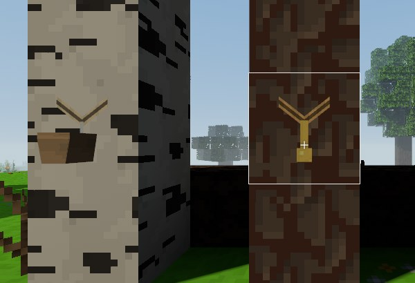

# Dary pnia (1.41.0 i 1.42.0)

Część D projektu drewna ([drewno.md](drewno.md), rozdział 6), w dwóch
wersjach: **1.41.0** - nacinanie, żywica i soki; **1.42.0** - guma,
lateks, żywice-barwniki, garbnik, napar z kory wierzby i to, do czego
służy klej (rozdział „Druga połowa" niżej).

## Jak to działa

1. **Nóż, PPM w bok pnia żywego drzewa** - nacięcie w kształcie V.
   Widać jasne drewno spod kory.
2. **Żywica** (drzewa iglaste) zastyga na korze pod nacięciem: zaciek
   rośnie, na końcu wisi kropla. **PPM** zbiera - czymkolwiek w ręce.
   Czekają najwyżej 3 krople.
3. **Sok** (brzoza, klon, palma) i **woda z baobabu** kapią na ziemię.
   Trzeba **powiesić kubek**: PPM glinianym kubkiem (z dowolnej gliny)
   na nacięciu. Pełny kubek zdejmuje się PPM. Niepełny - kucając, pustą
   ręką; to, co nakapało, się wylewa.
4. PPM, gdy nie ma czego zebrać, mówi, co słychać: czy płynie, na ile
   pełny jest kubek i za ile minut będzie pełny.
5. Po kilku dobach **nacięcie się zabliźnia** i przestaje dawać. Nóż
   otwiera je na nowo.

Nacinać można każdą kłodę pnia, na każdej wysokości - byle z boku.

## Co i kiedy

| Drzewo | Co daje | Kiedy | Ile na dobę (pień 1 × 1) | Zabliźnia się po |
|---|---|---|---|---|
| sosna, świerk, jodła, modrzew, kosodrzewina, sosna oścista, cedr, araukaria | żywica | cały rok: wiosna ×1, lato ×1,5, jesień ×0,8, zima ×0,3 | 2 krople | 5 dobach |
| brzoza | sok brzozowy | tylko wiosna | 2,5 kubka | 3 dobach |
| klon | sok klonowy | od połowy zimy do końca wiosny | 2,5 kubka | 3 dobach |
| palma kokosowa | sok palmowy | cały rok | 1,5 kubka | 3 dobach |
| baobab | woda | cały rok | 2 kubki | 3 dobach |
| wiśnia, akacja (1.42.0) | guma drzewna | tylko lato | 2 łzy | 5 dobach |
| banian (1.42.0) | lateks (do kubka) | cały rok | 2 bryłki | 3 dobach |
| dracena (1.42.0) | smocza krew | cały rok | 1 kropla | 5 dobach |
| eukaliptus (1.42.0) | czerwona żywica | tylko lato | 2 odłamki | 5 dobach |

Liczby: `src/blocks/treeGifts.js`.

Do tego:

- **Pora doby**: soki (brzoza, klon, palma) płyną głównie za dnia, gdy
  pień się nagrzeje - ×1,4 od 7:00 do 19:00, ×0,4 nocą. Żywica i woda
  z baobabu - bez różnicy. Przespany czas liczy się średnio.
- **Grubość pnia**: pień 2 × 2 daje dwa razy więcej, 3 × 3 i grubsze -
  trzy razy.
- **Drzewo ma tyle soku, ile ma**: kilka nacięć w jednym drzewie dzieli
  sok między siebie - razem dają tyle, co jedno. Więcej nacięć to tylko
  więcej kubków naraz. Zmieści się ich 2 na pniu 1 × 1, 4 na 2 × 2,
  6 na grubszych.
- **Zła pora**: nacięcie da się zrobić zawsze, ale zostanie suche - gra
  mówi, kiedy dany sok płynie.
- **Tylko żywe drzewo**: pień z koroną, stojący na ziemi (to samo
  rozpoznanie, co przy ścinaniu). Ściana domu z pni, okorowany pień
  i leżący pień nic nie dają. Kosodrzewinę i baobab, których się nie
  ścina, naciąć można.
- **Ścięcie drzewa**: nacięcia znikają, a kubek i zastygła żywica
  spadają na ziemię. To samo, gdy naciętą kłodę się wykopie albo okoruje.
- Żywica, która sama wycieka z dzikich sosen (pień sosny z żywicą),
  zostaje jak była.

## Napoje

| Napój | Energia | Syci | Działanie |
|---|---|---|---|
| sok brzozowy | 4 | 25 s | pokrzepienie |
| sok klonowy | 6 | 30 s | - |
| sok palmowy | 8 | 40 s | pokrzepienie |
| woda z baobabu | 2 | 20 s | orzeźwienie (nowe: zmęczenie przychodzi wolniej, 3 godz.) |
| **syrop klonowy** | 24 | 150 s | ciepło w brzuchu |

Jak napary: pije się je także z pełnym żołądkiem, kubek wraca do ręki.

**Syrop klonowy**: kubek soku klonowego trzymany (PPM) nad płonącym
ogniskiem **odparowuje** - trwa to 12 sekund, trzy razy dłużej niż
pieczenie. Syci jak mały posiłek.

## Druga połowa (1.42.0)

**Guma drzewna** (wiśnia, akacja - latem) zbiera się jak żywicę: łzy
na korze. Jest jadalna (mała przekąska).

**Lateks** (banian) kapie do kubka i **ścina się w nim w bryłkę**:
zbierasz bryłkę, a kubek - ten sam, który powiesiłeś - wraca do ręki.

Do czego służą (decyzja Kamila, 22.11.2026 - wszystkie trzy):

1. **Naprawa siekiery.** Guma albo lateks + żywica = 2 × **smoła
   klejąca**. Zużyta siekiera i smoła w siatce wytwarzania dają tę samą
   siekierę w lepszym stanie: **+40% stanu, najwyżej do 80%** - klejona
   nie jest jak nowa. Siekiery w stanie 80% i lepszym się nie klei.
2. **Lateks na ubranie.** Bryłka lateksu w ręce, PPM na gotowe ubranie
   leżące na stole krawieckim: ubranie jest „natarte lateksem" i **mokre
   grzeje jak suche** (zwykłe w wodzie grzeje w 30%). Kolor i wzór
   zostają; widać to w opisie ubrania.
3. **Spoiwo w przepisach.** Guma i lateks zastępują żywicę wszędzie,
   gdzie przepis chce „żywicy albo oliwek" (pochodnia, pochodnia
   z ogarka, lampa).

**Barwniki z żywic**: smocza krew → 2 × czerwony barwnik; czerwona
żywica eukaliptusa → 2 × brązowy.

**Garbnik**: kora dębu, namorzynu albo sekwoi wrzucona do wody (jak len
do moczenia, 1,5 minuty) zamienia się w garbnik. Garbnik → czarny
barwnik (dotąd tylko z mieszania trzech innych).

**Napar z kory wierzbowej**: kubek + 2 kory wierzby (z okorowania
siekierą) = kubek kory; nad ogniskiem - napar. Lekko goi stłuczoną
nogę, uspokaja przed snem i grzeje.

**Łyko z lipy** było w grze od 1.27.0 (kora lipowa moczona w wodzie) -
bez zmian.

**Poprawka przy okazji**: przepis kliknięty w księdze przepisów (i
komenda `/wytworz`) wkładał składniki do siatki „jak nowe" - zużyta
siekiera po zrobieniu polan z księgi wracała cała (błąd od 1.39.0),
a jedzenie świeże. Teraz stan zostaje (`Inventory.removeStack`).

## Obraz i wydajność

- Nacięcie to jedna mała siatka (kilka-kilkanaście czworokątów) z tym
  samym materiałem co karb ścinanego drzewa - bez nowych tekstur świata
  (drewno gatunku, glina kubka w jego kolorze, biel pod kolor soku).
- Rysowane są tylko nacięcia do 40 bloków od gracza; krople kapią tylko
  do 14 bloków.
- Stan liczy się raz na sekundę dla wszystkich nacięć naraz; czas płynie
  też dla dalekich drzew. Świat pamięta najwyżej 400 nacięć (najstarsze
  znikają).
- Rozpoznanie drzewa (to samo, co przy ścinaniu) robi się raz - przy
  nacinaniu.
- Zapis: razem ze światem. Gra ze znajomymi: nacięcia roznosi
  `StateSync` (ilość co ćwierć, kubek, zabliźnienie).

## Osiągnięcia

Pod korą (pierwsze nacięcie), Kap, kap, kap (pełny kubek soku),
Żywiczarz (10 kropli z własnych nacięć), Czterdzieści do jednego (syrop
klonowy), Piwniczka lasu (wszystkie cztery napoje) i dwa sekretne.

Od 1.42.0: Na słowo honoru (naprawa siekiery), Jak z gęsi woda (lateks
na ubraniu), Krew smoka, Apteka nad rzeką (napar z wierzby), Każde
drzewo coś daje (wszystkie dziewięć darów).

Poprawka w 1.42.0: **Zielarz** liczy tylko trzy napary z ziół. W 1.41.0
przez pomyłkę liczyły się do niego także soki z pnia. Zdobyte
osiągnięcie zostaje; niedokończony postęp liczy się od nowa.

## Komenda

`/naciecie` - które drzewa co dają, co płynie teraz, stan nacięcia pod
celownikiem; `/naciecie daj` - nóż i 4 kubki; `/naciecie czas <godziny>`
- przesuwa nacięcia w czasie; `/naciecie napelnij` - wiesza kubki
i napełnia wszystko.

## Pliki

- `src/blocks/treeGifts.js` - zasady i liczby,
- `src/game/TreeTaps.js` - stan nacięć, PPM, upływ czasu,
- `src/rendering/TapRenderer.js` - obraz,
- `src/items/foods.js` - napoje, syrop (`ROASTS`, `roastSeconds`),
- `tools/dary_pnia_tekstury.py` - ikony,
- `tools/sprawdz_darow_pnia.mjs` - test.

## Luki

- **Syrop nie powstaje w garnku**, jak było w planie, tylko z kubka nad
  ogniskiem (jak napar). Garnek gotuje dziś wyłącznie potrawy z kilku
  składników - syrop w garnku wymagałby osobnego trybu gotowania.
- **Soki się nie psują** (żaden napój w grze się nie psuje). Plan mówił,
  że syrop jest trwalszy od soku - na razie oba leżą bez końca.
- **Kubek z soku oddaje zawsze kubek ze zwykłej gliny**, także gdy
  wisiał biały albo czerwony (tak samo działają napary). Na drzewie
  kubek ma swój kolor i taki spada po ścięciu.
- **Nacięcie nie kołysze się z pniem** (jak pochodnia i karb): nisko
  różnicy nie widać, wysoko na giętkim drzewie przy wichurze nacięcie
  może odstawać od kory o ułamek bloku.
- **Deszcz nie wpada do kubka**, mróz nie zatrzymuje soku - liczy się
  tylko pora roku i doby, nie pogoda ani temperatura miejsca.
- **Pora roku jest jedna dla całego świata**: palma w tropikach płynie
  cały rok, ale brzoza posadzona w ciepłym kraju też czeka na wiosnę
  z kalendarza.
- **Nóż się nie zużywa** od nacinania (zużycie mają na razie tylko
  siekiery).
- **Nacięcie drzewa, które potem straci koronę** (liście opadną zimą,
  ktoś je zetnie nożycami), dalej daje - żywość sprawdza się raz, przy
  nacinaniu.
- **Na jednej kłodzie mieści się jedno nacięcie** (nie po jednym na
  każdej ścianie).
- Nie sprawdzone na prawdziwym sprzęcie ani w prawdziwej grze dwóch
  osób - tylko testy, gra w przeglądarce w kontenerze i gotowy test
  gry wieloosobowej (który nacięć nie dotyka).

Z 1.42.0:

- **Naprawiać można bez końca** (każda naprawa do 80%) - ceną jest
  guma (tylko latem) albo lateks i żywica. Nie ma licznika napraw.
- **Lateksu na ubraniu nie widać** na postaci ani na ikonce - tylko
  w opisie. Nie ściera się z czasem.
- **Deszcz nie moczy ubrań** (gra zna tylko „w wodzie" i „poza wodą"),
  więc natarte ubranie pomaga przy pływaniu i brodzeniu, nie w ulewie.
- **Pochodnia na gumie albo lateksie pali się tak samo** jak na żywicy;
  dolać paliwa do pochodni da się dalej tylko żywicą albo oliwkami.
- **Garbnik służy tylko do barwnika** - skór w grze nie ma (zwierząt się
  nie krzywdzi), więc niczego się nim nie garbuje.
- **Guma, kino i smocza krew nie mają własnego wyglądu na korze** poza
  kolorem zacieku.
- **Sekwoi i namorzynu** kora daje garbnik, ale sama sekwoja wymaga
  siekiery z metalu (część F) - na razie jej kora jest tylko z komend
  i trybu twórczego.
- Naprawa, lateks na ubraniu i barwniki sprawdzone testami na
  prawdziwych funkcjach gry, nie klikaniem w oknie ekwipunku.
