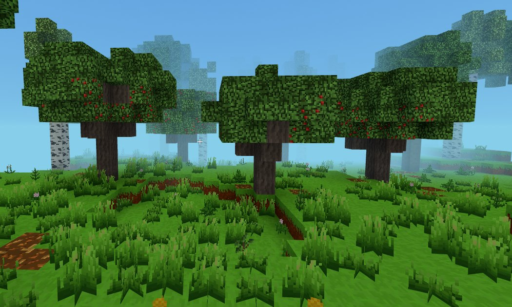

# Paczki drzew - nowe drzewo bez programowania

Nowy gatunek drzewa to jeden **folder** w `assets/drzewa/`. W folderze
leżą tekstury (obrazki PNG 16 x 16), opis drzewa (`drzewo.json`) i jego
kształt narysowany literkami w pliku tekstowym. Gra przy starcie sama
czyta wszystkie paczki i robi z nich:

- **bloki**: pień, okorowany pień (siekiera), deski, liście, sadzonka,
  opadłe liście i do dwóch **odmian liści** - np. liście z jabłkami,
  z których PPM zbiera owoce, a po zbiorze owoce **odrastają**,
- **przedmioty** (np. jabłko) - posadzone na ziemi dają sadzonkę,
- **drzewo w świecie** - według narysowanego kształtu, losowo obrócone,
  w kilku rozmiarach; sadzonka wyrasta w takie samo drzewo,
- **las**: drzewo samo rośnie w terenie realistycznym tam, gdzie pasuje
  mu klimat (albo tylko z sadzonki - jak wolisz),
- **przepisy**: deski z pnia (i patyki z desek), opadłe liście z liści,
  a do tego Twoje własne,
- ikonki w ekwipunku, nazwy w komendach (`/daj`, `/drzewa posadz`),
  strony w wiki gry i osiągnięcie *Sadownik* (zbiór owoców z drzewa).

Przykład, od którego najlepiej zacząć: **jabłoń** w `assets/drzewa/jablon/`.



---

## W skrócie

```
python tools/nowe_drzewo.py grusza       1. nowa paczka (pyta o nazwę i owoc)
                                         2. podmień tekstury, popraw kształt i nazwy
node tools/drzewa.mjs                    3. sprawdź (pokaże błędy)
node tools/drzewa.mjs pokaz grusza       4. zobacz, jak drzewo wyrośnie
```

5. W grze: `/drzewa posadz grusza`, `/drzewa paczki`, ekwipunek (**E**).
6. Wyślij na GitHuba - przez `git` albo przeciągając folder na stronie
   repozytorium. Akcja *Drzewa (paczki)* sama dopisze drzewo do listy,
   sprawdzi je i odświeży wiki.

Bez Pythona i Node.js też się da: skopiuj folder `jablon`, zmień w nim,
co trzeba (kroki niżej), i wgraj na GitHuba - resztę zrobi akcja.

---

## Co jest w folderze drzewa

Przykład - `assets/drzewa/jablon/`:

| Plik | Co to jest |
|---|---|
| `drzewo.json` | opis drzewa: nazwy, bloki, odmiany liści, przedmioty, kształt, gdzie rośnie, przepisy |
| `pien_bok.png`, `pien_gora.png` | pień: kora z boku, słoje na górze (i na dole) |
| `okorowany_bok.png`, `okorowany_gora.png` | okorowany pień (siekiera: PPM na pniu) |
| `deski.png` | deski |
| `liscie.png` | liście - przezroczyste piksele to prześwity w koronie |
| `liscie_jablka.png` | odmiana liści: liście z jabłkami |
| `sadzonka.png` | sadzonka - obrazek z przezroczystym tłem |
| `opadle_liscie.png` | opadłe liście leżące na ziemi pod drzewem (przezroczyste tło) |
| `jablko.png` | przedmiot - jabłko (przezroczyste tło) |
| `ksztalt_maly.txt`, `ksztalt_sredni.txt`, `ksztalt_duzy.txt` | kształt drzewa w trzech rozmiarach |

Obok paczek leży `assets/drzewa/lista.json` - lista folderów, które gra
wczytuje (`["jablon", "grusza"]`). Nie musisz jej pilnować: dopisuje do
niej `tools/nowe_drzewo.py`, `node tools/drzewa.mjs` i akcja na GitHubie.

---

## Krok 1. Załóż paczkę

**Sposób A - generator** (Python z numpy i Pillow, tak jak do tekstur):

```
python tools/nowe_drzewo.py grusza
```

Zapyta o polską nazwę (*grusza*), nazwę w dopełniaczu - "pień czego?"
(*gruszy*) i owoc (*gruszka*, Enter = bez owoców). Bez pytań:

```
python tools/nowe_drzewo.py grusza --nazwa grusza --dopelniacz gruszy --owoc gruszka
python tools/nowe_drzewo.py modrzew --nazwa modrzew --dopelniacz modrzewia --iglaste
```

Powstaje pełna, działająca paczka: `drzewo.json` z wypełnionymi polami,
tekstury zastępcze w stylu gry (kora, słoje, deski, liście, sadzonka,
opadłe liście, liście z owocami i owoc), dwa szablony kształtu (małe
i duże drzewo), wolne numery bloków i wpis na liście. Kolory możesz
podać od razu: `--kolor-lisci 90,150,60`, `--kolor-kory 104,88,74`,
`--kolor-drewna 216,186,138`, `--kolor-owocu 230,200,60`.

**Sposób B - kopia jabłoni:** skopiuj folder `assets/drzewa/jablon` pod
nową nazwą (np. `grusza`), w `drzewo.json` zmień nazwy i usuń linię
`"pierwszeId"` - numery nada `node tools/drzewa.mjs` albo akcja na GitHubie.

**Nazwa folderu** to nazwa drzewa w grze: same małe litery bez polskich
znaków i cyfry, bez spacji (`grusza`, `modrzew`, `wisnia2`). Z niej
powstają nazwy bloków: `grusza_log`, `grusza_leaves`, `grusza_sapling`...
Nie może się nazywać jak drzewo gry (`oak`, `buk`...).

---

## Krok 2. Tekstury

Każda tekstura to **PNG 16 x 16 pikseli** (narysujesz w Pikselu, Piskel,
Aseprite, GIMP, paint.net - z siatką i powiększeniem). Nazwy plików bez
polskich liter i spacji (`liscie_gruszki.png`, nie `liście gruszki.png`).

- **Kora, słoje, okorowany pień, deski** - cały kwadrat zamalowany
  (bez przezroczystości). Tekstura powtarza się na każdym bloku, więc
  dobrze, żeby lewy brzeg pasował do prawego, a górny do dolnego.
- **Liście** - przezroczyste piksele to prześwity (w grze widać przez nie
  głąb korony). Zwykle 10-20% pikseli przezroczystych.
- **Sadzonka, owoc, opadłe liście** - obrazek na przezroczystym tle.
  Owoc jest też ikonką w ekwipunku i tym, co trzymasz w ręce.
- **Liście z owocami** - najprościej: kopia `liscie.png` z dorysowanymi
  owocami (2 x 2 piksele: jasny róg z lewej u góry, ciemniejszy z prawej
  u dołu wyglądają jak kulka).

Kolory: gra ma światło padające z lewej góry - jaśniejsze piksele z tej
strony, ciemniejsze z prawej i u dołu. Porównaj z jabłonią i drzewami gry
(`assets/textures/blocks/terrain.png`, wiersze 5-8).

Brakujący albo zepsuty plik w grze widać od razu: **fioletowo-czarna
szachownica**, a na czacie - komunikat, którego pliku brakuje. Plik
w złym rozmiarze gra przeskaluje do 16 x 16, ale też o nim powie.

Tekstur paczek **nie wkleja się** do `terrain.png` - gra dokłada je do
atlasu sama przy starcie.

---

## Krok 3. drzewo.json

Opis drzewa (JSON: nazwy w cudzysłowach, przecinki między polami, bez
przecinka po ostatnim). Cały plik jabłoni:

```json
{
    "pierwszeId": 100,
    "gatunek": "Jabłoń domowa",
    "gatunekDopelniacz": "jabłoni",
    "krotko": "jabłoń",
    "nazwaAngielska": "Apple",
    "podobnyDo": "lipa",
    "bloki": {
        "pien": { "nazwa": "Pień jabłoni", "bok": "pien_bok.png", "gora": "pien_gora.png" },
        "okorowany": { "nazwa": "Okorowany pień jabłoni", "bok": "okorowany_bok.png", "gora": "okorowany_gora.png" },
        "deski": { "nazwa": "Deski jabłoniowe", "tekstura": "deski.png" },
        "liscie": { "nazwa": "Liście jabłoni", "tekstura": "liscie.png" },
        "sadzonka": { "nazwa": "Sadzonka jabłoni", "tekstura": "sadzonka.png" },
        "opadleLiscie": { "nazwa": "Opadłe liście jabłoni", "tekstura": "opadle_liscie.png" }
    },
    "odmianyLisci": [
        {
            "id": "jablka",
            "nazwa": "Liście jabłoni z jabłkami",
            "nazwaPoZbiorze": "Liście jabłoni (jabłka odrastają)",
            "tekstura": "liscie_jablka.png",
            "znak": "O",
            "udzial": 0.04,
            "zbior": { "przedmiot": "jablko", "ile": [1, 2] },
            "odrasta": 600
        }
    ],
    "przedmioty": {
        "jablko": { "nazwa": "Jabłko", "tekstura": "jablko.png", "sadzi": true }
    },
    "lupy": [["sadzonka", 0.05], ["jablko", 0.05]],
    "czasWzrostu": 300,
    "ksztalt": {
        "rodzaj": "szablon",
        "pliki": ["ksztalt_maly.txt", "ksztalt_sredni.txt", "ksztalt_duzy.txt"],
        "opadleLiscie": 0.12
    },
    "gdzieRosnie": {
        "czestosc": 0.06,
        "temperatura": [-0.2, 1.5],
        "wilgotnosc": [-0.5, 1.5],
        "wysokosc": [1, 24]
    },
    "przepisy": [
        { "id": "czerwona_lampa", "wynik": "lamp_red", "ile": 1, "skladniki": ["lamp", "jablko"], "opis": "Jabłko też jest czerwone." }
    ]
}
```

### Pola

| Pole | Co znaczy |
|---|---|
| `pierwszeId` | pierwszy numer bloku drzewa: 100, 110, 120... do 230, a od 0.30.0 także 1000, 1010... do 4990 (każde drzewo zajmuje 10 numerów; numery 2-bajtowe - `docs/numery-blokow.md`). Nadaje go generator, `node tools/drzewa.mjs` albo akcja na GitHubie (najpierw wolne w 100-239). **Raz nadanego nie zmieniaj** - numer zapisuje się w światach. |
| `gatunek` | pełna nazwa (*Jabłoń domowa*) - opisy, `/drzewa posadz` |
| `gatunekDopelniacz` | "pień czego?" (*jabłoni*) - księga przepisów (*pień jabłoni (też okorowany)*) |
| `krotko` | krótka nazwa (*jabłoń*) - komendy: `/drzewa posadz jablon` albo `/drzewa posadz jabłoń` |
| `nazwaAngielska` | opcjonalnie - angielska nazwa bloków (*Apple Log*) |
| `podobnyDo` | jak drzewo wygląda **z daleka** (daleki teren): `swierk`, `sosna`, `buk`, `lipa`, `dab` albo `brzoza` |
| `bloki` | nazwy i tekstury bloków: `pien` i `okorowany` (pola `bok` i `gora`), `deski`, `liscie`, `sadzonka` (pole `tekstura`) i opcjonalnie `opadleLiscie` |
| `odmianyLisci` | opcjonalnie, najwyżej 2 - niżej, *Krok 5* |
| `przedmioty` | opcjonalnie, najwyżej 4: `"klucz": { "nazwa", "tekstura", "sadzi" }`. W grze przedmiot nazywa się `<drzewo>_<klucz>` (`jablon_jablko`). `"sadzi": true` - posadzony na ziemi daje sadzonkę tego drzewa. Opcjonalnie `"kategoria"` (np. `"narzedzia"`) |
| `lupy` | co czasem wypada z liści w przygodzie: `[["co", szansa 0-1]]`. *co* to `"sadzonka"`, `"liscie"` albo klucz przedmiotu. Bez tego pola - sadzonka 5% |
| `kora` | opcjonalnie - przedmiot z okorowania pnia siekierą (jak kora brzozowa), np. `"kora": "kora"` z przedmiotem `"kora"` |
| `czasWzrostu` | po ilu sekundach (średnio) sadzonka wyrasta w drzewo (domyślnie 300 = 5 minut) |
| `ksztalt` | jak wygląda drzewo - *Krok 4* |
| `gdzieRosnie` | gdzie drzewo rośnie samo w świecie - *Krok 6* |
| `przepisy` | opcjonalnie - *Krok 7* |
| `wlaczone` | `false` - gra pomija drzewo (bez usuwania folderu) |

---

## Krok 4. Kształt drzewa

### Szablon - drzewo narysowane literkami (`"rodzaj": "szablon"`)

Plik `.txt` to drzewo pocięte na **warstwy od dołu do góry** - każda
warstwa to widok z góry na jedną wysokość, warstwy oddziela **pusta
linia**. Linie z `#` na początku to komentarze.

| Znak | Co to jest |
|---|---|
| `@` | podstawa pnia - **tylko w pierwszej warstwie**, dokładnie jedna; tu stała sadzonka |
| `P` | pień i konary (gałęzie z bloków pnia) |
| `L` | liście |
| `l` | liście, ale nie zawsze (70%) - postrzępiony brzeg korony, każde drzewo trochę inne |
| `O` (albo inna litera) | odmiana liści z tym `"znak"` w `odmianyLisci` (np. liście z jabłkami) |
| `.` | puste |

Mała jabłoń (`ksztalt_maly.txt`) - pień z 3 bloków i korona z 3 warstw:

```
# warstwa 1      # warstwa 4      # warstwa 5      # warstwa 6
.......          .......          .......          .......
.......          ...O...          ..LlL..          .......
.......          ..LLL..          .lLLLl.          ...l...
...@...          .LLPLL.          .LLLLL.          ..LLL..
.......          ..LLL..          .LLLLL.          ...L...
.......          ...O...          ..lLL..          .......
.......          .......          .......          .......
```

(warstwy 2 i 3 to sam pień: `P` w środku; w pliku warstwy są jedna pod
drugą, nie obok siebie.)

- **Rozmiary:** `"pliki"` to lista od najmniejszego do największego
  drzewa (1-8 plików). Każde drzewo w lesie i z sadzonki dostaje rozmiar,
  a rozmiar wybiera plik. Jeden plik = wszystkie drzewa takie same
  (tylko obrócone).
- Każde drzewo jest **losowo obracane i odbijane**, więc w lesie nie
  widać, że to ten sam szablon.
- Najwyżej **7 kratek od `@`** w każdą stronę (15 x 15) i **29 warstw**.
- Wszystkie wiersze warstwy nie muszą mieć tej samej długości, ale tak
  łatwiej się rysuje.
- Pień przy ziemi w terenie pochyłym sam schodzi w dół do gruntu.
- Opadłe liście (`"opadleLiscie": 0.12` w `ksztalt` - jak gęsto) leżą
  na trawie pod koroną.

**Podgląd** - jak drzewo wyrośnie (losowe `l`, obrót, rozmiar 0-100):

```
node tools/drzewa.mjs pokaz jablon          średnie
node tools/drzewa.mjs pokaz jablon 100 7    duże, inne losowanie (seed 7)
```

W grze: `/drzewa posadz jablon 100` (duże), `/drzewa posadz jablon 0` (małe).

### Gotowe kształty (`"rodzaj": "kula"`, `"stozek"`, `"parasol"`, `"kolumna"`)

Zamiast rysować - kształt z liczb. Każda liczba to `[dla małego, dla
dużego drzewa]`:

```json
"ksztalt": {
    "rodzaj": "kula",
    "wysokoscPnia": [3, 5],
    "promienKorony": [2, 3.5],
    "wysokoscKorony": [3, 6],
    "gestosc": 0.6,
    "opadleLiscie": 0.2
}
```

| Rodzaj | Wygląd |
|---|---|
| `kula` | zaokrąglona korona na pniu (lipa, jabłoń, klon) |
| `stozek` | korona od dołu szeroka, do góry coraz węższa (świerk, jodła) |
| `parasol` | wysoki pień, płaska szeroka korona na konarach (pinia, akacja); `wysokoscKorony` - grubość korony |
| `kolumna` | wąska, wysoka korona tej samej szerokości (topola) |

`wysokoscPnia` - goły pień pod koroną, `promienKorony` - ile bloków od
pnia w bok (najwyżej 7), `wysokoscKorony` - ile bloków ma korona,
`gestosc` 0-1 - jak gęsty jest brzeg korony (1 - pełny, 0 - bardzo
postrzępiony). Pień + korona najwyżej 28 bloków.

---

## Krok 5. Odmiany liści (owoce, kwiaty)

Odmiana to drugi rodzaj liści tego samego drzewa - np. **liście
z jabłkami** albo **kwitnące** (jak kwitnąca lipa). Najwyżej dwie.

| Pole | Co znaczy |
|---|---|
| `id` | nazwa odmiany (małe litery) - blok w grze: `<drzewo>_leaves_<id>` (`jablon_leaves_jablka`) |
| `nazwa` | polska nazwa bloku |
| `tekstura` | plik PNG |
| `znak` | litera w szablonie kształtu (np. `O`) - tam, gdzie ją narysujesz, będą te liście |
| `udzial` | 0-1 - jaka część liści **na wierzchu korony** losowo zamienia się w odmianę (działa też z gotowymi kształtami, gdzie nie ma szablonu) |
| `zbior` | PPM na liściach zbiera przedmiot: `{ "przedmiot": "jablko", "ile": [1, 2] }` (najmniej, najwięcej) |
| `odrasta` | po ilu sekundach (średnio) owoce odrastają po zbiorze. Bez tego pola po zbiorze zostają zwykłe liście |
| `nazwaPoZbiorze` | opcjonalnie - nazwa liści, na których owoce odrastają (domyślnie *Liście ... (po zbiorze)*) |

Jak to działa w grze: PPM na liściach z jabłkami - jabłka trafiają do
ekwipunku (dźwięk zbioru, osiągnięcie *Sadownik*), a liście zamieniają
się w "odrastające" - wyglądają jak zwykłe. Po `odrasta` sekundach znów
są z jabłkami (szybciej: `/drzewa tempo 60` albo `/drzewa rosnij`).
Zniszczone liście z owocami dają zwykłe liście i owoce. Odmiana bez
`zbior` (np. kwitnąca) jest tylko ozdobą.

Owoce odrastają tam, gdzie świat był zmieniany (jak krzaki owocowe) -
zbiór sam to zapewnia.

---

## Krok 6. Gdzie rośnie

```json
"gdzieRosnie": {
    "czestosc": 0.06,
    "temperatura": [-0.2, 1.5],
    "wilgotnosc": [-0.5, 1.5],
    "wysokosc": [1, 24]
}
```

| Pole | Co znaczy |
|---|---|
| `czestosc` | 0-1 - jaka część drzew **w lesie** (tam, gdzie pasuje klimat) to to drzewo. `0.06` = co mniej więcej szesnaste. `0` (albo brak pola) - drzewo rośnie tylko z sadzonki i komendą |
| `temperatura` | `[od, do]` - zakres temperatury: ok. -1 zimno (północ, wysokie góry) ... 1 ciepło |
| `wilgotnosc` | `[od, do]` - ok. -1 sucho ... 1 mokro |
| `wysokosc` | `[od, do]` - ile bloków nad poziomem morza (0 - brzeg morza, 20 - niziny i pagórki, 40+ - góry) |
| `biomy` | lista biomów, w których drzewo rośnie (`docs/biomy.md`): `laka`, `lisciasty`, `buczyna`, `brzezina`, `bor`, `swierczyna`, `hala`, `skaly`, `snieg`, `mokradla`, `plaza`. Np. `["mokradla"]` - olcha i wierzba, `["laka", "lisciasty"]` - jabłoń |

Pola, których nie podasz, pasują wszędzie. Drzewo pojawia się tylko tam,
gdzie i tak rośnie drzewo (zastępuje część drzew biomu - w lesie wiele,
na łące pojedyncze), w terenie realistycznym. Przykład: olcha
(`assets/drzewa/olcha/`) - `"czestosc": 0.5, "biomy": ["mokradla"]`:
połowa drzew na mokradłach to olchy.

**Jakie wartości są tutaj?** Komenda `/teren` pokazuje w miejscu, gdzie
stoisz, wysokość nad morzem i w linii *Pola* - `temperatura`
i `wilgotnosc`. `/mapa temperatura` i `/mapa wilgotnosc` pokazują je
na mapie.

**Istniejące światy:** drzewa z nowej paczki pojawiają się w miejscach,
które gra generuje od nowa - fragmenty świata zmienione przez gracza
(zapisane) zostają, jakie były. Bez paczek (albo z `czestosc` 0) lasy
są dokładnie takie same jak wcześniej.

---

## Krok 7. Przepisy (opcjonalnie)

Każde drzewo samo dostaje przepisy: **pień -> 4 deski** (także
okorowany pień), z desek - patyki (jak z każdych desek), a z opadłymi
liśćmi - **liście -> 2 opadłe liście** (i opadłe liście działają
w przepisach na czarnoziem). Własne przepisy - w `"przepisy"`:

```json
"przepisy": [
    { "wynik": "lamp_red", "ile": 1, "skladniki": ["lamp", "jablko"] },
    { "wynik": "stick", "ile": 2, "wzor": ["D", "D"], "klucz": { "D": "deski" }, "opis": "Krótsze patyki." }
]
```

- `skladniki` - przepis bez kształtu (1-4 rzeczy, obojętne gdzie leżą),
  albo `wzor` + `klucz` - kształt w siatce 2 x 2 (1-2 wiersze po 1-2
  znaki, `.` - puste miejsce; kształt można przesuwać i odbijać).
- Nazwy: bloki i przedmioty gry (np. `stick`, `lamp`, `granite`, grupy
  `#planks`, `#rock`... - pełna lista: `/przepisy lista`, wiki *Przepisy*)
  albo rzeczy z paczki: `pien`, `okorowany`, `deski`, `liscie`,
  `sadzonka`, `opadleLiscie`, `liscie_<odmiana>` i klucze przedmiotów.
- `id` (opcjonalnie) - nazwa przepisu w `/wytworz <drzewo>_<id>`,
  `opis` - dopisek w księdze przepisów.
- Przepis z błędem jest pomijany, a błąd widać na czacie gry.

---

## Krok 8. Sprawdź

```
node tools/drzewa.mjs
```

```
Paczki drzew (assets/drzewa/): 2 na liście, wczytane: 2, błędy: 0
  + nowe na liście: grusza
  * grusza: pierwszeId (brak) -> 110
  jablon: Jabłoń domowa, bloki 100-109, kształt szablon, wysokość 6-8, bloków w drzewie 39-191, w lesie: 6%
  grusza: Grusza, bloki 110-119, kształt szablon, wysokość 7-9, bloków w drzewie 30-120, w lesie: 5%
```

Narzędzie dopisuje nowe foldery do `lista.json`, nadaje numery bloków
i sprawdza paczki **tak samo jak gra przy starcie** - a do tego buduje
z każdej po kilka drzew na próbę. Błąd wygląda tak:

```
  BŁĄD: Drzewo "grusza": ksztalt_duzy.txt: nieznany znak "X" (warstwa 6, wiersz 3, kolumna 5) - znaki: P pień, L liście, ...
```

`node tools/drzewa.mjs --sprawdz` tylko sprawdza (niczego nie zapisuje).

**W grze** (przeglądarka: odśwież stronę - Ctrl + F5):

| Komenda | Co sprawdza |
|---|---|
| `/drzewa paczki` | wczytane paczki (numery bloków, kształt, odmiany, czy rośnie w lesie) i błędy |
| `/drzewa posadz grusza 100` | duże drzewo 5 bloków przed tobą (`0` - małe) |
| `/drzewa aleja` | wszystkie gatunki w rzędzie, razem z drzewami z paczek |
| `/drzewa znajdz grusza tp` | najbliższa grusza w lesie (jeśli `czestosc` > 0) |
| `/daj grusza_log`, `/daj grusza_gruszka 10` | bloki i przedmioty (albo **E** - kategoria *Drewno*, *Rośliny*, *Owoce*) |
| `/drzewa tempo 60` | sadzonki rosną i owoce odrastają 60 razy szybciej |
| `/przepisy grusza_planks` | przepisy |

Paczka z błędem **nie psuje gry**: drzewo z błędem w `drzewo.json` albo
w kształcie gra pomija (reszta działa), błędny przepis - pomija sam
przepis, a brakująca tekstura to szachownica. Po wejściu do świata na
czacie pojawia się, co poprawić.

---

## Krok 9. Na GitHuba

**Sposób A - git** (jak zwykle):

```
git add assets/drzewa
git commit -m "Nowe drzewo: grusza"
git push
```

**Sposób B - strona GitHuba** (bez Pythona, Node.js i gita):

1. Na stronie repozytorium wejdź do folderu `assets/drzewa`.
2. *Add file* -> *Upload files* i **przeciągnij cały folder drzewa**
   (np. `grusza` z plikami w środku) na stronę.
3. Na dole *Commit changes*.

Po każdym wysłaniu zmian w `assets/drzewa/` na GitHubie rusza akcja
**Drzewa (paczki)** (`.github/workflows/drzewa.yml`, zakładka *Actions*):

1. dopisuje nowe foldery do `lista.json` i nadaje im numery bloków,
2. sprawdza wszystkie paczki - błędy widać na stronie przebiegu
   i w podsumowaniu (czerwony krzyżyk = coś do poprawienia),
3. odświeża wiki gry (`docs/wiki/` - nowe bloki, przedmioty, przepisy),
4. zapisuje zmiany (commit *Drzewa: ...* od *github-actions*) w tej
   samej gałęzi. Na komputerze potem `git pull`.

Przy pull requeście akcja tylko sprawdza paczki.

**Aplikacja (Windows, Android):** nowe drzewo trafia do aplikacji
z najbliższym wydaniem - wydanie to podniesienie `"version"`
w `package.json` (`docs/aplikacja.md`). W przeglądarce działa od razu.

---

## Wyłączanie i usuwanie

- **Wyłączenie** bez usuwania: `"wlaczone": false` w `drzewo.json`.
- **Usunięcie:** skasuj folder (lista sama się poprawi). Bloki tego
  drzewa w zapisanych światach znikną (staną się powietrzem), a po
  przywróceniu paczki - wrócą. Dlatego **nie zmieniaj `pierwszeId`**
  drzewa, które było już w grze.

## Ograniczenia

- Najwyżej **15 drzew z paczek** (numery bloków 100-249, po 10 na drzewo).
- Najwyżej 2 odmiany liści i 4 przedmioty na drzewo.
- Drzewo: najwyżej 7 bloków od pnia w bok i 29 bloków wysokości.
- Paczka nie dodaje nowego zachowania (jak żywica wyciekająca z pnia
  sosny) - tylko to, co opisuje `drzewo.json`. Coś więcej - w kodzie
  (`src/blocks/trees.js`).
- Z daleka i na mapie drzewo wygląda jak gatunek z `podobnyDo`.

## Najczęstsze błędy

| Komunikat | Co zrobić |
|---|---|
| `drzewo.json ma błąd zapisu (...)` | brakujący albo nadmiarowy przecinek, cudzysłów, nawias. Sprawdź plik na <https://jsonlint.com> |
| `brak pliku tekstury x.png` | nazwa pliku w `drzewo.json` inna niż na dysku (wielkość liter też się liczy) |
| `x.png: tekstura musi mieć 16 x 16 pikseli` | zmień rozmiar obrazka (bez wygładzania) |
| `brak @ w pierwszej (najniższej) warstwie` | pierwsza warstwa szablonu musi mieć dokładnie jedno `@` |
| `drzewo sięga za daleko` | szablon ma kratkę dalej niż 7 od `@` |
| `nieznany znak "X"` | w szablonie jest litera, której nie ma w tabeli ani w `"znak"` odmian |
| `"pierwszeId" ... zachodzi na numery drzewa ...` | dwa drzewa z tym samym numerem - usuń `pierwszeId` z nowego i uruchom `node tools/drzewa.mjs` |
| `nazwa "..." jest zajęta` | folder nazywa się jak drzewo albo blok gry - zmień nazwę |

---

## Dla programisty - jak to działa

- `src/blocks/treePacks.js` - wczytuje `lista.json` i paczki (w Node -
  z dysku, w grze - `fetch`), sprawdza je, błędy zbiera w
  `TREE_PACK_ERRORS`. Moduł czeka na paczki przed startem (await na
  najwyższym poziomie), więc reszta gry widzi gotową listę.
- `src/blocks/trees.js` - bloki paczek (pień, okorowany, deski, liście,
  sadzonka, opadłe liście, odmiany i ich "odrastające" wersje z `grows`),
  gatunki w `TREE_SPECIES` / `TREE_NAMES`; `BASE_TREE_NAMES` - sześć
  gatunków gry.
- `src/items/ItemRegistry.js` - przedmioty paczek, `src/crafting/recipes.js` -
  deski, opadłe liście i przepisy z `drzewo.json`.
- `src/rendering/TextureAtlas.js` - tekstury paczek w wolnych wierszach
  atlasu (od wiersza 10; przy wielu paczkach atlas ma 32 wiersze),
  `atlasImage` - gotowy obrazek atlasu (też dla ikonek, `BlockIcons.js`).
- `src/world/trees/TreeShapes.js` - kształt z szablonu albo gotowy,
  odmiany na wierzchu korony, opadłe liście.
- `src/world/trees/Forests.js` - drzewo z paczki zamiast zwykłego
  (`czestosc`, zakresy klimatu; każda paczka losuje osobno, więc bez
  paczek świat się nie zmienia), `src/world/FarTerrain.js` - wygląd
  z daleka (`podobnyDo`).
- `tools/nowe_drzewo.py`, `tools/drzewa.mjs`,
  `.github/workflows/drzewa.yml`, wiki: `tools/wiki_dane.mjs` + `tools/wiki.py`.
