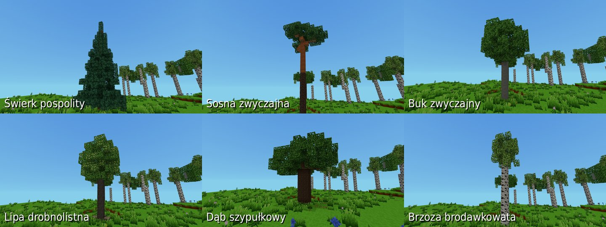
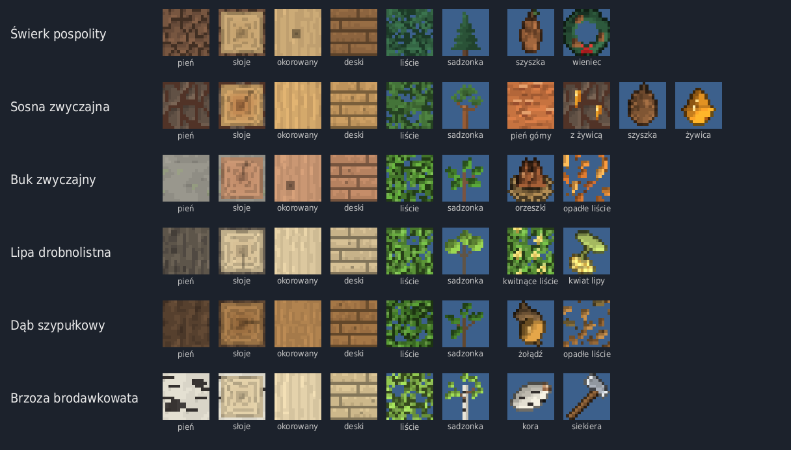
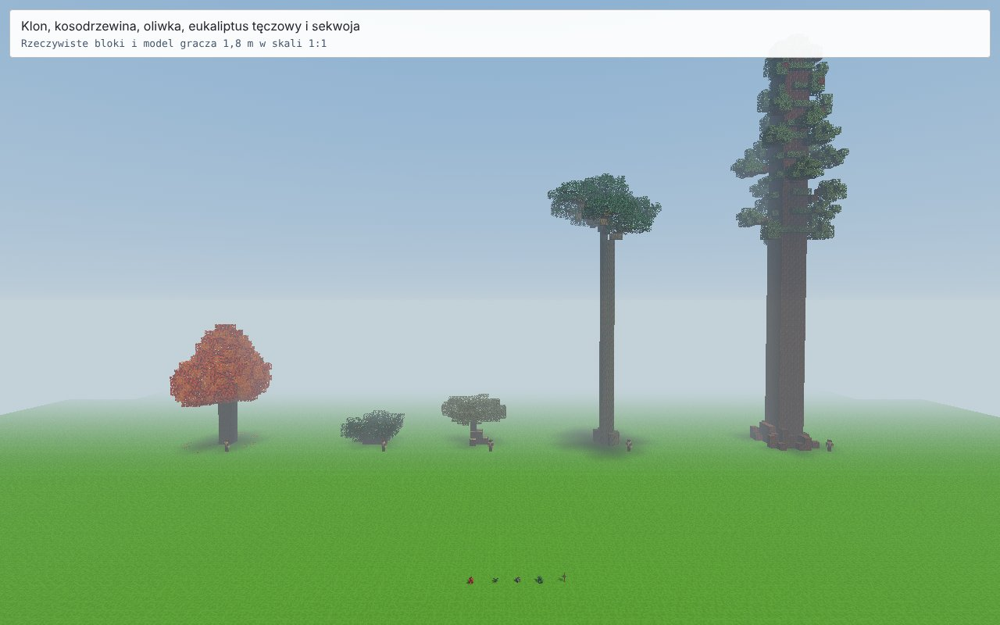
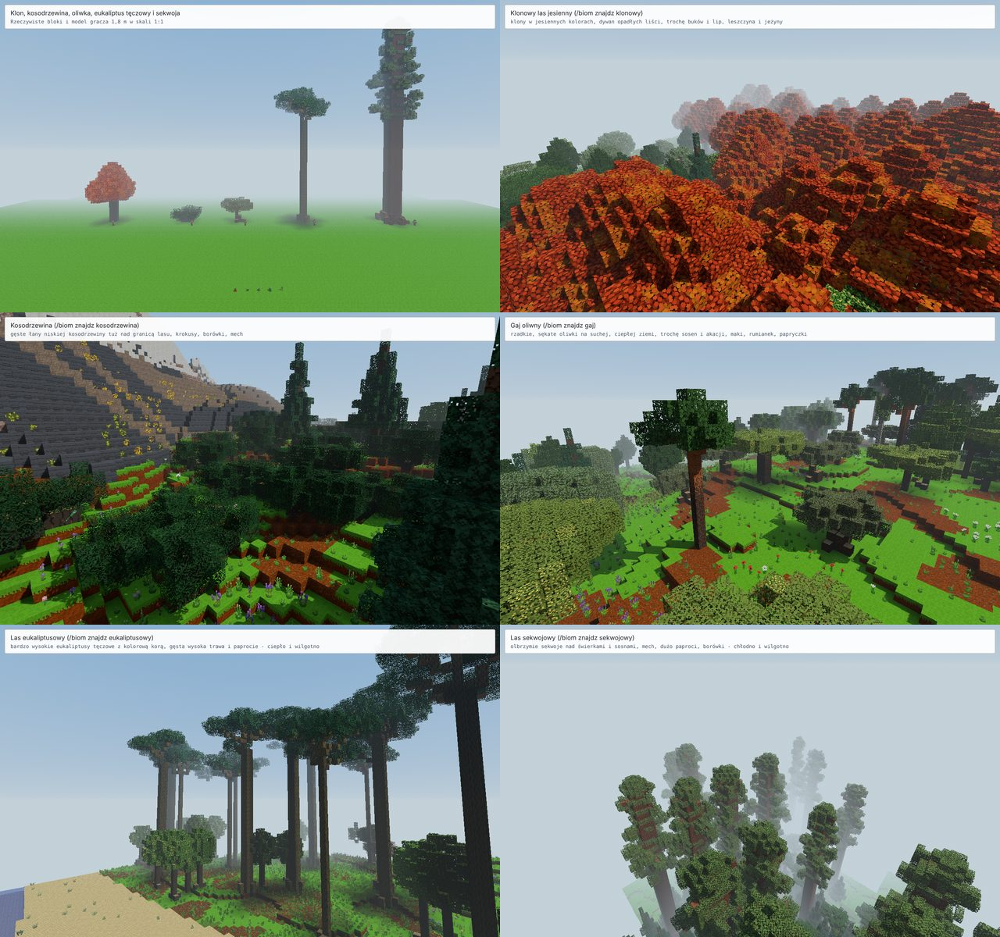
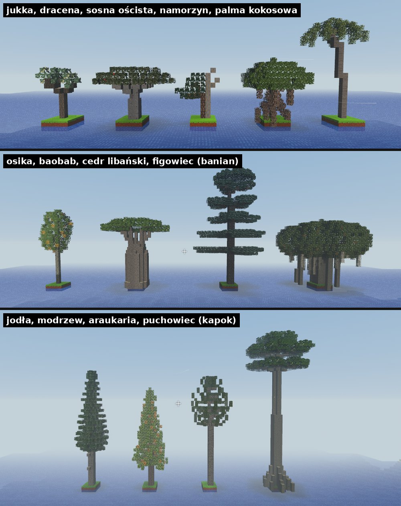

# Drzewa

Gra ma **trzydzieści dwa gatunki drzew**, zapisanych we wspólnym katalogu
`src/blocks/treeCatalog.js`. Każdy ma własne bloki, wygląd i zasady
występowania. Tekstury wszystkich gatunków są w `assets/textures/drzewa.png`.

| Gatunek | Nazwa do komendy |
|---|---|
| Świerk pospolity | `swierk` (także `spruce`) |
| Sosna zwyczajna | `sosna` (także `pine`) |
| Buk zwyczajny | `buk` (także `beech`) |
| Lipa drobnolistna | `lipa` (także `linden`) |
| Dąb szypułkowy | `dab` (także `oak`) |
| Brzoza brodawkowata | `brzoza` (także `birch`) |
| Jabłoń domowa | `jablon` |
| Olcha czarna | `olcha` |
| Wierzba biała | `wierzba` |
| Akacja parasolowata | `akacja` (także `acacia`) |
| Cypryśnik błotny | `cyprysnik` (także `bald_cypress`) |
| Wiśnia japońska | `wisnia` (także `cherry`) |
| Klon cukrowy (jesienny) | `klon` (także `maple`) |
| Sosna kosodrzewina | `kosodrzewina` (także `mugo`) |
| Oliwka europejska | `oliwka` (także `olive`) |
| Eukaliptus tęczowy | `eukaliptus` (także `rainbow_eucalyptus`) |
| Sekwoja olbrzymia | `sekwoja` (także `sequoia`) |
| Miłorząb dwuklapowy | `milorzab` (także `ginkgo`) |
| Jakaranda mimozolistna | `jakaranda` (także `jacaranda`) |
| Jodła pospolita | `jodla` (także `fir`) |
| Baobab afrykański | `baobab` |
| Palma kokosowa | `palma` (także `coconut_palm`) |
| Modrzew europejski | `modrzew` (także `larch`) |
| Namorzyn czerwony | `namorzyn` (także `mangrove`) |
| Puchowiec pięciopręcikowy (kapok) | `puchowiec` (także `kapok`) |
| Jukka krótkolistna (drzewo Jozuego) | `jukka` (także `joshua_tree`) |
| Topola osika | `osika` (także `aspen`) |
| Araukaria chilijska | `araukaria` (także `araucaria`) |
| Figowiec bengalski (banian) | `banian` (także `banyan`) |
| Dracena cynobrowa (smocze drzewo) | `dracena` (także `dragon_tree`) |
| Cedr libański | `cedr` (także `cedar`) |
| Sosna oścista | `oscista` (także `bristlecone`) |

Polskie znaki też działają (`dąb`, `jabłoń`, `świerk`). Leszczyna
jest obecnie krzewem owocowym, opisanym w osobnym systemie krzaków.

Organizacja tekstur i edycja katalogu: [arkusze tematyczne](tekstury-atlasy.md).
Od 0.80.0 gra nie wczytuje osobnych paczek drzew.





## Oglądanie drzew — od 0.78.0

Otwórz czat klawiszem **T** albo **/**. Trzy tryby pokazu:

```text
/drzewa las sosna 16 12345
/drzewa warianty sosna 12345
/drzewa porownanie 12345
```

- **las** sadzi wybrany gatunek w losowym układzie, z różnymi rozmiarami
  i kształtami. Liczba drzew: 1–36, domyślnie 16. Zajęte miejsca omija
  i podaje liczbę faktycznie posadzonych drzew.
- **warianty** pokazuje rozmiary i stany specjalne gatunku w rzędach:
  sosny z żywicą i bez, lipy kwitnące i zwykłe, jabłonie z owocami,
  bez owoców i po zbiorze. Jabłoń, olcha i wierzba mają po trzy
  szablony wielkości; gatunki proceduralne pokazujemy w pięciu rozmiarach.
- **porownanie** sadzi wszystkie gatunki obok siebie.

Ostatni argument to opcjonalny **seed pokazu** (0–4294967295).
Bez niego komenda losuje nowy zestaw; z nim można odtworzyć te same
drzewa i ich rozstaw. Seed pokazu jest niezależny od seeda świata.
Różny teren może zmienić wysokość posadzenia i dostępność miejsc.
Kształty proceduralne nie mają zamkniętej listy wszystkich możliwych
odmian — zmiana seeda pozwala oglądać kolejne sylwetki.

Pokaz powstaje **przed graczem, na istniejącej ziemi**, bez wycinania
drzew i budowli. Dla równego porównania najlepiej utworzyć osobny
świat w trybie programisty i odejść na **trawę obok centralnego placu**
(na jego posadzce drzewa nie rosną). Galeria wariantów
i porównanie wymagają miejsca na wszystkie egzemplarze; gdy przeszkadza
istniejący blok albo limit wysokości, komenda podaje problem, zanim
zacznie sadzić. Duży las powstaje partiami, a wynik pojawia się na czacie.

`/drzewa lista` wypisuje aktualny katalog, a `/drzewa ostatnie`
przypomina nazwy i współrzędne okazów ostatniego pokazu.
`/drzewa cofnij` cofa ostatni pokaz **w bieżącej sesji świata**,
zachowując bloki zmienione później przez gracza. Kolejny udany pokaz
zastępuje poprzednią możliwość cofnięcia. Same posadzone drzewa są
zwykłymi blokami świata i trafiają do zapisu.

## Nowe drzewa w skali gracza — 0.79.0

Przyjęto około **1 metra na blok**: postać ma 1,8 bloku wysokości,
a kamera z pierwszej osoby znajduje się 1,6 bloku nad stopami.
Rozmiary dotyczą dojrzałych drzew, z kilkoma losowymi sylwetkami,
od niższych okazów po duże. Korony są rozłożyste, a konary pozostawiają
miejsce, aby wejść pod drzewo i zobaczyć jego rozmiar z ziemi.

| Gatunek | Wysokość | Średnica korony | Charakterystyczna sylwetka |
|---|---|---|---|
| Akacja parasolowata | 8–12 bloków | około 12–18 bloków | szeroki parasol na rozchodzących się konarach |
| Cypryśnik błotny | 24–36 bloków | około 8–14 bloków | wysoki pień, rozszerzona podstawa, korzenie kolankowe i piętra gałęzi |
| Wiśnia japońska | 6–10 bloków | około 8–12 bloków | niskie rozwidlenie i szeroka, różowa korona |

To zakresy przyjęte do gry, z zaokrągleniem geometrii do bloków.
Paczki Kamila zawierały tekstury i podglądy, więc sylwetki odtworzono
proceduralnie. Oryginalne tekstury zostały zachowane. Odniesienia
botaniczne i sumy kontrolne są w historycznych opisach źródeł:
[akacja](zrodla/drzewa-0.79/acacia/README.md),
[cypryśnik](zrodla/drzewa-0.79/bald_cypress/README.md),
[wiśnia](zrodla/drzewa-0.79/cherry/README.md).

Akacje mogą pojawić się na ciepłych, suchych łąkach, cypryśniki na
niezalanej ziemi mokradeł, wiśnie na umiarkowanych łąkach i w lasach
liściastych. W istniejących zapisach nowe gatunki pojawiają się na
nowo generowanym terenie; zapisane budowle i stare drzewa pozostają.
Każdy gatunek ma sadzonkę, liście i ich odmianę, pień do okorowania,
deski oraz opał (pień + siekiera → 4 opały, siekiera zostaje).

Do szybkiego oglądania użyj `/drzewa posadz cyprysnik 75`,
`/drzewa warianty akacja` lub `/drzewa las wisnia 16`.
Galeria automatycznie dobiera odstępy do szerokich koron. Uproszczone
modele dalekiego terenu korzystają z tych samych wymiarów co pełne
drzewa i zachowują ich wysokość oraz własne kolory liści.

## Pięć drzew z paczek Kamila i ich biomy — 0.83.0





| Gatunek | Wysokość | Korona | Sylwetka | Wyroby i dodatki | Biom |
|---|---|---|---|---|---|
| Klon cukrowy | 14–22 | 10–16 | krótki pień, szeroka, zaokrąglona korona z kopuł, pomarańczowa ze złotymi plamami | deski klonowe, opał, **opadłe liście klonu** pod koroną | **Klonowy las jesienny** (`klonowy`); pojedynczo w lasach liściastych i buczynach |
| Kosodrzewina | 3–5 | 6–11 | bez prostego pnia: pokładające się pnie rozchodzą się przy ziemi, na końcach płaskie kępy igliwia; sąsiednie krzewy zrastają się w łany | deski, opał, **szyszka kosodrzewiny** (posadzona daje sadzonkę) | **Kosodrzewina** (`kosodrzewina`) - pas tuż nad granicą lasu w górach; pojedynczo na halach |
| Oliwka europejska | 5–8 | 8–13 | gruby, sękaty, skręcony pień (duże 2 x 2), płaska, szeroka, szarozielona korona | deski oliwkowe, opał, **oliwki** - zbiór PPM z liści z oliwkami (odrastają), posadzone dają sadzonkę | **Gaj oliwny** (`gaj`) - ciepło i sucho; pojedynczo na ciepłych, suchych łąkach |
| Eukaliptus tęczowy | 32–50 | 13–19 | bardzo wysoki, prosty, kolorowy pień, parasol z płaskich chmur liści na samej górze | deski, opał | **Las eukaliptusowy** (`eukaliptusowy`) - ciepło i wilgotno |
| Sekwoja olbrzymia | 46–72 | 11–17 | gruby (3 x 3, duże 4 x 4) rudy pień ze schodkową podstawą, długo goły, korona w górnej połowie, zwężona ku czubkowi | deski sekwojowe, opał, **szyszka sekwoi** (z igliwia z szyszkami - PPM, odrastają) | **Las sekwojowy** (`sekwojowy`) - chłodno, bardzo wilgotno, nisko; między sekwojami świerki i sosny |

Wszystkie mają sadzonkę (także model 3D w trzech jakościach), liście
i odmianę liści, pień do okorowania, deski (we wspólnych przepisach:
skrzynia, tratwa...) i własny **opał do ogniska** z własnym drewnem.
Liście spadają z koron jako cząsteczki w swoich kolorach (jesienne
klonu najładniej), a oliwki i szyszki sekwoi czasem spadają jak jabłka.

Oryginalne tekstury z paczek (pień, słoje, deski, liście, odmiana liści)
są w grze piksel w piksel; okorowany pień, sadzonkę, drewno ogniska,
oliwki, szyszki i opadłe liście klonu rysuje
`python tools/tekstury_drzew_083.py` w tym samym stylu.

Olbrzymy nie wchodzą na siebie: sekwoja rośnie tylko w co trzeciej
kratce siatki drzew (między nimi świerki), eukaliptus w co drugiej.
Pod limitem wysokości świata (128) sekwoja jest niższa, zamiast znikać.
W istniejących zapisach nowe drzewa i biomy pojawiają się na nowo
generowanym terenie.

```text
/drzewa porownanie
/drzewa las sekwoja 9
/biom znajdz klonowy
```

## Miłorząb i jakaranda — 0.85.0

Oba gatunki korzystają z oryginalnych tekstur paczek Kamila i wspólnego
arkusza `drzewa.png`. Paczki zawierały podglądy i wymiary, a geometrię
odtworzono proceduralnie. Przy skali około **1 m na blok** postać gracza
ma 1,8 m, dzięki czemu wysokość i szerokość korony widać także z ziemi.

| Gatunek | Wysokość dojrzałych okazów | Średnica korony | Wygląd |
|---|---|---|---|
| Miłorząb dwuklapowy (*Ginkgo biloba*) | 18–26 bloków | około 10–16 bloków | wysoki pień, nieregularne piętra gałęzi i złota korona |
| Jakaranda mimozolistna (*Jacaranda mimosifolia*) | 8–14 bloków | około 12–18 bloków | rozchodzące się konary i szeroka, lekka fioletowa korona |

Źródłowy miłorząb ma w `render_info.json` wysokość 25 m i koronę 13 m,
a jakaranda odpowiednio 13 m i 15 m. Losowe sylwetki gry obejmują
mniejsze i większe dojrzałe okazy; bryły zaokrąglamy do pełnych bloków.
To wybór reprezentatywnej skali, nie symulacja wieku ani wszystkich
rekordowych rozmiarów gatunku. Odniesienia: [University of Minnesota —
miłorząb](https://trees.umn.edu/nursery-tour/species/gi),
[UF/IFAS — jakaranda](https://ask.ifas.ufl.edu/publication/ST317)
i [RHS — jakaranda](https://www.rhs.org.uk/plants/jacaranda/growing-guide).

Każdy ma sadzonkę w trzech jakościach modeli, dwie odmiany liści,
pień, okorowane drewno, deski i opał. Uproszczone sylwetki zachowują
skalę oraz kolory. Nowe drzewa pojawiają się na nowo generowanym terenie;
zapisane wcześniej budowle i drzewa pozostają na swoich miejscach.

```text
/drzewa posadz milorzab 75
/drzewa warianty jakaranda 12345
/drzewa las milorzab 16 12345
/drzewa porownanie 12345
```

Metadane i sumy źródeł: `docs/zrodla/drzewa-0.85/`.
Kadry z gry i wyniki sprawdzeń: [próba 0.85.0](pomiary/drzewa-0.85.0/README.md).

Miłorząb pojawia się pojedynczo w umiarkowanych lasach liściastych,
buczynach i lasach klonowych. Jakaranda wybiera ciepłe łąki, lasy
liściaste i eukaliptusowe. Nie dochodzi nowy rodzaj biomu.
Opadające liście miłorzębu mają wachlarzowaty kształt; jakaranda gubi
drobne fioletowe płatki i wąskie liście.


## Trzynaście drzew z paczki „drzewa od jodły" i cztery biomy — 1.8.0

Paczka Kamila z 15 listopada 2026 r.: tekstury 16 × 16 (pień, słoje,
deski, liście, odmiana liści i dodatki) oraz podglądy sylwetek. Tekstury
są w `drzewa.png` piksel w piksel; sylwetki powstają proceduralnie
(`src/world/trees/TreeShapes.js`) w skali **1 blok ≈ 1 m**.



| Gatunek | W naturze | W grze (wysokość / średnica korony) | Sylwetka | Gdzie rośnie |
|---|---|---|---|---|
| Jodła pospolita (*Abies alba*) | 30–50 m | 28–44 / 7–11 | prosty pień, dół goły z sękami, wąski stożek gęstych pięter, czubek spłaszczony („bocianie gniazdo") | świerczyna, buczyna, las sekwojowy (8–32 bloki nad morzem) |
| Baobab afrykański (*Adansonia digitata*) | 18–25 m, pień 7–11 m | 15–22 / 16–22, pień **5–7 bloków** | butelkowaty pień, płaska korona z krótkich, grubych konarów | **sawanna** |
| Palma kokosowa (*Cocos nucifera*) | 15–25 m | 12–22 / 8–11 | wygięty, smukły pień, pióropusz opadających liści, pod nim **kokosy** | piasek plaż w ciepłym klimacie |
| Modrzew europejski (*Larix decidua*) | 25–45 m | 22–38 / 8–13 | luźny, ażurowy stożek, końce konarów opadają; część igliwia złota | góry: świerczyna, hala, kosodrzewina, bór (od 20 bloków nad morzem) |
| Namorzyn czerwony (*Rhizophora mangle*) | 8–15 m | 7–13 / 9–14 | pień na łukach **korzeni podporowych**, gęsta kopuła, wiszące korzenie | **namorzyny** i płytka woda gorących wybrzeży |
| Puchowiec, kapok (*Ceiba pentandra*) | 50–70 m | 40–58 / 16–24, pień 2–3 bloki | prosty pień na wysokich **przyporach**, parasol pięter konarów na samej górze | **las deszczowy** (co trzecia kratka - olbrzym ponad sklepieniem) |
| Jukka krótkolistna, drzewo Jozuego (*Yucca brevifolia*) | 5–12 m | 5–10 / 6–10 | pień rozwidla się kilka razy, każda gałąź z kolczastą rozetą; gałęzie w **kosmatej korze** z suchych liści | **półpustynia** |
| Topola osika (*Populus tremula*) | 20–30 m | 16–26 / 6–9 | smukły, jasny pień (u starych **ciemna kora przy ziemi**), wąska, wysoka, ażurowa korona | brzezina, chłodne łąki, bory, mokradła |
| Araukaria chilijska (*Araucaria araucana*) | 30–50 m | 26–42 / 10–16 | pień jak słup, parasol okółków długich, zadartych konarów | wilgotne góry: buczyna, hala, świerczyna (14–40 bloków) |
| Figowiec bengalski, banian (*Ficus benghalensis*) | 20–30 m, korona dużo szersza | 14–22 / 18–26 | zrośnięty pień, konary podparte **słupami korzeni**, niska szeroka kopuła, zasłony **korzeni powietrznych** | **las deszczowy** (sklepienie) |
| Dracena cynobrowa, smocze drzewo (*Dracaena cinnabari*) | 6–10 m | 6–10 / 9–14 | gładki pień, szprychy gałęzi, płaski gęsty parasol | **półpustynia** |
| Cedr libański (*Cedrus libani*) | 30–40 m | 22–36 / 16–24 | gruby pień, poziome konary z płaskimi talerzami igliwia, czubek jak stół | ciepłe, suche góry (16–40 bloków), gaj oliwny na wyżynie |
| Sosna oścista (*Pinus longaeva*) | 5–15 m | 5–11 / 7–11 | pokręcona, w większości **martwe, wybielone drewno**, suchy wierzchołek, kilka kęp igliwia | suche, zimne góry: hala, kosodrzewina i **goła skała** (od 26 bloków) |

Każde drzewo ma pień, okorowany pień, deski, liście z jedną odmianą
(szyszki, kwiaty, figi, złote igliwie...), sadzonkę w trzech jakościach
modeli, korę (podpałka) i opał do ogniska. Dodatkowe bloki:

| Blok | Numer | Co to |
|---|---|---|
| `mangrove_roots`, `banyan_roots` | pierwszy numer gatunku + 9 | ażurowe korzenie (jak liście: przepuszczają światło, szybko się je usuwa, pień je zastępuje) |
| `joshua_tree_log_shaggy`, `aspen_log_base`, `bristlecone_log_dead` | pierwszy numer + 8 | druga kora tego samego pnia; okorowanie daje zwykły okorowany pień i korę gatunku |
| `coconut_palm_leaves_kokosy` | 1126 (odrastające 1127) | liście z kokosami: PPM zbiera 1–2 kokosy (`coconut_palm_kokos`), odrastają; z kokosa wyrasta palma; od 1.9.0 kokos da się zjeść |

Od 1.9.0 z desek każdego z tych drzew robi się **schody, półbloki, płoty,
furtki, stoły stolarskie, drzwi, klapy, łóżka i skrzynie**
([stolarstwo.md](stolarstwo.md)), a sadzonki palmy kokosowej, jukki
i draceny rosną także na piasku.

### Biomy (opis: [biomy.md](biomy.md))

- **Sawanna** (`/biom znajdz sawanna`) - gorąco i sucho, otwarta równina:
  akacje i z rzadka baobaby.
- **Półpustynia** (`pustynia`) - bardzo gorąco i bardzo sucho: piasek,
  jukki i draceny (każda w swoich plamach).
- **Las deszczowy** (`deszczowy`) - najgoręcej i najwilgotniej: sklepienie
  z figowców co 12 bloków, ponad nim puchowce.
- **Namorzyny** (`namorzyny`) - mokradła w gorącym klimacie; namorzyny
  stoją gęsto w błocie i w wodzie do 2 bloków głębokości przy brzegu
  morza i jezior (pień i korzenie wypierają wodę).

Jodła, modrzew, osika, araukaria, cedr i sosna oścista rosną w
dotychczasowych biomach (kolumna „Gdzie rośnie"). Nowe drzewa i biomy
pojawiają się tylko w terenie generowanym od 1.8.0 - zapisane chunki się
nie zmieniają.

### Zasady w generatorze

- `shape.spacing` / `under` / `offset` (katalog): olbrzymy stoją w co
  n-tej kratce siatki drzew; podszyt (`under`) może mieć własny odstęp
  i przesunięcie (figowce nie stoją w kratkach puchowców).
- `open` (katalog): reguły miejsc poza zwykłym lasem - `surface`: `sand`
  (palma), `rock` (sosna oścista), `water` z `depth` (namorzyn w wodzie),
  `grass` z `biome` (gęste namorzyny w swoim biomie). Reguła losuje własną
  szansę, niezależnie od gęstości lasu; kratki spoza jej klimatu odpadają
  po dwóch odczytach szumu, bez liczenia terenu (`Forests.openRule`).
- Drzewo z `wade` (namorzyn w wodzie): pień i korzenie zastępują wodę,
  ażurowe korzenie pod wodą stają się pniem, liście do wody nie wchodzą.

```text
/drzewa las baobab 4 12345
/drzewa warianty banian 12345
/drzewa znajdz palma tp
/biom znajdz namorzyny
```

Metadane i sumy źródeł: `docs/zrodla/drzewa-1.8/`. Sprawdzenie:
`node tools/sprawdz_drzewa_180.mjs`. Import: `tools/tekstury_drzew_180.py`.

## Owoce, szyszki, opadłe liście, namorzyn w wodzie, figowiec-namiot — 1.10.0

Kolory liści w porach roku i kolor liści z biomu opisuje
[pory-roku.md](pory-roku.md#liście-drzew-w-porach-roku-1100).

### Plony trzynastu drzew z 1.8.0

Zbiór jak dotąd: PPM na liściach z plonem; liście zostają, plon odrasta po
około 15 minutach. Rzadko (3%) plon wypada też ze zwykłych liści.

| drzewo | liście z plonem | przedmiot | do czego |
|---|---|---|---|
| jodła | z szyszkami | szyszka jodły | sadzenie, podpałka |
| modrzew | z szyszkami (nowa odmiana) | szyszka modrzewia | sadzenie, podpałka |
| cedr | z szyszkami | szyszka cedru | sadzenie, podpałka |
| sosna oścista | z szyszkami | szyszka sosny ościstej | sadzenie, podpałka; spada z drzewa |
| araukaria | z szyszkami | orzeszki araukarii | jedzenie, sadzenie; spadają |
| baobab | z owocami (nowa odmiana) | owoc baobabu | jedzenie, sadzenie; spada |
| namorzyn | z siewkami | siewka namorzynu | sadzenie - także w wodzie; spada |
| puchowiec | z puchem | puch puchowca (kapok) | najlepsza podpałka (2 razy szybsza od trawy) |
| jukka | z kwiatami | kwiaty jukki | jedzenie |
| figowiec | z figami | figa | jedzenie, sadzenie; spada |
| dracena | z jagodami | jagody draceny | jedzenie, sadzenie; spadają |
| palma kokosowa | z kokosami (1.8.0) | kokos | jedzenie, sadzenie; spada |

„Spada" - dojrzały plon co jakiś czas spada z korony jako cząsteczka, jak
jabłka (`TreeParticles`). Szyszki jodły, modrzewia i cedru w naturze
rozpadają się albo zostają na gałęziach, kwiaty i puch nie spadają -
przedmiot ma w katalogu `"falls": false`. Podpałkę daje pole `"tinder"`.

Nowe odmiany liści zajmują wolne numery w dziesiątce gatunku: modrzew
z szyszkami 1138 (po zbiorze 1139), baobab z owocami 1118 (1119). Liście
baobabu z kwiatami i złote igliwie modrzewia zostały.

### Opadłe liście

Osika, baobab, figowiec, puchowiec i modrzew mają opadłe liście (numer
gatunku + 5): leżą pod drzewami, da się je zrobić z liści i wchodzą do
grupy „opadłe liście" w przepisach. Od 1.10.0 **wszystkie** opadłe liście
(także buka, dębu, klonu, jabłoni, olchy i wierzby) mają kolor pory roku
swojego gatunku.

### Namorzyn w wodzie

- Sadzonka namorzynu (albo siewka) kliknięta w dno płytkiej wody - piasek,
  żwir, błoto, glina albo ziemia - staje jako **wodna sadzonka** (blok
  1148): roślina wodna jak pałka, zajmuje komórkę wody i jej nie wypiera.
  Zebrana daje zwykłą sadzonkę.
- Rośnie tak samo jak na lądzie. Drzewo wyrasta z wody jak namorzyny
  z generatora: pień i korzenie podporowe wypierają wodę (korzenie pod
  wodą stają się pniem - ażurowy blok zostawiłby w wodzie dziurę), liście
  wody nie ruszają (`plantTree.js`).
- Na lądzie sadzonka rośnie na ziemi, piasku i błocie; siewkę jak inne
  nasiona sadzi się na rozgrzebanej ziemi.

### Figowiec-namiot i nowa jukka

- **Figowiec** (prośba Kamila: „jak ogromny namiot jako schronienie"):
  korona szeroka na 22-32 bloki (promień 11-16, najszersza w grze), wysoka
  na 13-20. Liście są powłoką grubą na 2-3 bloki - w środku jest pusto.
  Brzeg kopuły opada jak ściana namiotu do 3-4 bloków nad ziemię, niżej
  wisi zasłona korzeni powietrznych aż do ziemi, z 3-4 bramami szerokimi
  na około 5 bloków. Pod sklepieniem: gruby pień (3 × 3 albo 5 × 5),
  poziome konary i słupy korzeni, nad głową co najmniej 3 bloki wolnego.
  W lesie deszczowym figowce stoją co 24 bloki (dawniej co 12), a rzadki,
  samotny figowiec trafia się na sawannie.
- **Jukka** (drzewo Jozuego): kanciaste, kosmate ramiona - w bok, łokciem
  w górę, rozwidlenie - i osobna, zwarta kula liści na końcu każdego.
  Wysokość 5-11 bloków.

Sprawdzenia: `tools/sprawdz_liscie_pory.mjs`, `tools/sprawdz_drzewa_180.mjs`.

## Bloki

Każdy gatunek ma pięć bloków (`src/blocks/trees.js`):

| Blok | Nazwa (np. dąb) | Opis |
|---|---|---|
| pień | `oak_log` | kora z boku, słoje na górze i na dole |
| okorowany pień | `oak_log_stripped` | gładkie drewno (siekiera: PPM na pniu) |
| deski | `oak_planks` | cztery deski z usłojeniem |
| liście / igliwie | `oak_leaves` | z prześwitami - widać przez nie głąb korony |
| sadzonka | `oak_sapling` | wyrasta w całe drzewo |

(świerk - `spruce_...`, sosna - `pine_...`, buk - `beech_...`, lipa -
`linden_...`, brzoza - `birch_...`)

**Dodatki:**

| Gatunek | Dodatek | Co to jest |
|---|---|---|
| świerk | `spruce_cone` - szyszka świerka | wypada z igliwia, posadzona daje sadzonkę |
| świerk | `spruce_wreath` - wieniec świerkowy | dekoracja na ścianę (PPM na boku bloku) |
| sosna | `pine_log_upper` - pień sosny (górny) | rudopomarańczowa, łuszcząca się kora - góra pnia sosny |
| sosna | `pine_log_resin` - pień sosny z żywicą | PPM zbiera żywicę (zostaje zwykły pień) |
| sosna | `pine_cone` - szyszka sosny, `resin` - żywica | szyszka do posadzenia, kropla żywicy |
| buk | `beechnuts` - orzeszki bukowe | wypadają z liści, posadzone dają sadzonkę |
| buk | `beech_leaf_litter` - opadłe liście buka | rude liście leżące na ziemi pod bukiem |
| lipa | `linden_leaves_flowering` - kwitnące liście lipy | PPM zbiera kwiaty (zostają zwykłe liście) |
| lipa | `linden_flower` - kwiat lipy (z przysadką) | posadzony daje sadzonkę |
| dąb | `acorn` - żołądź | wypada z liści, posadzony daje sadzonkę |
| dąb | `oak_leaf_litter` - opadłe liście dębu | brązowe liście na ziemi pod dębem |
| brzoza | `birch_bark` - kora brzozowa | z okorowania brzozy siekierą |
| (wszystkie) | `axe` - siekiera | PPM na pniu - okorowany pień |

## Jak wyglądają w świecie

Kształt drzewa układa `src/world/trees/TreeShapes.js` - każdy gatunek
to jedna funkcja. Ten sam seed daje zawsze to samo drzewo; drzewa są
różnej wielkości (size 0-1).

- **Świerk** - wysoki (13-20 bloków), wąski stożek z pięter gałęzi
  (każde piętro na dole szersze), końce najniższych gałęzi piętra lekko
  opadają, ciemne igliwie do samego czubka.
- **Sosna** - najwyższa (15-22), długi goły pień: dół z grubą ciemną
  korą, góra rudopomarańczowa; na samej górze parasol z kilku osobnych
  kęp igliwia na krótkich gałęziach. Czasem z pnia wycieka żywica.
- **Buk** - gładki szary pień, szeroka (promień 3-5), gęsta, lekko
  spłaszczona korona z kopułkami na wierzchu i konarami w środku;
  pod spodem rude opadłe liście.
- **Lipa** - gruby ciemny pień z nabiegami korzeniowymi, wysoka,
  zaokrąglona, bardzo gęsta korona; zwykle kwitnie (żółte kwiatki na
  wierzchu korony).
- **Dąb** - duży: pień 2 x 2, krótki i gruby, 3-4 konary rozchodzące się
  na boki i w górę, na ich końcach kępy liści - szeroka (do 7 bloków od
  pnia), nieregularna korona; mały: pień 1 x 1 i 2-3 konary. Pod spodem
  brązowe opadłe liście.
- **Brzoza** - smukła (10-14), biały pień z czarnymi kreskami, czasem
  lekko pochylony; wąska, wysoka, ażurowa korona (dużo prześwitów)
  ze zwisającymi gałązkami.

**Liście** to sześciany z prześwitami (model `leaves`): przez dziurki
w liściach widać liście głębiej w koronie (rysowane są tylko przy
wierzchu korony - dwie warstwy, głębiej i tak prawie nic nie widać).
Liście **przepuszczają światło**, ale pełne światło nieba wpada tylko do
pierwszego bloku liści, a dalej słabnie o 1 na blok - pod koroną i
w gęstym lesie jest cień (`src/world/Light.js`). W kątach korony są
cienie (jak przy zwykłych blokach). Na liściach da się stać (mają
kolizję).

Ustawienie **Liście drzew** (*Ustawienia → Obraz → Zaawansowane*, `/ustaw liscie`):
*Ładne* - z prześwitami, *Szybkie* - bez ścian w środku korony
i z zamalowanymi prześwitami (dużo mniej do rysowania - las nie
spowalnia gry). Na telefonie domyślnie szybkie, w trybie ziemniaka
zawsze szybkie.

## Gdzie rosną

Tylko w terenie **realistycznym** (klasyczny się nie zmienia). Kod:
`src/world/trees/Forests.js`, liczby do strojenia: `FORESTS`
w `src/world/terrain/TerrainShape.js`.

- **Siatka:** drzewa stoją na siatce co 4 bloki - w kratce najwyżej jedno,
  w losowym miejscu kratki. Czy jest, jakiego gatunku i jak duże -
  zależy tylko od seeda i kratki, więc każdy chunk wie, jakie drzewa
  rosną obok niego, i wstawia u siebie ich kawałki (korona drzewa
  z sąsiedniego chunka wchodzi do tego). Drzewo na granicy chunków
  zawsze pasuje po obu stronach.
- **Gęstość lasu:** pole lasów (plamy ~190 bloków) - łąki z pojedynczymi
  drzewami ↔ gęste lasy (drzewo w połowie kratek); w suchym klimacie
  lasy są rzadsze, w wilgotnym gęstsze; drzewa rosną do kilku bloków
  poniżej granicy gołej skały (góry mają nagie szczyty); tylko na
  ziemi (nie na piasku i skale) i niezbyt stromo. Do tego **biom**
  (`docs/biomy.md`): w lasach las jest gęsty w całym biomie, bór jest
  rzadszy, na hali, mokradłach i plaży - pojedyncze drzewa, w skałach
  i na śniegu - żadnych. Mniej więcej 1/3 lądu to lasy.
- **Gatunek** - z gatunków biomu (`trees` w `src/world/terrain/Biomes.js`)
  i plam gatunków (~150 bloków - w lesie przeważa jeden, dwa gatunki):
  - świerczyna - świerki (z domieszką buka i brzozy),
  - bór sosnowy - sosny (trochę brzóz i świerków),
  - buczyna - prawie same buki,
  - las liściasty - dęby i lipy (trochę buków i brzóz),
  - brzezina - brzozy (trochę sosen, dębów, świerków),
  - mokradła - olchy i wierzby, brzozy,
  - łąka - pojedyncze dęby, lipy, brzozy, sosny i jabłonie,
  - hala - pojedyncze świerki, plaża - pojedyncze sosny.
  Każde drzewo sprawdza biom trochę obok siebie, więc na granicach
  biomów drzewa się przeplatają.
- **Pod drzewem:** pień wchodzi w trawę i rośliny (nie w ziemię ani skałę),
  na stoku schodzi w dół do gruntu; pod bukiem i dębem leżą opadłe
  liście.
- **Daleki teren:** z daleka las widać jako korony drzew - teren
  podniesiony do wysokości koron, w kolorze liści gatunku, który tam
  przeważa (także na kuli Ziemi z kosmosu).
- **Mapa:** `/mapa lasy` - gatunek, który przeważa (kolor), i gęstość
  lasu (im mocniejszy kolor, tym gęściej). `/teren` też mówi o lesie.

Start nowego świata nigdy nie wypada przy pniu drzewa, a gracz staje na
ziemi (nie na koronie). Meteoryt zmiata drzewa nad kraterem.

## Rozgrywka

- **Sadzonka** wyrasta w całe drzewo średnio po `TREE_GROWTH_SECONDS`
  sekundach (`src/config.js`, teraz 5 minut), każda w swoim czasie -
  tak jak krzaki: w chunkach wczytanych wokół gracza i zmienionych
  przez niego. Drzewo rośnie tylko wtedy, gdy pień ma miejsce (blok
  nad sadzonką - czeka dalej); liście omijają to, co zajęte. Każde
  wyrośnięte drzewo jest trochę inne (losowy rozmiar).
- **Sadzenie:** sadzonka na ziemi albo nasiono w ręce + PPM na rozgrzebanej
  ziemi (od 0.95.0: łopata + PPM robi pole - `docs/uprawa.md`):
  szyszka świerka i sosny, orzeszki bukowe, kwiat lipy, żołądź (brzoza -
  tylko sadzonka).
- **Siekiera** (`/daj axe`): PPM na pniu - okorowany pień; z brzozy
  jeszcze kora brzozowa. PPM z czymś innym w ręce stawia blok normalnie.
- **Żywica:** PPM na pniu sosny z żywicą (1-2 krople). **Kwiaty lipy:**
  PPM na kwitnących liściach (1-2 kwiaty).
- **Przygoda:** pień daje pień, liście - liście, a czasem jeszcze
  sadzonkę (5-7%) i nasiono gatunku (szyszkę, orzeszki, żołądź - 8-10%).
- **Wieniec świerkowy** wisi na boku bloku (nie na górze ani pod spodem)
  i znika razem z blokiem, na którym wisi. Opadłe liście leżą na
  pełnym bloku i też znikają, gdy go zabraknie; postawiony blok je
  zastępuje (jak trawę).

## Osiągnięcia

*Drwal* (zetnij pień), *Brzozowy papirus* (kora brzozowa siekierą),
*Leśniczy* (pień każdego z sześciu gatunków), *Drzewa świata* (pień każdego
z trzynastu drzew z 1.8.0), *Z małego ziarenka*
(wyhoduj drzewo z sadzonki); od 1.10.0 *Smaki dalekich stron* (zjedz sześć
plonów drzew z dalekich stron) i *Ogrodnik przypływów* (posadź namorzyn
w wodzie). Lista: `docs/osiagniecia.md`.

## Komendy

| Komenda | Co robi |
|---|---|
| `/drzewa` | ile drzew rośnie w okolicy (gatunki), las w miejscu gracza |
| `/drzewa posadz <gatunek> [0-100]` | drzewo 5 bloków przed tobą (rozmiar 0 - małe, 100 - duże) |
| `/drzewa <gatunek>` | to samo, krócej - np. `/drzewa dab` |
| `/drzewa lista` | wszystkie gatunki i pomoc do nowych pokazów |
| `/drzewa las <gatunek> [1-36] [seed]` | losowy las jednego gatunku, domyślnie 16 drzew |
| `/drzewa warianty <gatunek> [seed]` | rozmiary, szablony i stany specjalne gatunku |
| `/drzewa porownanie [seed]` | wszystkie gatunki obok siebie, z kontrolą wolnego miejsca |
| `/drzewa ostatnie` | nazwy i pozycje okazów ostatniego pokazu |
| `/drzewa cofnij` | cofa ostatni nowy pokaz w bieżącej sesji |
| `/drzewa aleja` | starsza komenda sadząca wszystkie gatunki w rzędzie, co 12 bloków |
| `/drzewa znajdz <gatunek> [tp]` | najbliższe drzewo gatunku w świecie (tp - przeniesienie pod nie) |
| `/drzewa rosnij` | sadzonki do 64 bloków od ciebie rosną od razu |
| `/drzewa tempo <0-500>` | szybszy wzrost (to samo co `/krzaki tempo`) |
| `/mapa lasy` | mapa lasów |

Gatunki w komendach: `swierk`, `sosna`, `buk`, `lipa`, `dab`, `brzoza`,
`jablon`, `olcha`, `wierzba`, `akacja`, `cyprysnik`, `wisnia`, `klon`,
`kosodrzewina`, `oliwka`, `eukaliptus`, `sekwoja`, `milorzab`,
`jakaranda` (albo po angielsku).

## Tekstury i dźwięki

Tekstury drzew rysuje **`tools/tekstury_drzew.py`** (ten sam styl
i narzędzia co `tools/tekstury.py`): kora z płytek, łusek albo bruzd,
słoje od środka pnia, deski z usłojeniem, liście z pojedynczych
listków albo igieł z przezroczystymi prześwitami, sadzonki i przedmioty
z ciemnym obrysem. `python tools/tekstury_drzew.py [podglad.png]`.
Wiersze 5-8 atlasu.

Pnie i deski mają nowy materiał dźwięków **drewno** (`wood` - ciepłe,
głuche puknięcie; przy niszczeniu ciche trzaski drzazg), liście -
szelest liści (`plant`). Pliki: `assets/sounds/blocks/` (nagrania -
`docs/opis-gry.md`, *Dźwięki*).

## Do zrobienia później

- liście opadające z drzew jesienią (zimą korona szarzeje, ale nie jest goła),
  śnieg leżący na ziemi i gałęziach - z aktualizacją pogody.

Braki spisane przy sprawdzaniu 1.9.0 (trzynaście drzew z 1.8.0):

- ~~Pory roku nowych drzew, owoce i szyszki, opadłe liście, namorzyn
  z sadzonki w wodzie, kolor liści z biomu~~ - zrobione w 1.10.0.
- **Powietrze i pogoda biomów.** Ciepło i wilgoć widać po ziemi i
  roślinach; mgła, kolor nieba, częstszy deszcz w mokrych biomach ani
  drżące powietrze nad pustynią nie są zrobione.
- ~~Jukka z daleka~~ - nowy kształt w 1.10.0 (osobne kule liści).
- **Las deszczowy i namorzyny** nie mają zrzutów w dokumentacji (z bliska
  sprawdzone w grze tylko w części - renderowanie zdalne jest wolne);
  pilnują ich testy na generatorze.
- **Paczki tekstur w wysokiej rozdzielczości:** atlas 1024 × 1536 zmniejszył
  największy kafelek o połowę ([kora.md](kora.md)). Powrót do dawnego
  limitu wymagałby drugiej tekstury na arkusze kory.

Braki spisane przy sprawdzaniu 1.10.0:

- **Bezlistne drzewa zimą.** Liście szarzeją i bieleją od śniegu, ale nie
  opadają - goła korona wymaga osobnego wyglądu bloku liści (albo
  ukrywania go w shaderze) i przyjdzie z pogodą.
- **Klon i miłorząb są latem zielone.** Ich tekstury z paczek są jesienne
  (czerwona, złota) i do 1.9.0 były takie cały rok; teraz widać je jesienią.
  To samo złote odmiany modrzewia i osiki. Kwiaty jakarandy i wiśni
  w teksturze liści zostały całoroczne - kwitnienie w swojej porze to
  osobna praca.
- **Daleki teren:** korony zmieniają kolor skokami i jednakowo w całym
  świecie; nie ma tam koloru liści z biomu ani śniegu.
- **Owoce bez pór roku.** Plony odrastają cały rok; kwitnienie i owocowanie
  w swojej porze (jak kwiaty z paczek) - do zrobienia.
- **Puch puchowca** jest tylko podpałką; wypełnienie pościeli (kapok to
  prawdziwy surowiec do poduszek) - do rozważenia.
- **Figowiec na stoku:** zasłona korzeni kończy się na wysokości podstawy
  pnia - na pochyłym terenie od niższej strony nie sięga ziemi.
- **Sadzonka namorzynu w głębszej wodzie** (2-3 bloki) stoi cała pod wodą;
  rośnie poprawnie, ale jej nie widać nad taflą.

