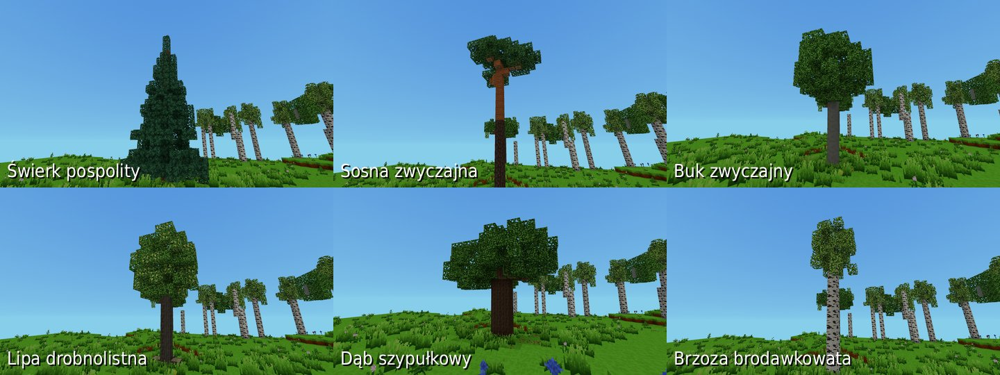
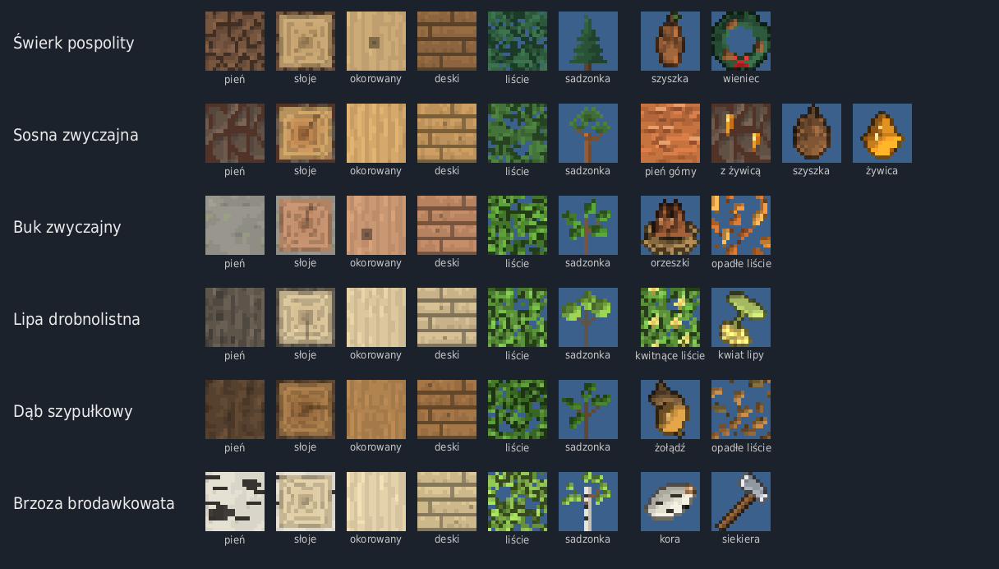
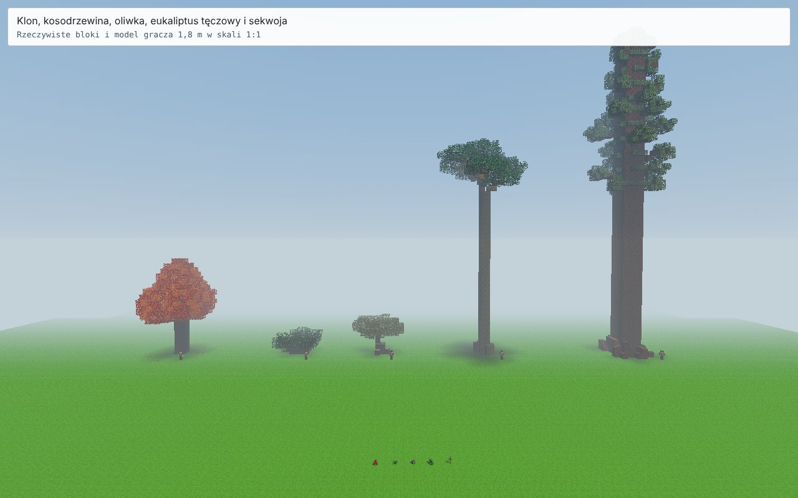
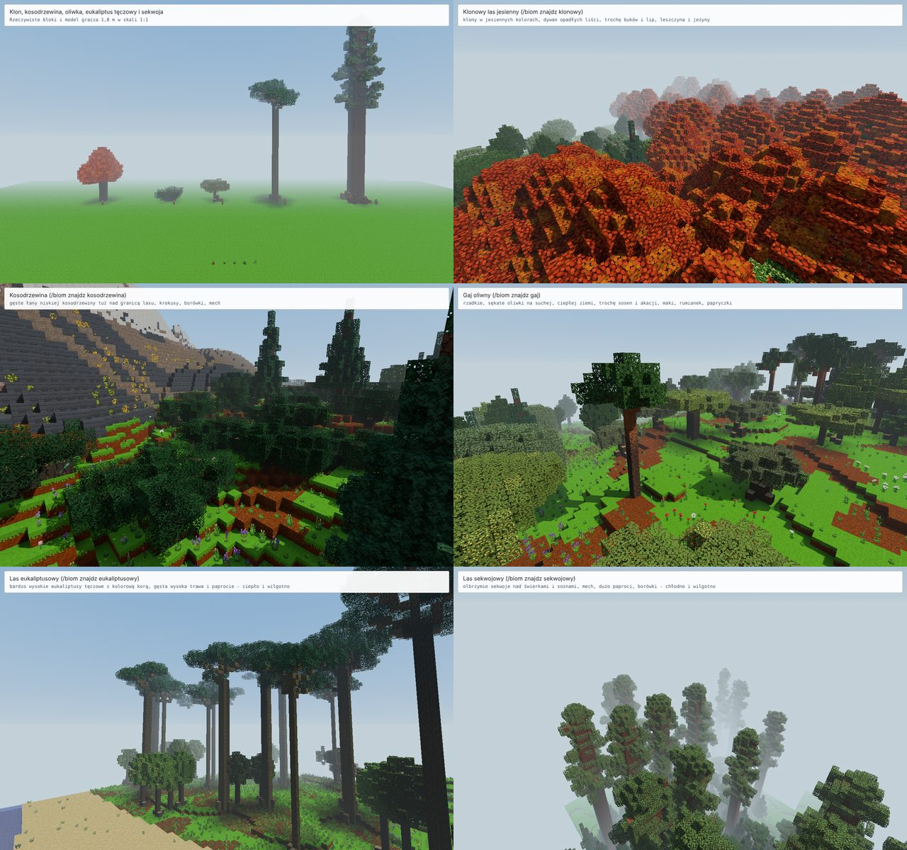

# Drzewa

Gra ma **dziewiętnaście gatunków drzew**, zapisanych we wspólnym katalogu
`src/blocks/treeCatalog.js`. Każdy ma własne bloki, wygląd i zasady
występowania. Tekstury wszystkich gatunków są w `assets/textures/drzewa.png`.

| Gatunek | Nazwa do komendy |
|---|---|
| Świerk pospolity | `swierk` (także `spruce`) |
| Sosna zwyczajna | `sosna` (także `pine`) |
| Buk zwyczajny | `buk` (także `beech`) |
| Lipa drobnolistna | `lipa` (także `linden`) |
| Dąb szypułkowy | `dab` (także `oak`) |
| Brzoza brodawkowata | `brzoza` (także `birch`) |
| Jabłoń domowa | `jablon` |
| Olcha czarna | `olcha` |
| Wierzba biała | `wierzba` |
| Akacja parasolowata | `akacja` (także `acacia`) |
| Cypryśnik błotny | `cyprysnik` (także `bald_cypress`) |
| Wiśnia japońska | `wisnia` (także `cherry`) |
| Klon cukrowy (jesienny) | `klon` (także `maple`) |
| Sosna kosodrzewina | `kosodrzewina` (także `mugo`) |
| Oliwka europejska | `oliwka` (także `olive`) |
| Eukaliptus tęczowy | `eukaliptus` (także `rainbow_eucalyptus`) |
| Sekwoja olbrzymia | `sekwoja` (także `sequoia`) |
| Miłorząb dwuklapowy | `milorzab` (także `ginkgo`) |
| Jakaranda mimozolistna | `jakaranda` (także `jacaranda`) |

Polskie znaki też działają (`dąb`, `jabłoń`, `świerk`). Leszczyna
jest obecnie krzewem owocowym, opisanym w osobnym systemie krzaków.

Organizacja tekstur i edycja katalogu: [arkusze tematyczne](tekstury-atlasy.md).
Od 0.80.0 gra nie wczytuje osobnych paczek drzew.





## Oglądanie drzew — od 0.78.0

Otwórz czat klawiszem **T** albo **/**. Trzy tryby pokazu:

```text
/drzewa las sosna 16 12345
/drzewa warianty sosna 12345
/drzewa porownanie 12345
```

- **las** sadzi wybrany gatunek w losowym układzie, z różnymi rozmiarami
  i kształtami. Liczba drzew: 1–36, domyślnie 16. Zajęte miejsca omija
  i podaje liczbę faktycznie posadzonych drzew.
- **warianty** pokazuje rozmiary i stany specjalne gatunku w rzędach:
  sosny z żywicą i bez, lipy kwitnące i zwykłe, jabłonie z owocami,
  bez owoców i po zbiorze. Jabłoń, olcha i wierzba mają po trzy
  szablony wielkości; gatunki proceduralne pokazujemy w pięciu rozmiarach.
- **porownanie** sadzi wszystkie gatunki obok siebie.

Ostatni argument to opcjonalny **seed pokazu** (0–4294967295).
Bez niego komenda losuje nowy zestaw; z nim można odtworzyć te same
drzewa i ich rozstaw. Seed pokazu jest niezależny od seeda świata.
Różny teren może zmienić wysokość posadzenia i dostępność miejsc.
Kształty proceduralne nie mają zamkniętej listy wszystkich możliwych
odmian — zmiana seeda pozwala oglądać kolejne sylwetki.

Pokaz powstaje **przed graczem, na istniejącej ziemi**, bez wycinania
drzew i budowli. Dla równego porównania najlepiej utworzyć osobny
świat w trybie programisty i odejść na **trawę obok centralnego placu**
(na jego posadzce drzewa nie rosną). Galeria wariantów
i porównanie wymagają miejsca na wszystkie egzemplarze; gdy przeszkadza
istniejący blok albo limit wysokości, komenda podaje problem, zanim
zacznie sadzić. Duży las powstaje partiami, a wynik pojawia się na czacie.

`/drzewa lista` wypisuje aktualny katalog, a `/drzewa ostatnie`
przypomina nazwy i współrzędne okazów ostatniego pokazu.
`/drzewa cofnij` cofa ostatni pokaz **w bieżącej sesji świata**,
zachowując bloki zmienione później przez gracza. Kolejny udany pokaz
zastępuje poprzednią możliwość cofnięcia. Same posadzone drzewa są
zwykłymi blokami świata i trafiają do zapisu.

## Nowe drzewa w skali gracza — 0.79.0

Przyjęto około **1 metra na blok**: postać ma 1,8 bloku wysokości,
a kamera z pierwszej osoby znajduje się 1,6 bloku nad stopami.
Rozmiary dotyczą dojrzałych drzew, z kilkoma losowymi sylwetkami,
od niższych okazów po duże. Korony są rozłożyste, a konary pozostawiają
miejsce, aby wejść pod drzewo i zobaczyć jego rozmiar z ziemi.

| Gatunek | Wysokość | Średnica korony | Charakterystyczna sylwetka |
|---|---|---|---|
| Akacja parasolowata | 8–12 bloków | około 12–18 bloków | szeroki parasol na rozchodzących się konarach |
| Cypryśnik błotny | 24–36 bloków | około 8–14 bloków | wysoki pień, rozszerzona podstawa, korzenie kolankowe i piętra gałęzi |
| Wiśnia japońska | 6–10 bloków | około 8–12 bloków | niskie rozwidlenie i szeroka, różowa korona |

To zakresy przyjęte do gry, z zaokrągleniem geometrii do bloków.
Paczki Kamila zawierały tekstury i podglądy, więc sylwetki odtworzono
proceduralnie. Oryginalne tekstury zostały zachowane. Odniesienia
botaniczne i sumy kontrolne są w historycznych opisach źródeł:
[akacja](zrodla/drzewa-0.79/acacia/README.md),
[cypryśnik](zrodla/drzewa-0.79/bald_cypress/README.md),
[wiśnia](zrodla/drzewa-0.79/cherry/README.md).

Akacje mogą pojawić się na ciepłych, suchych łąkach, cypryśniki na
niezalanej ziemi mokradeł, wiśnie na umiarkowanych łąkach i w lasach
liściastych. W istniejących zapisach nowe gatunki pojawiają się na
nowo generowanym terenie; zapisane budowle i stare drzewa pozostają.
Każdy gatunek ma sadzonkę, liście i ich odmianę, pień do okorowania,
deski oraz opał (pień + siekiera → 4 opały, siekiera zostaje).

Do szybkiego oglądania użyj `/drzewa posadz cyprysnik 75`,
`/drzewa warianty akacja` lub `/drzewa las wisnia 16`.
Galeria automatycznie dobiera odstępy do szerokich koron. Uproszczone
modele dalekiego terenu korzystają z tych samych wymiarów co pełne
drzewa i zachowują ich wysokość oraz własne kolory liści.

## Pięć drzew z paczek Kamila i ich biomy — 0.83.0





| Gatunek | Wysokość | Korona | Sylwetka | Wyroby i dodatki | Biom |
|---|---|---|---|---|---|
| Klon cukrowy | 14–22 | 10–16 | krótki pień, szeroka, zaokrąglona korona z kopuł, pomarańczowa ze złotymi plamami | deski klonowe, opał, **opadłe liście klonu** pod koroną | **Klonowy las jesienny** (`klonowy`); pojedynczo w lasach liściastych i buczynach |
| Kosodrzewina | 3–5 | 6–11 | bez prostego pnia: pokładające się pnie rozchodzą się przy ziemi, na końcach płaskie kępy igliwia; sąsiednie krzewy zrastają się w łany | deski, opał, **szyszka kosodrzewiny** (posadzona daje sadzonkę) | **Kosodrzewina** (`kosodrzewina`) - pas tuż nad granicą lasu w górach; pojedynczo na halach |
| Oliwka europejska | 5–8 | 8–13 | gruby, sękaty, skręcony pień (duże 2 x 2), płaska, szeroka, szarozielona korona | deski oliwkowe, opał, **oliwki** - zbiór PPM z liści z oliwkami (odrastają), posadzone dają sadzonkę | **Gaj oliwny** (`gaj`) - ciepło i sucho; pojedynczo na ciepłych, suchych łąkach |
| Eukaliptus tęczowy | 32–50 | 13–19 | bardzo wysoki, prosty, kolorowy pień, parasol z płaskich chmur liści na samej górze | deski, opał | **Las eukaliptusowy** (`eukaliptusowy`) - ciepło i wilgotno |
| Sekwoja olbrzymia | 46–72 | 11–17 | gruby (3 x 3, duże 4 x 4) rudy pień ze schodkową podstawą, długo goły, korona w górnej połowie, zwężona ku czubkowi | deski sekwojowe, opał, **szyszka sekwoi** (z igliwia z szyszkami - PPM, odrastają) | **Las sekwojowy** (`sekwojowy`) - chłodno, bardzo wilgotno, nisko; między sekwojami świerki i sosny |

Wszystkie mają sadzonkę (także model 3D w trzech jakościach), liście
i odmianę liści, pień do okorowania, deski (we wspólnych przepisach:
skrzynia, tratwa...) i własny **opał do ogniska** z własnym drewnem.
Liście spadają z koron jako cząsteczki w swoich kolorach (jesienne
klonu najładniej), a oliwki i szyszki sekwoi czasem spadają jak jabłka.

Oryginalne tekstury z paczek (pień, słoje, deski, liście, odmiana liści)
są w grze piksel w piksel; okorowany pień, sadzonkę, drewno ogniska,
oliwki, szyszki i opadłe liście klonu rysuje
`python tools/tekstury_drzew_083.py` w tym samym stylu.

Olbrzymy nie wchodzą na siebie: sekwoja rośnie tylko w co trzeciej
kratce siatki drzew (między nimi świerki), eukaliptus w co drugiej.
Pod limitem wysokości świata (128) sekwoja jest niższa, zamiast znikać.
W istniejących zapisach nowe drzewa i biomy pojawiają się na nowo
generowanym terenie.

```text
/drzewa porownanie
/drzewa las sekwoja 9
/biom znajdz klonowy
```

## Miłorząb i jakaranda — 0.85.0

Oba gatunki korzystają z oryginalnych tekstur paczek Kamila i wspólnego
arkusza `drzewa.png`. Paczki zawierały podglądy i wymiary, a geometrię
odtworzono proceduralnie. Przy skali około **1 m na blok** postać gracza
ma 1,8 m, dzięki czemu wysokość i szerokość korony widać także z ziemi.

| Gatunek | Wysokość dojrzałych okazów | Średnica korony | Wygląd |
|---|---|---|---|
| Miłorząb dwuklapowy (*Ginkgo biloba*) | 18–26 bloków | około 10–16 bloków | wysoki pień, nieregularne piętra gałęzi i złota korona |
| Jakaranda mimozolistna (*Jacaranda mimosifolia*) | 8–14 bloków | około 12–18 bloków | rozchodzące się konary i szeroka, lekka fioletowa korona |

Źródłowy miłorząb ma w `render_info.json` wysokość 25 m i koronę 13 m,
a jakaranda odpowiednio 13 m i 15 m. Losowe sylwetki gry obejmują
mniejsze i większe dojrzałe okazy; bryły zaokrąglamy do pełnych bloków.
To wybór reprezentatywnej skali, nie symulacja wieku ani wszystkich
rekordowych rozmiarów gatunku. Odniesienia: [University of Minnesota —
miłorząb](https://trees.umn.edu/nursery-tour/species/gi),
[UF/IFAS — jakaranda](https://ask.ifas.ufl.edu/publication/ST317)
i [RHS — jakaranda](https://www.rhs.org.uk/plants/jacaranda/growing-guide).

Każdy ma sadzonkę w trzech jakościach modeli, dwie odmiany liści,
pień, okorowane drewno, deski i opał. Uproszczone sylwetki zachowują
skalę oraz kolory. Nowe drzewa pojawiają się na nowo generowanym terenie;
zapisane wcześniej budowle i drzewa pozostają na swoich miejscach.

```text
/drzewa posadz milorzab 75
/drzewa warianty jakaranda 12345
/drzewa las milorzab 16 12345
/drzewa porownanie 12345
```

Metadane i sumy źródeł: `docs/zrodla/drzewa-0.85/`.
Kadry z gry i wyniki sprawdzeń: [próba 0.85.0](pomiary/drzewa-0.85.0/README.md).

Miłorząb pojawia się pojedynczo w umiarkowanych lasach liściastych,
buczynach i lasach klonowych. Jakaranda wybiera ciepłe łąki, lasy
liściaste i eukaliptusowe. Nie dochodzi nowy rodzaj biomu.
Opadające liście miłorzębu mają wachlarzowaty kształt; jakaranda gubi
drobne fioletowe płatki i wąskie liście.


## Bloki

Każdy gatunek ma pięć bloków (`src/blocks/trees.js`):

| Blok | Nazwa (np. dąb) | Opis |
|---|---|---|
| pień | `oak_log` | kora z boku, słoje na górze i na dole |
| okorowany pień | `oak_log_stripped` | gładkie drewno (siekiera: PPM na pniu) |
| deski | `oak_planks` | cztery deski z usłojeniem |
| liście / igliwie | `oak_leaves` | z prześwitami - widać przez nie głąb korony |
| sadzonka | `oak_sapling` | wyrasta w całe drzewo |

(świerk - `spruce_...`, sosna - `pine_...`, buk - `beech_...`, lipa -
`linden_...`, brzoza - `birch_...`)

**Dodatki:**

| Gatunek | Dodatek | Co to jest |
|---|---|---|
| świerk | `spruce_cone` - szyszka świerka | wypada z igliwia, posadzona daje sadzonkę |
| świerk | `spruce_wreath` - wieniec świerkowy | dekoracja na ścianę (PPM na boku bloku) |
| sosna | `pine_log_upper` - pień sosny (górny) | rudopomarańczowa, łuszcząca się kora - góra pnia sosny |
| sosna | `pine_log_resin` - pień sosny z żywicą | PPM zbiera żywicę (zostaje zwykły pień) |
| sosna | `pine_cone` - szyszka sosny, `resin` - żywica | szyszka do posadzenia, kropla żywicy |
| buk | `beechnuts` - orzeszki bukowe | wypadają z liści, posadzone dają sadzonkę |
| buk | `beech_leaf_litter` - opadłe liście buka | rude liście leżące na ziemi pod bukiem |
| lipa | `linden_leaves_flowering` - kwitnące liście lipy | PPM zbiera kwiaty (zostają zwykłe liście) |
| lipa | `linden_flower` - kwiat lipy (z przysadką) | posadzony daje sadzonkę |
| dąb | `acorn` - żołądź | wypada z liści, posadzony daje sadzonkę |
| dąb | `oak_leaf_litter` - opadłe liście dębu | brązowe liście na ziemi pod dębem |
| brzoza | `birch_bark` - kora brzozowa | z okorowania brzozy siekierą |
| (wszystkie) | `axe` - siekiera | PPM na pniu - okorowany pień |

## Jak wyglądają w świecie

Kształt drzewa układa `src/world/trees/TreeShapes.js` - każdy gatunek
to jedna funkcja. Ten sam seed daje zawsze to samo drzewo; drzewa są
różnej wielkości (size 0-1).

- **Świerk** - wysoki (13-20 bloków), wąski stożek z pięter gałęzi
  (każde piętro na dole szersze), końce najniższych gałęzi piętra lekko
  opadają, ciemne igliwie do samego czubka.
- **Sosna** - najwyższa (15-22), długi goły pień: dół z grubą ciemną
  korą, góra rudopomarańczowa; na samej górze parasol z kilku osobnych
  kęp igliwia na krótkich gałęziach. Czasem z pnia wycieka żywica.
- **Buk** - gładki szary pień, szeroka (promień 3-5), gęsta, lekko
  spłaszczona korona z kopułkami na wierzchu i konarami w środku;
  pod spodem rude opadłe liście.
- **Lipa** - gruby ciemny pień z nabiegami korzeniowymi, wysoka,
  zaokrąglona, bardzo gęsta korona; zwykle kwitnie (żółte kwiatki na
  wierzchu korony).
- **Dąb** - duży: pień 2 x 2, krótki i gruby, 3-4 konary rozchodzące się
  na boki i w górę, na ich końcach kępy liści - szeroka (do 7 bloków od
  pnia), nieregularna korona; mały: pień 1 x 1 i 2-3 konary. Pod spodem
  brązowe opadłe liście.
- **Brzoza** - smukła (10-14), biały pień z czarnymi kreskami, czasem
  lekko pochylony; wąska, wysoka, ażurowa korona (dużo prześwitów)
  ze zwisającymi gałązkami.

**Liście** to sześciany z prześwitami (model `leaves`): przez dziurki
w liściach widać liście głębiej w koronie (rysowane są tylko przy
wierzchu korony - dwie warstwy, głębiej i tak prawie nic nie widać).
Liście **przepuszczają światło**, ale pełne światło nieba wpada tylko do
pierwszego bloku liści, a dalej słabnie o 1 na blok - pod koroną i
w gęstym lesie jest cień (`src/world/Light.js`). W kątach korony są
cienie (jak przy zwykłych blokach). Na liściach da się stać (mają
kolizję).

Ustawienie **Liście drzew** (*Ustawienia → Obraz → Zaawansowane*, `/ustaw liscie`):
*Ładne* - z prześwitami, *Szybkie* - bez ścian w środku korony
i z zamalowanymi prześwitami (dużo mniej do rysowania - las nie
spowalnia gry). Na telefonie domyślnie szybkie, w trybie ziemniaka
zawsze szybkie.

## Gdzie rosną

Tylko w terenie **realistycznym** (klasyczny się nie zmienia). Kod:
`src/world/trees/Forests.js`, liczby do strojenia: `FORESTS`
w `src/world/terrain/TerrainShape.js`.

- **Siatka:** drzewa stoją na siatce co 4 bloki - w kratce najwyżej jedno,
  w losowym miejscu kratki. Czy jest, jakiego gatunku i jak duże -
  zależy tylko od seeda i kratki, więc każdy chunk wie, jakie drzewa
  rosną obok niego, i wstawia u siebie ich kawałki (korona drzewa
  z sąsiedniego chunka wchodzi do tego). Drzewo na granicy chunków
  zawsze pasuje po obu stronach.
- **Gęstość lasu:** pole lasów (plamy ~190 bloków) - łąki z pojedynczymi
  drzewami ↔ gęste lasy (drzewo w połowie kratek); w suchym klimacie
  lasy są rzadsze, w wilgotnym gęstsze; drzewa rosną do kilku bloków
  poniżej granicy gołej skały (góry mają nagie szczyty); tylko na
  ziemi (nie na piasku i skale) i niezbyt stromo. Do tego **biom**
  (`docs/biomy.md`): w lasach las jest gęsty w całym biomie, bór jest
  rzadszy, na hali, mokradłach i plaży - pojedyncze drzewa, w skałach
  i na śniegu - żadnych. Mniej więcej 1/3 lądu to lasy.
- **Gatunek** - z gatunków biomu (`trees` w `src/world/terrain/Biomes.js`)
  i plam gatunków (~150 bloków - w lesie przeważa jeden, dwa gatunki):
  - świerczyna - świerki (z domieszką buka i brzozy),
  - bór sosnowy - sosny (trochę brzóz i świerków),
  - buczyna - prawie same buki,
  - las liściasty - dęby i lipy (trochę buków i brzóz),
  - brzezina - brzozy (trochę sosen, dębów, świerków),
  - mokradła - olchy i wierzby, brzozy,
  - łąka - pojedyncze dęby, lipy, brzozy, sosny i jabłonie,
  - hala - pojedyncze świerki, plaża - pojedyncze sosny.
  Każde drzewo sprawdza biom trochę obok siebie, więc na granicach
  biomów drzewa się przeplatają.
- **Pod drzewem:** pień wchodzi w trawę i rośliny (nie w ziemię ani skałę),
  na stoku schodzi w dół do gruntu; pod bukiem i dębem leżą opadłe
  liście.
- **Daleki teren:** z daleka las widać jako korony drzew - teren
  podniesiony do wysokości koron, w kolorze liści gatunku, który tam
  przeważa (także na kuli Ziemi z kosmosu).
- **Mapa:** `/mapa lasy` - gatunek, który przeważa (kolor), i gęstość
  lasu (im mocniejszy kolor, tym gęściej). `/teren` też mówi o lesie.

Start nowego świata nigdy nie wypada przy pniu drzewa, a gracz staje na
ziemi (nie na koronie). Meteoryt zmiata drzewa nad kraterem.

## Rozgrywka

- **Sadzonka** wyrasta w całe drzewo średnio po `TREE_GROWTH_SECONDS`
  sekundach (`src/config.js`, teraz 5 minut), każda w swoim czasie -
  tak jak krzaki: w chunkach wczytanych wokół gracza i zmienionych
  przez niego. Drzewo rośnie tylko wtedy, gdy pień ma miejsce (blok
  nad sadzonką - czeka dalej); liście omijają to, co zajęte. Każde
  wyrośnięte drzewo jest trochę inne (losowy rozmiar).
- **Sadzenie:** sadzonka na ziemi albo nasiono w ręce + PPM na ziemi:
  szyszka świerka i sosny, orzeszki bukowe, kwiat lipy, żołądź (brzoza -
  tylko sadzonka).
- **Siekiera** (`/daj axe`): PPM na pniu - okorowany pień; z brzozy
  jeszcze kora brzozowa. PPM z czymś innym w ręce stawia blok normalnie.
- **Żywica:** PPM na pniu sosny z żywicą (1-2 krople). **Kwiaty lipy:**
  PPM na kwitnących liściach (1-2 kwiaty).
- **Przygoda:** pień daje pień, liście - liście, a czasem jeszcze
  sadzonkę (5-7%) i nasiono gatunku (szyszkę, orzeszki, żołądź - 8-10%).
- **Wieniec świerkowy** wisi na boku bloku (nie na górze ani pod spodem)
  i znika razem z blokiem, na którym wisi. Opadłe liście leżą na
  pełnym bloku i też znikają, gdy go zabraknie; postawiony blok je
  zastępuje (jak trawę).

## Osiągnięcia

*Drwal* (zetnij pień), *Brzozowy papirus* (kora brzozowa siekierą),
*Leśniczy* (pień każdego z sześciu gatunków), *Z małego ziarenka*
(wyhoduj drzewo z sadzonki). Lista: `docs/osiagniecia.md`.

## Komendy

| Komenda | Co robi |
|---|---|
| `/drzewa` | ile drzew rośnie w okolicy (gatunki), las w miejscu gracza |
| `/drzewa posadz <gatunek> [0-100]` | drzewo 5 bloków przed tobą (rozmiar 0 - małe, 100 - duże) |
| `/drzewa <gatunek>` | to samo, krócej - np. `/drzewa dab` |
| `/drzewa lista` | wszystkie gatunki i pomoc do nowych pokazów |
| `/drzewa las <gatunek> [1-36] [seed]` | losowy las jednego gatunku, domyślnie 16 drzew |
| `/drzewa warianty <gatunek> [seed]` | rozmiary, szablony i stany specjalne gatunku |
| `/drzewa porownanie [seed]` | wszystkie gatunki obok siebie, z kontrolą wolnego miejsca |
| `/drzewa ostatnie` | nazwy i pozycje okazów ostatniego pokazu |
| `/drzewa cofnij` | cofa ostatni nowy pokaz w bieżącej sesji |
| `/drzewa aleja` | starsza komenda sadząca wszystkie gatunki w rzędzie, co 12 bloków |
| `/drzewa znajdz <gatunek> [tp]` | najbliższe drzewo gatunku w świecie (tp - przeniesienie pod nie) |
| `/drzewa rosnij` | sadzonki do 64 bloków od ciebie rosną od razu |
| `/drzewa tempo <0-500>` | szybszy wzrost (to samo co `/krzaki tempo`) |
| `/mapa lasy` | mapa lasów |

Gatunki w komendach: `swierk`, `sosna`, `buk`, `lipa`, `dab`, `brzoza`,
`jablon`, `olcha`, `wierzba`, `akacja`, `cyprysnik`, `wisnia`, `klon`,
`kosodrzewina`, `oliwka`, `eukaliptus`, `sekwoja`, `milorzab`,
`jakaranda` (albo po angielsku).

## Tekstury i dźwięki

Tekstury drzew rysuje **`tools/tekstury_drzew.py`** (ten sam styl
i narzędzia co `tools/tekstury.py`): kora z płytek, łusek albo bruzd,
słoje od środka pnia, deski z usłojeniem, liście z pojedynczych
listków albo igieł z przezroczystymi prześwitami, sadzonki i przedmioty
z ciemnym obrysem. `python tools/tekstury_drzew.py [podglad.png]`.
Wiersze 5-8 atlasu.

Pnie i deski mają nowy materiał dźwięków **drewno** (`wood` - ciepłe,
głuche puknięcie; przy niszczeniu ciche trzaski drzazg), liście -
szelest liści (`plant`). Pliki: `assets/sounds/blocks/` (nagrania -
README, *Dźwięki*).

## Do zrobienia później

- liście opadające jesienią, śnieg na świerkach (pory roku),
- deski i inne bloki z pni (crafting).
