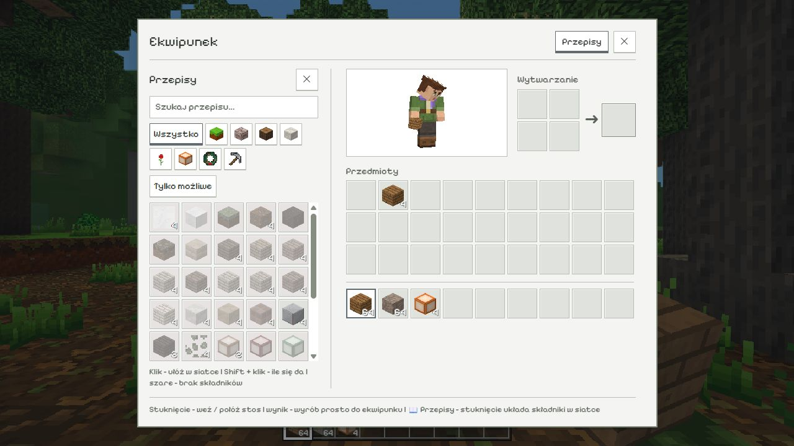
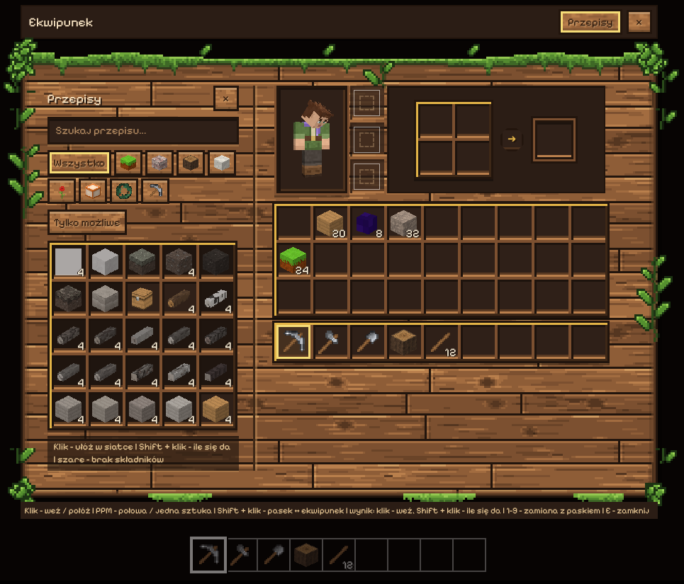

# Ekwipunek: wspólny panel, wygląd i motywy

Ekwipunek ma jedną wspólną ramkę. Po lewej znajduje się otwarta księga
przepisów, a po prawej postać, wytwarzanie, 27 miejsc i wyrównany pasek
9 miejsc. Księga jest częścią tego samego okna. Tryb kreatywny zachowuje
wyszukiwanie bloków, kategorie i kosz.



## Wygląd: drewniany i jasny

Okno ma dwa wyglądy do wyboru: *Ustawienia → Wygląd → Ekwipunek*
albo komenda `/ekwipunek wyglad [drewniany | jasny]`. Domyślny jest
**drewniany**:



- okno z poziomych desek (słoje, sęki, pęknięcia), z ciemnym obrysem,
  mchem na górnej krawędzi, kępami liści w rogach i pnączami po bokach,
- miejsca na przedmioty to ciemne przegródki z jaśniejszą listwą u dołu,
  w drewnianych ramkach ze złotym brzegiem; wybrane miejsce i gotowy
  wynik wytwarzania mają złotą obwódkę,
- przyciski to jasne deseczki, pola wyszukiwania i podgląd postaci -
  ciemne wnęki, drobne napisy pomocy - na ciemnych tabliczkach,
- podpowiedzi przedmiotów są ciemne, z drewnianym brzegiem.

Wybrany wygląd to atrybut `<html data-inv-style="wood | light">`
(ustawienie `inventoryStyle`, `src/main.js`). Wszystkie reguły
drewnianego wyglądu są w `src/ui/inventory-wood.css` i działają tylko
z `data-inv-style="wood"` - jasny wygląd i motywy menu działają jak
przedtem. Drewniany wygląd ma swoje kolory (`--inv-*` na
`:root[data-inv-style="wood"]`), więc motyw menu ich nie zmienia.

**Tekstury** (`assets/ui/inventory/wood/`) rysuje
`python tools/ekwipunek_drewno.py` (z podglądem:
`python tools/ekwipunek_drewno.py podglad.png`). Piksel tekstury to
3 piksele ekranu:

| plik | co to jest |
| --- | --- |
| `planks.png` | deski - tło okna (160 x 90, łączy się bez szwów) |
| `frame.png` | rama okna (`border-image`, wycinek 28): 12 pikseli na zewnątrz okna (liście, pnącza), dalej obrys i mech; krawędzie powtarzają się co 200 / 160 pikseli |
| `frame-compact.png` | ta sama rama bez części na zewnątrz - mały ekran (do 480 punktów szerokości albo 520 wysokości) |
| `board.png` | jasna deseczka - przyciski |

**Miejsce na ekranie:** rama zajmuje więcej niż jasna. Na ekranie
laptopa (do 820 punktów wysokości) odstępy są mniejsze, a lista bloków
(kreatywny) i księga przepisów są krótsze i przewijają się w środku -
okno mieści się w całości od 1366 x 768. Na małym ekranie (telefon)
liście nie wystają za okno.

## Pliki

- `src/ui/InventoryScreen.js` — budowa ekranu i dotychczasowe operacje
  na przedmiotach.
- `src/ui/inventory.css` — układ, odstępy, rozmiary oraz stany kontrolek.
- `src/ui/inventory-theme.css` — biała i jasnoszara paleta (wygląd jasny).
- `src/ui/inventory-wood.css` — wygląd drewniany (kolory, tekstury,
  grubości ramek).
- `assets/ui/themes/<motyw>/theme.css` — opcjonalne nadpisania motywu;
  ten plik jest ładowany jako ostatni.

Motyw dziedziczy wszystkie niepodane kolory z jasnej bazy. Dotychczasowe
motywy menu działają dalej; ich kolory ekwipunku można dodać oddzielnie.
Przełączenie motywu usuwa jego poprzednie nadpisania dzięki wymianie
jednego arkusza `theme-css`. Font nadal pochodzi z `--ui-font`.

## Kolory do nadpisania (wygląd jasny)

Wszystkie kolory określamy na `:root`. Podpowiedź i przedmiot pod kursorem
są bezpośrednio pod `body`, więc nadpisanie jedynie na `#inventory`
nie obejmie całego interfejsu.

| Zmienne | Przeznaczenie |
| --- | --- |
| `--inv-overlay` | Przyciemnienie świata za oknem |
| `--inv-panel-bg`, `--inv-surface-bg` | Główny panel, podgląd i pola tekstowe |
| `--inv-slot-bg`, `--inv-hover-bg`, `--inv-selected-bg` | Slot i jego stany |
| `--inv-border`, `--inv-border-strong`, `--inv-accent` | Obramowania i zaznaczenie |
| `--inv-text`, `--inv-muted` | Tekst główny i pomocniczy |
| `--inv-shadow`, `--inv-highlight` | Subtelny cień i światło krawędzi |
| `--inv-positive`, `--inv-negative` | Posiadane i brakujące składniki |
| `--inv-missing-bg`, `--inv-result-bg` | Niedostępny przepis i gotowy wynik |
| `--inv-tooltip-bg`, `--inv-tooltip-border` | Podpowiedzi przedmiotów i przepisów |
| `--inv-count-text`, `--inv-count-shadow` | Liczby stosów, również pod kursorem |

Przykład akcentu w przyszłym motywie:

```css
:root {
    --inv-accent: #79618d;
    --inv-selected-bg: #f5f0fa;
}
```

Kolor nie zastępuje obramowania, przygaszenia ani tekstowej informacji
o brakujących składnikach. Własną paletę należy sprawdzić również na
podpowiedziach, liczbach stosów i polach wyszukiwania.

## Rozmiary ekranu

Na węższym ekranie sekcje zmieniają ułożenie. Przy bardzo małej szerokości
siatka zapasów i pasek przewijają się razem, zachowując kolejność miejsc
i wielkość pól. Niskie okno pozwala przewinąć panel w pionie. Reguły
tego układu należą do `inventory.css`, a nie do palety motywu.

Przy zmianach sprawdzamy oba tryby gry, otwartą i zamkniętą księgę,
wyszukiwanie i „Tylko możliwe”, przenoszenie stosów, wytwarzanie,
trzymany przedmiot podczas przebudowy ekranu i ponowne wczytanie świata.
Testy reguł przedmiotów uruchamia `npm test`.
