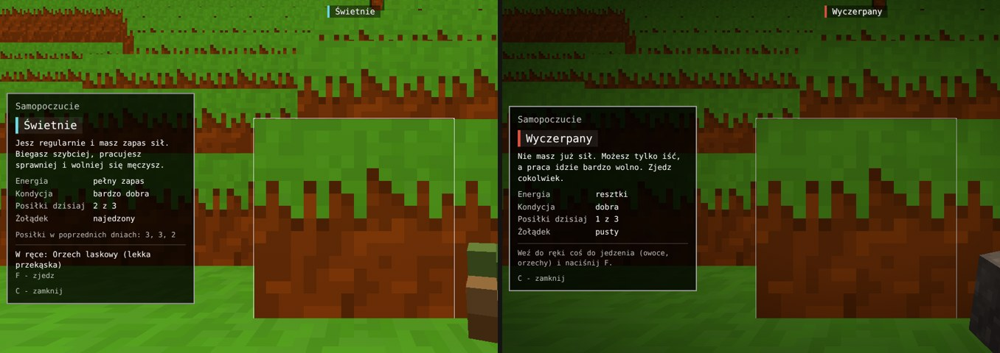

# Energia i samopoczucie (0.94.0)

Pomysł Kamila: w grze nie ma śmierci. Zamiast niej są **skutki** - gracz,
który o siebie nie dba, słabnie, a ten, który je regularnie, ma więcej
sił. To pierwsza część tego systemu: energia, kondycja, jedzenie
i okno statusu.

## Jak to działa

**Energia** to paliwo. Ubywa cały czas, szybciej przy wysiłku:

| Co robisz | Zużycie |
|---|---|
| stoisz | bardzo małe (ok. 30 na dobę gry) |
| idziesz | 1,5 raza większe |
| biegniesz albo płyniesz | ponad 3 razy większe |
| kopiesz | dodatkowo, jak przy biegu |
| skaczesz | trochę za każdy skok |

Energia wraca **tylko z jedzenia**. Na początku gracz ma zapas 75.

**Kondycja** mówi, ile energii ciało potrafi zmieścić (od 60 do 130,
na początku 100). Zmienia się raz na dobę gry, o świcie nowego dnia:

| Posiłki poprzedniego dnia | Kondycja |
|---|---|
| 3 albo więcej | rośnie (+4) |
| 2 | lekko rośnie (+1) |
| 1 | powoli spada (-2) |
| 0 | spada (-5) |

## Stany

Gra nie pokazuje pasków. Stan widać po **sercu** w lewym górnym rogu
ekranu (od 0.95.0, pixel art): jego kolor to samopoczucie, a przy
zmianie serce migocze - na lepsze z błyskiem i iskierkami, na gorsze
z drżeniem i przygaśnięciem. Zaliczony posiłek to krótkie „puknięcie",
burczenie w brzuchu - zadrżenie. Serce spokojnie bije; u zmęczonego
szybciej, u wyczerpanego nierówno. Szczegóły słowami są w **oknie
statusu** (klawisz **C**, na telefonie stuknięcie w serce).

| Serce | Stan |
|---|---|
| turkusowe | świetnie |
| czerwone | dobrze |
| żółte | głodny |
| pomarańczowe | zmęczony |
| szare, pęknięte | wyczerpany |

| Stan | Kiedy | Skutki |
|---|---|---|
| **Świetnie** | dużo energii i dobra kondycja (od 108) | szybszy bieg, szybsza praca, wolniejsze zużycie energii |
| **Dobrze** | co najmniej 40% zapasu | brak |
| **Głodny** | poniżej 40% | burczy w brzuchu (dźwięk i napis), jeszcze bez kar |
| **Zmęczony** | poniżej 22% | wolniejszy bieg, kopanie wolniejsze o 1/5 |
| **Wyczerpany** | poniżej 8% | nie da się biec, chód wolniejszy, kopanie dużo wolniejsze, ciemnieją brzegi obrazu |

Z samego głodu nic gorszego się nie dzieje - wyczerpany gracz dalej
chodzi i może jeść.

## Jedzenie

Weź jedzenie do ręki i naciśnij **F** albo **PPM** (na telefonie:
stuknięcie albo przycisk *Zjedz* w oknie statusu). Od 0.95.0 owoce sadzi
się tylko na rozgrzebanej ziemi ([docs/uprawa.md](uprawa.md)) - tam PPM
sadzi, wszędzie indziej zjada.

| Jedzenie | Energia | Syci na |
|---|---|---|
| Jabłko | 12 | 90 s |
| Orzech laskowy | 10 | 120 s |
| Oliwki | 8 | 80 s |
| Truskawki | 7 | 50 s |
| Bukiew | 7 | 90 s |
| Jeżyny, borówki | 6 | 45 s |
| Żołądź | 4 | 60 s |
| Papryczka chili | 3 | 20 s |

Wszystko to na razie **lekkie przekąski**. Najedzony gracz zużywa mniej
energii i nie burczy mu w brzuchu. Gdy żołądek jest pełny (kilka jabłek
pod rząd), trzeba chwilę odczekać.

**Posiłek** to wszystko, co zjesz w krótkim czasie (ok. minuty). Liczy
się, gdy da razem co najmniej 18 energii (np. dwa jabłka albo trzy
truskawki) i od poprzedniego posiłku minęły prawie trzy godziny gry
(ok. 2,5 minuty). Objadanie się daje energię, ale kondycji nie poprawia
- liczą się trzy posiłki w odstępach.

## Tryby gry

Energia działa w trybie **przygody**. W trybie kreatywnym i programisty
jest wyłączona: nie ubywa, nie trzeba jeść, serca nie widać. W locie
(komenda `/latanie`) też nie ubywa.

W **grze ze znajomymi** każdy ma własną energię. Stan gościa zapisuje
się u gospodarza razem z jego ekwipunkiem.

## Do testów

- `/energia` - energia, kondycja i stan w liczbach,
- `/energia 15` - ustawia energię (0-130),
- `/energia kondycja 110` - ustawia kondycję (60-130),
- `/czas predkosc 60` - doba mija w 20 sekund (rozliczenie posiłków).

## Dla programisty

- `src/game/Wellbeing.js` - cała logika i liczby (zużycie, progi stanów,
  posiłki, kondycja). Bez grafiki i dźwięku.
- `src/items/foods.js` - lista jedzenia. Każda pozycja ma `energy`,
  `fullness`, `kind` i pustą na razie listę `effects` - miejsce na
  przyszłe działanie potraw (ulubione dania, lepszy wzrok, siła).
- `src/ui/StatusPanel.js` - okno statusu, przyciemnienie;
  `src/ui/HeartIcon.js` - serce (rysunek, migotanie, iskierki),
  animacje w `src/ui/hud.css`.
- `src/game/Game.js` - `updateWellbeing` (zużycie, burczenie) i `eat`.
- `src/player/Player.js` - `stamina` (bieg i chód według stanu).
- Dźwięki: `assets/sounds/body/` (syntetyczne, `tools/dzwieki.py`,
  grupa `cialo`) - można podmienić nagraniami o tych samych nazwach.
- Zapis: `worldInfo.wellbeing` (gość: `worldInfo.guests[id].wellbeing`).
- Test: `node tools/sprawdz_energie.mjs`.

## Co dalej

Plan Kamila na kolejne wersje: upadki z wysokości (utykanie zamiast
obrażeń), tonięcie (utrata przytomności i pobudka na brzegu),
cechy rosnące od używania i dobrego jedzenia, pieczenie na ognisku
jako pierwszy porządny posiłek.
