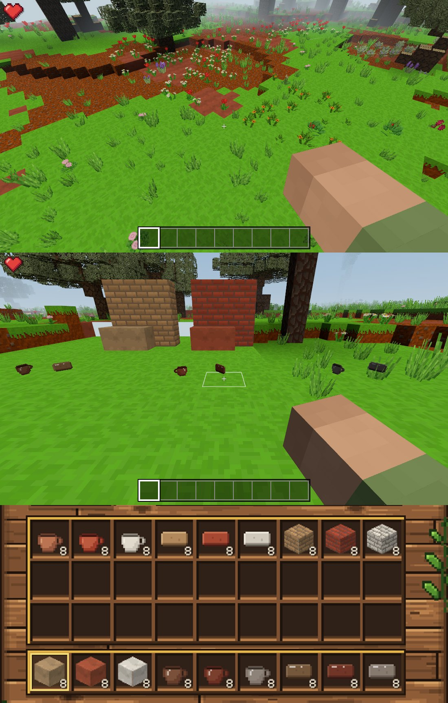

# Glina: trzy rodzaje, suszenie na słońcu, cegły

Od wersji 1.1.0 (pomysł Kamila). Glina leży **na powierzchni** tam,
gdzie w naturze, ma **trzy rodzaje**, a ulepione z niej rzeczy trzeba
**wysuszyć na słońcu**, zanim się do czegoś przydadzą.

## Gdzie szukać gliny

| Glina | Gdzie leży | Dlaczego tam |
|---|---|---|
| **Glina** (zwykła, beżowa) | brzegi **rzek i jezior** na nizinach - łąki i wszystkie lasy nizinne (do 5 bloków od wody); na **mokradłach** także dalej od wody | rzeka nanosi muł i odkłada go na brzegach |
| **Czerwona glina** | **gaje oliwne** i **lasy eukaliptusowe** - przy wodzie i płatami na otwartym terenie | w ciepłym, suchym klimacie żelazo w glebie rdzewieje (terra rossa) |
| **Biała glina** | **skaliste góry, hale i kosodrzewina** - płatami między skałami | kaolin powstaje ze zwietrzałego granitu |

- Glina leży **płatami** po kilka-kilkanaście bloków, nie pasem wzdłuż
  całego brzegu - idąc brzegiem rzeki, trafia się na nią co jakiś czas.
- Płat ma **dwa bloki grubości**. Kopie się ją ręką albo (szybciej)
  łopatą.
- Rośnie na niej trawa i kwiaty jak na ziemi.
- Na mapie terenu (M) każda glina ma swój kolor.
- Na plażach, pod śniegiem i na dnie morza gliny nie ma. Na dnie rzek
  i pod błotem mokradeł zwykła glina leży jak dotąd.

**Stare światy:** teren, którego gracz nie zmienił, tworzy się od nowa,
więc glina pojawi się także w istniejącym świecie. Kawałki świata,
w których coś zbudowano albo wykopano, zostają takie, jakie były.

## Lepienie i suszenie

| Co | Z czego | Wynik |
|---|---|---|
| Mokry kubek | 2 gliny tego samego rodzaju | 2 mokre kubki |
| Mokra cegła | 1 glina | 2 mokre cegły |
| Blok cegieł | 4 **suche** cegły (kwadrat 2×2) | 1 blok |

Mokry kubek i mokra cegła do niczego się jeszcze nie nadają. Żeby
wyschły:

1. **Wyrzuć je** (Q; na telefonie weź je w ekwipunku i stuknij obok okna)
   **pod gołym niebem**.
2. Poczekaj **2 minuty dnia** (około 2,5 godziny w grze).
3. Podnieś suche.

Zasady:

- schnie tylko **w dzień** - od 6:00 do 19:00. Noc przerywa suszenie,
  ale go nie cofa: rano schnie dalej;
- tylko **pod gołym niebem** - pod dachem i w jaskini nie schnie, pod gęstą koroną
  drzewa może nie schnąć;
- **nie w wodzie**;
- cały stos schnie naraz; świeża mokra rzecz dorzucona do stosu
  sprawia, że stos schnie od początku;
- postęp suszenia zapisuje się ze światem i widzą go znajomi w grze
  wieloosobowej.

Suchy kubek ma kolor swojej gliny (beżowy, czerwony, biały) - w każdym
da się zaparzyć napar ([docs/ziola.md](ziola.md)). Z suchych cegieł
powstają **cegły, czerwone cegły i białe cegły** - bloki do budowania,
twarde jak kamień.

## Znane ograniczenia

- Po wypiciu naparu wraca zawsze **zwykły gliniany kubek**, także gdy
  napar był w czerwonym albo białym.
- Podczas snu rzeczy nie schną (śpi się w nocy).
- Cegieł nie wypala się jeszcze w ogniu - na razie wystarcza słońce.

## Dla programisty

- `src/items/clay.js` - rodzaje gliny (`CLAY_KINDS`), nazwy przedmiotów,
  czas i warunki suszenia (`DRY_SECONDS`, `DRY_FROM_HOUR`,
  `DRY_UNTIL_HOUR`, `DRY_SKY_LIGHT`), lista mokre → suche (`DRYING`).
- `src/game/Drops.js` - `updateDrying`: suszenie leżącego przedmiotu
  (pole `dry` w zapisie).
- `src/world/terrain/RealisticGenerator.js` - `clayAt` i tabela
  `CLAY_GROUND`: w którym biomie jaka glina i jak często.
- `src/crafting/recipes.js` - przepisy i grupa `#cup` (każdy suchy
  kubek).
- `tools/tekstury_gliny.py` - tekstury bloków i ikony.
- Nowa glina: wpis w `CLAY_KINDS`, dwa bloki w `BlockRegistry.js`,
  tekstury, wiersz w `CLAY_GROUND`, kolor w `rocks.js` (`SOIL_INFO`).
- Test: `node tools/sprawdz_glina.mjs`.
