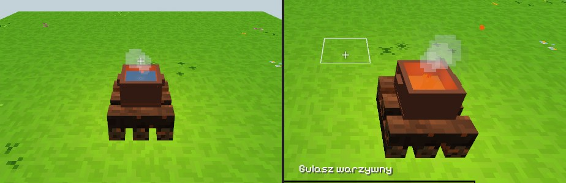

# Gotowanie w garnku (1.20.0)

Pierwsza część „kuchni i spiżarni": gliniany garnek nad ogniskiem. Łączy
glinę, wodę, ognisko i roślinne jedzenie - a w grze bez mięsa to
gotowane potrawy są najmocniejszym posiłkiem.

## Krok po kroku

1. **Ulep garnek i miski.** 3 gliny i patyk → mokry garnek; 3 gliny →
   2 mokre miski (z każdej z trzech glin wychodzą takie same). Wysusz je
   na słońcu jak kubki ([glina.md](glina.md)): wyrzucone w dzień pod
   gołym niebem schną 2 minuty.
2. **Nabierz wody.** Z pustym garnkiem w ręce kliknij PPM na wodę -
   rzekę, jezioro, morze. Garnek zamienia się w **garnek z wodą**.
3. **Postaw garnek na ognisku** (PPM). Ognisko może jeszcze nie płonąć.
4. **Wrzuć 2 albo 3 składniki** - PPM z surowym jedzeniem w ręce.
5. **Czekaj.** Nad płonącym ogniem potrawa gotuje się **45 sekund**. Nie
   trzeba trzymać przycisku ani stać obok; nad garnkiem unosi się para
   i słychać bulgotanie. Dorzucony składnik zaczyna gotowanie od nowa.
   Gdy ogień zgaśnie, gotowanie czeka na następny. Od 1.32.0 45 sekund
   to czas nad ogniem o temperaturze 800°: nad dębem (920°) wychodzi
   ok. 39 sekund, nad lipą (650°) ok. 55 ([ogniska.md](ogniska.md)).
6. **Nabierz miską** (PPM z glinianą miską): tyle porcji, ile było
   składników. Zjedzona potrawa **oddaje miskę**.
7. **Pusty garnek zdejmij pustą ręką** (PPM) i nabierz wody od nowa.

Pustą ręką zdejmuje się też garnek, w którym nic jeszcze się nie
ugotowało - woda i surowe składniki wracają. Garnka z gotową potrawą
zdjąć się nie da (najpierw miski). Z garnkiem na ogniu **nie da się
piec ani parzyć naparów** - garnek zajmuje ognisko.

## Potrawy

Co wyjdzie, zależy od składników - liczy się pierwsza pasująca potrawa
z tej listy:

| Potrawa | Składniki | Energia | Syci na |
|---|---|---|---|
| Gulasz warzywny | dynia i cukinia (trzeci składnik dowolny) | 38 | 290 s |
| Zupa dyniowa | dwa kawałki dyni | 34 | 260 s |
| Duszona cukinia | dwie cukinie | 32 | 250 s |
| Polewka orzechowa | dwie porcje orzechów, żołędzi, orzeszków bukowych, pestek dyni albo kokosa | 34 | 270 s |
| Kompot owocowy | same owoce | 26 | 190 s |
| Polewka | cokolwiek innego jadalnego | 28 | 210 s |

Dla porównania: najlepsza pieczona rzecz (pieczone jabłko) daje 22
energii, surowy kawałek dyni - 8. Trzy kawałki dyni to 24 energii na
surowo, 60 po upieczeniu i **102 jako zupa**.

Do garnka nadaje się każda surowa przekąska (owoce, orzechy, warzywa,
chili, oliwki). Rzeczy pieczonych, naparów i gotowych potraw się nie
gotuje. Każda potrawa to **porządny posiłek** (liczy się do kondycji -
[energia.md](energia.md)).

## Osiągnięcia i komendy

*Coś na ciepło* (ugotuj potrawę), *Kuchmistrz* (ugotuj wszystkie sześć).

`/garnek` - zestaw do ekwipunku (garnek z wodą, miski, składniki, opał),
`/garnek ognisko` - płonące ognisko z garnkiem przed tobą,
`/garnek gotuj` - dogotowuje potrawy w garnkach obok.

## Jak to działa

- `src/items/cookingData.js` - nazwy przedmiotów, potrawy (`DISHES`),
  ich wartości; `src/items/cooking.js` - rodzaje składników i `dishFor`.
- `src/game/CookingState.js` - stan garnka (bez grafiki): pole `pot`
  ogniska `{ items, progress, dish, portions, empty }`. Zapisuje się
  i wysyła innym graczom razem z ogniskiem (`restoreCampfire`).
- `src/game/Campfires.js` - `interactPot` (kliknięcia), `cooked`
  (napis, dźwięk, osiągnięcie); `GameInteraction.fillPot` - woda.
- `src/rendering/CampfireRenderer.js` - `syncPot`: garnek stoi na
  stosie polan i opada razem z nim, tafla zmienia kolor z wody na
  potrawę, para.
- Ikonki: `python3 tools/garnek_tekstury.py`, dźwięki:
  `python3 tools/dzwieki.py assets/sounds garnek`.

Nowa potrawa: wpis w `DISHES` (przed ogólniejszymi), ikonka
w `garnek_tekstury.py`, liczba w `COOKED_DISHES` (`achievements/list.js`).

## Czego nie ma (luki)

- **Jeden kolor garnka i misek** - z czerwonej i białej gliny wychodzą
  takie same jak ze zwykłej (kubki mają trzy kolory).
- **Przyprawy nie działają**: chili ani zioła nie zmieniają potrawy;
  potrawy nie mają dodatkowych efektów (plan: owoce z charakterem).
- **Kompot jest posiłkiem**, nie napojem - nie da się go wypić z pełnym
  żołądkiem.
- **Garnka nie da się postawić poza ogniskiem** ani napełnić z kubka;
  wody w garnku nie ubywa i nie trzeba jej dolewać między potrawami -
  ale pusty garnek trzeba zdjąć i napełnić.
- **Rozebrane ognisko z gotową potrawą**: garnek wraca, potrawa przepada.
- **Wodą z garnka nie da się niczego podlać ani zgasić ogniska.**
- Potrawy się nie psują i nie stygną (przechowywanie - następne wydanie).
- Płomienie przenikają przez garnek; garnek nie rzuca cienia słońca.
- Gra ze znajomymi: garnek jest wspólny (stan ogniska), ale napis
  i osiągnięcie „gotowe" dostaje tylko gracz stojący do 12 bloków.
- Dźwięki są syntetyczne, nieodsłuchane na żywo.
