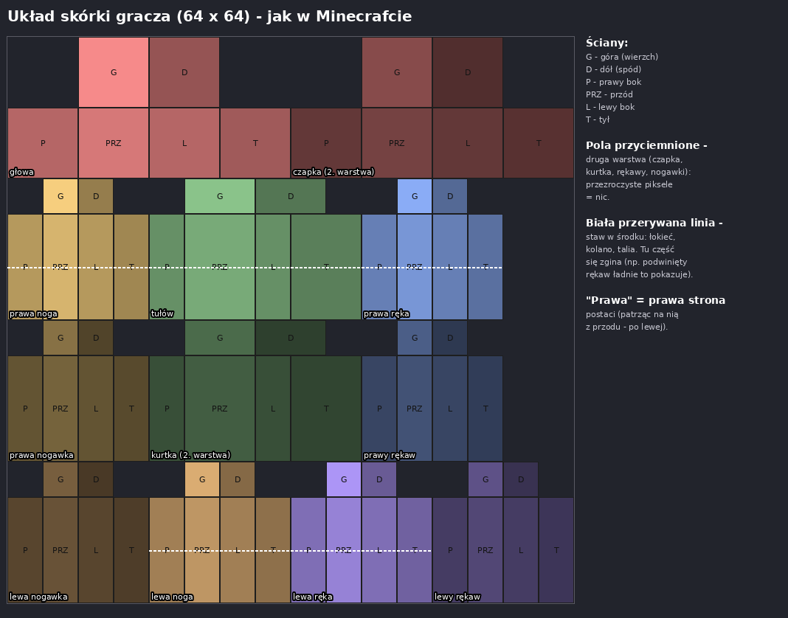
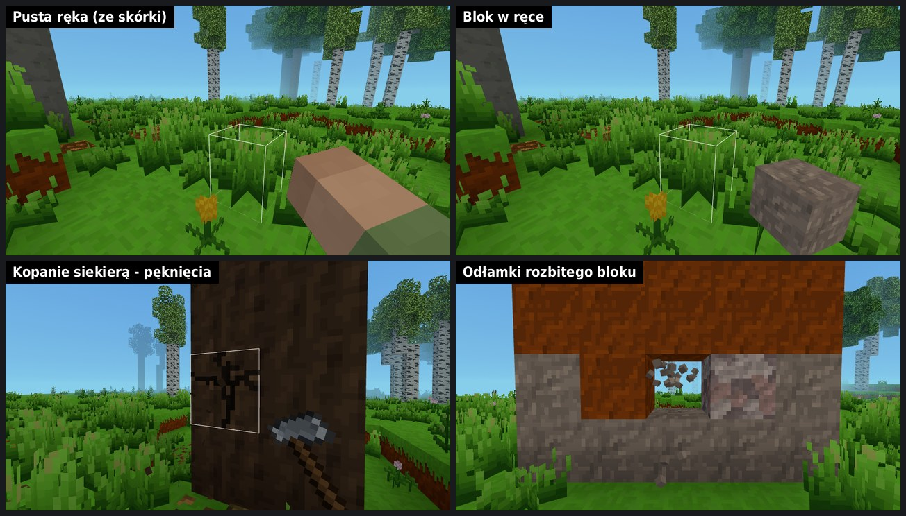

# Gracz - model, animacje, ruch

Trzeci rozdział gry (po świetle i terenie). Cel: postać gracza w stylu
Minecrafta, ale z większą liczbą stawów, żeby animacje chodzenia,
biegania, kucania i skakania były płynniejsze i bardziej naturalne.

## Gdzie jesteśmy

**Etap 1 - podstawy (zrobione):**

- **Model z 11 stawami** - ręce, nogi i tułów zginają się w środku
  (łokieć, kolano, talia).
- **Skórka 64 x 64** w układzie skórek Minecrafta (z drugą warstwą),
  domyślna skórka "Wędrowiec", wczytywanie własnej.
- **Widok z trzeciej osoby** (F5): z oczu / zza pleców / z przodu,
  kamera nie wchodzi w ściany.
- **Kucanie** (Shift) i **bieg** (2x W albo R) - też jako mechanika.
- **Animacje**: stanie (oddech), chód, bieg, kucanie, skradanie, skok,
  spadanie, lądowanie, machnięcie ręką, latanie, pływanie, obrót głowy i ciała.
- Blok z paska w prawej ręce, model oświetlony jak bloki (niebo, lampy,
  noc, dynamiczne światło, mgła).
- Narzędzia: `/kamera`, `/animacja`, `/model`, `/skorka`.

**Etap 2 - widok z oczu (zrobione):**

- **Ręka i przedmiot w ręce** z oczu gracza (prawy dolny róg ekranu).
- **Kołysanie widoku** przy chodzeniu i ugięcie kamery po upadku.
- **Kopanie** w trybie przygody: trzymany LPM, blok pęka, odłamki.
- Szczegóły: *Widok z oczu* i *Kopanie* niżej.

## Model

Wymiary w pikselach skórki - 32 piksele to wysokość gracza (1,8 bloku),
czyli jak w Minecrafcie:

```
              ┌──────┐
              │głowa │  8 x 8 x 8                    ── szyja
           ┌──┼──────┼──┐
   ramię   │  │klatka│  │  ramię    klatka 8 x 6 x 4 ── talia
           ├──┤      ├──┤  ── łokieć
 przedramię│  │brzuch│  │ przedramię brzuch 8 x 6 x 4 ── miednica
           └──┼──┬───┼──┘            ręce: 4 x 6 x 4 + 4 x 6 x 4
              │udo│udo│  ── biodra
              ├───┼───┤  ── kolana   nogi: 4 x 6 x 4 + 4 x 6 x 4
              │gol│gol│
              └───┴───┘
```

**Stawy (11):** miednica, talia, szyja, 2 barki, 2 łokcie, 2 biodra,
2 kolana. Kod: `src/player/PlayerModel.js` (lista `BONES`).

**Zginane klocki:** wyprostowana ręka wygląda jak jeden klocek 4 x 12 x 4
(jak w Minecrafcie), a w środku zgina się bez szpar - górna i dolna
połowa obracają się osobno, a wierzchołki w stawie leżą w połowie między
nimi. Dzięki temu tekstura jest ciągła, a zgięcie wygląda jak "ścięty"
klockowy łokieć.

Drugi styl - **klocki**: każda połowa jest osobnym, sztywnym klockiem
(wyraźnie widać dwie części, przy mocnym zgięciu - kanciasty staw).
Przełącza się w *Ustawienia → Gracz → Zgięcia rąk i nóg* albo
`/model klocki` / `/model gladki`.

**Kierunki:** model patrzy w stronę -Z, jego prawa strona to +X.

## Skórka

Obrazek PNG **64 x 64**, układ jak w skórkach Minecrafta (działa też
stary 64 x 32). Każda część ma 6 ścian, ułożonych jak siatka pudełka:



- **Druga warstwa** (czapka, kurtka, rękawy, nogawki) jest trochę
  większa od zwykłej - przezroczyste piksele = nic. Można ją wyłączyć:
  *Ustawienia → Gracz* albo `/model warstwa wyl`.
- **Staw jest w połowie** ręki, nogi i tułowia (biała przerywana linia
  na rysunku). Ubranie, które się tam zmienia (podwinięty rękaw, pasek,
  cholewka buta), ładnie pokazuje zgięcie.
- Szablon do zamalowania (kolorowe pola): `assets/textures/player/skin-szablon.png`.
- Domyślna skórka: `assets/textures/player/skin.png` ("Wędrowiec":
  oliwkowa kurtka z podwiniętymi rękawami, fioletowy szalik w kolorze
  lepidolitu, pasek w talii, skórzane buty do kolan).

**Własna skórka:** *Ustawienia → Gracz → Skórka - wczytaj plik...*
albo `/skorka plik`. Zostaje zapamiętana w przeglądarce;
`/skorka domyslna` wraca do domyślnej. Pasują też skórki z Minecrafta.

## Animacje

Animacje są **proceduralne** - nie ma zapisanych klatek, tylko wzory
z liczbami w `src/player/animations.js` (kąty w stopniach, z opisami).
Silnik: `src/player/PlayerAnimator.js`.

| animacja | co się dzieje |
|---|---|
| **stanie** | oddech (klatka lekko się unosi), ręce trochę odstają i kołyszą się |
| **chód** | nogi do przodu i do tyłu, kolano zgina się, gdy noga idzie do przodu; ręce na przemian z nogami, łokcie lekko zgięte; miednica i klatka skręcają się w przeciwne strony |
| **bieg** | dłuższe kroki, kolana mocno w górę, łokcie zgięte (praca rąk), pochylenie do przodu, podskok w fazie lotu |
| **kucanie** | miednica i klatka pochylone, uda do przodu, kolana zgięte, ręce przed sobą |
| **skradanie** | chód w kucki - krótkie kroki |
| **skok / spadanie** | noga z przodu idzie w górę, ręce lekko w bok; przy spadaniu ręce rozkładają się szerzej |
| **lądowanie** | ugięcie kolan - tym mocniejsze, im szybciej gracz spadał |
| **machnięcie** | prawa ręka do przodu i w dół (niszczenie / stawianie bloku), klatka skręca się za nią |
| **latanie** | nogi luźno, lekko z tyłu; przy ruchu pochylenie do przodu |
| **pływanie** | żabka: ręce do przodu i na boki, nogi kopią; płynąc - ciało prawie poziomo, w miejscu - utrzymywanie się na wodzie (liczby: `swim` w `animations.js`) |
| **głowa i ciało** | głowa patrzy tam, gdzie kamera (do 60° w bok); ciało obraca się za kamerą, a przy chodzeniu w bok - w stronę ruchu |

Najważniejsze sztuczki:

- **Faza kroku rośnie z przebytą drogą**, nie z czasem - nogi
  przebierają się tak szybko, jak gracz naprawdę idzie.
- **Stany mieszają się płynnie** (wagi 0-1): chód przechodzi w bieg,
  kucanie dochodzi do każdej pozy, skok wtapia się w krok.
- **Stopy zostają na ziemi** - miednica obniża się dokładnie o tyle, o ile
  skróciły się ugięte nogi (kucanie, lądowanie, kroki).

Strojenie: zmień liczbę w `animations.js`, odśwież grę i sprawdź
`/animacja chodzenie` (model idzie w miejscu, kamera z przodu)
i `/model tempo 0.25` (zwolnione 4 razy).

## Sterowanie i ruch

| klawisz | co robi |
|---|---|
| **Shift** | kucanie: 30% prędkości, gracz ma 1,5 bloku wysokości (wejdzie pod półtora bloku), oczy niżej, **nie spada z krawędzi** |
| **2x W** albo **R** + W | bieg: 130% prędkości, pole widzenia o 10% szersze; kończy się po puszczeniu W, przy kucaniu albo na ścianie |
| **F5** | widok: z oczu → zza pleców → z przodu |

Bieg nie jest pod Ctrl (jak w Minecrafcie), bo Ctrl+W w przeglądarce
zamyka kartę. Liczby: `CROUCH_...`, `SPRINT_...`, `THIRD_PERSON_DISTANCE`
w `src/config.js`. Odległość kamery: *Ustawienia → Gracz* albo
`/ustaw kamera 3`.

## Widok z oczu



Z oczu widać to, co trzymasz w prawej ręce - jak w Minecrafcie:

| w ręce | jak wygląda |
|---|---|
| nic | prawa ręka ze skórki (z rękawem z drugiej warstwy): pięść z prawej, trochę poniżej środka, reszta ręki idzie w prawy dolny róg |
| blok | sześcian obrócony tak, że widać dwa boki i wierzch |
| przedmiot (siekiera, owoc, szyszka...) i płaskie bloki (wieniec, ściółka) | płaski obrazek: głowica / czubek w głąb ekranu i do środka, trzonek w prawym dolnym rogu |
| roślina (kwiat, sadzonka) | dwie skrzyżowane płaszczyzny jak w świecie |

Ręka ma **własną scenę i kamerę** (pole widzenia stałe - 70°, nie
zmienia się przy biegu), rysowaną na samym końcu na wyczyszczonej
głębi - nigdy nie wchodzi w ścianę. Oświetla się jak model gracza
(niebo, lampy, lampa w ręce, meteoryt, noc). Na węższym ekranie
(telefon pionowo) przesuwa się bliżej środka, żeby nie uciekła za
krawędź.

**Animacje ręki:**

- **machnięcie** - przy każdym kliknięciu i przy każdym uderzeniu
  w trakcie kopania: pusta ręka - cios do przodu, blok i przedmiot -
  szerokim łukiem w górę i do środka ekranu, potem w dół (0,3 s; przy
  kopaniu tyle, ile trwa jedno uderzenie, więc machnięcia idą jedno za
  drugim bez przerw),
- **wyjęcie** - po zmianie miejsca na pasku ręka chowa się w dół i wraca
  z nowym przedmiotem (0,22 s),
- **kołysanie** przy chodzeniu (ósemka, w rytm kroków; przy biegu
  mocniej), w miejscu - lekki oddech,
- **spóźnianie się** za obrotem kamery - ręka "płynie" za wzrokiem.

**Kołysanie widoku**: przy chodzeniu kamera kiwa się w rytm kroków (na
boki i w dół, z lekkim przechyłem; `VIEW_BOB_HEIGHT`, `VIEW_BOB_STEPS`
w `src/config.js`), a po upadku z wysoka na chwilę się ugina. Kiwa się
tylko obraz - celowanie i ruch liczą się z oczu gracza. Wyłączenie:
*Ustawienia → Gracz → Kołysanie przy chodzeniu* albo `/ustaw kolysanie wyl`;
samą rękę wyłącza `/ustaw reka wyl`.

Strojenie: pozy (położenie, obrót, wielkość) są w `POSES` na początku
`src/player/FirstPersonHand.js` - w układzie kamery: +X w prawo, +Y
w górę, -Z do przodu.

## Kopanie

W **trybie przygody** blok trzeba kopać - trzymać LPM (na telefonie:
przytrzymać palec albo przycisk z kilofem):

- co 0,25 s ręka uderza: stuk (dźwięk kroku po tym bloku) i kilka
  odłamków z trafionej ściany,
- blok **pęka** - 10 etapów pęknięć (`src/interaction/BlockCracks.js`,
  tekstura z `tools/pekniecia.py`),
- po czasie kopania blok znika, a **odłamki** (małe sześciany w kolorach
  pikseli jego tekstury, przyciemnione jak światło w tym miejscu) sypią
  się, odbijają od ziemi i znikają (`src/rendering/BlockDebris.js`),
- puszczony LPM albo inny blok pod celownikiem - kopanie od nowa,
- po rozbiciu bloku 0,15 s przerwy przed następnym.

| bloki | czas |
|---|---|
| rośliny | od razu |
| liście | 0,35 s |
| lampy | 0,45 s |
| piasek, trawa, ziemia, błoto, glina | 0,55-0,6 s, **łopatą ~0,2 s** |
| żwir | 0,7 s, łopatą 0,23 s |
| wapień, piaskowiec | 1,8 s, **kilofem 0,6 s** |
| drewno (pnie, deski) | 2 s, **siekierą 0,67 s** |
| kamień, łupek | 2,2 s, kilofem 0,73 s |
| lepidolit | 2,5 s, kilofem 0,83 s |
| granit, bazalt | 2,8 s, kilofem 0,93 s |
| meteoryt | 4,5 s, kilofem 1,5 s |

Narzędzia (siekiera, kilof, łopata) robi się z patyków i skał -
przepisy: `docs/wiki/przepisy.md`.

Liczby: `BREAK_SECONDS` (dla materiałów), `LEAVES_BREAK_SECONDS`,
`TOOL_MATERIALS`, `TOOL_SPEED`, `MINING_HIT_SECONDS`, `MINING_DELAY_SECONDS` w
`src/config.js`, a twardość pojedynczych skał - `hardness`
w `src/blocks/BlockRegistry.js`. W **trybie kreatywnym** bloki znikają
od razu, a trzymany LPM niszczy kolejny co 0,25 s
(`CREATIVE_REPEAT_SECONDS`). Odłamki lecą w obu trybach.

## Narzędzia

| komenda | do czego |
|---|---|
| `/kopanie [blok \| lista]` | czas kopania bloku, na który patrzysz (albo podanego); `lista` - wszystkie czasy |
| `/ustaw reka wl\|wyl`, `/ustaw kolysanie wl\|wyl` | ręka w widoku z oczu, kołysanie widoku |
| `/kamera [oczy \| tyl \| przod]` | widok kamery (jak F5) |
| `/animacja <nazwa>` | podgląd animacji w miejscu: `stanie`, `chodzenie`, `bieg`, `kucanie`, `skradanie`, `skok`, `machanie`, `latanie`, `plywanie`, `plywanie-w-miejscu`; `/animacja wyl` |
| `/model` | informacje; `/model gladki` / `klocki`, `/model warstwa wl\|wyl`, `/model tempo 0.25` |
| `/skorka plik`, `/skorka domyslna` | własna skórka / domyślna |
| F3 | w debugu: czy gracz kuca / biegnie, widok kamery, wagi animacji |

## Plan - co dalej

1. **Więcej animacji**: obrót w miejscu (przestępowanie z nogi na nogę),
   lądowanie z dużej wysokości (przyklęk), zmęczenie po długim biegu,
   pływanie (razem z prawdziwą wodą z rozdziału o terenie), wspinanie,
   siadanie, emotki (`/emotka machanie`, `/emotka taniec`).
2. **Szczegóły modelu**: smukłe ręce (3 piksele, jak skórki "Alex"),
   mruganie oczami, szalik / peleryna, które powiewają przy biegu.
3. **Edytor póz** - ustawianie stawów myszką i zapisywanie póz / klatek
   animacji do pliku (np. do emotek).
4. **Cień pod graczem** (miękka plama na ziemi).
5. **Narzędzia do kopania** - kilof (skały szybciej), łopata (ziemia,
   piasek), może różne materiały narzędzi.
6. Ten sam model dla innych postaci (NPC, w przyszłości inni gracze).

## Do ustalenia z Kamilem

- Który styl zgięć ma być domyślny: gładki czy klocki?
- Czy bieg pod R + dwuklik W pasuje (Ctrl odpada przez przeglądarkę)?
- Wygląd domyślnej skórki - zostaje "Wędrowiec", czy robisz własną?
