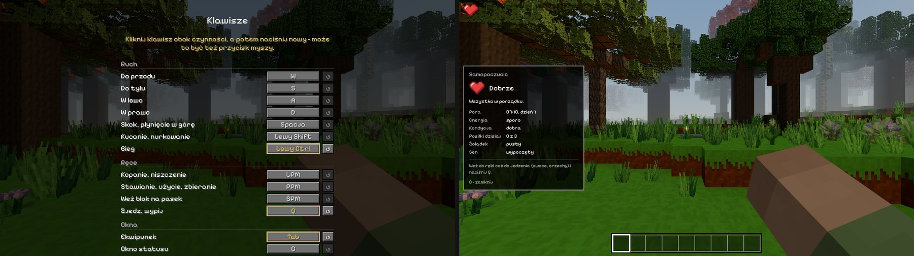

# Klawisze do ustawienia przez gracza (0.99.0)

Pomysł Kamila: gracze mają swoje nawyki, więc każdą czynność w grze
można przypisać do innego klawisza albo przycisku myszy.

## Dla gracza

**Ustawienia → Gracz → Klawisze** (także z pauzy w grze). Na liście są
wszystkie czynności w czterech grupach:

| Grupa | Czynności (domyślny klawisz) |
|---|---|
| **Ruch** | do przodu (W), do tyłu (S), w lewo (A), w prawo (D), skok (Spacja), kucanie (Shift), bieg (R) |
| **Ręce** | kopanie (LPM), stawianie i użycie (PPM), weź blok na pasek (środkowy przycisk myszy), zjedz / wypij (F) |
| **Okna** | ekwipunek (E), okno statusu (C), mapa (M), księga osiągnięć (L), czat (T), komenda (/), widok (F5), napisy debugowania (F3) |
| **Pasek bloków** | miejsca 1-9 (lista zwinięta - rozwija się kliknięciem) |

- **Zmiana:** kliknij klawisz obok czynności i naciśnij nowy. Może to
  być klawisz, przycisk myszy (także środkowy i boczne) - klawisz może
  zastąpić przycisk myszy i odwrotnie. **Esc** w trakcie czekania
  zostawia wszystko po staremu.
- **Zajęty klawisz:** czynności zamieniają się klawiszami, więc żadna
  nie zostaje bez klawisza i żaden klawisz nie robi dwóch rzeczy.
- **↺** obok czynności przywraca jej domyślny klawisz, przycisk
  *Domyślne klawisze* - wszystkie. *Przywróć domyślne* w ustawieniach
  (grafika, dźwięk...) klawiszy nie rusza.
- Zmienione klawisze są podkreślone, a przycisk w ustawieniach mówi,
  ile ich jest (*Klawisze: zmienione (3)*).
- Nie da się przypisać: **Esc** (pauza), F8 (zgłoszenie problemu), F11,
  F12 i klawiszy systemu.
- Samouczek, poradnik, okno statusu, ekwipunek, mapa i podpowiedzi na
  pasku pokazują **klawisze gracza**, nie domyślne.
- Zapis jest razem z ustawieniami gry (na tym urządzeniu), wspólny dla
  wszystkich światów. Na telefonie (sterowanie dotykowe) ekranu nie ma.

W przeglądarce Ctrl i Alt razem z innymi klawiszami mogą uruchamiać jej
skróty (Ctrl+W zamyka kartę) - w aplikacji na komputer tego problemu
nie ma.

Komenda: `/ustaw klawisze` (ile zmieniono), `/ustaw klawisze domyslne`.

## Napisy debugowania i zegar

Od 0.99.0 **napisy debugowania (F3) są na początku wyłączone** - nowy
gracz widzi czysty ekran. U kogoś, kto grał wcześniej, wyłączają się
raz przy aktualizacji; F3 (albo `/ustaw debug wl`) włącza je z powrotem
i to już zostaje.

Godzina była dotąd tylko w tych napisach, więc **okno statusu**
(klawisz C) ma nowy wiersz *Pora*: godzina i numer dnia. Samouczek
w kroku o śnie też mówi, która jest godzina.

## Dla programisty

Jedna warstwa tłumaczenia, bez zmian w grze: **gra dalej pyta
o domyślne kody** (`isKeyDown('KeyW')`, `isMouseDown(0)`), a wciśnięty
klawisz jest najpierw tłumaczony na kod czynności, do której gracz go
przypisał.

- `src/input/bindings.js` - lista czynności (`ACTIONS`: nazwa, domyślny
  kod, grupa), klasa `Bindings` (`logical`, `assign`, `restore`,
  `reset`), nazwy klawiszy (`keyLabel`) i podpowiedzi:
  `formatKeys('Naciśnij [eat].')` → `Naciśnij F.`, `{break}` → `lewy
  przycisk myszy`; `plainKeys(tekst)` podmienia w gotowych napisach
  „LPM" i „PPM". Kody myszy: `Mouse0`...`Mouse4`.
- `src/input/InputManager.js` - `press` / `release` tłumaczą klawisze
  i przyciski; `onMouseKey` zgłasza oknom czynność przypisaną do myszy.
- `src/app/keys.js`, `src/ui/InventoryScreen.js` - klawisze okien
  czytane przez `bindings.logical` (ekwipunek przypisany do środkowego
  albo bocznego przycisku myszy zamyka się tym samym przyciskiem).
- `src/ui/Menu.js` (`showKeys`), `src/ui/menu.css` (`.keys-*`).
- Ustawienie `keys` (`src/settings/Settings.js`): tylko zmienione
  czynności, `{ czynność: kod }`; `cleanBindings` naprawia uszkodzony
  zapis. `SETTINGS_REVISION = 3` wyłącza raz napisy debugowania.
- **Nowa czynność:** wpis w `ACTIONS`; w grze pytaj o jej domyślny kod.
  **Nowa podpowiedź z klawiszem:** nazwa czynności w nawiasach
  (`[inventory]`) i `formatKeys`.
- Test: `node tools/sprawdz_klawisze.mjs` (m.in. czy każdy klawisz,
  o który pyta gra, jest na liście czynności).
