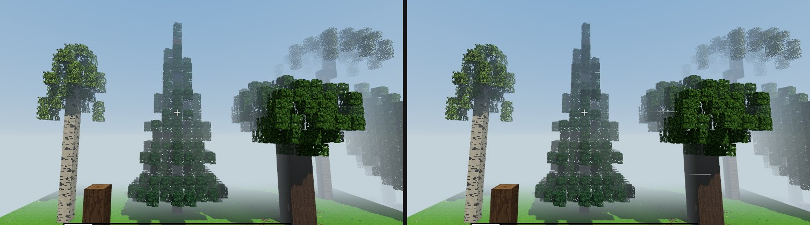

# Kołysanie drzew

Druga wersja części C projektu [drewno.md](drewno.md) (rozdział 3).
**W grze od 1.40.0.**

## Co widać

Całe drzewo - **pień z koroną** - lekko wygina się z wiatrem: przy ziemi
wcale, im wyżej, tym bardziej. Wiatr przygina je w swoją stronę
i puszcza powolnymi podmuchami; czubek zatacza przy tym małą pętlę na
boki. Części liści dalej drżą osobno, jak dotąd.

| Jak mocno | Drzewa |
|---|---|
| mocno | palma, brzoza, osika, eukaliptus, świerk, jodła, modrzew |
| średnio | sosna, lipa, olcha, wierzba, klon, wiśnia, jakaranda, miłorząb, jabłoń, cypryśnik, namorzyn, drzewo Jozuego, dracena |
| ledwo | dąb, buk, oliwka, akacja, cedr, araukaria, sosna oścista, kosodrzewina |
| tylko liście | baobab, sekwoja, puchowiec, banian |

- **Wiatr z pogody**: w ciszy drzewa ledwo oddychają (12% siły),
  w wichurze kołyszą się w pełni. Kierunek jest kierunkiem wiatru.
- **Ile**: brzoza 12 m w wichurze - czubek ok. ćwierć bloku; dąb tej
  samej wysokości cztery razy mniej. Najwyżej 0,45 bloku.
- To **sam wygląd**: bloki, kolizje i celowanie zostają na miejscu. Na
  wysokości oczu pień praktycznie stoi, więc siekiera trafia tam, gdzie
  widać.
- Wyłącza je to samo ustawienie, co **kołysanie roślin** (Ustawienia →
  Modele).

## Co jest drzewem

Kołysze się to, co wygląda na żywe drzewo:

- **liście** każdego gatunku - zawsze,
- **pień** tylko wtedy, gdy **w tej samej kolumnie nad nim są liście
  jego gatunku**. Słup albo ściana z pni postawiona ręką stoi.

Wysokość liczy się od ziemi pod kolumną (pierwszy pełny blok, który nie
jest drzewem).

## Wydajność

- Kołysanie liczy **karta graficzna** w programie cieniującym terenu
  i liści - procesor w trakcie gry nic nie robi.
- Nie ma nowych danych w siatce: wysokość jedzie w bajcie, który pnie
  miały pusty, a liście oddały (siła drżenia części wynika teraz z jej
  fazy).
- Przy budowie siatki chunka dochodzi jedno przejście kolumny w dół dla
  kolumn, w których stoi drzewo (pamiętane na czas budowy).

## Komenda

`/kolysanie` ([komendy.md](komendy.md)): siła teraz, `<0-100>` ustawia
ją na stałe, `pogoda` wraca do wiatru.

## Kod

| Plik | Co robi |
|---|---|
| `src/blocks/treeSway.js` | giętkość gatunków, bajt wysokości, wygięcie, siła wiatru |
| `src/rendering/PlantWind.js` | `treeSwayOffset` (GLSL) i `uTreeWind` |
| `src/rendering/ChunkMesher.js` | wysokość nad ziemią w wierzchołkach pnia i liści |
| `src/rendering/BlockRenderData.js` | materiał terenu (pień) i liści |
| `tools/sprawdz_kolysania.mjs` | testy |

## Luki

- **Cienie drzew się nie kołyszą** - cień zostaje tam, gdzie drzewo
  stałoby prosto (liście od zawsze drżą bez cienia; przy mocnym wietrze
  cień czubka może się rozmijać z koroną o ułamek bloku).
- **Dalekie drzewa** (uproszczony teren w oddali) stoją.
- Rzeczy **przyczepione do pnia** (pochodnia, huba, pnącze, karb) nie
  idą razem z nim; na wysokości gracza różnica jest niewidoczna, wyżej
  może być widać szczelinę.
- **Konar bez liści nad sobą** stoi, choć liście obok się kołyszą.
- Pień domu stojącego **dokładnie pod koroną** tego samego gatunku
  będzie się lekko wyginał.
- Liście posadzone jako żywopłot też się wyginają (nisko - prawie nic).
- W chwili ścięcia padająca bryła startuje z pozycji prostej - przy
  wichurze czubek może drgnąć.
- Pomiaru wpływu na szybkość budowy siatek nie robiłem na prawdziwym
  sprzęcie.
