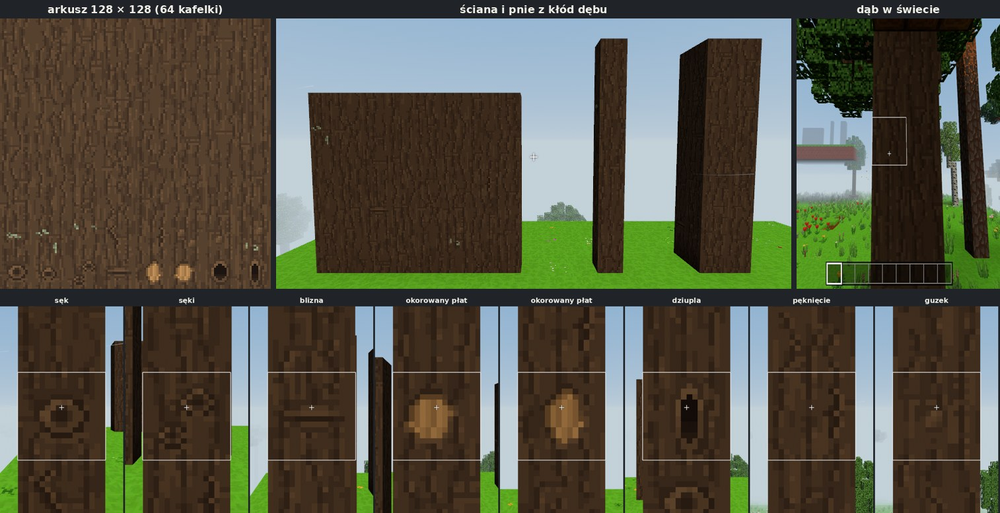

# Arkusze kory

Od wersji 1.7.0 (pomysł Kamila). Na razie: **dąb**.

Bok pnia nie jest już jednym obrazkiem 16 × 16 powtarzanym na każdym
bloku. Pień ma **arkusz 128 × 128 pikseli** - 64 kafelki kory (8 × 8) -
a gra dla każdego boku każdego bloku wybiera jeden z nich.

## Jak to działa

- Wybór jest **losowy z wagami**, osobny dla każdej z czterech stron
  bloku. Zależy od miejsca bloku w świecie, więc w tym samym miejscu jest
  zawsze ten sam kafelek.
- **Zwykła kora** (48 odmian) to ok. 94% boków. Reszta to dodatki:

| Dodatek | Kafelków | Jak często (część boków) |
|---|---|---|
| porosty, pęknięcia, guzki | 8 | ok. 3,9% |
| sęki (zarośnięte ślady po gałęziach), blizna | 4 | ok. 1,3% |
| okorowany płat (widać jasne drewno) | 2 | ok. 0,5% |
| dziupla | 2 | ok. 0,3% |

  Drobne dodatki widać na większości dębów, sęk albo okorowany płat co
  kilka drzew, dziuplę rzadko (dokładna liczba zależy od wielkości
  drzewa).
- To dalej **ten sam blok**: ten sam przedmiot, zapis i zasady. Kłoda
  postawiona przez gracza też dostaje kafelek ze swojego miejsca, więc
  czasem trafi się na niej sęk albo dziupla.
- Wierzch i spód pnia (słoje) bez zmian. Ikonka w ekwipunku i kłoda
  w dłoni pokazują zwykły kafelek.
- Dziupla jest rysunkiem na płaskiej ścianie (bez wgłębienia).

## Zasada rysowania arkusza

Żeby dowolny kafelek pasował nad i pod dowolnym innym:

1. **Na górnej i dolnej krawędzi każdego kafelka bruzdy kory są w tych
   samych kolumnach** (dąb: piksele 2, 7 i 12, najciemniejszy ton).
2. **Lewa i prawa krawędź to grzbiet kory** (bez bruzdy) - pasuje też
   obok siebie na grubych pniach.
3. W środku kafelka bruzdy mogą się wić, rozszerzać i przerywać.
4. Dodatki (sęk, dziupla...) trzymają się środka - nie dotykają
   krawędzi.

Arkusz można namalować ręcznie - gra go tylko tnie. Kolejność kafelków:
wierszami od góry; rodzaj każdego kafelka (od niego zależy waga) jest
w `src/rendering/BarkSheets.js`.

## Wydajność

- Rysowanie: **bez zmian** - te same ściany, ten sam materiał, to samo
  polecenie rysowania. Zmienia się tylko, który kawałek atlasu jest na
  ścianie.
- Budowanie chunka: wybór kafelka to jedno mieszanie liczb i jeden odczyt
  z tablicy - ok. 10 ns na bok pnia.
- Pamięć: arkusz to 64 kratki atlasu (8 wierszy). Dla wszystkich 19
  gatunków drzew byłoby to ok. 150 wierszy - dlatego mniejsze gatunki
  mogą dostać mniejszy arkusz.

## Nowe drzewo z arkuszem

1. Arkusz 128 × 128 według zasady wyżej (ręcznie albo funkcją
   w `tools/tekstury_kory.py`).
2. Wpis w `SHEETS` i `ATLAS_ROW` w `tools/tekstury_kory.py`, uruchomić
   `python3 tools/tekstury_kory.py`.
3. Wpis w `BARK_SHEETS` w `src/rendering/BarkSheets.js` (blok pnia,
   nazwa arkusza, rodzaje 64 kafelków).
4. `node tools/sprawdz_kore.mjs`.

## Znane ograniczenia

- Paczka tekstur gracza, która podmienia zwykły bok pnia dębu
  (`oak_log_side`), nie zmienia arkusza - na pniach dalej widać arkusz
  gry.
- Pozostałe drzewa mają jeszcze jeden obrazek kory.

## Dla programisty

- `tools/tekstury_kory.py` - rysuje arkusz i dopisuje go do atlasu
  (jeden kafelek atlasu 8 × 8 kratek).
- `src/rendering/BarkSheets.js` - `BARK_SHEETS`, `BARK_WEIGHTS`,
  `barkLookup`, `barkTile(lookup, x, y, z, ściana)`.
- `src/rendering/BlockRenderData.js` - `barkSheet`: UV 64 kafelków.
- `src/rendering/ChunkMesher.js` - `addCubeFaces` bierze UV boku
  z arkusza.
- Test: `node tools/sprawdz_kore.mjs`.
