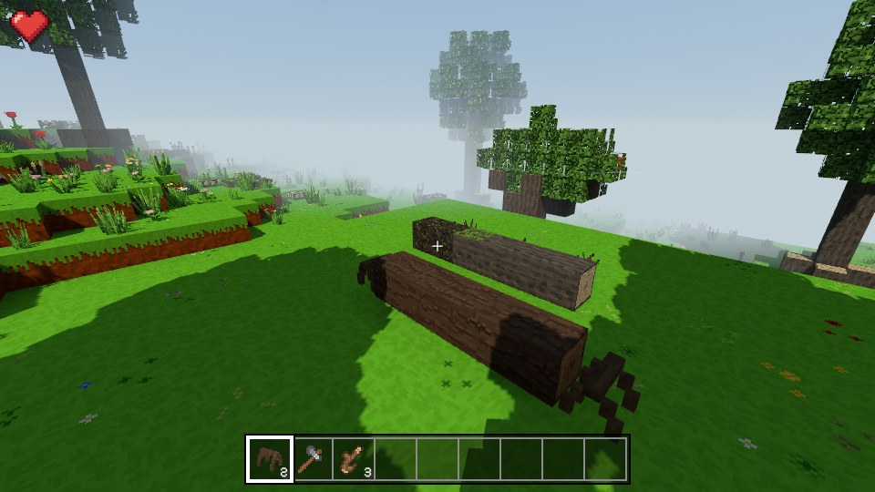

# Kozły

Trzecia, ostatnia wersja części B projektu [drewno.md](drewno.md)
(rozdział 4), pomysł Kamila. **W grze od 1.38.0.** Wcześniej:
[scinanie.md](scinanie.md), [powalone-drzewa.md](powalone-drzewa.md).

## Po co

Ścięte drzewo zostawia leżący pień. Na ziemi tnie się go źle - siekiera
bije w grunt. **Kozioł** podpiera pień: postaw po jednym **na obu
końcach leżącego pnia**, a pień między nimi leży na kozłach.

| | Na ziemi | Na kozłach |
|---|---|---|
| LPM siekierą: metr pnia → pień | 3 razy wolniej | zwykłe tempo |
| kucnięcie + LPM siekierą: metr pnia → 4 polana | nie da się | tak |
| PPM (siekierą albo pustą ręką): kora | tak | tak |

Kozły nie są obowiązkowe (decyzja Kamila) - pierwsze drzewo da się
pociąć bez nich, tylko wolno. Szybko się opłacają.

## Kozioł

- **Przepis**: 3 konary w siatce wytwarzania (bez narzędzi). Konary
  spadają z korony każdego ściętego drzewa, więc pierwsze drzewo samo
  daje materiał.
- **Stawianie**: PPM na ziemi za końcem pnia. Belka kozła ustawia się
  sama w poprzek pnia; bez pnia obok - w poprzek spojrzenia. Gra mówi,
  czy pień leży już na kozłach, czy trzeba postawić drugi.
- **Zabieranie**: kozioł rozbija się szybko (także ręką) i wraca do
  ekwipunku - stawiasz go przy następnym pniu.
- Gruby pień (2 × 2 i grubsze) potrzebuje tak samo **jednego kozła na
  koniec** - może stać przy dowolnym z bloków czoła.

## Co znaczy „na kozłach"

Gra nie pamięta żadnych stanowisk - sprawdza bloki przy każdym kopaniu
(`src/game/Sawhorses.js`):

1. Od kopanego bloku w obie strony wzdłuż pnia: jak daleko ciągnie się
   leżący pień (zdrowy albo okorowany, ta sama oś, ta sama wysokość).
2. Za każdym końcem: czy stoi kozioł. Szukamy dalej wzdłuż osi przez
   **puste miejsca po już odciętych metrach** (do 24 bloków, do pierwszej
   przeszkody) - dzięki temu kozłów nie trzeba przestawiać, gdy pień się
   skraca. Kozioł może stać o blok w bok albo w górę/dół.
3. Kozioł po obu stronach → pień leży na kozłach.

Spróchniałe kawałki pnia przerywają odcinek (wyłamuje się je ręką).

## Łupanie na opał

Kucając, siekierą w pień na kozłach: zamiast pnia dostajesz **4 polana**
gatunku, tak samo mokre, jak świeżo porąbane w siatce wytwarzania
([ogniska.md](ogniska.md) - wilgotność). Okorowany pień daje te same
polana. Przepis „pień + siekiera" w siatce wytwarzania zostaje.

## Komenda

`/kozly` ([komendy.md](komendy.md)): opis pnia pod celownikiem, `daj`,
`postaw [gatunek] [długość]`.

## Kod

| Plik | Co robi |
|---|---|
| `src/blocks/sawhorse.js` | blok kozła (15510-15511) |
| `src/game/Sawhorses.js` | odcinek pnia, kozły na końcach, tempo, łupanie, podpowiedzi |
| `src/world/ShapeBoxes.js` | kształt kozła (belka i cztery nogi) |
| `src/interaction/BlockPlacer.js` | belka w poprzek pnia |
| `tools/sprawdz_kozlow.mjs` | testy |

## Luki

- **Siekiera nie zużywa się** - „dwa razy szybsze zużycie bez kozłów"
  przyjdzie z twardością i zużyciem narzędzi (część C).
- Kłoda **nie odpada „z tego końca, przy którym stoisz"** - tniesz ten
  metr, w który celujesz.
- Przepis na opał w siatce wytwarzania **zostaje** (projekt mówi, że
  kozły go zastąpią) - żeby nie zabierać opału graczom bez kozłów.
- Drugi przepis na kozioł (4 patyki i sznur) - nie ma.
- Kozioł ma teksturę kory dębu niezależnie od gatunku konarów.
- **Piła** (deski prosto z pnia) - później.
- Pień leży na ziemi także „na kozłach" - nie unosi się na belki.
