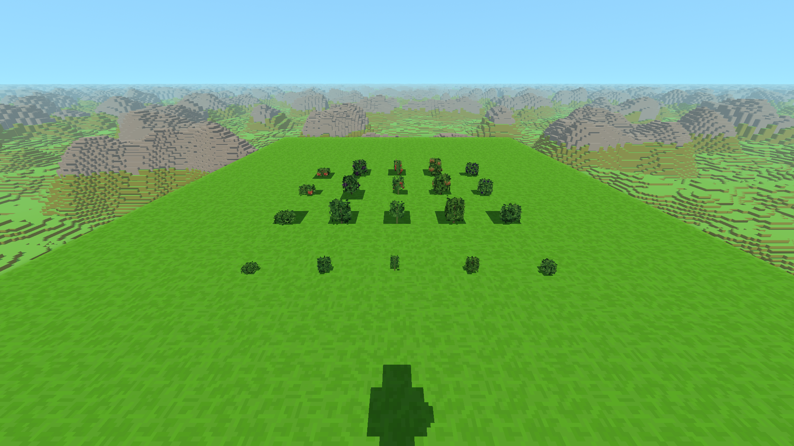

# Krzaki owocowe i owoce 3D — 0.50.0

Truskawka, jeżyna, chili i leszczyna korzystają z puszystych, wycinanych
liści borówki oraz owoców z bryłek o siatce 1/16 bloku. To podmiana
wyglądu istniejących roślin, także w zapisanych światach; nie wymaga
ponownego generowania terenu. ID bloków, czas wzrostu i plony zostają
takie jak w 0.49.0.

| Roślina | Sylwetka | Owoce na pełnym modelu |
| --- | --- | --- |
| Truskawka | Niska, szeroka, jasna rozeta | 5 czerwonych owoców z zielonymi szypułkami i pestkami |
| Jeżyna | Wyższy, ciemniejszy, luźny krzew | 7 ciemnych, ziarnistych owoców |
| Chili | Wąska korona nad widoczną łodygą | 5 wydłużonych, zagiętych papryczek |
| Leszczyna | Najwyższy, gęstszy krzew z brązowym pędem | 6 brązowych orzechów w zielonych okrywach |

Każdy gatunek ma cztery dotychczasowe etapy. Młoda roślina płynnie
powiększa się; owoce wyrastają wokół własnych środków. Posadzenie,
zbiór, pełny ekwipunek i usunięcie używają krótkich reakcji w kierunku
borówki. Wspólny limit 12 aktywnych animacji obejmuje również borówkę
i rośliny z paczek. Nieruchome krzaki pozostają w siatkach chunków.

Owoce w ekwipunku to podglądy tych samych modeli 3D, które rosną na
krzakach. W dłoni również są bryłami. Dotyczy to wszystkich pięciu
gatunków, także borówki: jej owoc pochodzi bezpośrednio z oryginalnego
modelu i zachowuje jego UV. Ikony są liczone raz i przechowywane w
pamięci, bez osobnego kontekstu WebGL dla każdego przedmiotu.

Geometria: `src/rendering/FruitBushGeometry.js`; zasady animacji:
[animacje-roslin.md](animacje-roslin.md). Sprawdzenia regresji:
`tools/sprawdz_krzaki_owocowe.mjs` (w pełnym `npm test`).

## Sprawdzenia w grze

Próba na osobnym profilu Electron 44.4.5, w natywnej rozdzielczości
1920×1080, na RTX 3050 Laptop (ANGLE / D3D11), laptop na zasilaczu.
Normalne zapisy zainstalowanej gry nie były używane. Seed 2138286349.

Wszystkie pięć gatunków przeszło zbiór z wolnym i pełnym ekwipunkiem,
odrastanie części owoców, pełne owocowanie, zmianę wielkości sadzonki
oraz zniszczenie w trakcie wzrostu. Sprawdzone także zapis i ponowne
wczytanie modeli oraz ikony i owoce w dłoni. Podczas oględzin poprawiono
szczelinę na owocu borówki: podwójny margines UV przesuwał krawędź
jednopikselowego fragmentu do przezroczystego pola atlasu. Test
`sprawdz_uv_owocow.mjs` odtwarza ten przypadek na rzeczywistym układzie
atlasu i sprawdza, że zwykłe przedmioty zachowują dotychczasowe UV.

Zestaw regresji `npm test` przeszedł. Po końcowych poprawkach wysokości,
kategorii i UV ponownie przeszły celowane sprawdzenia krzaków i borówki.
Eksport wiki korzysta z tego samego renderera ikon i rzeczywistych PNG;
odświeżone zostały ikony pięciu owoców i czterech etapów pięciu krzaków.

Surowe wyniki i skrypt lokalnej próby:
[pomiary/krzaki-owocowe-0.50.0](pomiary/krzaki-owocowe-0.50.0/).

## Wydajność

Ta sama pozycja i ustawienia w obu wersjach: 400 krzaków pięciu gatunków,
pełne bloki 48, daleki teren 8192, cienie 3, renderowanie 100%, FOV 75.
Każdy pomiar: 10 sekund rozgrzewki i 30 sekund próbkowania, bez testów
CPU w tle. VSync pozostaje włączony na ekranie 144 Hz. Czas GPU pochodzi
z `EXT_disjoint_timer_query_webgl2`; 1% low to odwrotność średniego czasu
najwolniejszego 1% klatek. To lokalny test krzaków, nie gwarancja tej samej
płynności w każdym fragmencie świata.

| Próba | Średnie FPS | 1% low FPS | P99 klatki | Średni czas GPU |
| --- | ---: | ---: | ---: | ---: |
| 0.49.0, 400 nieruchomych | 143,88 | 104,46 | 8,8 ms | 3,72 ms |
| 0.50.0, 400 nieruchomych | 144,02 | 115,09 | 7,9 ms | 5,48 ms |
| 0.49.0, zmiana 24 etapów co 2,4 s | 141,72 | 75,94 | 11,6 ms | 4,01 ms |
| 0.50.0, zmiana 24 etapów co 2,4 s | 138,21 | 45,18 | 13,9 ms | 5,91 ms |
| 0.50.0, pojedynczy wzrost co 2,4 s | 142,44 | 67,39 | 10,3 ms | 5,76 ms |

Bogatsza geometria zwiększa koszt GPU statycznej sceny o około 1,76 ms.
Liczba wywołań renderowania rośnie z 242 do 245; modele nadal są łączone
w siatki chunków. Limit odświeżania ekranu ukrywa część różnicy w średnich
FPS, dlatego obok podano czas GPU.

Masowa próba wymusza zmiany etapów 24 blisko położonych roślin naraz,
nie odtwarza ich naturalnych odstępów wzrostu. W 0.49.0 animowało się
wtedy najwyżej 5 borówek; w 0.50.0 animuje się do 12 krzaków różnych
gatunków. Średni koszt aktualizacji animacji wzrósł z 0,23 do 1,09 ms,
a najdłuższa klatka z 19,5 do 34,3 ms. **W tym stresowym przypadku nie
utrzymuje się stale 60 FPS**. W próbie pojedynczego wzrostu aktualizacja
animacji zajmowała średnio 0,13 ms, a 1% low wyniósł 67,39 FPS; pojedyncza
najdłuższa klatka nadal trwała 28,3 ms. Wynik nie jest obietnicą braku
każdego chwilowego przycięcia.

Oględziny i pomiary wykonano na kodzie `cf6db57`; bazą porównania jest
`b299f76` (0.49.0). Końcowe pomiary używały takiego samego widoku:
81 wczytanych chunków i 496 kafelków dalekiego terenu. Materiały GPU
przeszły sprawdzenia WebGL 2 oraz wariantu WebGL 1, bez błędów JavaScript.

## Kadry z gry

Zbliżenia krzaka i owocu w dłoni:
[truskawka](pomiary/krzaki-owocowe-0.50.0/after-strawberry.png),
[jeżyna](pomiary/krzaki-owocowe-0.50.0/after-blackberry.png),
[chili](pomiary/krzaki-owocowe-0.50.0/after-chili.png),
[leszczyna](pomiary/krzaki-owocowe-0.50.0/after-hazel.png),
[borówka](pomiary/krzaki-owocowe-0.50.0/after-blueberry.png).
