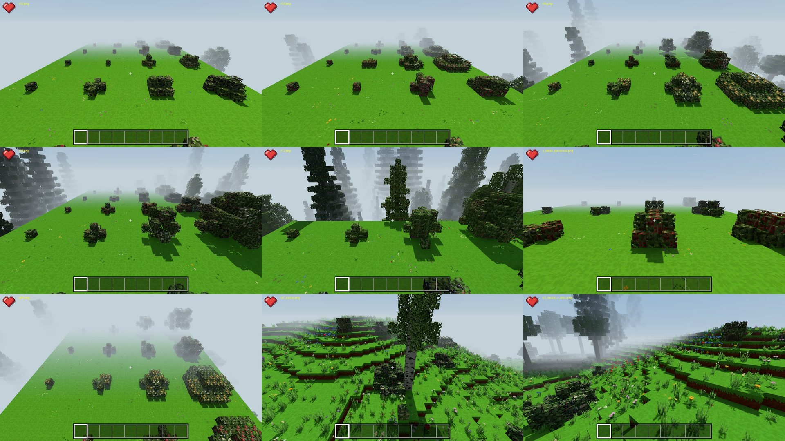

# Krzewy jagodowe (1.17.0)

Pierwsza część roślin jadalnych z paczki Kamila `food_pack_all`
(19 roślin, tekstury 16 × 16 - materiały autorskie Kamila). W 1.17.0
weszły **krzewy jagodowe**; rośliny niskie (żurawina, brusznica,
truskawka i poziomka, dynia i cukinia) oraz pnącza (winorośl, chmiel,
kiwi, marakuja, fasola i groch) czekają na kolejne wydania.

Na zrzutach (renderer programowy, krótki zasięg widzenia): galeria
`/krzewy galeria` - w każdym rzędzie od prawej jeden blok, mały krzak,
dojrzały krzew i stara kępa (porzeczki, agrest, maliny, dzika róża, bez,
rokitnik, leszczyna) - oraz dzikie zarośla jeżyn na stoku w brzezinie.
Aronii na zrzutach nie ma: jej pędy poprawiałem już po nich.

## Czym krzew różni się od krzaka

Krzaki owocowe z 0.50.0 (borówka, truskawka, jeżyna, chili, leszczyna) to
jeden blok z modelem 3D. **Krzew jagodowy jest budowlą z bloków** - tak
jak na podglądach z paczki: liście z owocami i kwiatami, czasem pędy albo
pień. Stare krzaki zostają bez zmian.

| Krzew | Odmiany | Owoc (przedmiot) | Sylwetka | Gdzie rośnie dziko |
| --- | --- | --- | --- | --- |
| Aronia | - | aronia | prosty krzew na pędach, do 3 bloków | mokradła, brzeziny, łąki |
| Porzeczka | czerwona, czarna | czerwone / czarne porzeczki | kopuła do 2 bloków | lasy liściaste, mokradła, lasy klonowe, buczyny |
| Agrest | zielony, czerwony | agrest / czerwony agrest | kopuła; bywa „pienny" (kula na pniu) | lasy liściaste, skały, buczyny, łąki |
| Malina | czerwona, żółta | maliny / żółte maliny | niski, szeroki gąszcz | świerczyny, bory, brzeziny, lasy, hale, łąki |
| Dzika róża | - | owoce dzikiej róży; z kwiatów płatki | szeroka kopuła do 3 bloków | łąki, gaje oliwne, brzeziny, lasy |
| Bez czarny | - | owoce bzu; z kwiatów kwiat bzu | wysoki krzew z pniem, do 6 bloków | lasy liściaste, łąki, mokradła, buczyny |
| Rokitnik | - | owoce rokitnika | krzew z pniem, do 3 bloków | plaże i wydmy (na piasku), skały, hale |
| Borówka wysoka | - | borówki (te same co z lasu) | kopuła do 2 bloków | mokradła, bory, lasy klonowe |
| Zarośla jeżyn | - | jeżyny (te same co z lasu) | gąszcz do 3 bloków | lasy, brzeziny, łąki, bory |
| Krzew leszczyny | - | orzechy laskowe | wysoki krzew z kilkoma pniami, do 6 bloków | lasy liściaste, buczyny, brzeziny |

Każdy krzew ma cztery rozmiary jak na podglądach: **jeden blok**, **mały
krzak**, **dojrzały krzew** i **stara kępa**. Rozmiar jest losowy -
u dzikich krzewów i u tych z sadzonki.

## Zbiór i odrastanie

- **PPM na liściach z owocami** zbiera owoce. Gałązka zostaje i zaczyna
  od nowa: liście po zbiorze → kwiaty → (niedojrzałe owoce) → owoce.
  Każdy etap trwa średnio 240 s (`/krzaki tempo` przyspiesza także krzewy).
- Bez czarny i leszczyna mają etap niedojrzałych owoców; rokitnik nie
  ma rysunku kwiatu, więc od razu zawiązuje owoce.
- **PPM na kwiatach dzikiej róży albo bzu** zrywa płatki / kwiaty -
  gałązka wraca wtedy do początku i owoców z tego kwitnienia nie da.
- Zwykłe liście krzewu (środek kępy) nic nie robią - to budulec.
  Zniszczone dają blok liści, czasem sadzonkę; pędy i pnie dają patyk.
- Jesienią liście krzewów zmieniają kolor jak liście drzew, zimą szarzeją
  i leży na nich śnieg (`LeafSeasons.js`; aronia i borówka czerwienieją,
  róża pomarańczowieje, jeżyna miedzieje, reszta żółknie).

## Sadzenie

Owoc posadzony na rozgrzebanej ziemi daje sadzonkę swojej odmiany
(czarna porzeczka → czarna porzeczka). Sadzonka po około 5 minutach
wyrasta w cały krzew - mały albo dojrzały - jeśli nad nią jest miejsce.
Borówki, jeżyny i orzechy laskowe sadzi się po staremu (dają leśny krzak
z 0.50.0); ich krzewy rosną tylko dziko albo z sadzonki, która czasem
wypada z liści.

## Komendy i osiągnięcia

- `/krzewy` - lista, `/krzewy galeria` - wszystkie krzewy w czterech
  rozmiarach, `/krzewy <gatunek> [rozmiar 0-100] [odmiana]` - jeden krzew,
  `/krzewy znajdz [gatunek]` - najbliższy dziki krzew.
- Osiągnięcia: *Prosto z krzewu*, *Zapach czerwca*, *Własny krzew*,
  *Jagodowy ogród* (wszystkie dziesięć owoców).

## Jak to działa

| Plik | Co robi |
| --- | --- |
| `src/blocks/shrubs.js` | katalog gatunków, bloki (16 numerów na gatunek, 14300-14999), etapy gałązki |
| `src/world/shrubs/ShrubShapes.js` | sylwetki: `buildShrub(gatunek, odmiana, ziarno, rozmiar)` |
| `src/world/shrubs/Shrubs.js` | dzikie krzewy w generatorze (siatka co 7 bloków, pole zarośli, kępy jednego gatunku), `stampShrub`, `plantShrub` |
| `src/game/PlantGrowth.js` | sadzonka (`grows.shrub`) wyrasta w krzew |
| `tools/krzewy_tekstury.py` | wkleja rysunki Kamila z `tools/wzorce/krzewy/` do `rosliny.png`, rysuje sadzonki z kolorów liści, zapisuje modele sadzonek |
| `tools/sprawdz_krzewy.mjs` | test: bloki, etapy, tekstury, sylwetki, wstawianie, generacja |

Krzew bez pnia układa się na gruncie kolumna po kolumnie (na stoku nie
wisi w powietrzu). Krzew z pniem stoi sztywno, a pień schodzi do ziemi.
Liście wchodzą tylko w powietrze i drobne rośliny - nie niszczą bloków
ani pni drzew. Dzikie krzewy nie zapisują się w świecie: każdy chunk
wylicza je z ziarna (jak drzewa), więc w **już odwiedzonych chunkach
starych światów krzewów nie będzie** - pojawią się w nowo odkrywanym
terenie.

Co zmieniłem względem paczki (`tools/krzewy_tekstury.py`):

- Ikonki przedmiotów, owoce, kwiaty i pnie są bez zmian, piksel w piksel.
- Najciemniejsze liście (jeżyna, aronia, dzika róża, bez czarny, agrest,
  borówka) są lekko rozjaśnione - do jasności liści dębu i buka, najwyżej
  o 25%. Obok drzew z gry wyglądały na prawie czarne. Porzeczka, malina,
  rokitnik i leszczyna zostały bez zmian.
- Pędy aronii są jaśniejsze o połowę - w cieniu pod liśćmi zlewały się
  w czarną kratę.
- Jesienne i zimowe tekstury z paczki nie są użyte: kolor jesieni
  i śnieg liczy shader liści, tak jak u drzew.
- Sadzonek w paczce nie było - są dorysowane z kolorów liści gatunku.
- Sylwetki układa gra (cztery rozmiary na wzór podglądów), a nie gotowe
  budowle z paczki.

## Czego jeszcze nie ma (stan na 1.17.0)

- kwitnienie i owocowanie nie zależą od pory roku (krzew owocuje cały
  rok; zimą też),
- warianty „uprawne" z podglądów (plantacja aronii, żywopłot, róża na
  płocie, maliny przy słupkach) nie generują się - można je zbudować
  samemu z sadzonek i bloków liści,
- zimowe gałązki z owocami (dzika róża, rokitnik) i jesienna aronia
  z paczki czekają na osobne bloki,
- pnącza jeżyny (`vine*.png`) wejdą razem z pozostałymi pnączami,
- krzewy nie są widoczne w dalekim terenie (za małe),
- płatki róży, kwiat bzu i nowe owoce można tylko zjeść - przepisów
  (soki, konfitury, barwniki) jeszcze nie ma,
- liści krzewu nie da się przejść (są pełnym blokiem jak liście drzew).
