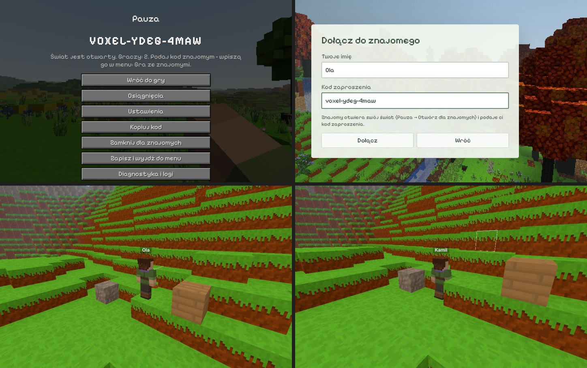

# Gra ze znajomymi (0.92.0)

Pomysł Kamila: gra wieloosobowa przez internet. Jeden gracz otwiera
swój świat dla znajomych, a inni dołączają po kodzie zaproszenia, także
z innego miasta. Nie trzeba zakładać kont ani własnego serwera.

## Jak zagrać

**Gospodarz** (świat jest jego):

1. Wchodzi do swojego świata i otwiera pauzę (Esc).
2. Wpisuje swoje imię i klika **Otwórz dla znajomych**.
3. W pauzie i na czacie pojawia się **kod zaproszenia**, np.
   `VOXEL-K7M2-9QXA`. Przycisk **Kopiuj kod** kopiuje go do schowka.
4. Podaje kod znajomym, np. na Discordzie albo SMS-em.

**Gość:**

1. W menu głównym klika **Gra ze znajomymi**.
2. Wpisuje swoje imię i kod. Wielkość liter, spacje i myślniki nie mają
   znaczenia, a przedrostek `VOXEL` można pominąć.
3. Klika **Dołącz**. Świat wczytuje się od gospodarza.

**Wyjście z gry:**

- Gość: Pauza → **Rozłącz i wyjdź do menu**.
- Gospodarz:
  - **Zamknij dla znajomych** kończy grę wieloosobową, ale sam gra dalej.
  - **Zapisz i wyjdź do menu** kończy grę wszystkim. Goście wracają do
    menu z napisem *Koniec gry u znajomego*.

W jednym świecie może grać do 8 osób: gospodarz i 7 gości.

## Co jest wspólne

| Co | Jak |
| --- | --- |
| Bloki | Wszyscy widzą każde postawienie i zniszczenie bloku, z dźwiękiem i odłamkami. Wspólne jest też otwieranie drzwi, klap i furtek oraz zmiany przy stole stolarskim. |
| Teren | Gość buduje świat z tego samego ziarna. Od gospodarza dostaje tylko chunki, które gracze zmienili, i to dopiero wtedy, gdy podejdzie blisko. |
| Inni gracze | Każdy widzi model drugiego gracza z jego skórką i imieniem nad głową. Widać też ruch: chodzenie, bieg, kucanie, pływanie i latanie, machanie ręką i przedmiot w ręce. |
| Skrzynie | Wspólna zawartość. Co jeden włoży, drugi może wyjąć. |
| Stoły stolarskie | Deski na blacie są wspólne. |
| Ogniska | Wspólne są opał, podpałka, rozpalanie i palenie się. |
| Tratwy | Tratwą płynie ten, kto na niej siedzi, a inni widzą, jak płynie. |
| Pora dnia | Od gospodarza. Świat żyje dalej także wtedy, gdy gospodarz ma pauzę. |
| Meteoryty | Gospodarz losuje meteoryt i wybija krater. Goście widzą przelot i wybuch. |
| Wzrost roślin | Krzak albo sadzonka rośnie u gracza, który jest najbliżej, więc każdy wzrost liczy się tylko raz. |
| Czat | Wiadomość bez `/` trafia do wszystkich jako `<Imię> tekst`. Komendy działają tylko u tego, kto je wpisał. |
| Tryb gry | Taki jak w świecie gospodarza: przygoda albo kreatywny. |

**Co zostaje u każdego osobno:** ustawienia, osiągnięcia, widok
z trzeciej osoby i dźwięki.

Woda płynie u każdego sama. Ta sama symulacja z tych samych bloków daje
ten sam wynik, a zmiana, od której woda ruszyła (np. rozbity brzeg),
jest wspólna.

## Zapis

- **Świat zapisuje się tylko u gospodarza.** Gość nic nie zapisuje
  u siebie.
- **Ekwipunek i miejsce gościa** gospodarz zapisuje razem ze światem
  (`worldInfo.guests`):
  - zapis idzie co 5 sekund i przy wyjściu gościa,
  - przy następnym wejściu gość ma te same rzeczy i stoi w tym samym
    miejscu,
  - nowy gość pojawia się obok gospodarza.
- **Gościa rozpoznaje się po identyfikatorze jego gry** (ustawienie
  `playerId`, losowane raz), nie po imieniu. Imię można zmieniać.

## Połączenie

Gra łączy komputery bezpośrednio (WebRTC) przez bibliotekę
[PeerJS](https://peerjs.com/) (`lib/peerjs/`, licencja MIT).

- **Serwer połączeń.** Gospodarz rejestruje się w nim pod kodem
  zaproszenia, a gość szuka gospodarza po tym kodzie. Serwer pomaga tylko
  się odnaleźć, a sama gra płynie potem bezpośrednio między komputerami.
  - Domyślnie gra używa darmowego, publicznego serwera PeerJS
    (`0.peerjs.com`). Prowadzą go twórcy PeerJS, bez gwarancji
    działania.
  - Serwer widzi adresy IP graczy, tak jak każdy serwer w internecie.
- **Serwer pośredniczący (TURN).** Gdy routery nie pozwalają na
  bezpośrednie połączenie, gra może płynąć przez taki serwer z domyślnych
  ustawień PeerJS.
- **Własny serwer.** Można postawić własny serwer połączeń
  ([peerjs-server](https://github.com/peers/peerjs-server)) i wpisać go
  w grze: `/ustaw serwer https://moj-serwer.pl/peer`. Powrót do
  domyślnego: `/ustaw serwer -`. Gospodarz i goście muszą mieć ten sam
  serwer.
- **Ta sama wersja gry.** Gospodarz i goście muszą mieć tę samą wersję
  gry (te same numery bloków). Inaczej gospodarz nie wpuści gościa
  i pokaże powód.

## Ograniczenia pierwszej wersji

- **Tylko na komputerze:** w aplikacji na Windows i w przeglądarce.
  W aplikacji na telefon przycisków gry ze znajomymi na razie nie ma.
- **Świat działa, dopóki gra gospodarz.** Gdy gospodarz wyjdzie, gra
  kończy się wszystkim.
- **Rośliny i woda poza zasięgiem gospodarza.** Gospodarz liczy wzrost
  roślin i płynięcie wody tylko w chunkach, które sam ma wczytane. Gość,
  który odejdzie daleko, liczy je u siebie i wysyła tylko zmiany bloków.
- **Skrzynia otwarta przez dwie osoby naraz:** wygrywa ostatnia zmiana.

## Jak to działa (pliki)

| Plik | Co robi |
| --- | --- |
| `src/net/protocol.js` | rodzaje wiadomości, kod zaproszenia, imiona, stan gracza w tablicy, bloki chunka (RLE + base64), odcisk numerów bloków |
| `src/net/PeerTransport.js` | połączenie (PeerJS): gospodarz pod kodem, gość do gospodarza, wiadomości JSON |
| `src/net/NetSession.js` | wspólne: zmiany bloków (`World.onBlockSet`), stan gracza 15 razy na sekundę, czat, wzrost roślin u najbliższego |
| `src/net/NetHost.js` | gospodarz: powitanie gościa, chunki na prośbę, przekazywanie zmian innym, zapis gości, tratwy, meteoryty, pora dnia |
| `src/net/NetClient.js` | gość: dołączenie, chunki od gospodarza, zmiany od innych, tratwy, zapis u gospodarza |
| `src/net/RemoteChunkStore.js` | chunki zmienione u gospodarza (zamiast zapisu świata u gościa); chunk czeka na bloki (`World.chunkGate`) |
| `src/net/StateSync.js` | skrzynie, stoły i ogniska: wysyłane tylko zmiany, odebrane podmieniane w miejscu |
| `src/net/RemotePlayers.js` | inni gracze: model ze skórką, animacje, przedmiot w ręce, imię |

## Sprawdzanie

- `node tools/sprawdz_multiplayer.mjs` (w `npm test`, 78 sprawdzeń):
  - kody zaproszeń, imiona, czat,
  - pakowanie stanu gracza, bloki chunka bez strat,
  - czekanie na zmienione chunki, skrzynie, stoły i ogniska bez odbijania
    zmian,
  - gospodarz: przekazywanie zmian (nie do autora), złe zmiany, wersja
    i bloki gościa, komplet graczy, zapis gościa, tratwy, rośliny,
    zamknięcie,
  - gość: zmiany w chunkach w pamięci i poza nią, tratwy, pora dnia,
    meteoryty.
- `node tools/sprawdz_multiplayer_webgl.mjs`: prawdziwa gra w dwóch
  kartach Chrome, z połączeniem między kartami zamiast internetu
  (`tools/fixtures/net-loopback.js`). Sprawdza:
  - wejście gościa i ten sam teren u obu,
  - bloki w obie strony, także w chunku zmienionym daleko i w chunku,
    którego gość jeszcze nie miał,
  - skrzynię, porę dnia i czat,
  - model i imię drugiego gracza,
  - zapis ekwipunku gościa po jego wyjściu.

  Zrzuty trafiają do `test-results/multiplayer/`.
