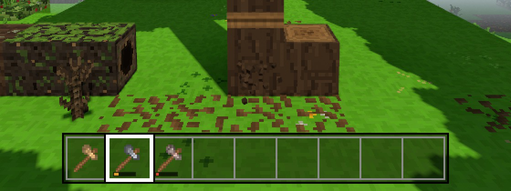

# Twardość i zużycie narzędzi

Pierwsza wersja części C projektu [drewno.md](drewno.md) (rozdział 5).
**W grze od 1.39.0** - na początek dla **siekiery**.

Do 1.38.0 skała, z której jest narzędzie, była tylko wyglądem. Teraz
liczy się jej twardość.

## Twardość skał

| Siekiera z | Twardość | Tnie drewno do twardości | Nie zużywa jej drewno do |
|---|---|---|---|
| piaskowca | 2 | 3 - świerk, jodła, sosna, lipa, osika... | 1 |
| wapienia | 3 | 4 | 1 |
| łupka | 4 | 6 - także brzoza, wiśnia | 2 |
| kamienia | 5 | 7 - wszystko oprócz akacji, namorzynu i oliwki | 2 |
| bazaltu | 6 | 9 - wszystko | 3 |
| granitu | 7 | 10 - wszystko | 3 |

Twardość drewna: [ogniska.md](ogniska.md) (`src/blocks/woodTraits.js`),
komenda `/drewno`. Świerk 2, sosna 3, brzoza 5, dąb i buk 7, akacja
i namorzyn 8, oliwka 9.

## Trzy zasady

1. Siekiera tnie drewno najwyżej **półtora raza twardsze** od siebie.
   Za miękką nie da się **ściąć drzewa**: cios nie wchodzi, a gra mówi,
   jakiej skały trzeba.
2. **Zużycie** rośnie z twardością drewna względem skały. Kamienna
   siekiera wystarcza na **dwa dęby albo sześć brzóz**.
3. Gdy siekiera jest **co najmniej dwa razy twardsza** od drewna, nie
   zużywa się wcale: kamienna na świerku, granitowa na sośnie.

Ciosów do pęknięcia nowej siekiery:

| Siekiera | sosna (3) | brzoza (5) | dąb (7) |
|---|---|---|---|
| piaskowcowa | 20 | nie bierze | nie bierze |
| wapienna | 48 | nie bierze | nie bierze |
| łupkowa | 118 | 29 | nie bierze |
| kamienna | 388 | 48 | 23 |
| bazaltowa | bez zużycia | 81 | 33 |
| granitowa | bez zużycia | 144 | 48 |

Wzór: zużycie jednego ciosu = `0,0515 × (twardość drewna / twardość
skały − 0,5) ^ 1,3` (zero, gdy wynik w nawiasie nie jest dodatni).

## Co zużywa siekierę

- **Cios w drzewo** (ścinanie) - jeden cios.
- **Wykopany pień**: stojący, okorowany i leżący - jak jeden cios.
- **Leżący pień cięty bez kozłów** - **dwa razy więcej** (siekiera bije
  w ziemię; [kozly.md](kozly.md)). Zbyt miękką siekierą leżący pień da
  się pociąć, ale zużywa ją to bardzo szybko.
- Nie zużywa: okorowywanie, deski i inne bloki, spróchniały pień, tryb
  twórczy.

## Jak to widać

- **Pasek pod ikonką** (jak pasek świeżości): szary - cała, pomarańczowy
  - wyszczerbiona (poniżej połowy), czerwony - pęknięta (poniżej jednej
  piątej). Nowa siekiera paska nie ma.
- Gra mówi, gdy siekiera **się wyszczerbi** i gdy **pęka**.
- W opisie przedmiotu: twardość, jakie drewno tnie i stan w procentach.
- Gdy siekiera **pęknie, w ręce zostaje patyk**.
- Stos kilku siekier zużywa się wspólnie; zużyta i nowa nie łączą się
  same w jeden stos.

## Komenda

`/siekiera` ([komendy.md](komendy.md)): tabela skał i stan siekiery
w ręce, `daj [skała]`, `stan <procent>`.

## Kod

| Plik | Co robi |
|---|---|
| `src/items/toolWear.js` | twardość skał, zasady, pasek, opis (czyste funkcje) |
| `src/game/ToolWear.js` | zużycie w grze: cios, wykopany pień, kozły, pęknięcie |
| `src/game/Felling.js` | za miękka siekiera nie ścina; cios zużywa |
| `tools/sprawdz_narzedzi.mjs` | testy |

## Luki

- **Trzy wyglądy siekiery** (ikonka i w dłoni: cała, wyszczerbiona,
  pęknięta) - na razie jest tylko pasek i komunikaty. Ikonki rzeczy są
  rysowane raz na rodzaj, nie na stan stosu.
- **Kilof, łopata i nóż** nie mają jeszcze twardości ani zużycia.
- **Metal meteorytowy** (twardość 20, trzy razy szybsze cięcie, jedyny
  na olbrzymy) to część F. Do tego czasu sekwoję i puchowiec bierze
  każda siekiera (mają miękkie drewno).
- Twardość skały **nie zmienia szybkości** cięcia - tylko to, co da się
  ściąć, i zużycie.
- Zbyt miękka siekiera **tnie leżące i postawione pnie** (z dużym
  zużyciem) - ograniczenie dotyczy tylko ścinania żywych drzew.
- Siekiery z ostrzem z **różnych skał** (mieszany przepis) liczą się jak
  kamienne.
- Zużytej siekiery **nie da się naprawić**.
