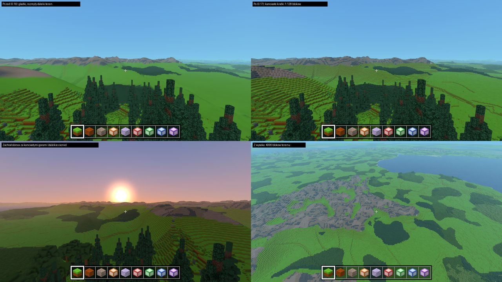
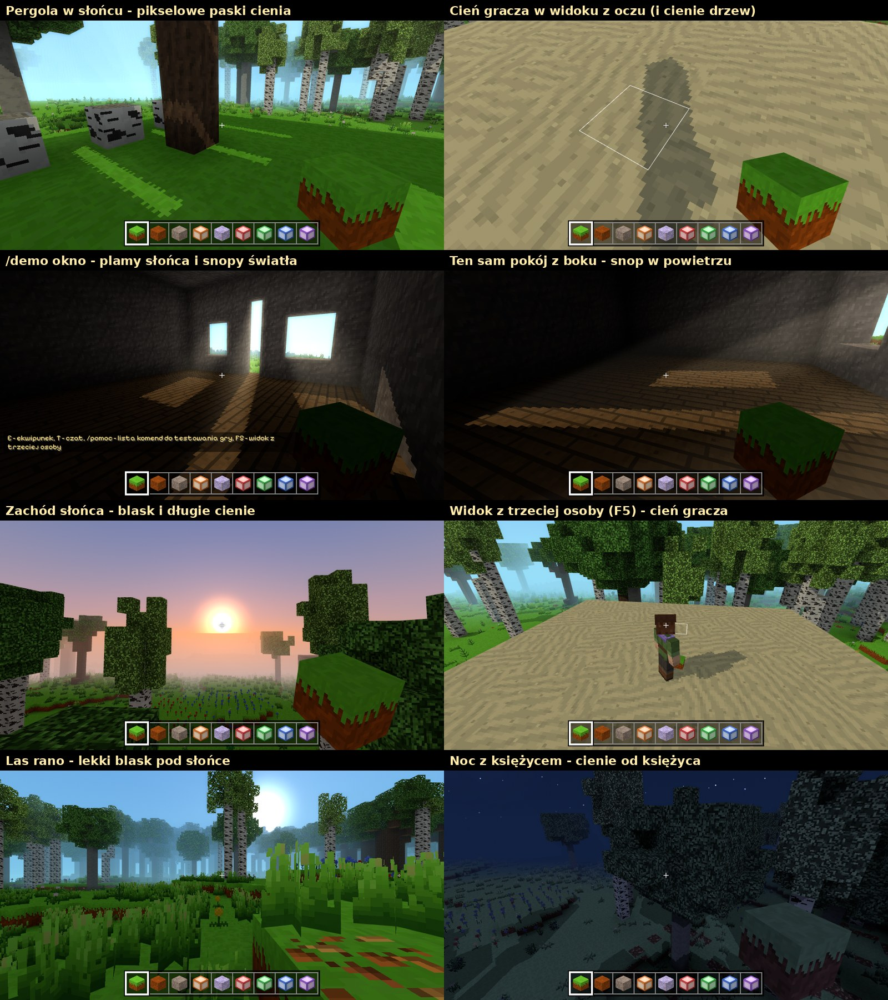
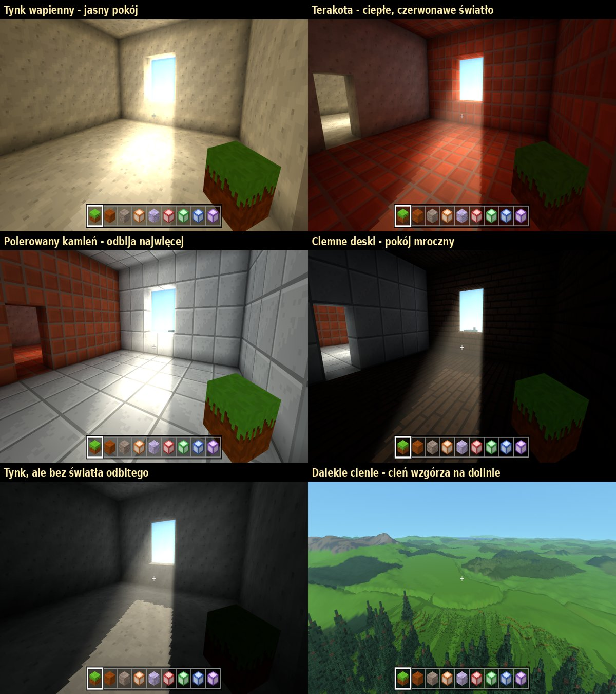

# Niebo i światło

Jak są zbudowane dzień i noc, niebo, daleki teren i oświetlenie
bloków - i gdzie podepną się rzeczy planowane na później.

## Jak to działa teraz

```
czas świata (WorldTime)          jedna liczba: ile dni minęło (3.5 = 4. dzień, południe)
        │
        ▼
Celestial                        gdzie są słońce, księżyc i gwiazdy; faza księżyca
        │
        ▼
SkyState (SkyColors.js)          kolory nieba i światła o tej porze
        │
        ├──► warstwy nieba       kopuła, księżyc, słońce, gwiazdy (src/sky/layers/)
        ├──► skyUniforms         kolor nieba dla kopuły i dla mgły na blokach
        └──► światła świata      otoczenie (ambient), słońce, księżyc
```

Wszystko liczy się co klatkę z **czasu świata** - nie ma tu nic
losowego ani zapamiętanego (poza efektami jak migotanie gwiazd).
Dzięki temu po wczytaniu świata niebo jest dokładnie takie jak przy
wyjściu, a przestawienie zegara (`[` / `]` w debugu) od razu daje
właściwe niebo.

### Światło na blokach

Każdy róg ściany w meshu chunka ma cztery liczby (atrybut `color`):

| kanał | co zawiera | skąd |
|---|---|---|
| r, g, b | światło bloków (lamp), już w kolorze | `ChunkMesher.js` z `Light.js` |
| a | światło nieba (0-15 zamienione na jasność) | `ChunkMesher.js` z `Light.js` |

W shaderze bloków (`BlockRenderData.js`):

- światło nieba mnoży się przez światła sceny (otoczenie + słońce +
  księżyc), które co klatkę ustawia `Sky.js` według pory dnia,
- światło lamp nie zależy od pory dnia,
- liczy się jaśniejsze z nich.

Z **cieniami słońca** (niżej) jest jedna różnica: światło nieba
z chunków przyciemnia już tylko światło otoczenia (i to mocniej w ciemnych
miejscach), a światło słońca (albo księżyca) zależy wyłącznie od tego,
czy jego promień dochodzi do danego piksela - stąd jasna plama słońca
w ciemnym pokoju.

Najważniejsza zasada: **mesh chunka nie zależy od pory dnia.** Zmiana
dnia w noc nie przebudowuje żadnego chunka - zmieniają się tylko
światła sceny i kolory nieba. Tę zasadę warto trzymać też przy
kolejnych rzeczach.

### Niebo z warstw

Niebo ma własną scenę i kamerę (`Sky.js`) i jest rysowane przed
światem. Każda rzecz na niebie to osobna **warstwa** w `src/sky/layers/`
z tymi samymi metodami:

```js
class MojaWarstwa {
    object                                       // obiekt three.js
    update(state, celestial, dt, pixelRatio)     // co klatkę
    dispose()                                    // przy wyjściu ze świata
}
```

Nowa warstwa = nowy plik + dopisanie jej do listy w konstruktorze
`Sky`. Kolejność rysowania ustala `object.renderOrder`. Obecnie:
kopuła (0), księżyc (1), słońce (2), galaktyki (2.5), gwiazdy (3),
spadające gwiazdy (3.5). Księżyc zapisuje głębię, więc zasłania słońce
i gwiazdy za sobą - dzięki temu zaćmienie słońca "dzieje się samo".

### Kolejność rysowania klatki

```
0. mapy cieni       bliska tylko gdy trzeba, daleka po kawałku, cień gracza (Shadows.render)
1. niebo            własna scena i kamera (Sky.render)
   (kula Ziemi      tylko wysoko - src/space/Globe.js, docs/kosmos.md)
2. daleki teren     własna scena i kamera (FarTerrain.render)
   (chmury na kuli  tylko wysoko)
3. świat            chunki, meteoryty, ramka bloku...
4. promienie        snopy światła w powietrzu (LightShafts.render)
5. ręka             widok z oczu (FirstPersonHand.render)
```

Między krokami czyszczona jest tylko głębia, więc każdy kolejny krok
jest na wierzchu poprzedniego: góry dalekiego terenu zasłaniają
zachodzące słońce, a prawdziwe chunki zawsze zasłaniają daleki teren.
Słońce i księżyc chowają się pod linią `Sky.horizonDip` - z dalekim
terenem i z wysoka to brzeg terenu, który jest trochę pod linią poziomu.

### Mgła i mgiełka

Funkcja `skyColor(kierunek)` w `skyShader.js` liczy kolor nieba
i jest używana przez kopułę nieba, mgłę na blokach i mgiełkę na
dalekim terenie. Dlatego teren w oddali ginie dokładnie w kolorze nieba
za nim, także o zachodzie, gdy niebo z jednej strony jest pomarańczowe.
Każda zmiana wyglądu nieba w `skyColor` automatycznie zmienia mgłę.

- **Bez dalekiego terenu** bloki od ~45% zasięgu widzenia znikają we
  mgle (jak dawniej).
- **Z dalekim terenem** bloki nie znikają: od ~65% zasięgu ich tekstury
  zlewają się w średni kolor (`atlasAverageTexture` w `TextureAtlas.js`),
  a cały teren - bliski i daleki - dostaje tę samą mgiełkę rosnącą
  z odległością (`farHaze` w `src/rendering/viewUniforms.js`,
  `FAR_HAZE_DISTANCE` i `FAR_HAZE_MAX` w `config.js`). Na końcu zasięgu
  bloki wyglądają więc tak jak daleki teren za nimi.

## Plan rozwoju

### Kolorowe światło - ZROBIONE

- `BlockRegistry.js`: pole bloku `lightColor` (np. `'#ff3a2a'`) obok `light`.
- `Light.js`: kanały nieba (0-15) i `RED`, `GREEN`, `BLUE` (0-255), każdy
  rozlewany tym samym kodem. Kolorowe światło traci 25% na blok (a nie
  stałą wartość), więc proporcje kanałów - kolor - zostają do końca
  zasięgu; zasięg dalej zgadza się z siłą `light` (15 = 14 bloków).
- `ChunkMesher.js`: jasność z poziomu najmocniejszego kanału, kolor
  z proporcji kanałów.
- Sprawdzanie: `/demo swiatlo`, `/swiatlo`.

### Barwa światła z nieba - ZROBIONE

Kolory światła na blokach nie są nigdzie wpisane na sztywno -
`SkyColors.js` liczy je z kolorów nieba:

- światło otoczenia - z odcienia całego nieba (w dzień lekko, w nocy
  mocniej),
- światło słońca - z koloru tarczy słońca,
- światło księżyca - niebieskawe, zabarwione kolorem księżyca.

**Warianty nieba** (`Sky.variant`): `sunsetColor` (kolor łuny wschodu
i zachodu) i `moonColor` (kolor księżyca). Dziś ustawiają je komendy
`/niebo zachod` i `/ksiezyc kolor`; w przyszłości np. losowy wariant
zachodu na każdy dzień (z seedu świata, żeby był zawsze taki sam) albo
krwawy księżyc co kilka pełni. Światło dostosuje się samo. Kolejne
rzeczy do zmiany (np. kolor zenitu, kolor gwiazd) warto dodawać jako
kolejne pola wariantu, liczone w `SkyState.update`.

### Dynamiczne światło - ZROBIONE

`src/world/DynamicLight.js`: pudełko 32 x 32 x 32 komórek wokół gracza.
Gdy któreś źródło przejdzie do innego bloku (albo zmienią się bloki
w pudełku), liczy w nim rozlewanie tym samym zanikiem co lampy
(`COLOR_DECAY` z `Light.js`) - więc światło omija ściany - i wysyła
wynik na kartę jako teksturę 3D. Shader bloków (`BlockRenderData.js`)
czyta z niej światło w komórce przed każdą ścianą i bierze jaśniejsze
z tego i zwykłego światła. Meshe chunków się nie zmieniają.

Źródło to `{ position, color: [r, g, b], strength: 0-15 }`. Dziś
źródłami są: lampa trzymana w ręce (wybrana na pasku), lecący meteoryt,
błysk uderzenia i kule z `/demo kula` - zbiera je
`Game.updateDynamicLight()`. Nowe źródło (płonąca strzała, świecący
potwór...) = dopisanie go do tej listy. Całość wyłącza ustawienie
„Dynamiczne światło” (WebGL2; na starszym WebGL1 go nie ma).

Ograniczenie: światło liczy się tylko w pudełku wokół gracza, więc
źródło dalej niż ~16 bloków nie oświetla terenu (samo świecenie
- np. kulę ognia - dalej widać).

### Daleki teren (horyzont) - ZROBIONE



`src/world/FarTerrain.js`: za zasięgiem widzenia, do odległości
z ustawienia "Daleki teren" (do 16 384 bloków), rysuje się kanciasty
teren z kratek - te same góry, wzgórza i lasy, które wygenerowałyby
się tam naprawdę (`generator.farSurface`), ale bez pojedynczych bloków.

- **Kratki**: każda kratka to słupek o boku `s` bloków - płaski wierzch
  na wysokości terenu w jej środku i pionowe ścianki tam, gdzie sąsiad
  jest niżej (u dołu ciemniejsze, jak cień w kącie; ścianka trawy u góry
  zielonkawa jak brzeg bloku trawy). Każda kratka ma trochę inną jasność
  (shader, stały wzór w świecie). Wierzchy kratek o tej samej wysokości
  i rodzaju łączą się w prostokąty, ścianki wzdłuż granicy też - płaska
  woda albo równina to kilka trójkątów (`meshFarTile` w
  `src/world/farSamples.js`).
- **Kafelki** (drzewo czwórkowe): 32 x 32 kratki, tuż za zasięgiem
  widzenia kratka ma 1 blok, dalej 2, 4, 8... do 128 - mniej więcej
  odległość / 64 przy średnich szczegółach (`DETAILS` - ustawienie
  *Szczegóły dalekiego terenu*: niskie - odległość / 32, wysokie - / 96;
  w trybie ziemniaka `POTATO_DETAIL` - około 8 razy mniej trójkątów niż
  średnie). Dzięki temu dwa razy dalszy horyzont to tylko jeden poziom
  kafelków więcej: przy średnich 4096 bloków ~1 mln trójkątów, 8192 ~1,3
  mln, 16 384 ~1,5 mln.
  Kafelki leżą w stałych miejscach świata i nowy zestaw pokazuje się
  dopiero, gdy jest gotowy (na początku - po kolei, najbliższe najpierw).
  Szczeliny między kafelkami różnej dokładności zasłaniają fartuchy
  (ścianki na brzegu kafelka opuszczone w dół).
- **Wątki**: wysokości kratek i gotowe siatki liczą osobne wątki
  przeglądarki (`src/world/FarTerrainWorker.js`, tyle ile rdzeni minus
  dwa, najwyżej 3) - każdy z własnym generatorem terenu. Gra tylko
  wkłada gotowe siatki do sceny. Bez wątków (stara przeglądarka) liczy
  się w grze, z limitem czasu na klatkę (`BUILD_BUDGET_MS`).
- **Środek**: w zasięgu prawdziwych chunków daleki teren jest wycięty
  (`discard` w shaderze) co do chunka - według maski chunków z meshem
  (`chunkMaskUniforms` w `viewUniforms.js`) - nie wystaje spomiędzy
  prawdziwych drzew ani przez wykopane dziury.
- **Granica z chunkami**: ścianka słupka w chunku bez meshu zwrócona do
  prawdziwych chunków zostaje (widać ją z nich), a na granicach chunków
  w bliskich kafelkach koron drzew i wody są dodatkowo **kurtyny** -
  ścianki od wierzchu w dół, rysowane tylko od strony prawdziwych
  chunków. Bez nich z góry między prawdziwymi drzewami (albo przez wodę)
  było widać niebo tam, gdzie daleki słupek ma tę samą wysokość co
  sąsiad i zwykłej ścianki nie ma.
- **Woda na granicy**: wierzch dalekiej wody jest na wysokości
  powierzchni bliskiej wody (tuż pod jej najniższą falą), a bliska woda
  tuż przy końcu chunków robi się nieprzezroczysta, w kolorze dalekiej
  wody - z tej samej maski wie, że pod nią nie ma już narysowanego dna
  (inaczej widać by przez wodę jasny pas nieba).
- **Kolory**: średnie kolory tekstur trawy (wierzch i bok), skał (każda
  swoim kolorem), piasku, wody i liści gatunku, który przeważa w lesie -
  nowa tekstura sama zmienia daleki teren.
- **Światło**: te same światła nieba co bloki (`Sky.attachLights`), to
  samo nocne odbarwienie, ten sam suwak jasności. Zaćmienie, faza
  księżyca, kolor zachodu - wszystko działa i tu.
- **Zmiany gracza**: kolumny w chunkach zmienionych przez gracza są
  liczone z ich bloków (`World.savedChunks`). Gdy taki chunk znika
  z pamięci, kafelki nad nim przebudowują się (`invalidateChunk`).
- **Sprawdzanie**: `/horyzont`, `/horyzont lod` (kolory według
  wielkości kratki), `/horyzont odswiez`, `/wydajnosc`.
- Pomysły: chmury rzucające cień na daleki teren, woda (gdy będzie)
  jako płaszczyzna w kafelkach, zimą śnieg na szczytach.

### Cienie słońca i promienie światła - ZROBIONE



**Cienie** (`src/rendering/Shadows.js`, ustawienie *Cienie słońca*):

- *mapa cieni* - świat narysowany „oczami słońca” (kamera ortograficzna
  z kierunku światła, sama głębia) w teksturze 1024 albo 2048 pikseli
  na 32 albo 64 bloki wokół gracza — **16 próbek na blok**,
- od 0.52.0 shader sprawdza cień w rzeczywistym punkcie powierzchni,
  bez zaokrąglania do pikseli tekstury. Cztery porównania głębi z wagami
  biliniowymi delikatnie wygładzają krawędź, także dla cienia gracza
  i dalekiego terenu. To filtrowanie cienia, bez rozmywania tekstur.
  Głębia każdej próbki jest korygowana do płaszczyzny odbiorcy, żeby
  uniknąć samocienia podłoża przy niskim słońcu,
- mapa nie jest rysowana co klatkę: tylko gdy słońce przesunie się
  o ~0,1° (`ANGLE_STEP`), gracz odejdzie o 1/4 zasięgu od środka mapy
  albo zmieni się chunk w jej zasięgu (najwyżej 10 razy na sekundę).
  Do mapy rysuje się osobna scena `World.shadowScene` z kopiami meshy
  chunków (ta sama geometria, materiały tylko z głębią): woda nie rzuca
  cienia, trawa i kwiaty - drobne cienie (z większym zapasem przy
  porównaniu, bo kołyszą się na wietrze), liście - z prześwitami
  (plamki słońca pod drzewem),
- piksele mapy stoją w miejscu (kamera przesuwa się o całe piksele), więc
  brzegi cieni nie migoczą, gdy gracz chodzi,
- cienie rzuca mocniejsze z dwóch świateł: w dzień słońce, w jasną noc
  księżyc. Przy horyzoncie (`FADE_LOW`-`FADE_HIGH`) cienie płynnie znikają,
  w kosmosie ich nie ma,
- przy niskim słońcu mapa obejmuje bloki tylko ±32 bloki w pionie od
  gracza (`VERTICAL_RANGE`), za to jest gęstsza wzdłuż długich cieni,
- **gracz** rzuca cień z własnej, małej mapy (co klatkę, także w widoku
  z oczu), a model i ręka ciemnieją w cieniu: `SunShadows.sunVisibility`
  to promień od gracza do słońca przez bloki (liście przepuszczają trochę),
- z cieniami słońce świeci mocniej, a światło z całego nieba jest
  słabsze (`SHADOW_SUN_BOOST`, `SHADOW_AMBIENT` w `config.js`), a tam,
  gdzie mało światła nieba, jest ciemniej (`SHADOW_INDOOR_DARKNESS`) -
  plamy słońca i cienie są wyraźne,
- przy wyłączonych dalekich cieniach poza zasięgiem mapy zostaje dostęp
  do nieba. W jakości „Dalekie” większe mapy zachowują cień również
  poza bliskimi chunkami; przejścia mają płynnie wygaszaną wagę.

**Promienie światła** (`src/rendering/LightShafts.js`, ustawienie
*Promienie światła*, wymaga cieni):

1. głębia bliskich chunków (do zasięgu mapy cieni) w połowie
   rozdzielczości - gdzie kończy się powietrze,
2. dla każdego punktu ekranu 20 kroków od oka do ściany: w mapie cieni
   sprawdzamy, czy powietrze w tym miejscu jest w słońcu; każdy
   oświetlony krok dodaje światła (dalsze mniej - bliski snop jest
   wyraźny), najwięcej patrząc w stronę słońca,
3. rozmycie i dodanie do obrazu w kolorze światła.

Gęstość powietrza zależy od tego, jak ciemno jest wokół gracza (oczy
przyzwyczajone do ciemności): w pokoju z oknem snop jest wyraźny, na
dworze zostaje blask wokół słońca (`SHAFT_...` w `config.js`).
O wschodzie i zachodzie promienie są mocniejsze, nocą - słabe, w kolorze
księżyca. Pod wodą ich nie ma.

**Dalekie mapy cieni** (jakość *Dalekie*): od 0.25.0 mapa średnia
ma promień 256 bloków i rozdzielczość 1024, a zewnętrzna promień
1024 i rozdzielczość 2048. Zachowują pełną wagę do 82% promienia,
czyli około 800 bloków dla zewnętrznej mapy. Kamera obejmuje przeszkody
w stronę światła, więc odległa góra może zacieniać również bliski teren.
Mapy powstają do drugiego bufora we wspólnym budżecie 24 rysowań
i 120 tys. trójkątów na klatkę; gotowa tekstura i jej macierz są
publikowane razem. Od 0.52.0 wszystkie trzy mapy korzystają z tego
samego filtra krawędzi, z mniejszą szczegółowością w oddali.
Szczegóły: [cienie 0.25.0](cienie-0.25.0.md).

Test: `/demo okno`, `/cienie`, `/cienie dalekie`, `/czas ustaw zachod`.

### Światło odbite - EKSPERYMENTALNE



`src/world/BounceLight.js`, ustawienie *Światło odbite* (działa
z cieniami słońca; od 0.17.0 domyślnie wyłączone - na dworze oświetlona
trawa w pudełku wokół gracza świeci i widać jasny krąg, który idzie za
graczem. Do poprawy: światło odbite słabnące przy brzegu pudełka
i tam, gdzie jest dużo nieba). Słońce wpadające przez okno nie zostaje na
podłodze: oświetlona podłoga i ściany świecą dalej, w kolorze swojej
tekstury, a światło rozlewa się po pokoju. Wokół gracza jest pudełko
komórek (`BOUNCE_SIZE` x `BOUNCE_HEIGHT`, jak w dynamicznym świetle):

1. **bloki** - które komórki są ścianą i ile światła odbija każda
   ściana: średni kolor tekstury (góra, boki, spód osobno) razy pole
   bloku `reflect` (domyślnie 1),
2. **źródła** - komórki powietrza przy ścianach zwróconych do światła,
   do których dochodzi słońce (promień w stronę słońca przez bloki -
   ten sam co dla modelu gracza): świecą tyle, ile odbija oświetlona
   ściana,
3. **rozlewanie** - światło rozchodzi się po powietrzu (nie przez
   ściany), słabnąc z odległością (`BOUNCE_SPREAD`); przy jasnej
   ścianie wraca do komórki (kolejne odbicia - biały pokój jest
   jaśniejszy w całości), przy ciemnej przepada. Liczone krokami
   nadrelaksacji Gaussa-Seidla (na zmianę w przód i w tył), od
   poprzedniego wyniku, więc zmiany są płynne,
4. wynik (pierwiastek - więcej odcieni w półmroku) idzie jako
   tekstura 3D do shadera bloków i modeli: światło odbite razy kolor
   ściany, pod gołym niebem słabsze (`BOUNCE_OUTDOOR` - tam świeci
   całe niebo).

Każdy krok jest podzielony na kawałki (najwyżej ~2,5 ms na klatkę).
Liczy się od nowa, gdy słońce przesunie się o ~1,4°, gracz odejdzie
o 8 bloków albo zmienią się bloki w pudełku. Kolor i siłę (pora dnia,
księżyc) dodaje shader - o zachodzie nic się nie przelicza.

Z cieniami światło nieba z chunków (to, które wlewa się przez okno
wg zasad Minecrafta) przyciemnia pokój mocniej (`SHADOW_INDOOR_DARKNESS`),
więc wnętrze oświetla głównie światło odbite - zależne od tego, z czego
jest dom. **Budulec** (`tools/tekstury_budulec.py`): tynk wapienny
(`reflect` 1.1 - biały, jasny pokój), tynk ochrowy (1.1 - ciepły),
terakota (1 - czerwonawe światło), polerowany kamień (1.8 - gładki,
odbija najwięcej), ciemne deski (0.6 - pochłaniają światło).

Test: `/demo dom` (cztery pokoje z różnego budulca, każdy z oknem od
strony słońca), `/swiatlo` (ile światła odbitego jest przy głowie),
`/swiatlo odbite wl | wyl`.

### Słońce i kolorowe wschody / zachody

- Kolory: tabela w `SkyColors.js` (wiersze dla różnych wysokości słońca).
- Kształt łuny i poświaty: funkcja `skyColor` w `skyShader.js`.
- Tarcza słońca: `layers/Sun.js` (rozmiar, kolor, można dać teksturę jak
  księżycowi).
- Pomysły: łuna zależna od pogody, promienie słońca (nowa warstwa), pory
  roku - w `Celestial.js` słońce może chodzić wyżej latem i niżej zimą
  (dłuższe i krótsze dni).

### Księżyc

- Ruch i fazy: `Celestial.js` (`MOON_CYCLE_DAYS`, nachylenie orbity
  `MOON_ORBIT_TILT`). Faza nie jest „wpisana” - wynika z tego, gdzie
  księżyc jest względem słońca, a tarcza jest oświetlana z kierunku
  słońca. Inny cykl albo inna orbita = fazy dalej się zgadzają.
- Wygląd: `layers/Moon.js` i `assets/textures/sky/moon.png`.
- Pomysły: zaćmienie księżyca (pełnia w cieniu Ziemi - czerwona tarcza;
  działałoby jak zaćmienie słońca, tylko w pełni), krwawy księżyc,
  faza wpływająca na potwory.

### Zaćmienia słońca - ZROBIONE

- **Kiedy** (`Celestial.js`): księżyc chodzi kilka-kilkanaście stopni
  na północ albo południe od drogi słońca, a ta "szerokość" zmienia się
  płynnie z cyklu na cykl (`newMoonLatitude`). W nowiu, w którym jest
  mniejsza niż suma promieni tarcz, księżyc przechodzi przed słońcem.
  Które nowie, wynika z numeru cyklu (zawsze te same), a ile ich jest -
  z `ECLIPSE_CHANCE` i `ECLIPSE_TOTAL_SHARE` w `config.js`. Pierwsze dwa
  nowie świata nie mają zaćmień.
- **Ile zasłania**: `Celestial.eclipse` - pole wspólnej części tarcz
  (`sunCoverage`) liczone z prawdziwego położenia słońca i księżyca.
  Pełne zaćmienie jest możliwe, bo księżyc jest trochę większy niż
  słońce (`MOON_DIAMETER` > `SUN_DIAMETER`); im większa różnica, tym
  dłużej trwa.
- **Wygląd** (`SkyColors.js`, `ECLIPSE_...`): światło słońca słabnie
  dokładnie o zasłoniętą część, niebo i światło otoczenia trochę wolniej
  (przy małym zaćmieniu prawie nic nie widać). W pełnym: zmrok,
  łuna dookoła horyzontu (`uEclipseGlow` w `skyColor`), korona wokół
  tarczy (`layers/Sun.js`), najjaśniejsze gwiazdy, słaba poświata
  ciemnej strony księżyca.
- **Sprawdzanie**: `/zacmienie`, `/zacmienie lista`, `/zacmienie
  nastepne`, `/zacmienie pokaz pelne | czesciowe | 50`.

### Noc zależna od księżyca - ZROBIONE

`SkyColors.js` liczy dla każdej chwili, jak ciemne jest niebo i ile
światła daje księżyc (faza x wysokość nad horyzontem):

- **światło na blokach**: w nowiu tylko słabe światło gwiazd, w pełni
  sporo światła księżyca (`MOON_AMBIENT`, `MOON_LIGHT`). Nocą świat
  traci kolory i idzie w barwę światła księżyca (`NIGHT_DESATURATION`,
  shader bloków) - pełnia jest jasna, ale srebrna, a nie dzienna,
- **gwiazdy**: `state.starLimit` - jaka część najsłabszych gwiazd
  znika (zmierzch, jasny księżyc: `MOON_HIDES_STARS`),
- **Droga Mleczna i galaktyki**: `state.galaxyVisibility`,
- **spadające gwiazdy**: `state.meteorsPerMinute`
  (`METEORS_PER_MINUTE`, `METEOR_SHOWER_FACTOR`).

### Gwiazdy, Droga Mleczna, galaktyki - ZROBIONE

- `layers/Stars.js`: `STAR_COUNT` gwiazd (w nowiu widać wszystkie), kolory,
  migotanie, zawsze te same (stały seed).
- `layers/Galaxies.js`: pas Drogi Mlecznej z obłokami i ciemnymi pasmami
  pyłu (szum w shaderze), cieplejsze jądro, trzy odległe galaktyki.
  Kierunek pasa i galaktyk - stałe na górze pliku.
- Pomysły: gwiazdozbiory, zorza polarna (nowa warstwa), pory roku
  (Droga Mleczna w innym miejscu o tej samej godzinie).

### Meteoryty - ZROBIONE

- **Spadające gwiazdy** (`layers/ShootingStars.js`): smugi na niebie,
  co dwudziesta to kolorowy bolid. Mniej więcej co siódma noc to deszcz
  meteorów (`isMeteorShowerNight` w `Sky.js`) - kilka razy więcej smug
  i wszystkie lecą z jednego punktu nieba (radiantu).
- **Meteoryty spadające na ziemię** (`src/game/Meteorites.js`) - pokaz
  w trzech częściach:
  1. *przelot* (`FLIGHT_SECONDS`, 8 s): z daleka (`START_DISTANCE`),
     nisko nad horyzontem, na początku wolno, potem coraz szybciej.
     Rozżarzona, obracająca się bryła (tekstura bloku meteorytu)
     w trzech poświatach, świecący warkocz, kanciaste iskry
     (`rendering/CubeParticles.js` - świecące sześciany, stygną z bieli
     przez pomarańcz do czerwieni), smuga dymu i co chwilę odpadający
     płonący odłamek. Niebo wokół kuli łuna (`uMeteorGlow`
     w `skyShader.js`), a teren jaśnieje coraz mocniej
     (`rendering/meteorLight.js` - światło punktowe w shaderach bloków,
     roślin, dalekiego terenu, modelu gracza i cząsteczek; bez cieni,
     za to z każdej odległości). Z bliska działa też dynamiczne światło;
  2. *uderzenie*: błysk ekranu (nakładka), nieba (`uSkyFlash`)
     i terenu, wstrząs kamery (`Meteorites.shake`, `Game.render`), kula
     ognia, fala iskier, deszcz odłamków w kolorach rozbitych bloków
     (odbijają się od bloków i leżą chwilę), słup iskier, pierścień pyłu;
     krater z nierównym brzegiem, wyłożony żwirem i ziemią kamienistą,
     z wałem wyrzuconej ziemi, osmalona (czarnoziem) okolica bez roślin
     (`SCORCH_RADIUS`), na dnie blok `meteorite` (świeci) i czasem
     odłamki;
  3. *po uderzeniu* (`IMPACT_SECONDS`): słup dymu podświetlony od dołu,
     iskry z krateru, gasnący żar.
  Ile cząsteczek - `PARTICLES` (tryb ziemniaka: 40%). Częstość:
  `METEORITES_PER_NIGHT` w `config.js`. Nigdy nie spada w chunki
  zmieniane przez gracza. Komendy: `/meteor`, `/meteor tu`,
  `/meteor pokaz`, `/meteor tempo 0.25`.
- Pomysły: rzadki meteoryt z nowym surowcem w środku, meteoryt
  zostawiający płonące bloki (ogień), dźwięk przelotu i uderzenia.

### Kosmos - ZROBIONE (sekret)

Wysoko nad światem (`Sky.space`, `SkyState.space`): czarna kopuła
(`uSpace`), gwiazdy i Droga Mleczna także w dzień, bez horyzontu
i migotania, białe słońce, planety (`layers/Planets.js` - widoczne
tylko tam), a świat zagięty w kulę Ziemi. Opis: `docs/kosmos.md`.

### Chmury (na przyszłość)

Warstwa w scenie nieba (płaskie, przesuwane z wiatrem) albo bryły
w scenie świata; kolor z `SkyState` (różowe o zachodzie, szare nocą).

## Gdzie co zmienić - ściąga

| chcę zmienić... | plik |
|---|---|
| długość doby, godzinę startu, cykl księżyca, liczbę gwiazd | `src/config.js` (DZIEŃ I NOC) |
| kolory nieba i światła o różnych porach | `src/sky/SkyColors.js` |
| wygląd gradientu, łuny zachodu, poświaty słońca | `src/sky/skyShader.js` |
| rozmiar i wygląd słońca / księżyca | `src/sky/layers/Sun.js`, `Moon.js` |
| teksturę księżyca | `assets/textures/sky/moon.png` |
| jak światło słabnie z odległością, domyślny kolor lamp, cienie w kątach | `src/config.js` (OŚWIETLENIE) |
| kolor i siłę światła konkretnego bloku | `src/blocks/BlockRegistry.js` (`light`, `lightColor`) |
| jak mocno niebo i księżyc barwią światło | `src/sky/SkyColors.js` (`AMBIENT_TINT_...`, `SUN_TINT`, `MOON_TINT`) |
| ile światła daje księżyc, jak bardzo noc traci kolory, ile gwiazd chowa pełnia, ile spadających gwiazd | `src/sky/SkyColors.js` (`MOON_...`, `NIGHT_DESATURATION`, `METEORS_...`) |
| wygląd Drogi Mlecznej i galaktyk | `src/sky/layers/Galaxies.js` |
| jak często spadają meteoryty, krater | `src/config.js` (`METEORITES_PER_NIGHT`), `src/game/Meteorites.js` |
| dynamiczne światło (pudełko, źródła) | `src/world/DynamicLight.js`, `Game.updateDynamicLight()` |
| jak często są zaćmienia, ile z nich pełnych, rozmiar tarcz | `src/config.js` (`ECLIPSE_...`, `SUN_DIAMETER`, `MOON_DIAMETER`) |
| jak ciemno jest w czasie zaćmienia, kolory nieba i łuny | `src/sky/SkyColors.js` (`ECLIPSE_...`) |
| korona przy pełnym zaćmieniu | `src/sky/layers/Sun.js` |
| daleki teren: dokładność kafelków, kolory | `src/world/FarTerrain.js` |
| gęstość mgiełki w oddali | `src/config.js` (`FAR_HAZE_DISTANCE`, `FAR_HAZE_MAX`) |
| jak bloki zlewają się w daleki teren, suwak jasności | `src/rendering/viewUniforms.js`, `BlockRenderData.js` |
| co upraszcza tryb ziemniaka | `src/config.js` (`POTATO_...`), `FarTerrain.js` (`POTATO_DETAIL`), define `POTATO` w shaderach bloków i dalekiego terenu |
| cienie słońca: rozmiar i zasięg mapy, jak często się przerysowuje, kiedy znikają przy horyzoncie | `src/rendering/Shadows.js` (`SHADOW_QUALITY`, `ANGLE_STEP`, `FADE_...`) |
| daleka mapa cieni: zasięg, jak często, na ile klatek | `src/rendering/Shadows.js` (`FAR_...`) |
| światło odbite: pudełko, jak daleko się rozlewa, jasność, pod gołym niebem | `src/config.js` (`BOUNCE_...`), `src/world/BounceLight.js` |
| jak mocno blok odbija światło | `src/blocks/BlockRegistry.js` (pole `reflect`) |
| jak mocno świeci słońce z cieniami, jak ciemno jest w środku | `src/config.js` (`SHADOW_SUN_BOOST`, `SHADOW_AMBIENT`, `SHADOW_INDOOR_DARKNESS`) |
| promienie światła: jasność, gęstość powietrza na dworze i w środku | `src/config.js` (`SHAFT_...`), wygląd: `src/rendering/LightShafts.js` |
| komendy do sprawdzania | `src/commands/gameCommands.js`, opis: `docs/komendy.md` |
