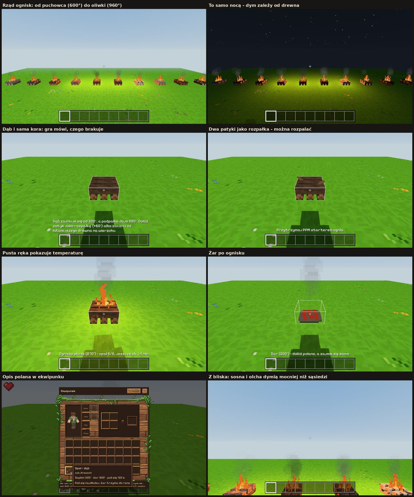
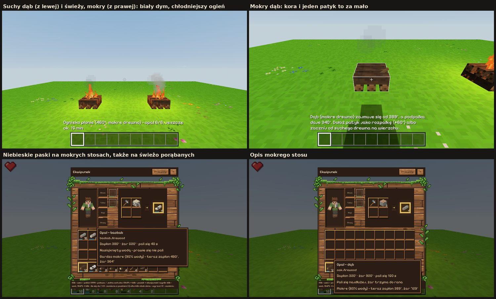
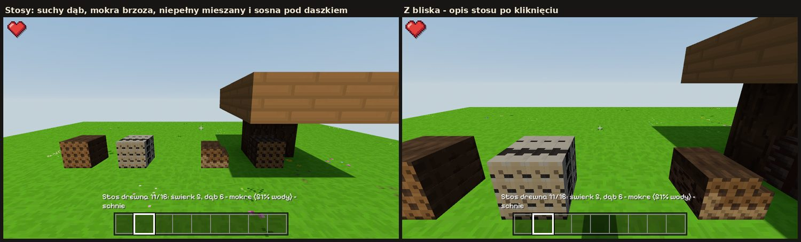

# Ogniska

Od wersji 0.51.0 ognisko buduje się w świecie, bez przedmiotu „ognisko”.

1. W craftingu połącz pień (także okorowany) z siekierą: dostaniesz **4 opały**, a siekiera zostanie w siatce.
2. Opałem kliknij PPM suche, stałe podłoże. Kolejne kliknięcia dokładają polana, aż będzie ich **6**.
3. Dodaj podpałkę: korę (okoruj pień siekierą - od 0.100.0 każde drzewo daje korę), trawę, słomę, gałązki porostu albo hubę. Lepsza podpałka skraca rozpalanie (huba - o połowę; tabela: [ziola.md](ziola.md#podpałka-do-ogniska)). Od 1.32.0 podpałka musi też dać radę polanu z wierzchu - patrz niżej.
4. Z dwóch patyków zrób **starter ognia**. Skieruj celownik na ognisko i trzymaj PPM przez **5 sekund** (z lepszą podpałką krócej). Na telefonie przytrzymaj „Postaw”. Starter pozostaje w ekwipunku.

Polana można mieszać: każde zachowuje swój model i teksturę, a od 1.32.0 także swój charakter.

## Ognisko z temperaturą (1.32.0)

Pomysł Kamila ([drewno.md](drewno.md)): każde drewno pali się inaczej, a ogień ma temperaturę.

### Cechy drewna

Każdy z 32 gatunków ma **zapłon** (jak gorący musi być ogień, żeby polano się zajęło), **żar** (najwyższą temperaturę, jaką daje) i **czas palenia** jednego polana. Pełna tabela: [drewno.md](drewno.md#tabela-gatunków); w grze `/drewno`. Liczby widać też po najechaniu na polano w ekwipunku.

| Drewno | Zapłon | Żar | Polano | Pełny stos | Ciepło przy ogniu |
|---|---|---|---|---|---|
| puchowiec | 250° | 600° | 35 s | 3,5 min | +12°C |
| świerk | 240° | 700° | 55 s | 5,5 min | +16°C |
| sosna | 220° | 740° | 60 s | 6 min | +18°C |
| lipa | 260° | 650° | 50 s | 5 min | +14°C |
| brzoza | 270° | 860° | 100 s | 10 min | +22°C |
| buk | 300° | 900° | 135 s | 13,5 min | +24°C |
| dąb | 320° | 920° | 150 s | 15 min | +25°C |
| oliwka | 290° | 960° | 165 s | 16,5 min | +26°C |

Iglaste zajmują się łatwo, palą krótko i strzelają iskrami. Liściaste trudniej rozpalić, ale grzeją mocno i długo.

### Rozpalanie etapami

- **Podpałka daje temperaturę na start**: trawa, trzcina i słoma **260°**, kora, huba, porost i puch puchowca **280°**, kora żywiczna (sosna, świerk, kosodrzewina, eukaliptus) i szyszki **300°**, kora brzozowa **330°**.
- **Polano z wierzchu stosu zajmie się tylko wtedy, gdy podpałka jest co najmniej tak gorąca jak jego zapłon.** Trawa zapali świerk, sosnę czy lipę; dębu, buka ani brzozy - nie.
- **Rozpałka z patyków** *(dodatek)*: PPM patykiem na ułożonym stosie. Każdy patyk dodaje podpałce **60°**, mieszczą się **dwa**. Trawa i dwa patyki (380°) rozpalą każde suche drewno, nawet baobab.
- Druga droga: **łatwe drewno na wierzchu**. Świerk położony na dębowym stosie zajmie się od trawy, a od niego - dąb pod spodem. Żar każdego drewna jest wyższy niż zapłon dowolnego innego, więc ogień, który już płonie, nie zgaśnie na trudnym polanie.
- Gdy podpałka jest za słaba, gra mówi to od razu (przy dokładaniu podpałki, pustą ręką i starterem): „Dąb zajmuje się od 320°, a podpałka daje 280°. Dołóż patyk jako rozpałkę (+60°) albo zacznij od łatwiejszego drewna na wierzchu." Trzymanie startera nic wtedy nie daje i nic nie przepada.
- Huba tli się długo: puszczone rozpalanie stygnie przy niej trzy razy wolniej.

### Temperatura, ciepło i gotowanie

- Ogień zaczyna od temperatury podpałki i w około pół minuty dochodzi do **żaru polana, które właśnie się pali** (tego z wierzchu). Gdy ogień przechodzi na następne polano, temperatura płynnie się zmienia - zimniejsze drewno dołożone na wierzch studzi ognisko.
- **Ciepło przy ognisku** = (temperatura − 300) / 25 °C: lipa ok. +14, sosna +18, brzoza +22 (tyle było dotąd zawsze), dąb +25, oliwka +26. Świeżo rozpalony ogień prawie nie grzeje.
- **Gotowanie i pieczenie**: 800° to zwykła szybkość, dąb jest o 15% szybszy, lipa o 19% wolniejsza (granice: 0,4-1,25).
- PPM pustą ręką pokazuje temperaturę: „Ognisko płonie (920°) - opał 4/6, jeszcze ok. 9 min".

### Żar

- Każde wypalone polano zostawia żar: miękkie drewno kilka sekund, twarde ponad minutę (świerk 10 s, brzoza 33 s, dąb 75 s, oliwka 91 s). Po stosie świerka żar trzyma **minutę**, po stosie dębu **7,5 minuty**; najwyżej 10 minut.
- Żar ma 500° i stygnie przez ostatnie dwie minuty do 250°. Grzeje do +5°C, a nad żarem **da się piec** (wolniej).
- **Polano dołożone na żar zajmuje się samo** po 4 sekundach - bez podpałki, startera i pełnego stosu - jeśli żar jest gorętszy niż zapłon polana. Na gorącym żarze zajmie się nawet dąb, na dogasającym już tylko łatwe drewno. Potem dokłada się jak do płonącego ogniska.
- Na zimnym popiele wszystko po staremu: sześć polan, podpałka, starter.

### Dym i iskry

Dymi i strzela polano, które właśnie się pali. Modrzew sypie iskrami, świerk i eukaliptus mniej, liściaste wcale. Olcha i baobab kopcą, sosna i kosodrzewina dają ciemny dym, buk i osika palą się prawie bez dymu.

### Do sprawdzania

`/drewno` (tabela), `/drewno dąb` (jeden gatunek), `/drewno ognisko dąb`, `/drewno ognisko dąb zimne`, `/drewno ognisko dąb zar`, `/drewno rzad` (dziesięć ognisk obok siebie), `/drewno zestaw` ([komendy.md](komendy.md)). Test: `tools/sprawdz_drewna.mjs`.

### Luki i świadome uproszczenia

- (1.32.0) Drewno było zawsze suche - od 1.33.0 jest wilgotność, opis niżej.
- (1.32.0) Deszcz nie gasił ogniska, a pochodnie się nie wypalały - od 1.35.0 jedno i drugie działa.
- **Twardość** drewna jest w danych i w `/drewno`, ale nic jeszcze nie robi - czeka na ścinanie i narzędzia (części B i C).
- Temperatura zależy tylko od polana z wierzchu, nie od wielkości stosu; liczby (stała 12 s dochodzenia do żaru, wzór na ciepło, czas żaru) dobrałem na oko - do strojenia w grze.
- Polano na żarze zajmuje się także, gdy nikt nie patrzy; napis i osiągnięcie dostaje tylko gracz w promieniu 8 bloków.
- W grze ze znajomymi temperaturę i żar każdy liczy u siebie (jak dotąd spalanie) - krótko po dołączeniu liczby mogą się różnić o kilka stopni.
- Rozpałka to dwa patyki wetknięte między górne polana; nie mają własnej animacji zapłonu.

## Wilgotność drewna (1.33.0)

Druga część projektu drewna ([drewno.md](drewno.md), A2).

- **Polana prosto spod siekiery są mokre** - tym bardziej, im więcej soku ma gatunek. Brzoza, olcha, wierzba, cypryśnik i namorzyn są bardzo mokre (80% wody), dąb, buk, klon i lipa mokre (60%), sosna, świerk i większość iglastych wilgotne (40%), a **oliwka, akacja, sosna oścista i jukka palą się od razu** (15%). Baobab jest nasiąknięty (95%).
- Wilgotność niesie **stos polan**: mokry ma **niebieski pasek** na ikonce (tym dłuższy, im więcej wody) i opis po najechaniu, np. „Mokre (60% wody) - teraz zapłon 389°, żar 729°". Suche i mokre polana leżą w osobnych stosach; położone ręcznie jeden na drugi mieszają się i wilgotność wychodzi ze średniej. **Pnie wilgotności nie mają** - drewno schnie dopiero porąbane.
- **Mokre polano trudniej zapalić i słabiej grzeje.** Do 15% wody jest suche; powyżej kara rośnie i przy 80% jest pełna: zapłon **o 100° wyższy**, żar **o 30% niższy**. Świeży dąb: zapłon 389° zamiast 320°, żar 729° zamiast 920°. Świeża sosna prawie tego nie czuje (258°) - żywica pomaga.
- Zwykła kora (280°) i dwa patyki (400°) zapalą świeże drewno każdego gatunku poza namorzynem i baobabem - te trzeba najpierw podsuszyć albo dołożyć do płonącego ognia. Gra mówi wprost: „Dąb (mokre drewno) zajmuje się od 389°, a podpałka daje 280°…".
- **W płonącym ognisku drewno schnie.** Polano z wierzchu schnie, paląc się (w połowie palenia zostaje ćwierć nadmiaru wody) - najpierw **syczy i dymi na biało**, a ogień jest chłodniejszy. Polana pod nim schną od ciepła (w pełni mokre w 5 minut). Mokre polano dołożone do ognia zawsze się zajmie, ale na chwilę studzi ognisko.

### Schnięcie

Ubytek wilgotności na dobę gry (20 minut) = 0,35 × miejsce × temperatura + ogień:

| Miejsce | Mnożnik | Świeży dąb wyschnie (15°C) |
|---|---|---|
| plecak, skrzynia | 0,3 | ok. 4 doby |
| piwniczka (skrzynia bez nieba nad sobą) | 0,15 | ok. 8,5 doby |
| na ziemi, w zimnym stosie ogniska, w drewutni (1.34.0) | 1 | ok. 1,3 doby |
| to samo w słońcu (dzień, gołe niebo, bez deszczu) | 1,5 | niecała doba |
| dwa bloki od płonącego ogniska | +4 na dobę | ok. 2 minuty |

- **Temperatura**: przy 15°C zwykłe tempo, w upale do dwóch razy szybciej, na mrozie pięć razy wolniej - zimą drewno suszy się przy ogniu.
- **Ogień**: liczy się ciepło ogniska w tym miejscu (jak przy ogrzewaniu gracza) - im bliżej i im gorętszy ogień, tym szybciej. W plecaku działa w 30%: stojąc przy ognisku, wysuszysz dąb w ok. 7 minut; polana rzucone obok ognia (klawisz wyrzucania) wyschną w ok. 2 minuty.
- **Deszcz** moczy polana leżące pod gołym niebem i zimne stosy ognisk (do 60% wody); plecak, skrzynia i dach chronią. Polano w wodzie nasiąka (95%).
- Gdy drewno w plecaku albo obok gracza wyschnie, gra pisze „Drewno wyschło: …".

### Luki (wilgotność)

- (1.33.0) Drewutni jeszcze nie było - od 1.34.0 jest stos drewna, opis niżej.
- (1.33.0) Deszcz nie gasił płonącego ogniska - od 1.35.0 chłodzi je i gasi słabe, opis niżej.
- **Pnie i deski nie mają wilgotności**; mokry jest każdy świeżo porąbany stos polan, nawet z pnia, który rok leżał w skrzyni. Suche drewno z powalonych drzew dojdzie ze ścinaniem (część B).
- Deszcz i temperaturę liczy się tam, gdzie stoi gracz - dalekie (niewczytane) polana schną w zwykłym tempie pory roku i nie mokną.
- Mokrych polan w stosie ogniska nie widać po teksturze - tylko po pasku, opisie, dymie i syku (w drewutni są ciemniejsze).
- Liczby (100°, 30%, tempo schnięcia) są na oko - do strojenia. `/drewno tempo` przyspiesza schnięcie do prób.

### Do sprawdzania (wilgotność)

`/drewno swieze dąb` (mokre polana), `/drewno mokre 60`, `/drewno ognisko dąb mokre`, `/drewno schniecie`, `/drewno tempo 50` ([komendy.md](komendy.md)). Test: `tools/sprawdz_wilgotnosci.mjs`.

## Drewutnia (1.34.0)

Stos polan do suszenia ([drewno.md](drewno.md), A2b).

- **Układanie**: kucnij i kliknij ziemię polanem (PPM) - powstaje **stos drewna**. Bez kucania polano zakłada ognisko, jak dotąd. Potem PPM polanem dokłada jedno, a z kucnięciem - tyle, ile się zmieści.
- Stos mieści **16 polan** (cztery warstwy po cztery), różnych gatunków. Polana leżą wzdłuż spojrzenia: od przodu widać ich czoła.
- **Zdejmowanie**: PPM pustą ręką zdejmuje jedno polano z wierzchu, z kucnięciem - wszystkie tego gatunku, które leżą na wierzchu. Rozbity stos oddaje wszystko (przy pełnym ekwipunku rozbiórka jest zablokowana, jak przy ognisku).
- **Schnięcie**: polana na stosie schną jak na powietrzu - ponad trzy razy szybciej niż w plecaku (świeży dąb ok. 1,3 doby gry, w słońcu niecała doba, przy ognisku kilka minut) - i **nie zajmują ekwipunku**. Gdy cały stos obok gracza wyschnie, gra pisze „Drewno wyschło: stos (16 polan)".
- **Dach**: stos pod gołym niebem moknie w deszczu (do 60% wody). Pod dachem - dowolnym blokiem nad nim - nie zmoknie i schnie dalej, tylko bez dopłaty za słońce. Drewutnia to po prostu stosy pod daszkiem.
- **Mokre polana widać**: są ciemniejsze. PPM czymkolwiek innym pokazuje opis: „Stos drewna 16/16: dąb 12, brzoza 4 - mokrych 4 z 16 - schnie".
- Stos jest stały (nie da się przez niego przejść) i stoi na podłożu - usunięcie bloku pod nim rozbiera stos.

Obraz: każdy stos to jedna siatka (jedno rysowanie), budowana od nowa tylko po zmianie zawartości; widać najwyżej 48 stosów w promieniu 64 bloków. Do prób: `/drewno stos`, `/drewno stos brzoza mokre`, `/drewno tempo 50`. Test: `tools/sprawdz_drewutni.mjs`.

### Luki (drewutnia)

- Nie ma osobnego bloku wiaty ani stojaka - dach buduje się samemu ze zwykłych bloków.
- Niepełny stos też zajmuje cały blok (kolizja i celownik), choć polan widać mniej.
- Stos nie płonie i nie zajmuje się od ogniska obok (pożar to część E).
- Dalekie (niewczytane) stosy schną w zwykłym tempie pory roku i nie mokną.
- Zdjęte naraz polana o różnej wilgotności dostają średnią.

## Deszcz a ognisko (1.35.0)

- Deszcz pada na ogniska **pod gołym niebem** (nad ogniskiem widać niebo); pod dachem nic się nie zmienia.
- **Chłodzi ogień**: żar palącego się polana jest niższy nawet o 35% (ulewa). Dąb w ulewie ma ok. 600° zamiast 920° - mniej grzeje i wolniej gotuje.
- **Słabe ognisko gaśnie**: gdy pada porządnie (natężenie od 0,3), a schłodzony żar spada poniżej 560°, ogień gaśnie po ok. 12 sekundach ulewy. Ulewę przetrwa dąb, buk, klon, jabłoń, akacja, oliwka, namorzyn i eukaliptus; świerk, sosna, brzoza, lipa czy wierzba zgasną. Zwykły deszcz gasi tylko najsłabsze drewno (lipa, wierzba, osika, puchowiec), mżawka żadnego. Mokre drewno gaśnie łatwiej.
- Zgaszone ognisko zostaje ze stosem (wierzchnie polano nadpalone) i resztką żaru; gra pisze „Deszcz zgasił ognisko". Stos pod gołym niebem dalej moknie.
- **Żar po ognisku** gaśnie w ulewie pięć razy szybciej.
- PPM pustą ręką pokazuje to w opisie: „Ognisko płonie (600°, pada na nie deszcz) - …"; ogień w deszczu paruje na biało.
- Przespanego deszczu gra nie liczy - ogniska dopalają się jak w pogodę.

Pochodnie w deszczu i ich wypalanie: [pochodnie.md](pochodnie.md#wypalanie-1350). Test: `tools/sprawdz_pochodni_paliwa.mjs`.

## Wcześniej

**Od 0.100.0 polana spalają się po kolei** (od wierzchu stosu; do 1.31.0 każde 80 sekund, od 1.32.0 zależnie od drewna): wypalone znika, a ognisko przygasa sześcioma etapami - płomień i światło maleją razem z opałem. Do płonącego ogniska można dokładać polana (do sześciu); opis: [przedmioty-i-noz.md](przedmioty-i-noz.md#ognisko-etapami). Sen i utrata przytomności dopalają ogniska o przespany czas.

Palące się drewno czernieje i pokazuje żarzące szczeliny. Po wypaleniu ostatnie polano osiada w ciągu 2,4 sekundy, zostawiając popiół i żar (do 1.31.0 zawsze na 90 sekund; od 1.32.0 zależnie od drewna, a polano dołożone na gorący żar zajmuje się samo). Na zimny popiół można znów dokładać opał - ponowne rozpalenie wymaga wtedy kompletu sześciu polan, nowej podpałki i startera. Do pełnego stosu nie dokłada się siódmego polana.

Niedokończone, niepalące się ognisko można rozebrać: odzyskuje się świeży opał, niewykorzystaną podpałkę i patyki rozpałki. Zwęglonego drewna nie da się zamienić z powrotem w świeży opał. Przy pełnym ekwipunku rozbiórka, także przez usunięcie podłoża, zostaje zablokowana zamiast gubić przedmioty.

Stan polan, podpałki, rozpałki, spalania, temperatury, żaru i popiołu zapisuje się wraz ze światem. Ogniska poza wczytanymi chunkami nadal odmierzają czas aktywnej gry. Zamknięcie gry lub pauza zatrzymuje ten czas; zapis nie wznawia samoczynnie niedokończonego trzymania startera.

Od 1.20.0 na ognisku można postawić **gliniany garnek** i gotować w nim potrawy - [gotowanie.md](gotowanie.md).

## Grafika i koszt

- Model polan pochodzi z zatwierdzonego pliku Blockbench; jeden piksel odpowiada 1/16 bloku. Źródła i dziewięć atlasów są w `assets/models/campfire/`.
- Od 0.51.1 płomienie animuje 16 klatek tekstury przy 12 klatkach/s. Atlas powstaje raz z zatwierdzonej sylwetki, a ogniska mają przesunięte fazy animacji. Dodatkowe falowanie modelu ma połowę pierwotnej amplitudy. Wysokość nadal rośnie podczas rozpalania. Dym i iskry korzystają ze wspólnej puli maksymalnie 96 drobin (od 1.32.0 ich ilość zależy od drewna).
- Popiół ma kwadratowy obrys ze schodkami na siatce 1/16 bloku; węgle tworzą nieregularny układ prostokątny.
- Ciepłe światło migocze delikatnie. Najbliższe **4 ogniska** oświetlają otoczenie i rzucają cienie terenu oraz roślin. Zasięg każdego źródła łagodnie wygasa do 16 bloków.
- Jedna tekstura głębi mieści cztery zestawy sześciu kierunków po 256 × 256. Mapa powstaje przy zmianie źródła lub pobliskiego mesha; samo migotanie nie odświeża map ani chunków. Aktualizowany jest najwyżej jeden zestaw na 0,1 s, rotacyjnie między źródłami.
- Widoczne modele mają limit 32 ognisk w promieniu 72 bloków. Limit grafiki nie wpływa na zapis i spalanie.
- Ustawienie „Dynamiczne światło” steruje dodatkowym oświetleniem ognisk. Płomień, żar, dym i stan gry działają również bez niego.

Cechy drewna: `blocks/woodTraits.js`, logika: `CampfireState.js`, interakcje: `Campfires.js`, modele i drobiny: `CampfireRenderer.js`, światło i cienie: `CampfireLight.js`.
