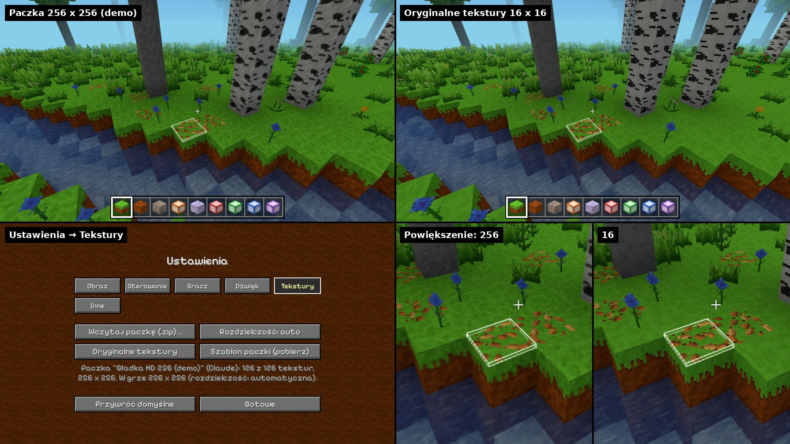

# Paczki tekstur

Własne tekstury bloków, roślin i przedmiotów - w **dowolnej
rozdzielczości** (np. 64 x 64, 512 x 512, 1254 x 1254). Paczka to plik
`.zip`; gra wczytuje go w **Ustawienia → Tekstury** (na komputerze,
w przeglądarce i w aplikacji na telefon - tam wybiera się plik z pamięci
telefonu).

## Szablon

Folder **`paczka-tekstur-szablon/`** w repozytorium - oryginalne
tekstury gry, każda w osobnym pliku, z opisem (`CZYTAJ.md` - tabela:
który plik to który blok). Spakowany jest też w każdym wydaniu gry:
`Voxel-Game-paczka-tekstur.zip` (w grze: Ustawienia → Tekstury →
*Szablon paczki*, albo `/tekstury szablon`).

Szablon robi `python tools/paczka_tekstur.py` (z `terrain.png`, paczek
drzew, pęknięć i księżyca) - po zmianie tekstur albo nowym bloku trzeba
go uruchomić jeszcze raz.

## Jak zrobić paczkę

1. Skopiuj szablon, w `paczka.json` wpisz nazwę, autora i opis.
2. Podmień obrazki w `bloki/` - kwadratowe PNG, najlepiej wszystkie tej
   samej wielkości. Przezroczystość jak w oryginałach (liście, rośliny,
   przedmioty).
3. Czego nie zmieniasz - usuń albo zostaw; brakujące tekstury zostają
   oryginalne (powiększone, ostre piksele).
4. Spakuj do `.zip` (zawartość folderu albo cały folder - gra sama
   pominie folder na początku ścieżek).
5. Ustawienia → Tekstury → **Wczytaj paczkę (.zip)** → wybierz plik.
   Gra pokazuje postęp, potem uruchamia się ponownie (świat zapisuje
   się przedtem).

Plik paczki:

| ścieżka | co |
|---|---|
| `paczka.json` | `{ "nazwa": "...", "autor": "...", "opis": "..." }` (niekonieczny) |
| `bloki/<nazwa>.png` | tekstura kafelka atlasu, np. `bloki/grass_top.png` - nazwy jak w `ATLAS_TILES` (`src/rendering/TextureAtlas.js`) i w szablonie |
| `bloki/<drzewo>/<plik>.png` | tekstury drzew z paczek drzew (`assets/drzewa/`), np. `bloki/jablon/liscie.png` |
| `pekniecia.png` | pęknięcia kopanego bloku - 10 etapów obok siebie |
| `niebo/ksiezyc.png` | tarcza księżyca |

Inne pliki (np. `CZYTAJ.md`) są pomijane; nieznane obrazki pokazuje
`/tekstury lista`. Wielkość liter w nazwach nie ma znaczenia. Obrazek
wyższy niż szeroki (np. tekstura animowana - klatki jedna pod drugą) -
gra bierze kwadrat z góry.

## Rozdzielczość w grze

Paczka może mieć tekstury dowolnej wielkości, ale w grze wszystkie są
przeskalowane do jednej **rozdzielczości w grze** (Ustawienia →
Tekstury → *Rozdzielczość*, `/tekstury rozdzielczosc`):

- **automatyczna** - najbliższa potęga dwójki od rozdzielczości paczki
  (np. 20 → 32, 1254 → 2048), ale **najwyżej 512 x 512 na komputerze
  i 256 x 256 na telefonie**,
- albo wybrana: 16, 32, 64, 128, 256, 512 (mniej = szybciej, mniej
  pamięci). Każde kliknięcie przycisku *Rozdzielczość* - następna;
  zmienia się 2 sekundy po ostatnim kliknięciu (przeskalowanie
  i ponowne uruchomienie gry).

Dlaczego nie więcej: wszystkie tekstury leżą w jednym obrazku (atlas
16 x 11 kafelków) na karcie graficznej. Przy 512 x 512 na kafelek to
8192 x 5632 pikseli - ok. 250 MB pamięci karty z mipmapami; 1024 x 1024
to już prawie 1 GB i obrazek 16384 pikseli szerokości (największy, jaki
przyjmuje wiele kart). Gra sama sprawdza, ile karta przyjmie
(`maxResolution` w `TexturePacks.js`), i nie proponuje więcej.

Zmniejszanie jest gładkie (po kawałku, po 2 razy - ładniej niż od razu
z 1254 do 64), powiększanie (np. paczka 16 x 16 w grze 64) - ostre
piksele.

## Jak to działa (kod)

- `src/rendering/TexturePacks.js` - czytanie `.zip` (bez bibliotek:
  katalog plików z końca zipa, rozpakowanie - `DecompressionStream`
  przeglądarki), zapis w IndexedDB **`voxel-game-tekstury`** (osobno od
  światów): oryginalne pliki paczki i tekstury przeskalowane do
  rozdzielczości w grze (PNG) - przy starcie wczytują się szybko.
  Rozdzielczość (`gameResolution`, `maxResolution`).
- `src/rendering/TextureAtlas.js` - atlas przy starcie gry: oryginalny
  (`terrain.png` + paczki drzew), a z paczką - kafelki T x T (z paczki
  albo powiększone oryginalne) i **mipmapy**: pomniejszone kopie atlasu
  (T/2, T/4... do 1 piksela), każdy kafelek pomniejszany osobno, więc
  kolory sąsiednich kafelków się nie mieszają. Z daleka karta bierze
  mniejszą kopię (filtr `NearestMipmapLinear`) - duże tekstury nie
  migoczą. UV kafelków się nie zmieniają (te same kafelki, 16 w rzędzie).
  Ikonki bloków - z kopii 64 x 64, średnie kolory (daleki teren,
  odłamki) - z kopii 16 x 16.
- Woda (`BlockRenderData.js`) sama wybiera kopię atlasu (`textureLod`),
  bo jej współrzędne tekstury skaczą co piksel (`uAtlasTile`,
  `uAtlasMipmaps`).
- Pęknięcia (`BlockCracks.js`) i księżyc (`Moon.js`) - z paczki, jeśli
  je ma.
- `src/app/textures.js` - wczytanie, rozdzielczość, oryginalne
  tekstury, szablon - wspólne dla zakładki Tekstury (`Menu.js`)
  i `/tekstury`. Każda zmiana: zapis świata i ponowne uruchomienie gry
  (atlas, ikonki i kolory dalekiego terenu liczą się raz, przy starcie).
- Telefon: wybór pliku przez `<input type="file">` - w aplikacji
  obsługuje go Capacitor (systemowe okno wyboru pliku; bez filtra `.zip`,
  bo nie każdy telefon rozpoznaje typ pliku).

## Komenda

`/tekstury` - stan; `wczytaj` (wybór pliku), `rozdzielczosc [auto | 16
... 512]`, `oryginalne`, `szablon`, `lista` (brakujące i pominięte
pliki paczki).

## Do zrobienia później

- Kilka paczek naraz i przełączanie między nimi (dziś jedna - nowa
  zastępuje poprzednią).
- Tekstury interfejsu (przyciski, czcionka), nieba, skórki (skórka ma
  osobne ustawienie - *Gracz*).
- Wygładzanie (filtr liniowy) dla paczek "nie-pikselowych".
