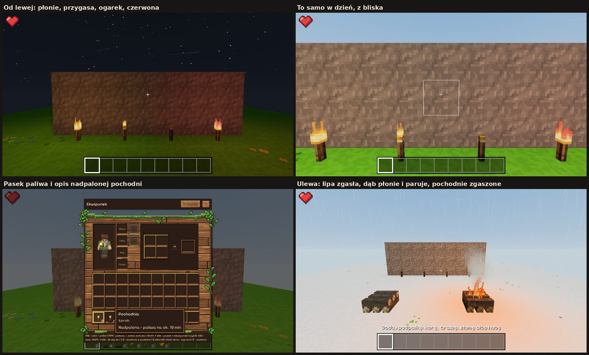

# Animowane pochodnie — 0.61.0

Pochodnia wykorzystuje model i oryginalne animowane tekstury z moda
**Reactive Torch**, przekazanego przez Kamila. Płomień ma 20 klatek,
100 ms na klatkę, płynne przejścia i pętlę trwającą 2 sekundy.
Animacja działa w świecie oraz na pochodni trzymanej w ręce.

## Wytwarzanie i używanie

- (Od 1.35.0 pochodnie się wypalają - rozdział „Wypalanie".)
- **Patyk + żywica (albo oliwki) → 4 pochodnie.** Żywicę zbiera się PPM z żywicznego
  pnia sosny. Przepis działa w siatce 2 × 2, bez ustalonego układu.
- Pochodnia może stać na pełnym bloku albo wisieć na jego bocznej ścianie.
  Nie zajmuje miejsca w wodzie. Po usunięciu podpory zostaje usunięta;
  podczas kopania w przygodzie trafia wraz z łupami do ekwipunku.
- **PPM barwnikiem na pochodnię** zmienia jej kolor i zużywa jeden barwnik
  w przygodzie. Ten sam kolor nie zużywa kolejnego barwnika.
- **Dowolna pochodnia + barwnik → pochodnia w wybranym kolorze** działa
  również w siatce wytwarzania. Przepisy widać w księdze.
- Zniszczona kolorowa pochodnia zachowuje kolor. Kolor i mocowanie są
  również zapisywane w świecie. W kreatywnym odmiany są w kategorii
  **Światło**, a barwniki w **Narzędzia i surowce**.

## Wypalanie (1.35.0)

Decyzja Kamila ([drewno.md](drewno.md)): pochodnie się wypalają.

- Postawiona pochodnia pali się **godzinę** (trzy doby gry). Przez ostatnie 12 minut **przygasa**: mniejszy płomień, słabsze światło (9 zamiast 14), bez iskier. Potem zostaje **ogarek** - nie świeci i nie ma koloru.
- **Dolewanie paliwa**: PPM żywicą albo oliwkami na pochodni albo ogarku - pali się znów godzinę, w dawnym kolorze. Ogarek zdjęty ze ściany to przedmiot; z żywicą albo oliwkami w siatce wytwarzania daje nową pochodnię.
- **Paliwo zostaje w pochodni.** Zdjęta ze ściany wraca do ekwipunku z resztą paliwa (pomarańczowy pasek na ikonce, opis „Nadpalona - paliwa na ok. 15 min"); postawiona znów - pali się tyle, ile jej zostało. Nowe i nadpalone leżą w osobnych stosach. Barwienie nie dolewa paliwa.
- **PPM pustą ręką** mówi, na ile starczy paliwa.
- **Deszcz** gasi pochodnie pod gołym niebem po ok. 20 sekundach ulewy (słabszy deszcz - dłużej, mżawka wcale). Zgaszona ma jeszcze paliwo: **PPM starterem ognia** rozpala ją na nowo. Pod dachem pochodnie płoną dalej.
- **Lampy nie gasną** - to nagroda za trudniejszy przepis.
- **Łuczywo**: żywiczne polano (sosna, kosodrzewina, świerk, modrzew, sosna oścista) i siekiera dają 4 szczapy. To najlepsza podpałka (350° - zapala dąb bez patyków), a postawione świeci jak pochodnia, tylko **6 minut** (od razu słabszym światłem).
- Sen i utrata przytomności spalają paliwo o przespany czas. Pochodnie w dawnych światach dostają pełne paliwo, gdy gra je pierwszy raz zobaczy.
- Przygasająca pochodnia grzeje o połowę słabiej, ogarek wcale.

Do prób: `/pochodnia`, `/pochodnia daj`, `/pochodnia paliwo 15`, `/pochodnia czas 50`. Test: `tools/sprawdz_pochodni_paliwa.mjs`. Pliki: `src/items/torchFuel.js` (liczby), `src/game/TorchBurn.js` (wypalanie), `src/blocks/torches.js` (etapy jako bloki 16000-16089).

### Luki (wypalanie)

- Pochodnia pali się tyle samo bez względu na to, czy zrobiono ją z żywicy, czy z oliwek (w projekcie: olej dłużej).
- Pochodnia w ręce i w ekwipunku nie traci paliwa - tylko postawiona.
- Łuczywo postawione wygląda jak zwykła przygasająca pochodnia; zdjęte wraca jako nadpalona pochodnia, nie łuczywo.
- Deszcz liczy się tam, gdzie stoi gracz; dalekim pochodniom ubywa tylko paliwa, a blok zmienia się po wczytaniu terenu.
- W grze ze znajomymi bloki zmienia gospodarz; u gościa etap może zmienić się z sekundowym opóźnieniem.
- Liczby (godzina, 12 minut, 20 sekund deszczu) są na oko - do strojenia.

## Barwniki z roślin

Każdy z poniższych składników daje jedną sztukę barwnika. Źródła
przypisane w paczkach roślin do tych samych grup kolorów też działają.

| Barwnik | Składnik |
|---|---|
| Czerwony | mak, truskawki, papryczki chili lub składnik grupy czerwonej |
| Żółty | mniszek |
| Biały | rumianek |
| Zielony | koniczyna, pokrzywa, paproć lub składnik grupy zielonej |
| Niebieski | chaber, borówki lub składnik grupy niebieskiej |
| Fioletowy | jeżyny, wrzos, krokus lub składnik grupy fioletowej |
| Brązowy | żołądź |

Pozostałe kolory powstają przez mieszanie. Liczba wynikowych barwników
jest równa liczbie użytych składników.

| Wynik | Barwniki do zmieszania |
|---|---|
| Pomarańczowy | czerwony + żółty |
| Purpurowy | fioletowy + różowy |
| Jasnoniebieski | niebieski + biały |
| Limonkowy | zielony + biały |
| Różowy | czerwony + biały |
| Szary | czarny + biały |
| Jasnoszary | szary + biały |
| Turkusowy | niebieski + zielony |
| Czarny | czerwony + zielony + niebieski |

## Światło, animacja i zapis

Oryginalne barwione tekstury zmieniają głównie końcówki płomienia;
drewniany trzonek i ciepły dół pozostają rozpoznawalne. Światło otoczenia
korzysta ze wspólnego systemu RGB gry i uwzględnia ciepłą podstawę
płomienia. Czarna odmiana nie odejmuje światła od świata.

Płonąca pochodnia ma stałą emisję (poziom 14; przygasająca 9, ogarek 0 - to osobne bloki). Klatki animacji wybiera GPU
ze wspólnej tekstury. Zmiana klatki nie zapisuje bloku ani nie uruchamia
ponownie rozchodzenia światła. Kolorowanie uruchamia standardową zmianę
bloku i aktualizuje oświetlenie tylko wtedy, kiedy kolor się zmienił.

Numery bloków **10010–10094** zapisują 17 odmian i pięć mocowań. Chunk
przechowuje pomocniczy indeks pochodni, odbudowywany z zapisanych bloków;
indeks trafia również z workera generującego/wczytującego teren. Iskry
i dym korzystają ze wspólnej, ograniczonej puli cząsteczek.

## Pliki

- `src/blocks/torches.js` — warianty, kolory, numery i mocowania.
- `src/items/dyes.js`, `src/crafting/recipes.js` — barwniki i przepisy.
- `src/rendering/TorchGeometry.js`, `TorchMaterial.js`, `TorchRenderer.js`
  — model, animacja i cząsteczki.
- `src/game/TorchInteraction.js` — barwienie postawionej pochodni.
- `assets/models/torch/` — oryginalne PNG i licencja MIT autora.
- `tools/sprawdz_pochodnie.mjs`, `tools/sprawdz_pochodnie_webgl.mjs`
  — sprawdzenia zasad oraz renderowania animacji w Chrome.
