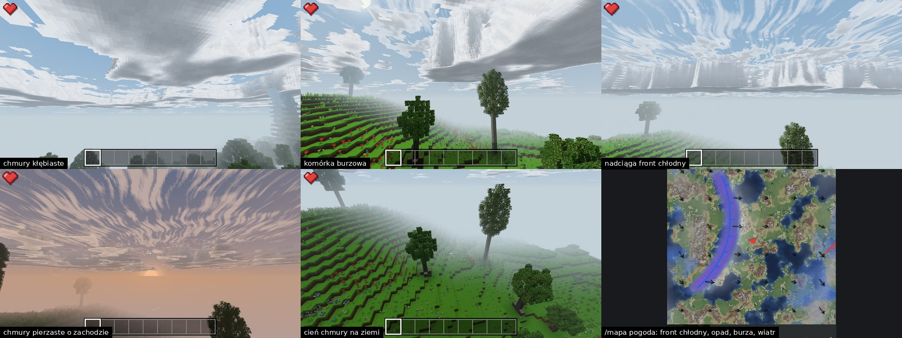
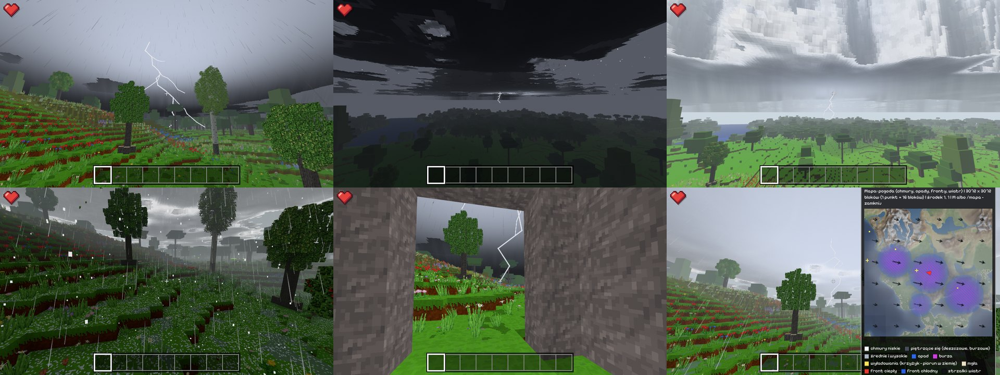
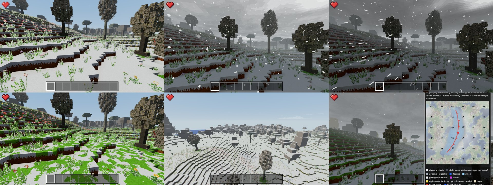
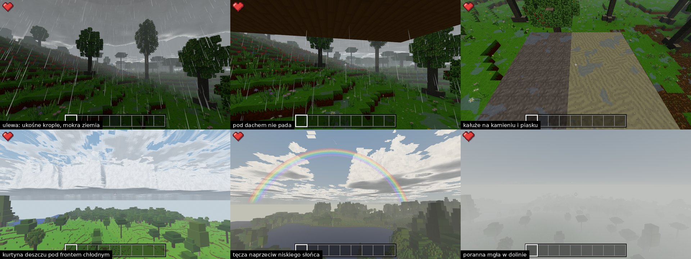

# Pogoda

Pogoda w Various Roots nie jest włącznikiem dla całego świata. To mapa,
która płynie nad krajobrazem: front widać z daleka, da się przed nim
uciec albo pójść mu naprzeciw. Liczy się wyłącznie z **ziarna świata
i czasu gry** - nic nie trafia do zapisu, a w grze ze znajomymi wszyscy
widzą ten sam front w tym samym miejscu (czas świata jest wspólny).

Kod: `src/weather/`, chmury na niebie: `src/sky/layers/Clouds.js`.

## Plan aktualizacji pogodowej

Całość jest za duża na jedno wydanie, więc idzie w sześciu częściach.
Każda jest grywalna sama w sobie.

| nr | część | stan |
|---|---|---|
| 1 | **Niebo i fronty** - pole pogody, fronty, lokalny wiatr, chmury na trzech piętrach, cienie chmur, mapa pogody, `/pogoda` | **1.11.0** |
| 2 | **Deszcz** - od mżawki po ulewę, skośne krople, odległe kurtyny deszczu, mokry świat i kałuże, schronienie pod dachem, dźwięk deszczu i wiatru, mgła, tęcza i halo | **1.12.0** |
| 3 | **Burze** - letnie komórki i ciemne fronty, wyładowania w chmurach i w ziemię oświetlające krajobraz, grzmot spóźniony o odległość, grad | **1.13.0** |
| 4 | **Zima** - temperatura, rodzaje śniegu (od krup po mokre płaty), śnieżyca, zamieć przy ziemi, pokrywa śnieżna (wizualna) i topnienie, szron | **1.14.0** |
| 5 | **Pustynia i morze** - pyłowa mgiełka, burza piaskowa, haboob, wiry pyłowe, sztorm ze spienionymi falami | plan |
| 6 | **Wpływ na rozgrywkę** - deszcz gasi ognisko, rośliny rosną po deszczu, zimno | plan |

Ustalenia z Kamilem: pogoda **ma wpływać na rozgrywkę** (część 6),
śnieg na ziemi będzie **wizualną pokrywą** (nie blokami), piorun na
początek daje **tylko światło i dźwięk**.

## Jak powstaje pogoda (`WeatherField.js`)

1. **Przepływ.** Każdy świat ma stały kierunek, z którego nadciąga pogoda
   (przeważnie z zachodu, w każdym świecie trochę inaczej) i prędkość 5,5
   bloku na sekundę. Doba gry to 20 minut, więc front przechodzi nad
   graczem przez kilka-kilkanaście minut.
2. **Układy.** Na dwóch siatkach płynących z przepływem żyją układy
   pogodowe. Każdy rośnie, trwa około dwóch dób gry i zanika; w jego
   oczku rodzi się następny.

   | układ | co niesie | kiedy częściej |
   |---|---|---|
   | wyż | czyste niebo, słaby wiatr | lato |
   | front ciepły | najpierw chmury pierzaste, potem średnie, potem niskie z jednostajnym deszczem; za nim przejaśnienia | jesień, zima |
   | front chłodny | wąska ściana piętrzących się chmur z ulewą (latem z burzą), tuż za nią przejaśnienie, potem przelotne deszcze; silny, porywisty wiatr, który skręca | cały rok |
   | niż | niebo zamknięte cienką, szarą warstwą, miejscami mżawka | jesień, zima |
   | burze | kilka komórek burzowych, które rosną i zamierają, z kowadłem wysokich chmur; żyją z popołudniowego słońca | lato |
   | przelotne deszcze | wypiętrzone kłęby, z których tu i tam przez chwilę pada | wiosna |
   | chmury pierzaste | samo pole wysokich chmur | cały rok |

3. **Tło.** Chmury kłębiaste dobrej pogody: rosną od południa, najwięcej
   ich po południu, nocą znikają. Latem jest ich więcej.
4. **Klimat.** W suchych stronach świata (pustynia, sawanna - pole
   wilgotności generatora terenu) chmur z przerwami i deszczu jest mniej;
   zamknięte niebo frontu zostaje zamknięte.

Front ma **przekrój jak prawdziwy**, więc pogodę da się czytać z nieba:
pierzaste smugi na czystym niebie znaczą, że za kilka minut przyjdzie
front ciepły; ciemna ściana na horyzoncie i rosnący wiatr - front chłodny.

Próbka pola (`field.sample(x, z, doby)`) podaje: pokrycie chmurami
niskimi, ich piętrzenie, chmury średnie i wysokie, opad, burzę, wpływ
wyżu oraz wiatr (kierunek, prędkość, porywistość).

## Wiatr

Do 1.10.3 wiatr był jeden dla całego świata (0,6-2,4 bloku/s). Teraz
wieje stamtąd, skąd nadciąga pogoda, a układy go wzmacniają i skręcają:
w wyżu prawie cisza, przed frontem chłodnym i przy burzy nawet 8-10
bloków/s w porywach. Wiatr w miejscu gracza (`weather.wind`) niesie
spadające liście i smugi wiatru, a rośliny kołyszą się tym mocniej, im
silniej wieje (`weather.sway`, od 0,55 do 3 razy zwykłego kołysania).

Wiatr w menu głównym zostaje po staremu (`world/AmbientWind.js`).

## Chmury (`sky/layers/Clouds.js`, `weather/cloudShader.js`)

Trzy piętra, każde płynie z inną prędkością i w trochę innym kierunku:

| piętro | wysokość (y) | wygląd | prędkość |
|---|---|---|---|
| niskie | podstawa ok. 210 (latem wyżej, zimą niżej) | kłębiaste i warstwowe; zbudowane z kolumn-klocków o boku 8 bloków, z płaską podstawą, tarasami i wierzchem - z bliska jak chmury z klocków, mają boki i widać je także z góry | jak przepływ |
| średnie | 470 | drobne kłębki albo szara zasłona | 1,25 × |
| wysokie | 760 | pierzaste, falujące smugi ułożone z wiatrem | 1,9 × |

Teren kończy się na wysokości 128, więc chmury zawsze są nad nim.

- **Gdzie są chmury**, mówi mapa pogody: tekstura 128 × 128 punktów,
  punkt co 128 bloków (ponad 16 km), odświeżana po jednym wierszu na
  klatkę. **Kształt** daje mała tekstura szumu (`CloudNoise.js`),
  wyrównana tak, żeby „pokrycie 40%" znaczyło 40% nieba w chmurach.
- **Kolor** bierze się z nieba: w dzień białe z szarym spodem (gruba
  chmura ma spód ciemny), o wschodzie i zachodzie pomarańczowe
  i podświetlone od dołu - wysokie świecą najdłużej, bo słońce jeszcze je
  widzi - nocą ciemne, rozjaśnione księżycem. Z odległością chmury
  toną w kolorze nieba.
- **Z góry.** Gdy leci się ponad chmurami, rysują się drugi raz, po
  terenie, i zasłaniają go. W środku chmury robi się biało.
- **Kosmos.** Wysoko nad ziemią chmury gasną - tam ma je kula Ziemi.

## Światło i cienie chmur

- **Zachmurzenie zmienia światło całego świata.** Zamknięte niebo nad
  graczem przechodzi w profil światła pochmurnego (ten sam, który dotąd
  włączało tylko `/swiatlo chmury`): słońce słabnie, niebo szarzeje,
  cienie miękną. Pod grubą chmurą deszczową albo burzową jest jeszcze
  ciemniej (`Sky.cloudDepth`).
- **Cienie chmur suną po krajobrazie** - po blokach, roślinach, liściach,
  wodzie i dalekim terenie. Cień leży pod tą samą chmurą, którą widać na
  niebie, i przesuwa się z niskim słońcem. Pod zamkniętym niebem cienie
  znikają (światło i tak jest rozproszone).

## Deszcz (1.12.0)

Pada tam, gdzie mówi pole pogody (`sample.rain`). Deszcz ma kilka warstw,
każda z innego miejsca w kodzie:

- **Krople wokół gracza** (`rendering/RainStreaks.js`) liczy karta
  graficzna: do 6000 kropel w pudełku 36 × 26 × 36 bloków wokół kamery
  (tryb ziemniaka: 1600). Każda ma stałe miejsce i spada z prędkością
  deszczu - w dół i z wiatrem, stąd **ukos**. Procesor przesuwa tylko jedno
  wspólne przesunięcie, więc deszcz nic go nie kosztuje.
  - *Mżawka* (słaby opad z niskiej, cienkiej chmury): drobne krople,
    5 bloków/s, gęsto. Wiatr pochyla ją najmocniej.
  - *Deszcz* i *ulewa*: smugi do około bloku długości, 11-21 bloków/s, im
    mocniej pada, tym gęściej.
- **Rozpryski** na ziemi (do 700) i **kręgi na wodzie** (dawny
  `RainEffects.js` - jego kreski są teraz ukryte, zostało szukanie, gdzie
  kropla trafia w wodę).
- **Schronienie** (`RainShelter`): mapa 64 × 64 kolumn wokół gracza
  z wysokością pierwszego od góry bloku, który zatrzymuje deszcz (pełny
  blok, liście, woda). Kropla poniżej tej wysokości znika - pod dachem,
  w jaskini i pod koroną drzewa nie pada, a przez okno widać deszcz na
  zewnątrz. Mapa odświeża się w pół sekundy (dwa wiersze na klatkę),
  więc postawiony dach od razu chroni.
- **Kurtyny deszczu** (`cloudShader.js`, `rainVeil`): szara, smugowata
  zasłona między ziemią a podstawą chmur tam, gdzie pada. Na niebie rysuje
  ją shader chmur (czternaście odczytów mapy pogody wzdłuż promienia),
  na dalekim terenie - jego własny shader tym samym kolorem, więc kurtyna
  sięga od chmury do ziemi. Smugi pochylają się z wiatrem. Liczy się
  tylko wtedy, gdy gdzieś w zasięgu mapy pada.
- **Mokra ziemia.** Druga tekstura mapy pogody (R opad, G burza, B mokra
  ziemia, A mgła) pamięta deszcz w każdym punkcie: ziemia moknie w około
  25 sekund i schnie około 6 minut. Bloki pod gołym niebem ciemnieją
  (pod dachem i w głębi lasu zostają suche - decyduje światło nieba),
  a na płaskich wierzchach zbierają się **kałuże** z pikseli wielkości
  pikseli tekstur, w których widać kolor nieba. Daleki teren też
  ciemnieje - widać, którędy przeszedł deszcz.
- **Powietrze.** Deszcz zagęszcza mgiełkę (ulewa około 3,5 raza), więc
  w ulewie daleki krajobraz znika w szarości.

## Burze (1.13.0)

Burza była już w polu pogody (letnie komórki burzowe, burzowa linia
frontu chłodnego) - od 1.13.0 błyska, grzmi i sypie gradem.

- **Gdzie i kiedy błyska** (`weather/Thunderstorm.js`). Jak cała pogoda -
  tylko z ziarna świata i czasu gry. Świat jest podzielony na kratki po
  256 bloków, czas na sekundy; w każdej kratce i sekundzie rzuca się
  „kostką", a szansa rośnie z siłą burzy w tym miejscu (`sample.storm`,
  od 0,12; najwięcej od 0,72). W środku komórki burzowej wypada błysk co
  kilka sekund, w całej burzy - co dwie-trzy. Około jedna trzecia
  wyładowań bije w ziemię, reszta zostaje w chmurze. W grze ze znajomymi
  wszyscy widzą ten sam piorun w tym samym miejscu i chwili.
  - *Letnie komórki* (układ „burze") żyją ze słońca: błyska od południa
    do wieczora, nocą zamierają.
  - *Fronty chłodne* niosą burzę o każdej porze doby - stąd nocne
    burze. Jesienią i zimą błyska kilka razy rzadziej.
- **Błysk.** Jedno wyładowanie to jeden do trzech błysków w ułamku
  sekundy (nie częściej niż co 0,11 s): piorun do ziemi - ostre i krótkie,
  w chmurze - miękkie i dłuższe.
  - **Chmury** świecą wokół wyładowania (`cloudShader.js`, do trzech
    błysków naraz) - podstawa najmocniej, boki, chmury średnie i wysokie
    (kowadło) słabiej, zasłona deszczu też. Z daleka burzę widać nocą
    jako rozbłyskujący pas nad horyzontem.
  - **Krajobraz.** Najsilniejszy błysk jest jednym światłem w miejscu
    wyładowania (dla pioruna - w połowie kanału, dla błysku w chmurze -
    w chmurze). Oświetla bloki, rośliny, daleki teren, modele i cząstki:
    w nocy na chwilę robi się jasno jak w dzień, z kolorami. To to samo
    światło w shaderach, którym świeci kula ognia meteorytu
    (`rendering/meteorLight.js`) - nic nie kosztuje, gdy nie błyska;
    meteoryt ma pierwszeństwo. Błysk świeci **tylko tam, dokąd dochodzi
    światło nieba**: w jaskini i w zamkniętym domu zostaje ciemno, przez
    drzwi i okno wpada.
  - **Niebo i mgiełka** jaśnieją razem z błyskiem (`uStormFlash`).
- **Kanał pioruna** (`rendering/LightningBolts.js`): kanciasta łamana od
  podstawy chmury do ziemi (do 18 odcinków - prosto w dół albo skosem)
  z dwiema-czterema odnogami, które gasną w powietrzu. Bije w najwyższy
  blok kolumny (także w koronę drzewa), nie niżej niż poziom morza.
  Szerokość jest stała na ekranie, więc piorun widać z kilku kilometrów,
  a z bliska nie jest grubą rurą. Rysuje się dwoma poleceniami tylko na
  czas błysku: daleka część po dalekim terenie (góry zasłaniają piorun
  za nimi), bliska w świecie. Do czterech piorunów naraz.
- **Grzmot** (`audio/ThunderAudio.js`) - bez nagrań, z szumu deszczu:
  - **spóźniony o odległość** - dźwięk leci 343 bloki na sekundę (blok
    to metr): trzy sekundy od błysku to kilometr. Słychać go do 5200
    bloków;
  - z bliska ostry **trzask** i krótki huk, z daleka sam niski, długi
    **pomruk**, który się przetacza (wysokie tony giną po drodze);
  - w schronieniu przytłumiony; do ośmiu grzmotów naraz.
- **Ciemne chmury burzowe.** Chmura ciemnieje i sinieje tam, gdzie pole
  pogody ma burzę (kanał G drugiej mapy pogody), a grube chmury mają
  ciemniejszą podstawę - front chłodny nadciąga z ciemną ławą u dołu.
- **Grad** (`rendering/Hail.js`): pada krótko, w samym środku
  najsilniejszych burz (`sample.hail`, burza powyżej 0,86). Białe kulki
  lecą szybciej i bardziej pionowo niż deszcz, odbijają się od ziemi
  i dachów (pod dachem ich nie ma - ta sama mapa schronienia co deszcz),
  **stukoczą** (osobny dźwięk; pod dachem głuchszy) i zostawiają na
  płaskich wierzchach **biały nalot**, który rośnie kilkanaście sekund
  i topnieje ponad minutę. Nalot leży tam, gdzie spadł (do 150 bloków
  od tego miejsca).
- **Znaki przed burzą:** wiatr rośnie i robi się porywisty, na horyzoncie
  widać ciemną ławę chmur i kurtynę deszczu, nocą błyski, a grzmoty są
  coraz krócej po błyskach.

### Błyski a wygoda

Ustawienie **Błyski burzy** (Ustawienia → Gra, `/ustaw blyski`):

- *Pełne* - ostre błyski (do trzech w wyładowaniu),
- *Łagodne* - jedno powolne rozjaśnienie o połowę słabsze, bez migotania,
- *Wył.* - teren i niebo nie błyskają wcale; zostaje piorun, łagodna
  poświata w chmurze i grzmot.

## Zima (1.14.0)

### Temperatura

Pole pogody ma teraz **temperaturę powietrza** (`sample.temp`, stopnie
Celsjusza, na poziomie morza). Składa się z:

- **pory roku:** średnio 9° wiosną, 20° latem, 8° jesienią i -5° zimą
  (`SEASON_TEMP`), z płynnym przejściem między porami;
- **klimatu:** pole temperatury generatora terenu przesuwa ją o do 18°
  w górę (gorące strony świata, `CLIMATE_HEAT` - na pustyni zimą śnieg
  nie leży, latem jest ponad 30°) albo o do 11° w dół (zimne,
  `CLIMATE_TEMP`). Do 1.14.0 włącznie klimat nie docierał do pogody
  w grze (błąd podłączenia) - temperatura zależała tylko od pory roku;
  poprawione w 1.14.1;
- **pory doby:** najcieplej po południu, najzimniej przed świtem - przy
  czystym niebie różnica to około 11°, pod zamkniętym niebem 4°;
- **układów:** za frontem chłodnym o kilka stopni zimniej, w wycinku
  ciepłym frontu ciepłego cieplej, pod burzą chłodny podmuch; wyż latem
  grzeje, a zimą mrozi (mroźne, pogodne noce); niż zimą jest łagodny;
- **opadu**, który chłodzi;
- **wysokości:** 0,08° chłodniej na każdy blok ponad poziom morza
  (`TEMP_LAPSE`) - na szczytach jest o ponad 6° zimniej niż nad morzem.

Sama pora roku i klimat (`sample.tempSlow`) zmieniają się powoli - od
nich zależy zimowa pokrywa śnieżna. Temperaturę widać w `/pogoda`,
w prognozie i na ekranie F3.

### Deszcz czy śnieg

O rodzaju opadu decyduje temperatura **tam, gdzie stoi gracz** (na jego
wysokości): powyżej 2° deszcz, poniżej zera śnieg, pomiędzy - deszcz ze
śniegiem (krople i płatki naraz). Dlatego w górach może padać śnieg, gdy
w dolinie leje.

- **Płatki** (`rendering/SnowFall.js`) liczy karta graficzna jak krople
  deszczu: do 5200 kwadratowych płatków w pudełku wokół kamery (tryb
  ziemniaka: 1400), każdy opada powoli, płynie z wiatrem i kołysze się
  na boki. Rodzaj zależy od temperatury:
  - *około zera* - duże, mokre płaty, cięższe, lecą prawie prosto,
  - *kilka stopni mrozu* - zwykły śnieg,
  - *duży mróz* - drobny, suchy puch, który wiatr niesie w całości.
- **Śnieżyca:** w silnym wietrze płatki lecą prawie poziomo i rozciągają
  się w smugi, a widoczność spada (śnieg zagęszcza powietrze ponad dwa
  razy mocniej niż deszcz).
- **Zamieć przy ziemi:** gdy leży śnieg i wieje od 4,5 bloku/s, wiatr
  porywa go z ziemi - nisko nad nią suną białe smugi (do 1500), także
  wtedy, gdy z nieba nic nie pada.
- **Krupa śnieżna:** z wypiętrzonych chmur przelotnych opadów przy
  temperaturze około zera lecą drobne, białe kulki - mniejszy i wolniejszy
  grad (`Hail.js`), z cichym stukotem.
- Pod dachem, w jaskini i pod gęstą koroną śnieg nie pada (ta sama mapa
  schronienia co deszcz). Zasłona opadu na horyzoncie jest wtedy jasna.
- Śnieg nie moczy ziemi i nie szumi - słychać wiatr, a od 6,5 bloku/s
  **wycie wichury** (wysoki ton, który faluje z porywami; `WeatherAudio`).

### Pokrywa śnieżna (wizualna)

Śnieg na ziemi to nie bloki, tylko **biała pokrywa rysowana przez shader**
na tym, co już stoi (ustalenie z Kamilem). Nic się nie zapisuje i nic nie
zmienia w świecie.

- **Zimowa pokrywa** bierze się z powolnej temperatury (pora roku, klimat,
  wysokość): leży cała, gdy średnia spada do -3°, i znika przy +1°.
  W środku zimy cały umiarkowany i chłodny świat jest biały, w gorących
  stronach śniegu nie ma, a góry bieleją wcześniej i trzymają śnieg
  dłużej niż doliny - **granicę śniegu widać na stokach**.
- **Świeży śnieg** pamięta trzecia tekstura mapy pogody (R świeży opad,
  G temperatura teraz, B temperatura powolna, A szron): przybywa, póki
  pada (ulewa zasypuje ziemię w około 36 s, słaby opad w kilka minut),
  na mrozie leży kilka dób, przy plusowej temperaturze **topnieje** tym
  szybciej, im cieplej (przy 6° w niecałe dwie minuty). Dzięki temu śnieg
  spada także jesienią i wiosną, gdy przyjdzie mróz - i znika po odwilży.
- **Jak wygląda.** Na płaskich wierzchach bloków pod gołym niebem: płaty
  z pikseli wielkości pikseli tekstur, które rosną od pojedynczych plam
  po zwartą biel i tak samo się kurczą, gdy topnieje. **Zielony pasek
  trawy na bokach bloków bieleje razem z wierzchem** (tym samym płatem,
  który leży nad nim). Trawy, kwiaty i krzewy mają część pikseli białą -
  źdźbła wystają spod śniegu. Liście drzew mają śnieg na wierzchu wtedy,
  gdy leży on na ziemi (do 1.13.0: przez całą zimę). Pod dachem,
  w jaskini i w gęstym lesie śniegu nie ma (decyduje światło nieba).
  Śnieg zakrywa mokrą ziemię i kałuże.
- **Daleki teren** bieleje tak samo (płatami z grubego szumu; ściany
  stopni tylko trochę, woda wcale) - z daleka widać białe góry nad
  zielonymi dolinami i to, dokąd doszła zima.
- **Kroki** po śniegu skrzypią (dźwięk śniegu zamiast trawy czy kamienia).

### Szron

W mroźną (poniżej 1,5°), pogodną i cichą noc na wierzchach bloków,
pasku trawy i roślinach osiada **szron**: lekkie zbielenie z gęstszymi
białymi ziarnami. Pojawia się wieczorem, najmocniejszy jest o świcie,
znika przed południem; pod chmurami i w suchym klimacie jest słabszy,
w wietrze i opadzie nie ma go wcale. Tam, gdzie leży śnieg, szronu nie
widać.

## Dźwięk (1.12.0)

`audio/WeatherAudio.js` - bez nagrań, z jednego bufora szumu i filtrów:

- **deszcz:** syk kropel, głośniejszy i niższy przy mocnym opadzie
  (mżawka cicha i wysoka) i niski pomruk ulewy;
- **wiatr:** słychać go od około 1,6 bloku/s, najgłośniejszy przy 9;
  faluje z porywami;
- **schronienie:** `RainShelter.cover()` mówi, jaka część kolumn wokół
  głowy gracza ma dach - pod dachem deszcz cichnie o ponad połowę i traci
  wysokie tony (zostaje bębnienie), wiatr też cichnie. W drzwiach jest
  pośrodku.

Dźwięk idzie przez suwak *Otoczenie*, milknie w pauzie i jest przytłumiony
pod wodą razem z resztą.

## Mgła, tęcza i halo (1.12.0)

- **Mgła poranna** (`sample.fog`): zbiera się między 2 a 9 rano przy
  czystym niebie i wietrze poniżej 3 bloków/s. Nie każdego ranka i nie
  wszędzie - plamy po kilka kilometrów, co rano inne; jesienią mniej
  więcej co trzeci ranek, wiosną i latem co piąty, zimą co dziesiąty
  (niebo jest wtedy częściej zamknięte), na pustyni prawie nigdy. Gęsta
  mgła zdarza się kilka razy rzadziej. Mgła
  zagęszcza powietrze kilkanaście razy i **leży nisko** (wysokość warstwy
  spada z 250 do 48 bloków): doliny toną, szczyty wystają. Niebo szarzeje.
- **Mgiełka po deszczu:** gdy przestaje padać, nad mokrą ziemią przez
  kilka minut unosi się lekka mgła.
- **Tęcza:** łuk 42° naprzeciw słońca z siedmiu pasów. Pojawia się, gdy
  słońce jest nisko (do około 40° nad horyzontem), świeci na gracza, a po
  przeciwnej stronie nieba pada (z mapy pogody, do 3000 bloków) albo pada
  tuż przy nim.
- **Halo:** pierścień 22° wokół słońca albo księżyca, gdy niebo zasnuwa
  cienka warstwa chmur wysokich bez niższych chmur - tak wygląda niebo
  kilka minut przed frontem ciepłym.

## Komendy i mapa

| komenda | działanie |
|---|---|
| `/pogoda` | niebo nad tobą, piętra chmur, wiatr; najbliższy front albo burza i za ile minut tu będzie |
| `/pogoda prognoza` | zmiany nieba w tym miejscu na najbliższe półtorej doby gry |
| `/pogoda znajdz <rodzaj> [tp]` | najbliższy układ danego rodzaju; `tp` przenosi tuż przed niego |
| `/pogoda ustaw <rodzaj>` | ustawia pogodę nad tobą (stoi w miejscu) |
| `/pogoda ustaw <rodzaj> nadciaga` | układ zaczyna kilka tysięcy bloków pod wiatr i nadciąga jak prawdziwy |
| `/pogoda auto` | powrót do pogody liczonej samodzielnie |
| `/pogoda deszcz [0-100]`, `/pogoda sucho` | sam deszcz, do odwołania (do 20% - mżawka) |
| `/pogoda mgla [0-100]` | mgła nad tobą, do odwołania |
| `/pogoda tecza [wl\|wyl]` | tęcza, do odwołania (widać ją tyłem do niskiego słońca) |
| `/pogoda piorun [odległość] [chmura]` | wyładowanie przed tobą (domyślnie piorun w ziemię 150 bloków dalej; `chmura` - błysk w chmurze); komenda podaje, po ilu sekundach dojdzie grzmot |
| `/pogoda grad [0-100]` | grad nad tobą, do odwołania |
| `/pogoda temperatura <stopnie>` | ta sama temperatura wszędzie (na poziomie morza; w górach dalej chłodniej), do odwołania - poniżej zera opad jest śniegiem i kładzie się zimowa pokrywa |
| `/pogoda snieg [0-100]` | opad śniegu nad tobą (domyślnie 60%); gdy jest za ciepło, ustawia też -3° - ziemia bieleje, póki pada |
| `/pogoda pokrywa [0-100]` | pokrywa śnieżna wszędzie, do odwołania (do oglądania topnienia: 100, 60, 30...) |
| `/pogoda szron [0-100]` | szron, do odwołania |
| `/mapa pogoda [skala]` | **mapa pogody na żywo**: chmury (im ciemniejsze, tym bardziej się piętrzą), deszcz (niebieski), śnieg (jasnoniebieski), zimowa pokrywa śnieżna (teren bieleje), burza (fioletowy), wyładowania z ostatniej minuty (żółte: krzyżyk - piorun w ziemię, kropka - błysk w chmurze), linie frontów (czerwona - ciepły, niebieska - chłodny) i strzałki wiatru. Domyślnie 64 bloki na punkt (ponad 12 km). Przy otwartym czacie mysz pokazuje pogodę wskazanego miejsca |

Rodzaje: `pogodnie`, `pochmurno`, `front-cieply`, `front-chlodny`,
`burza`, `przelotne`, `pierzaste`.

Pogoda ustawiona komendą jest tylko u tego gracza i nie daje osiągnięć.
`/pogoda ustaw burza` stawia główną komórkę burzy nad tobą: pada, wieje
i błyska, ale nie sypie gradem bez przerwy (do gradu jest `/pogoda grad`).

## Ustawienia

- **Chmury** (Ustawienia → Obraz → zaawansowane, `/ustaw chmury`):
  *Pełne* (z bokami i wierzchem), *Płaskie* (sama podstawa - dużo
  tańsze), *Wył.* Jakość grafiki *Niska* i *Średnia* oraz telefon
  zaczynają z płaskimi, *Wysoka* i *Najwyższa* z pełnymi; tryb ziemniaka
  zawsze używa płaskich. Stary zapis ustawień zachowuje swoją jakość.
- **Cienie chmur** (`/ustaw cienie-chmur`): wł. / wył. W trybie ziemniaka
  wyłączone.
- **Mokra ziemia i kałuże** (`/ustaw mokra-ziemia`, od 1.12.0): wł. / wył.
  W trybie ziemniaka wyłączone; kropel jest wtedy 1600 zamiast 6000.
- **Pokrywa śnieżna i szron** (`/ustaw snieg`, od 1.14.0): wł. / wył.
  Działa także w trybie ziemniaka (płatków jest wtedy 1400 zamiast 5200,
  smug zamieci 400 zamiast 1500).
- **Błyski burzy** (Ustawienia → Gra, `/ustaw blyski`, od 1.13.0):
  *Pełne* / *Łagodne* / *Wył.* - opis wyżej. W trybie ziemniaka gradu
  jest 400 kulek zamiast 1400 i nie ma białego nalotu.

## Wydajność

- **Procesor:** pogoda ma własny etap w `/wydajnosc` („Pogoda (mapa
  chmur, wiatr)"). Na maszynie testowej 0,33 ms na klatkę średnio.
  Przy wejściu do świata i po dalekim teleporcie mapa liczy się raz
  w całości (ok. 0,1 s).
- **Karta graficzna:** chmury liczą się dla pikseli nieba; czyste niebo
  kończy się po czterech odczytach mapy. Cień chmur to trzy odczyty
  tekstury na piksel terenu. **Kosztu na prawdziwej karcie nie zmierzono**
  - tutaj gra działa tylko na programowym rysowaniu. Do sprawdzenia
  u Kamila: `/wydajnosc test` z chmurami pełnymi, płaskimi i wyłączonymi.

- **Deszcz (1.12.0):** krople i rozpryski to dwa polecenia rysowania
  i żadnej pracy procesora na kroplę; mapa schronienia to około 130
  kolumn na klatkę. Mokra ziemia to jeden odczyt tekstury więcej na piksel
  terenu, kałuże dwa (tylko na mokrych wierzchach). Kurtyny deszczu liczą
  się tylko, gdy w zasięgu mapy pada. Kosztu na prawdziwej karcie także
  tu nie zmierzono.

- **Burze (1.13.0):** losowanie wyładowań to jeden przebieg na sekundę
  gry (2600 kratek, około 0,8 ms) i tylko wtedy, gdy mapa pogody ma
  w zasięgu burzę. Błysk na terenie korzysta z istniejącego światła
  meteorytu w shaderach (bez nowej pracy na piksel; doszło jedno
  mnożenie przez światło nieba). Poświata w chmurach, ciemnienie chmur
  burzowych i nalot gradu liczą się w shaderach tylko wtedy, gdy coś
  błyska, jest burza albo leży grad. Piorun to dwa polecenia rysowania
  na czas błysku, grad - dwa, gdy pada. Kosztu na prawdziwej karcie
  także tu nie zmierzono.

- **Zima (1.14.0):** temperatura to kilka działań więcej w próbce pola
  pogody (bez nowych odczytów szumu poza klimatem, który jest
  zapamiętywany). Płatki i zamieć to po jednym poleceniu rysowania
  i żadnej pracy procesora na płatek. Pokrywa śnieżna w shaderze bloków:
  jeden odczyt tekstury na piksel płaskiego wierzchu i dwa odczyty szumu
  tam, gdzie śnieg leży; na dalekim terenie jeden-dwa odczyty. **Gdy
  w zasięgu mapy pogody nigdzie nie może leżeć śnieg (lato, ciepłe
  strony), shadery nie liczą go wcale.** Kosztu na prawdziwej karcie
  także tu nie zmierzono.

## Osiągnięcia

*Pierwsze krople* (deszcz, który przyniosła pogoda), *Wiatr we włosach*
(wiatr od 6 bloków/s), *Ani jednej chmurki* (środek wyżu w dzień),
*Głowa w chmurach* (wlot w niską chmurę). Od 1.12.0: *Niech sobie pada*
(deszcz przeczekany pod dachem), *Siedem kolorów* (tęcza), *Mleko*
(gęsta poranna mgła). Od 1.13.0: *Raz, dwa, trzy...* (piorun w ziemię
nie dalej niż kilometr), *O włos* (piorun bliżej niż 50 bloków),
*Kulki lodu* (grad pod gołym niebem). Od 1.14.0: *Pierwszy śnieg*
(opad śniegu), *Zadymka* (śnieżyca: gęsty śnieg i silny wiatr), *Biało,
bielutko* (pełna pokrywa śnieżna pod gołym niebem), *Srebrny poranek*
(szron).

## Sprawdzenia

`tools/sprawdz_pogode.mjs` (ponad 5000 sprawdzeń): powtarzalność
i zakresy pola, gładkość w czasie i przestrzeni, ruch układów, przekroje
frontów, pory roku i klimat, mapa pogody w teksturze (także po
przesunięciu okna), światło, cienie i wiatr, szum chmur i próg pokrycia,
kolory chmur o różnych porach, opisy słowne, prognoza, komenda, mapa,
ustawienia, osiągnięcia i wpięcie w grę.

`tools/sprawdz_deszcz.mjs` (ponad 3800 sprawdzeń, 1.12.0): mgła poranna
(pora, niebo, wiatr, pory roku, klimat), druga mapa pogody i pamięć
mokrej ziemi, tęcza i halo, mapa schronienia na prawdziwych chunkach
(dach, liście, woda, postawiony dach, okno za graczem), krople (mżawka,
ulewa, ukos, zawijanie, tryb ziemniaka), głośności i filtry dźwięku oraz
łańcuch Web Audio na atrapie, gęstość powietrza, shadery, komenda,
ustawienia, osiągnięcia.

`tools/sprawdz_burze.mjs` (ponad 400 tysięcy sprawdzeń, 1.13.0):
losowanie wyładowań (tylko w burzy, to samo z każdego miejsca, pory
roku), grad w polu pogody, błysk (liczba i odstępy impulsów, tryb
łagodny bez migotania), burza w grze klatka po klatce (każde wyładowanie
raz, światło, poświata w chmurach, przeskok czasu, komenda), kanał
pioruna (ciągłość, odnogi, bufor, dwa przebiegi), grzmot (opóźnienie,
trzask, pomruk, schronienie, kolejka głosów na atrapie Web Audio), grad
(kulki, tryb ziemniaka, stukot, nalot), shadery, komendy, ustawienie,
osiągnięcia.

`tools/sprawdz_zime.mjs` (ponad 16 tysięcy sprawdzeń, 1.14.0):
temperatura (pory roku, klimat, pora doby pod czystym i zamkniętym
niebem, układy, wysokość, zakres i gładkość), deszcz czy śnieg, szron,
trzecia mapa pogody (temperatury w bajtach, świeży opad przybywa, leży
na mrozie i topnieje w cieple, śnieg nie moczy ziemi), pokrywa śnieżna
(ten sam rachunek w grze i w shaderze, góry i doliny, ustawienie,
komendy), płatki, śnieżyca, zamieć przy ziemi i krupa, opisy słowne,
komendy, wycie wiatru, shadery (także boki bloków trawy), osiągnięcia,
mapa.

Testy przeglądarkowe, które oglądają drzewa, tekstury i wodospady, mają
stałe progi kolorów i nie dotyczą pogody, więc ją wyłączają
(`tools/fixtures/calm-weather.js`: bez chmur, cieni chmur, mokrej ziemi,
deszczu, mgły, gradu, burzy i pokrywy śnieżnej) - świat testów o ziarnie 42 zaczyna się w deszczu
frontowym, a chmury i deszcz liczone programowo wydłużały te testy
o jedną czwartą. `tools/fixtures/waterfall-ripple-benchmark.js` włącza
deszcz tak jak komenda (`game.rainOverride`). Testy materiałów
(`tools/*_render_checks.js`) wyłączają pogodę w shaderach na swój czas
(`tools/render_check_weather.js`), bo porównują teren z modelami,
a modele nie mokną, nie dostają cienia chmur i mają inne światło nieba
niż ściana obok (błysk burzy). Shadery pogody kompilują
się i rysują w testach prawdziwej gry z domyślnymi ustawieniami (światło,
paczka, gra wieloosobowa, logi). Do powtarzalnych porównań światła w grze
służy `/pogoda ustaw pogodnie`.

## Braki (stan na 1.14.0)

- **Śnieg to tylko obraz** (ustalenie z Kamilem): nie ma grubości, nie
  zostają w nim ślady, nie da się go zebrać ani ulepić; zimno nie działa
  jeszcze na gracza, rośliny ani wodę (część 6).
- **Woda nie zamarza** - zimą rzeki i jeziora zostają wodą wśród bieli.
- **Śnieg leży tylko na płaskich wierzchach i pasku trawy na bokach:**
  schody, płoty, modele (skrzynia, ognisko, pochodnia, gracz) i pnie
  drzew są bez śniegu; nie ma czap śniegu na gałęziach ani zasp pod
  ścianami. Pod wąskim okapem śnieg leży tak daleko, jak sięga światło
  nieba.
- **Świeży śnieg topnieje według temperatury nad morzem:** w górach
  powinien leżeć dłużej niż w dolinie, a znika razem z nim (zimową
  pokrywę w górach liczy się już osobno, z wysokością).
- **Zamieć nie usypuje zasp** i nie zna przeszkód - smugi suną po ziemi
  także za ścianą, jeśli nie ma nad nimi dachu.
- **Szron i śnieg są jedne dla wszystkich bloków** - piasek, kamień
  i deski bieleją tak samo jak trawa; szron nie rysuje się na szybach.
- **Zimą drzewa liściaste nie gubią liści** (korona jest szara -
  `docs/pory-roku.md`), a daleki las ma białe tylko wierzchy koron.
- **Tęcza zimą** nie odróżnia śniegu od deszczu, a mgła nie zamarza
  w szadź.
- **`/pogoda temperatura`, `snieg`, `pokrywa` i `szron` działają tylko
  u gracza, który je wpisał.**

- **Piorun to tylko światło i dźwięk** (ustalenie z Kamilem): nie
  podpala, nie rani i nie zostawia śladu w miejscu uderzenia.
- **Błysk nie rzuca cieni** - światło przechodzi przez góry i drzewa;
  o tym, co ciemne, decyduje tylko światło nieba na ścianie. Świeci
  jedno, najsilniejsze wyładowanie naraz, a gdy leci meteoryt - żadne.
- **Daleki piorun jest nisko nad horyzontem.** Podstawa chmur leży około
  140 bloków nad graczem, więc z dwóch kilometrów kanał ma na ekranie
  kilka stopni wysokości i w lesie chowa się za drzewami - z daleka
  burzę widać głównie po rozbłyskach chmur.
- **Wyładowanie w chmurze nie ma kształtu** - to okrągła poświata, bez
  rozgałęzionych błyskawic pełznących po spodzie chmury.
- **Grzmot nie zna gór ani wody:** nie ma echa w dolinach, pod wodą
  słychać go jak resztę świata. Głośności i barwy nie dało się tu
  odsłuchać (do oceny u Kamila).
- **Grad jest wszędzie taki sam** (jedna wielkość kulek) i nie robi
  nic poza obrazem i dźwiękiem; biały nalot jest tylko na blokach
  w okolicy miejsca, w którym gracz stał pod gradem (nie na dalekim
  terenie, liściach i roślinach).
- **Zimą też bywa burza** - od 1.14.0 ze śniegiem i krupą zamiast
  deszczu, gdy jest mróz; błyska i grzmi tak samo.
- **Krople deszczu i woda nie błyskają** razem z piorunem; kałuże go nie
  odbijają.
- **Burza idzie z czasem gry:** gdy czas stoi (`/czas predkosc 0`), nie
  błyska (także `/pogoda piorun` czeka na ruszenie czasu); przy mocno
  przyspieszonym czasie błyski są krótsze, niż da się zobaczyć.
- **`/pogoda piorun` i `grad` działają tylko u gracza, który je wpisał.**
- **Kurtyna deszczu z daleka jest niska.** Podstawa chmur leży około 140
  bloków nad graczem, więc z 2000 bloków zasłona ma na ekranie tylko
  kilka stopni wysokości - wyraźna robi się poniżej kilometra.
- **Mgła jest jedna dla całego widoku** (liczona nad graczem): z góry nie
  widać osobnej ławicy mgły w dolinie, a stojąc poza mgłą nie widać jej
  z daleka.
- **Mokra ziemia nie zna dachów dalej niż światło nieba:** o tym, co
  suche, decyduje światło nieba na ścianie, więc pod wąskim okapem ściana
  też ciemnieje. Kałuże nie znikają na stokach (są tylko na płaskich
  wierzchach bloków, ale także na szczycie wzgórza) i nie mają kręgów
  od kropel.
- **Liście zatrzymują cały deszcz** - pod koroną jest sucho, nic z niej
  nie kapie.
- **Dźwięk deszczu jest jeden:** nie różni się o liście, wodę i dach
  (poza przytłumieniem w schronieniu); pojedynczych kropel o dach nie
  słychać.
- **Kropli nie zatrzymują modele** (skrzynia, ognisko, tratwa) ani
  rośliny; deszcz nie gasi jeszcze ogniska (część 6).
- **Tęcza i halo są tylko na niebie** - nie rysują się na tle terenu
  (podstawa łuku znika za horyzontem).
- **Daleka ściana chmur jest mało wyrazista** - z kilku kilometrów
  piętrzące się chmury zlewają się w jasny pas z ciemną podstawą.
- **Cienia chmur nie dostają** modele (gracz, przedmioty na ziemi,
  skrzynie, ogniska) ani rozbryzgi wodospadów; promienie światła
  w powietrzu też o nim nie wiedzą.
- **Woda nie odbija chmur** (odbija sam kolor nieba).
- **Paleta światła „Poprzednia"** (`/swiatlo paleta poprzednia`) nie
  ciemnieje pod zachmurzeniem i nie gęstnieje we mgle.
- **Rośliny przechylają się zawsze w tę samą stronę** - zmienia się siła
  kołysania, nie kierunek.
- **Tło menu nie ma chmur ani deszczu**, a chmury na kuli Ziemi (widok
  z kosmosu) nie są tymi z pola pogody.
- **Przeskok czasu** (sen, `/czas`) przeskakuje też pogodę; mokra ziemia
  po cofnięciu czasu liczy się od nowa.
- **`/pogoda ustaw`, `mgla` i `tecza` nie są wysyłane innym graczom.**
