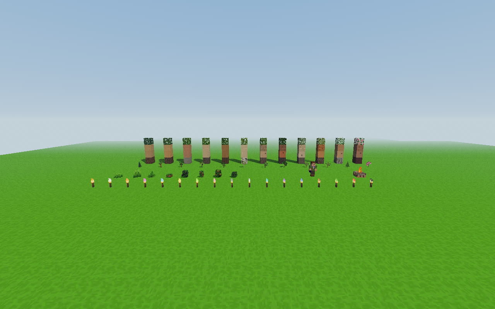
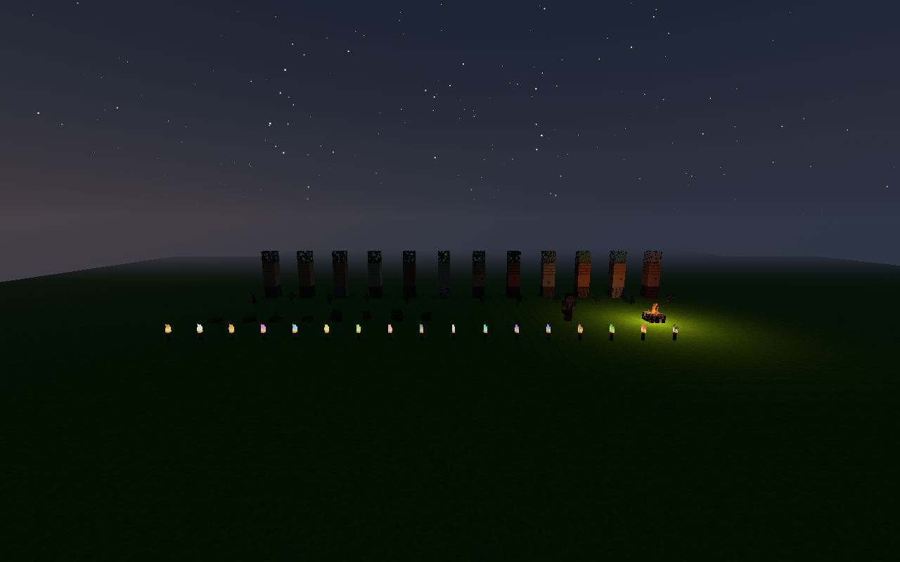
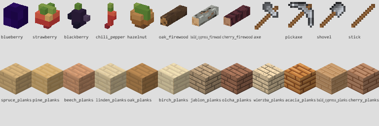

# Atlasy tekstur 0.80.0 — zgodność wyglądu

Sprawdzenie z 10 listopada 2026 r. Przed migracją uruchomiono niezmienioną
wersję 0.79.0 i zapisano układ oraz SHA-256 pikseli jej rzeczywistego atlasu.
Nową wersję porównano do tego wzorca, w oddzielnym płaskim świecie testowym.
Zapisy gracza nie były otwierane.

- Wszystkie **363 nazwy, prostokąty UV i widoczne piksele RGBA** atlasu
  GPU są identyczne z 0.79.0. Atlas nadal ma **256 × 560** pikseli.
- Oryginalne piksele **17 pełnych animacji pochodni**, skórki gracza
  i klatek płomienia ogniska pozostały identyczne.
- **24 ikony** owoców, opału, narzędzi, patyka i desek wszystkich
  gatunków są identyczne z wcześniejszą wersją na tym samym rendererze.
- Każda próba rzeczywistego `Game` wykonała **816 sprawdzeń**,
  wyrenderowała scenę dnia i nocy oraz planszę ikon. Zero błędów gry,
  shaderów, WebGL i brakujących zasobów HTTP.

| Renderer | PNG w scenie 0.79.0 | PNG w scenie 0.80.0 | Wynik |
|---|---:|---:|---|
| NVIDIA GeForce RTX 3050 Laptop GPU / D3D11 | 143 | 7 | zaliczony |
| Chrome / SwiftShader | 142 | 7 | zaliczony |

Liczby dotyczą wczytanych obrazów w tej scenie; cały zestaw zasobów gry
zawiera dziewięć arkuszy. Scena nie otwiera wszystkich ekranów menu.
Mniejsza liczba odczytów upraszcza start i edycję tekstur; nie jest to
pomiar FPS ani dowód zmniejszenia kosztu rysowania świata.

Pełne raporty: [RTX 3050](native.json), [SwiftShader](software.json).
Kod i tekstury obu końcowych prób mają tę samą sumę SHA-256:
`50eaa1a8ca8349b872b35680ad19f33d1271f04551993c1881996b5c0c0aa2ad`
(287 plików). Kadry z natywnego WebGL mają 1280 × 800 pikseli.

## Widoki z gry







## Półprzezroczyste animacje

Próba porównawcza wykryła, że pośrednie wycinanie półprzezroczystych
klatek pochodni przez Canvas2D zaokrąglało część kolorów. Odczyt pochodni
korzysta z `ImageBitmap` bez premultiplikowania alfa, z jawną orientacją
obrazu. Dzięki temu wszystkie oryginalne piksele animacji pozostają
identyczne, a istniejący test WebGL sprawdza klatki, interpolację,
zapętlenie, kolory, model w dłoni i współdzielenie tekstur.

Izometryczne ikony bloków są rysowane przez Canvas2D: D3D11 i SwiftShader
nieco inaczej rasteryzują ukośne krawędzie. Każdy porównano z jego własnym
wzorcem 0.79.0, bez zwiększania tolerancji ani zmiany wzorcowych obrazów.

## Odtwarzanie

```powershell
node tools/sprawdz_atlasy_tekstur.mjs
node tools/sprawdz_atlasy_webgl.mjs
```

Drugi skrypt domyślnie używa Chrome/SwiftShader; `VOXEL_QA_ELECTRON`
może wskazywać lokalny plik wykonywalny Electron dla testu sprzętowego.
`VOXEL_TEST_OUTPUT` wybiera katalog dowodów. Dane wzorcowe 0.79.0
są zapisane w `tools/fixtures/texture-atlas-079.json` i
`texture-atlas-visual-079*.json`; test nie potrzebuje starego checkoutu.
