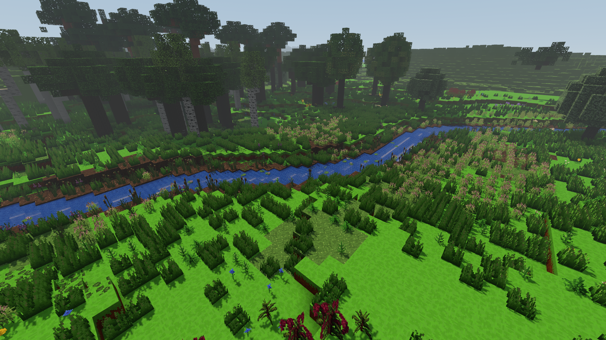
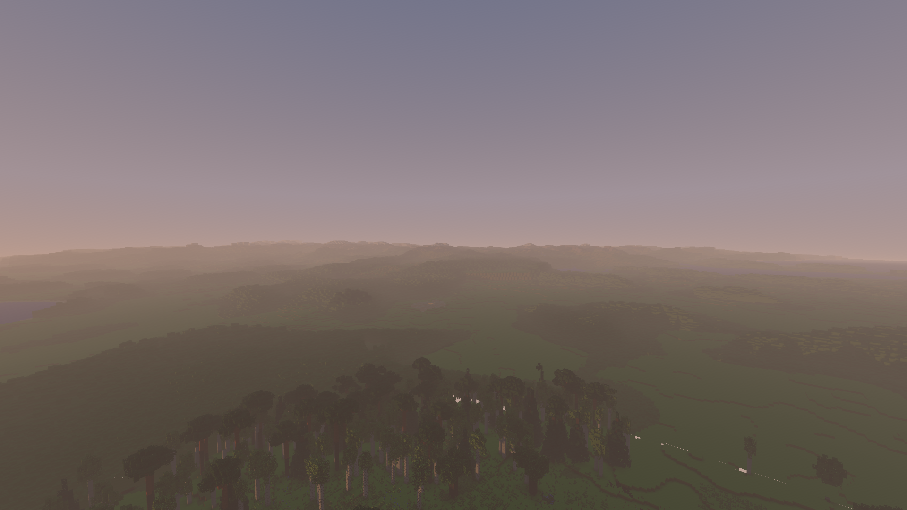
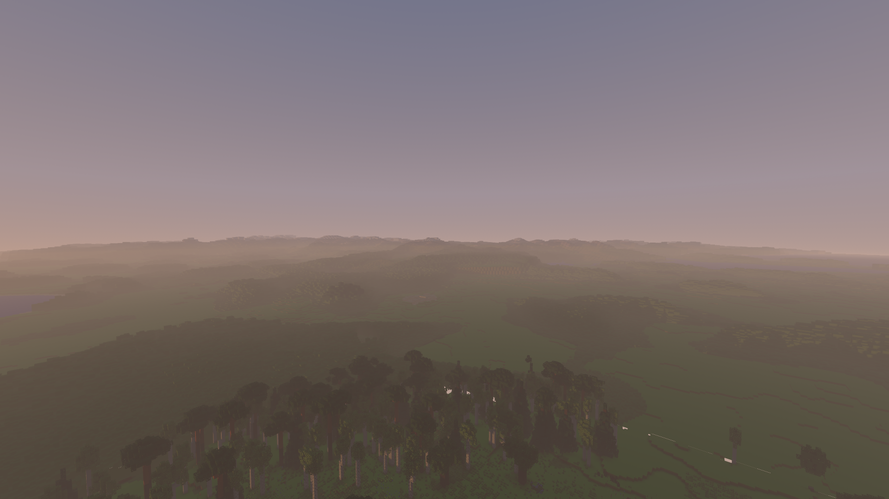
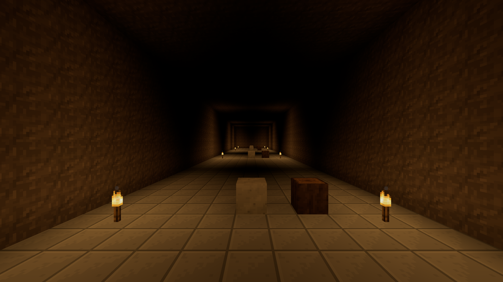
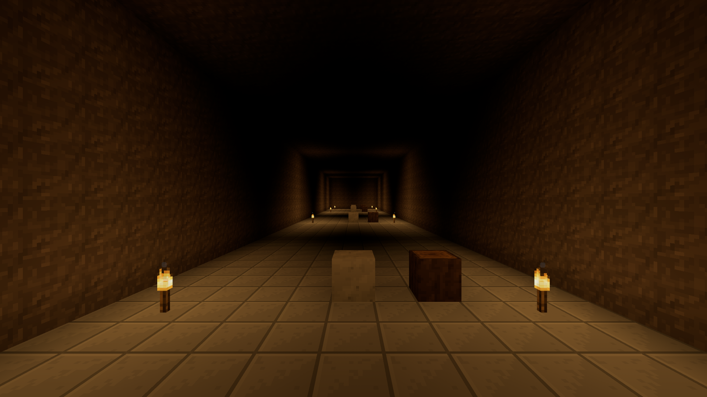

# Atmosfera 0.63.0 — odbiór na RTX 3050 Laptop

Nowa perspektywa atmosferyczna zachowuje mały koszt w nieruchomych
scenach: mediana dodatkowego czasu GPU z trzech par wynosi **0,112 ms
(1,58%)**. Bliski brzeg pozostaje czytelny, daleki teren przechodzi ku
kolorowi horyzontu, a zamknięty korytarz zachowuje ciepłe światło pochodni
bez atmosferycznej poświaty nieba.

**Cel stale równych 60 FPS podczas doczytywania nie jest jeszcze w pełni
osiągnięty.** W locie z pełnym terenem 128 i horyzontem 2048 średnia nowej
wersji wynosi 82,87 FPS, ale P95 czasu klatki to 20,8 ms. Ten wynik nie
uprawnia do deklaracji, że każda klatka mieści się w 16,67 ms.

## Co porównano

- 5 listopada 2026, Windows, NVIDIA GeForce RTX 3050 Laptop, zasilacz.
- Electron 44.4.5 / Chromium 152.0.7977.130, WebGL2 / ANGLE D3D11.
- Bufor 1920×1080, DPR 1, VSync na monitorze 144 Hz, bez limitu FPS gry.
- Naturalna paleta, HDR16F, ekspozycja 1, MSAA 4, jasność 0, cienie 3,
  odbicia Standard, transmisja liści, refleksy i promienie światła włączone.
- Nowa trawa kępiasta włączona; stały seed lasu `2138286349`.
- Każdy statyczny wiersz: puste kolejki, 2 s stabilizacji, 10 s rozgrzewki
  i 30 s próbki. Ruch: 10 s rozgrzewki i ciągłe 120 s z doczytywaniem.

„Poprzednia” oznacza `atmosphereLook=baseline`, czyli dawną ścieżkę mgły
**w tym samym kodzie 0.63.0**. „Nowa” oznacza `natural`. Nie jest to pomiar
osobnego instalatora 0.62.0. Przełącznik nie zmienia palety, ekspozycji,
materiałów, geometrii ani źródeł światła.

## Trzy pary nad rzeką

Oko `(198,63.6,-261)`, stały kierunek, południe, pełne bloki 64,
daleki teren 1024. Kolejność: poprzednia/nowa, nowa/poprzednia,
poprzednia/nowa. P95 klatki we wszystkich sześciu próbach wynosi 13,9 ms,
P99 14,0 ms.

| Raport | Wariant | Średnie FPS | Mediana GPU | P95 GPU | Mediana CPU | Klatki >16,67 / >33,33 ms | Maks. klatka |
| --- | --- | ---: | ---: | ---: | ---: | ---: | ---: |
| 004 | Poprzednia | 134,94 | 6,989 ms | 7,381 ms | 5,7 ms | 0 / 0 | 14,4 ms |
| 005 | Nowa | 130,81 | 7,182 ms | 7,606 ms | 5,8 ms | 1 / 1 | 34,7 ms |
| 006 | Nowa | 131,48 | 7,164 ms | 7,574 ms | 5,6 ms | 2 / 0 | 21,2 ms |
| 007 | Poprzednia | 134,04 | 7,052 ms | 7,473 ms | 5,7 ms | 1 / 0 | 20,9 ms |
| 008 | Poprzednia | 133,18 | 7,079 ms | 7,487 ms | 5,7 ms | 0 / 0 | 14,3 ms |
| 009 | Nowa | 132,31 | 7,140 ms | 7,554 ms | 5,8 ms | 0 / 0 | 14,6 ms |

Różnice median GPU w parach: **+0,193 / +0,112 / +0,061 ms**.
Mediana różnic to +0,112 ms, mediana względnych różnic +1,58%.
Mediana różnic P95 GPU wynosi +0,101 ms; mediany CPU +0,100 ms.
Wystąpiły pojedyncze wolniejsze klatki, zachowane w tabeli.
FPS ograniczony odświeżaniem nie zastępuje pomiaru kosztu GPU.

W każdej próbie: `valid=true`, `gpuValid=true`, brak błędów JS/shaderów,
brak `disjoint`, pominiętych zapytań GPU, niegotowych kolejek i przebudów
geometrii. Zamrożona para obrazów ma identyczne wywołania rysowania,
trójkąty, kamerę, czas wiatru i snapshot cieni roślin.

## Dalszy widok

Raport 013: kadr „Daleki las”, pełne bloki 128, horyzont 2048, nowa
atmosfera, południe. Średnio **143,31 FPS**, mediana GPU **6,384 ms**,
P95/P99 klatki **7,1 / 7,2 ms**. Jedna klatka miała **41,5 ms**.
Próba jest ważna i bez błędów, przebudów lub niegotowych kolejek.

To inny kierunek kamery i inne obciążenie niż brzeg rzeki. Wyższego FPS
nie interpretujemy jako przyspieszenia po zwiększeniu zasięgu. Brak
osobnego pomiaru starej atmosfery w tym kadrze. Widoczne uproszczenie
roślinności w dalekim LOD pozostaje dotychczasową cechą gry; ten PR
zmienia atmosferę, nie wprowadza odległych modeli drzew i krzewów.

## Ruch i doczytywanie

Oba przebiegi używają tej samej 120-sekundowej trasy, pory dnia,
rozdzielczości, pełnego terenu 128 i horyzontu 2048. Kamera porusza się
po elipsie o półosiach 96/48 bloków, 18 bloków nad wysokością gruntu.
Nazwa `high` w nazwie raportu oznacza poprzednio wybraną kamerę;
podczas próbki pracuje wspólna funkcja trasy lotu, nie stały kadr z góry.

| Raport | Kolejność / wariant | Średnie FPS | P95 / P99 klatki | Mediana GPU | Mediana CPU | >16,67 ms | >33,33 ms | Maks. |
| --- | --- | ---: | ---: | ---: | ---: | ---: | ---: | ---: |
| 020 | Pierwszy / nowa | 82,87 | 20,8 / 21,2 ms | 9,003 ms | 10,7 ms | 962 / 9944 | 14 | 41,9 ms |
| 021 | Drugi / poprzednia | 76,54 | 20,9 / 27,7 ms | 9,049 ms | 12,0 ms | 1243 / 9184 | 19 | 42,0 ms |

Oba wyniki są ważne, bez błędów, nieważnych lub pominiętych zapytań GPU.
Niepuste kolejki w tej próbie są zamierzone i zapisane w raporcie.
Nie było klatki przekraczającej 50 ms.

**To kontrola zachowania podczas ruchu, nie kontrolowana seria kosztu
samej atmosfery.** Nowa wersja jechała pierwsza, poprzednia druga,
w tym samym świecie i procesie, z innym stanem cache i możliwą zmianą
temperatury/taktowania. Z lepszego wyniku nowej wersji nie wyciągamy
wniosku o przyspieszeniu streamingu.

Zasoby pierwszego lotu: geometrie 1046→1353, tekstury 32→32,
chunki 346→372; drugiego: 1353→1353, 32→32, 372→372.
Liczniki przebudów wzrosły odpowiednio o 807 i 884. Zapisane są
również próbki zasobów co 10 s. Rozgrzanie cache oraz krótki pomiar
nie dowodzą braku wycieku pamięci podczas wielogodzinnej gry.

## Kontrola wyglądu i osłonięcia

Pary PNG mają zamrożone animacje i identyczne ustawienia poza
`atmosphereLook`. Zdjęcia 1920×1080 skopiowano bez obróbki.

Brzeg w południe — poprzednia atmosfera:

Ten sam brzeg — nowa atmosfera:

Daleki teren o zachodzie — poprzednia atmosfera:

Ten sam zachód — nowa atmosfera:

Zamknięty korytarz — poprzednia atmosfera:

Ten sam korytarz — nowa atmosfera:

W zamkniętym korytarzu próbki `near`, `center`, `end`, ściana i kamera
mają `sky=0`, podczas gdy zewnętrze ma `sky=15`. Ciepłe kanały lamp
pozostają obecne. Po otwarciu okna kamera przy nim otrzymuje `sky=3`;
zamknięcie przywraca `sky=0`. Przełączenie samej atmosfery nie zmienia
tych danych ani geometrii. Podziemne tłumienie opiera się na dostępie
do nieba przy kamerze i powierzchni; nie jest pełnym śledzeniem drogi
przez wszystkie wnętrza i otwory.

Pary 027/028 i 029/030 obejmują nocną paletę materiałów oraz ognisko.
Zachowują identyczną kamerę i czas, bez przebudów lub błędów. Ciepłe
lokalne światło pozostaje czytelne przy nowej atmosferze.

Tryb ziemniaka sprawdzono wizualnie w natywnej aplikacji: las i horyzont
zachowują kolor atmosfery oraz ciągłość dalekiego terenu. Nie zapisano
zamrożonej pary ani pomiaru wydajności tej konfiguracji. Bramka gotowości
harnessu oczekiwała na kolejkę odbić, mimo że tryb ziemniaka wyłącza ich
przeliczanie. Po zakończeniu odbioru poprawiono wyłącznie ten warunek:
gotowość odbić jest teraz wymagana, kiedy odbicia są włączone. Nie zmienia
to warunku użytego w zaakceptowanych pomiarach standardowej jakości.
Poprawionej bramki nie sprawdzano ponownym uruchomieniem natywnym.

## Końcowe testy automatyczne

Pełne `npm test` przeszło przed ostatnim uproszczeniem wywołań w shaderach.
Po tej poprawce uruchomiono ponownie pełny test
`tools/sprawdz_swiatlo_webgl.mjs`: **PASS, 62 shadery**, łącznie
z dotychczasową kontrolą WebGL1. Oddzielnie przeszły **56 702 sprawdzenia
CPU atmosfery** i **217 sprawdzeń kamery oraz cyklu życia menu**.

Nowa kontrola pikseli korzysta z rzeczywistych materiałów i liniowego
bufora 16×16, przy stałym kolorze nieba i wyłączonych źródłach powierzchni.
Teren bliski, rośliny, liście, woda, modele i teren daleki dają identyczne
RGB `[12,37,62]` na dystansie 800, zarówno w zwykłym trybie, jak i ziemniaku.
Zamknięte wnętrze daje `[0,0,0]`, a oglądany z wnętrza odsłonięty krajobraz
zachowuje `[12,37,62]`. Kontrole dawnej mgły (`[2,7,12]`), mgły pod wodą
(`[5,28,46]`) i albedo omijającego atmosferę (`[64,64,64]`) również przeszły.
To sprawdzenie poprawności renderowania przez SwiftShader, nie pomiar FPS
ani zamiennik opisanej wyżej próby natywnej na RTX 3050.

SHA-256 końcowego raportu WebGL `result.json`:
`22b57ebe3441fc2b8658c3946177665f303902249d63739187f29cbea4eb7f59`.

## Źródła dowodów i ograniczenia

Skrót wszystkich prób, metadanych kadrów i hashy surowych plików:
[`evidence.json`](evidence.json). Metodyka i obsługa:
[`README.md`](README.md).

Zaakceptowany proces: `atmosphere-2026-11-05T22-03-51-398Z`.
Baza repozytorium przy starcie: `812cf8b7782d22935a307c80c63fa6ca5f0b1c60`.
Zmiany były jeszcze niezatwierdzone; zmierzony hash 173 plików `src`
to `7aaad48c30b78dd8dc0543ec29d6942204158250625fa8c3b0715c4fc1657ad5`.
Po pomiarach ponownie sprawdzono surowe bajty tą samą procedurą co
launcher — wynik jest identyczny. Hash inwentarza assetów opisuje
posortowane nazwy i rozmiary, nie zawartość każdego pliku.

Hash harnessu przy pomiarach wynosi
`7aaf0deef532908c995a2e5716448a62f7a5e69db8c4123b600732a44a906704`.
Końcowy harness ma odmienny hash przez opisaną wyżej korektę bramki
gotowości; oba hashe zapisano w `evidence.json`. Kod gry pozostał identyczny.

Dwa wcześniejsze procesy prototypowe zakończyły się błędem kompilacji
sterownika GPU podczas przygotowania wody. Ich wyniki nie weszły do
pomiarów. Po ograniczeniu liczby wywołań funkcji mgły i nieba w shaderze
nowy proces uruchomił się poprawnie. Błąd braku tekstury księżyca
w adresie harnessu poprawiono niezależnie przed zaakceptowanym startem.

Wczesny odczyt `gpuFeatures` w manifeście pochodzi sprzed utworzenia
WebGL i błędnie sugeruje wyłączony GPU. Faktyczną kartę potwierdzają
`WEBGL_debug_renderer_info` oraz ważne pomiary GPU. ANGLE nadal emituje
znane ostrzeżenia `X3595`; w zaakceptowanym procesie nie wystąpił błąd
wykonania ani nieudany program shaderowy.

Odbiór dotyczy komputera. Kompilacja Androida nie zastępuje pomiaru
na fizycznym telefonie. Stałej ekspozycji i pojedynczego tonowania
nie zastąpiono automatyczną adaptacją ani globalnym filtrem kolorów.
