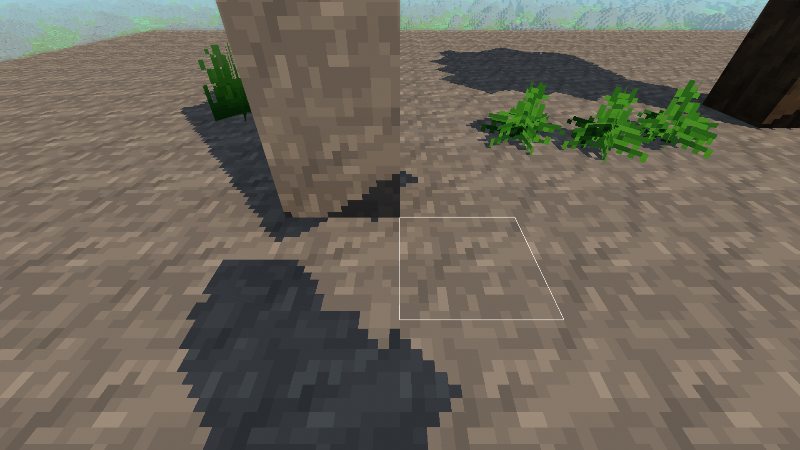

# Cienie 0.52.0 — naturalne krawędzie

Próba z 2026-11-01, natywny Electron 44.4.5 / Chrome 152, RTX 3050 Laptop
(ANGLE D3D11), bufor 1920 × 1080, laptop na zasilaczu. Osobny profil i świat
seed 2138286349, jakość cieni „Dalekie”, pełne chunki 48, horyzont 8192.

## Wynik

Usunięto zaokrąglanie odbiorcy do siatki 1/16 bloku. Cztery porównania
mapy głębi z wagami biliniowymi wygładzają brzeg. Korekta głębi do płaszczyzny
odbiorcy działa dla każdej próbki, również przy niskim słońcu. Ten sam filtr
obsługuje bliską, średnią, daleką mapę oraz osobną mapę gracza.

Obejrzano w grze słup kamienny, pień, liście, paprocie i cień gracza, także
ze zbliżenia, nocą i o zachodzie. Kadry pochodzą bezpośrednio z renderera.
Wersja porównawcza podmienia wyłącznie `Shadows.js` na plik z 0.51.1
(commit `9b75fbc7d791b21f48b05bbbcc7dd6897b6a3e84`); pozostały kod i scena są wspólne.

Przed zmianą:

Po zmianie:

[Pełny kadr przed](before-fixture-day.png), [pełny kadr po](after-fixture-day.png),
[noc](after-fixture-night.png), [zachód](after-fixture-sunset.png).

## Sprawdzenia

- Pełne `npm test` i kontrola składni zmienionych modułów: OK.
- `checkDistantShadowRendering` w natywnej grze na RTX 3050: OK,
  [pełny raport](after-gpu.json), bez błędów JS/WebGL.
- Ciągła krawędź: przesuwanie odbiorcy co 1/512 bloku daje 17 poziomów
  jasności wewnątrz jednej komórki 1/16 dla terenu i 6 dla cienia modelu;
  pełne zacienienie 0, pełne oświetlenie 127, monotoniczne przejście.
  Ta sama próba na shaderze 0.51.1 kończy się oczekiwanym błędem:
  jeden poziom jasności w komórce 1/16. Potwierdza to, że test wykrywa
  dawną pikselizację, a nie tylko sprawdza uruchomienie renderera.
- Test obejmuje również przeszkodę odległą o 800 bloków, przejścia map,
  słońce 0,5° / 2° / 5°, brak samocienia płaszczyzny, wygaszanie jakości
  0/1/2 oraz niezależność podglądu ekwipunku.

## Wydajność i zakres

Rozmiary map, odległości i budżety aktualizacji pozostały takie same.
Filtr zwiększa liczbę odczytów na mapę z jednego do czterech; nie dodaje
map ani przebiegów rysowania. Dalekie cienie zachowują pełną wagę do około
800 bloków. To filtrowane mapy cieni, bez symulacji zmiennej szerokości
półcienia; bardzo dalekie szczegóły nadal ogranicza rozdzielczość map.

Pomiar porównawczy FPS pozostaje do wykonania: w czasie oględzin działała
również zwykła aplikacja gry. Nie traktujemy tej sesji jako potwierdzenia
stabilnych 60 FPS. Skrypt ma powtarzalny widok terenu i lot 256 bloków
(10 s rozgrzewki + 30 s pomiaru, klatki CPU i zapytania czasu GPU).

## Odtworzenie

`node docs/pomiary/cienie-0.52.0/serve.cjs` serwuje próbę na 127.0.0.1:63528.
Uruchom `native-launcher.cjs` istniejącym Electronem. Wybierz świat i użyj
przycisków sceny. `Ctrl+Shift+Q` zamyka tylko próbę.

Do A/B zapisz `git show 9b75fbc:src/rendering/Shadows.js` jako UTF-8 do
`../voxel-shadow-style-proof/baseline-Shadows.js`, a serwer i launcher uruchom
z `--baseline` (port 63529). Uruchamiaj jedną próbę naraz, po zamknięciu
innych gier. Wyniki trafiają do tego samego katalogu poza repozytorium.
