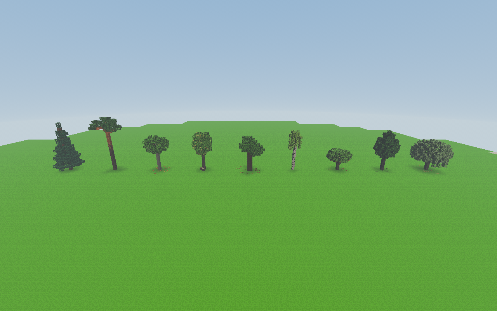
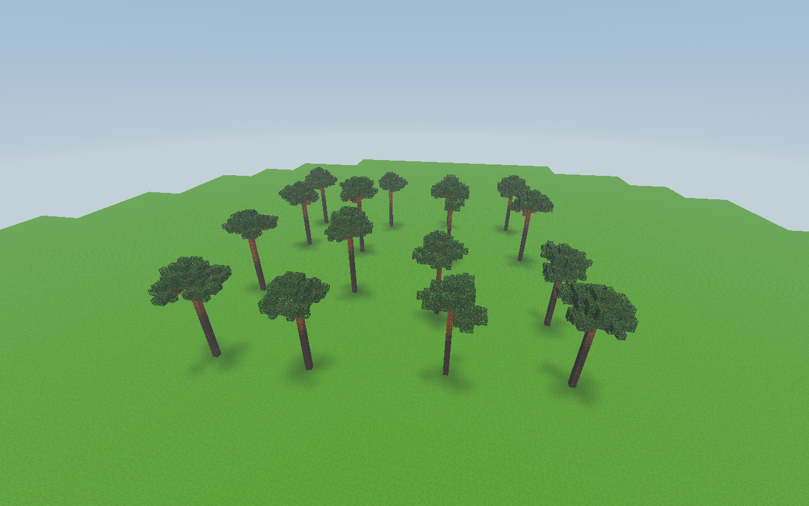
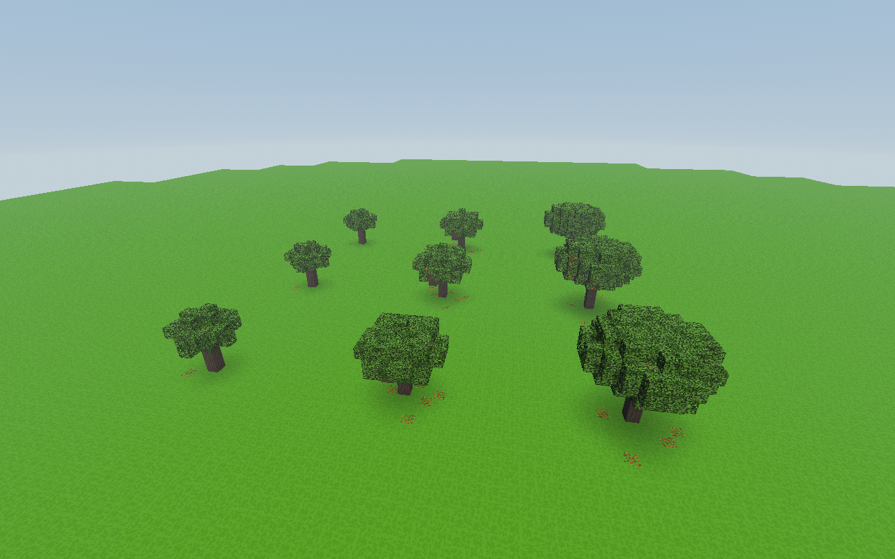
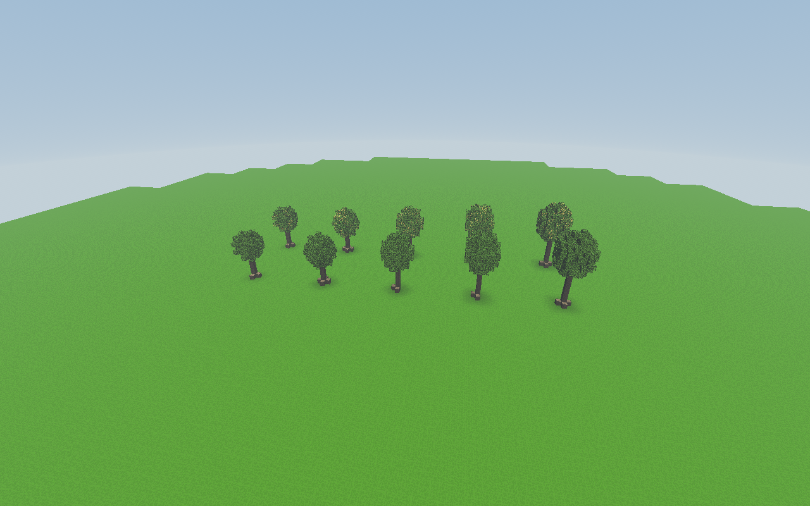

# Komendy drzew — próba 0.78.0

2026-11-09: dwa niezależne uruchomienia prawdziwego `Game`, parsera czatu
`CommandRegistry`, generatorów drzew i meshera. Każde zakończyło się
**98 sprawdzeniami, czterema widokami i bez błędów gry/WebGL**.

- Electron: **NVIDIA GeForce RTX 3050 Laptop GPU**, ANGLE/D3D11;
  [raport natywny](native-render.json).
- Chrome: SwiftShader, próba zgodności taka jak w CI;
  [raport programowy](software-render.json).
- 1280 × 800, liście z części i prześwitami, pełna geometria drzew;
  wyłączone cienie, wiatr i daleki teren. To test komend i modeli, nie pomiar FPS.
- Oddzielny profil, nowy płaski świat, bez zapisu; nie otwierano zapisów gracza.
- Wszystkie 214 plików `src` miały przed i po obu próbach ten sam SHA-256:
  `4436c4dd51e25217b039c6604c45873bc82f44036145690d06d24e820a6cbc5c`.

Sprawdzono listę dziewięciu gatunków, podpowiedzi Tab, błędne argumenty bez
zmiany świata, porównanie gatunków, warianty lipy i jabłoni, losowy las 16
sosen, limit 36 sosen oraz cofanie. Ten sam seed po cofnięciu odtwarzał
identyczne bloki, a inny seed zmieniał las. Po cofnięciu wszystkie wczytane
bloki były identyczne z pierwotnym terenem.

Na RTX 3050 przygotowanie porównania zajęło 84 ms, lasu 16 sosen 181 ms,
a lasu 36 sosen 310 ms **łącznie**, z oddawaniem sterowania między porcjami.
To jednorazowe czasy zadań na płaskim, wczytanym terenie. Nie są pomiarem
czasu klatki ani gwarancją wydajności w dowolnym świecie.

## Widoki z rzeczywistej gry na RTX 3050

Kadry pochodzą bezpośrednio z bufora WebGL ukrytego okna Electron. Teren
wokół pokazu został wczytany wyłącznie na potrzeby tych ujęć; daleka krawędź
płaskiego placu jest granicą wczytanego obszaru próby.

`/drzewa porownanie 12345` — od lewej: świerk, sosna, buk, lipa, dąb,
brzoza, jabłoń, olcha, wierzba.



`/drzewa las sosna 16 12345` — różne rozmiary, kształty koron i przesunięcia.



`/drzewa warianty jablon 12345` — trzy szablony wielkości; rzędy zwykłych
liści, owocowania oraz stanu po zbiorze.



`/drzewa warianty lipa 12345` — pięć rozmiarów, liście zwykłe i kwitnące.



## Odtwarzanie

```powershell
node tools/sprawdz_pokaz_drzew_webgl.mjs
```

Domyślnie uruchamiany jest Chrome/SwiftShader. Opcjonalna zmienna
`VOXEL_QA_ELECTRON` wskazuje lokalny plik wykonywalny Electron i włącza
ten sam test na natywnym GPU. `VOXEL_TEST_OUTPUT` wybiera katalog wyników.
Próba tworzy tymczasowy profil i usuwa go po zakończeniu.
