# Trzy nowe drzewa — skala i próba w grze 0.79.0

2026-11-09. Dwa uruchomienia rzeczywistego `Game`, atlasu tekstur,
generatorów i komend w osobnym, płaskim świecie. Zapisy gracza nie były
otwierane. Przy każdym drzewie stoi oryginalny `PlayerModel` o nominalnej
wysokości **1,8 bloku**. Blok odpowiada w tej próbie jednemu metrowi;
bliskie kadry mają oczy na wysokości **1,6 bloku** i zwykłe pole widzenia 70°.

| Gatunek, rozmiar 75%, seed 12345 | Wysokość | Rozpiętość korony | Bloki drzewa |
|---|---:|---:|---:|
| Akacja parasolowata | 11 m | 15 × 15 m | 406 |
| Cypryśnik błotny | 33 m | 12 × 11 m | 595 |
| Wiśnia japońska | 9 m | 11 × 11 m | 294 |

To wymiary konkretnych wygenerowanych okazów. Inne rozmiary i seedy dają
odmienne sylwetki w granicach opisanych w [instrukcji drzew](../../drzewa.md).

- **Electron / NVIDIA GeForce RTX 3050 Laptop GPU, ANGLE/D3D11**:
  166 sprawdzeń, 9 widoków, dwa kadry pomiarowe, zero błędów.
  [Raport natywny](native-render.json).
- **Chrome / SwiftShader**: 144 sprawdzenia, te same 9 widoków,
  zero błędów. [Raport programowy](software-render.json).
- Oba procesy odczytały identyczne 455 plików `src`, `assets/drzewa`,
  `assets/models/rosliny` i `assets/models/campfire`;
  SHA-256 przed i po każdej próbie:
  `9f55917e04a3c0005b539be589f696d108cd8e9b741c636f240388e45fa7be93`.

Sprawdzono pełną geometrię wszystkich trzech drzew przez granice chunków,
ich obecność w katalogu i porównaniu gatunków, wszystkie rozmiary i stany
liści w galerii oraz cofanie do oryginalnych bloków. Dorosły cypryśnik
przekracza dawny limit wysokości drzew 28 bloków, zachowując cały czubek.

## Kadry z rzeczywistej gry na RTX 3050

1280 × 800, liście z części i prześwitami, cienie słońca poziomu 1.
Włączona jest pełna geometria drzew. Wiatr i daleki teren są wyłączone
w tej scenie porównawczej; trawiasty obszar wokół okazów jest zwykłym
terenem gry. Obrazy odczytano bezpośrednio z bufora WebGL ukrytego okna.

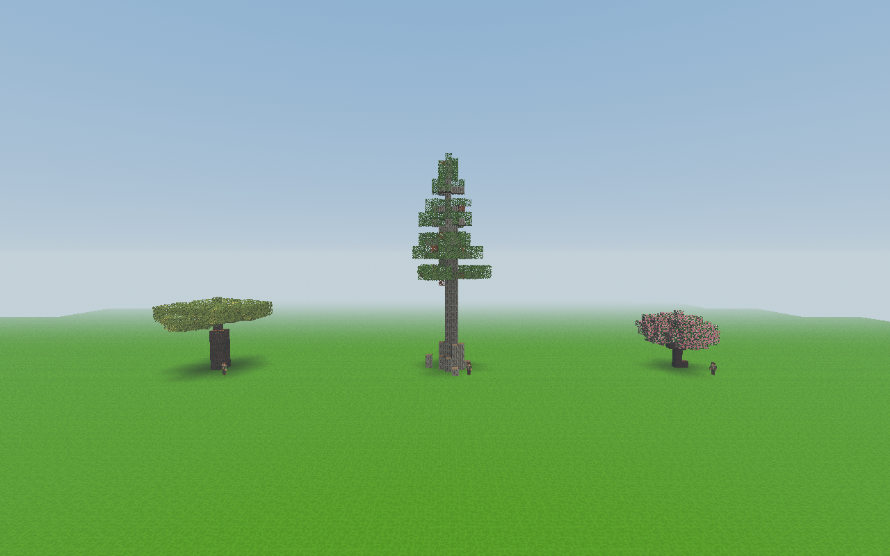

### Akacja

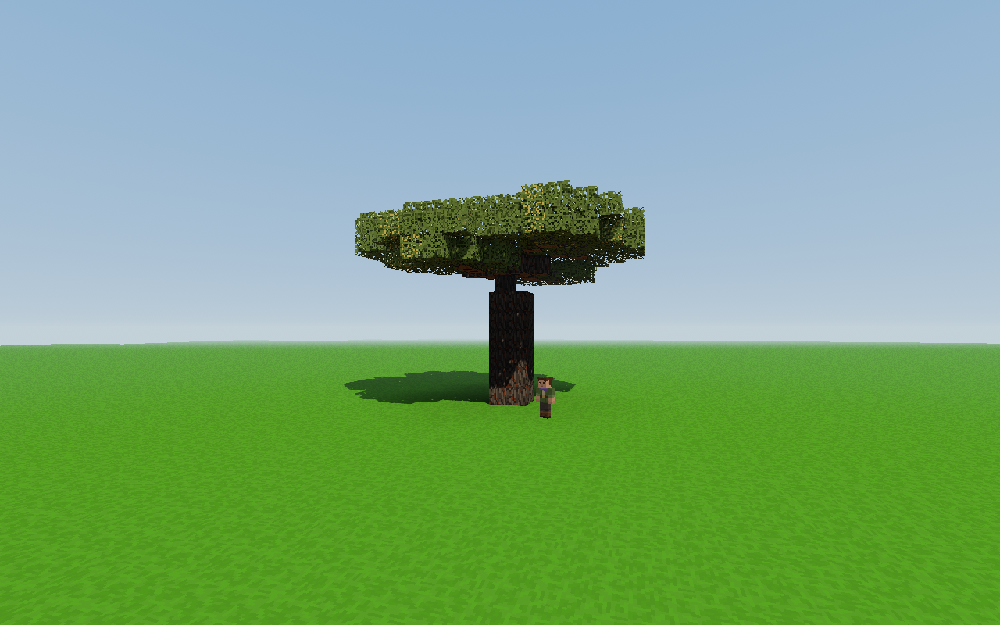

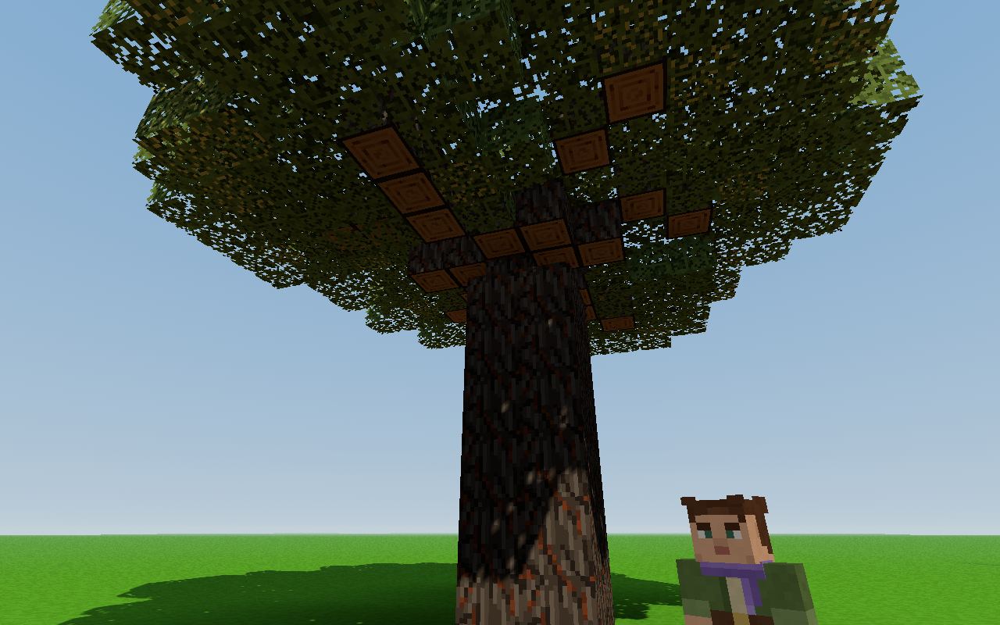

### Cypryśnik

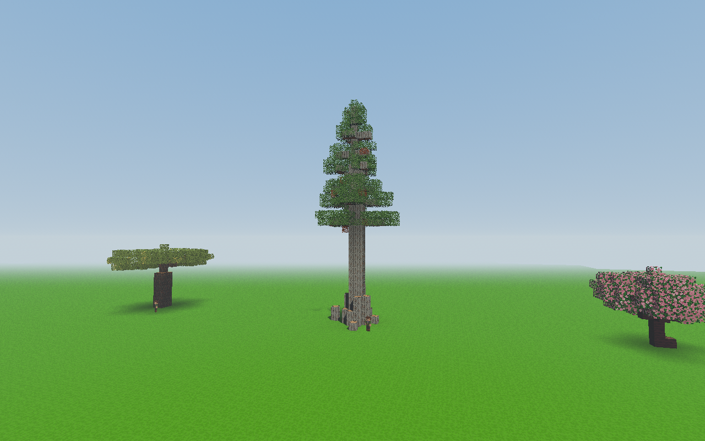

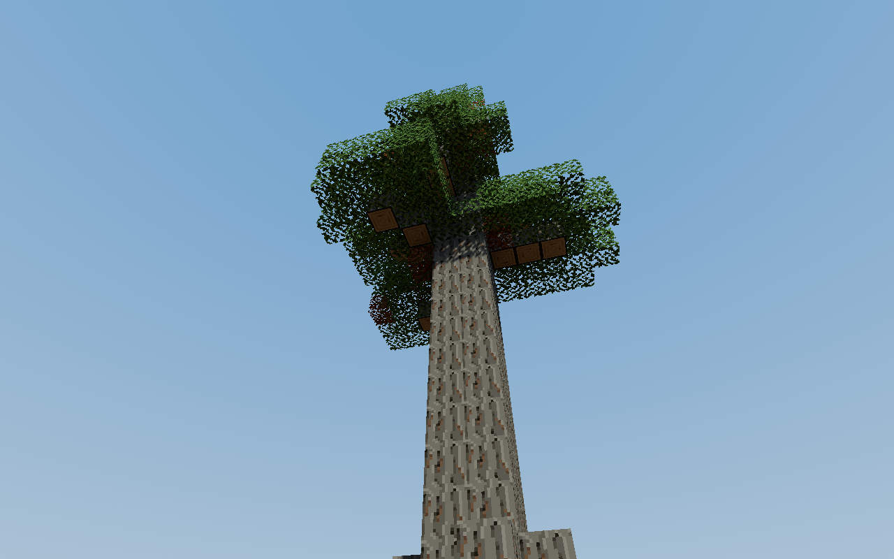

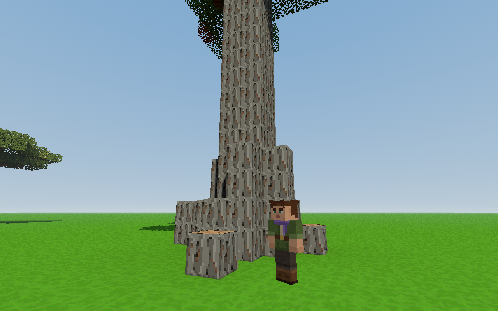

### Wiśnia

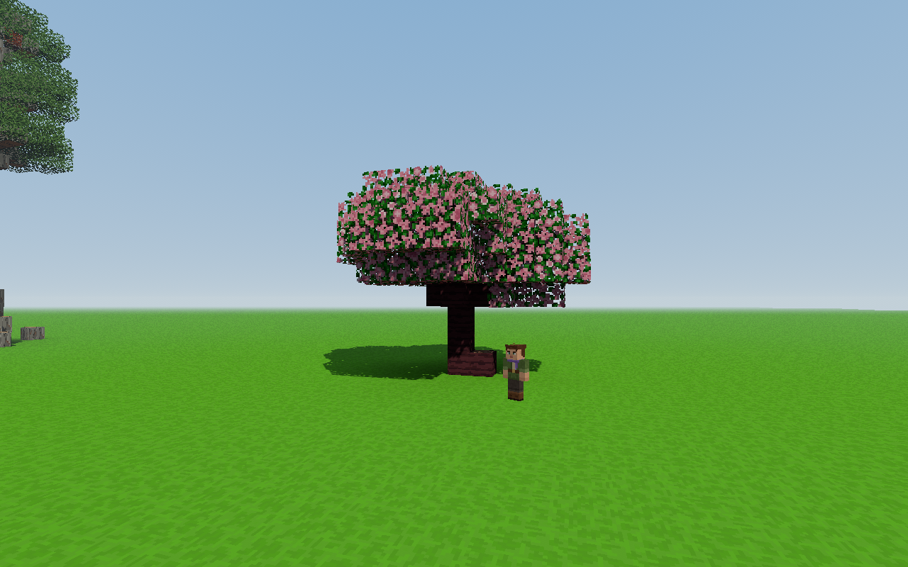

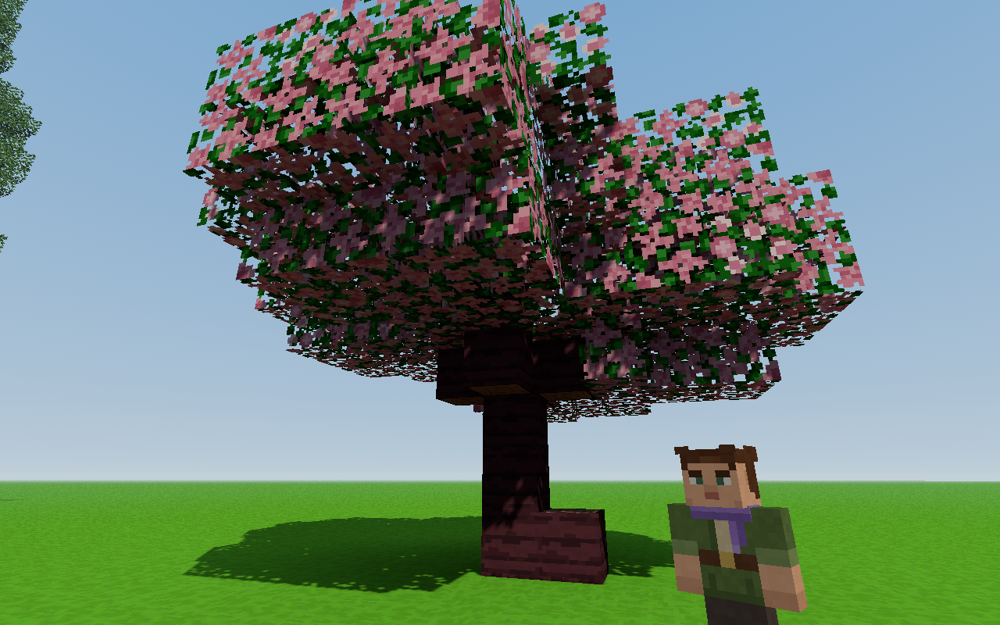

### Sadzonki

Każdy nowy gatunek sprawdzono w trzech ustawieniach modeli: prostym,
półrealistycznym i szczegółowym. Rzeczywista geometria sadzonek w scenie
miała odpowiednio 48, 288 i 1960 wierzchołków. Kadr pokazuje wersję
szczegółową oraz postać gracza.

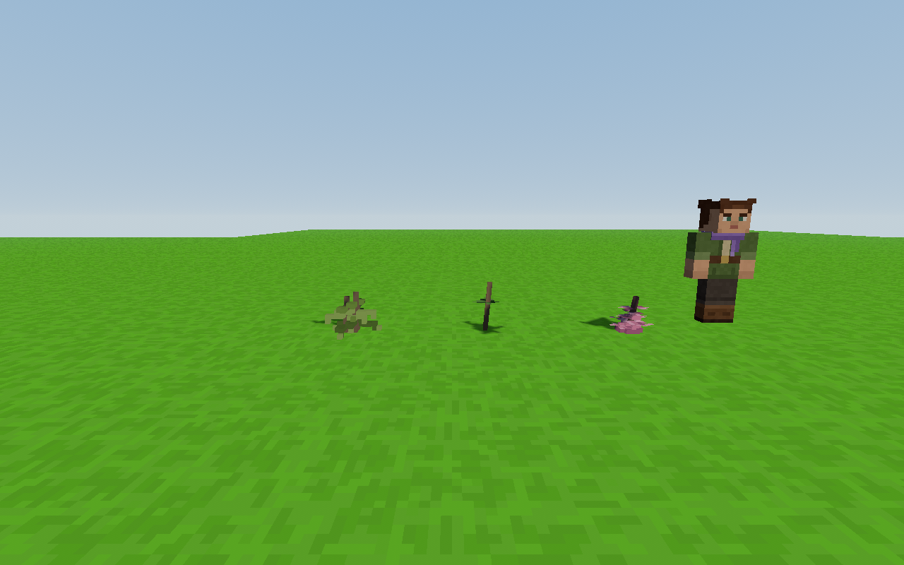

## Kontrola kosztu większego lasu

RTX 3050 Laptop GPU, laptop na zasilaczu. Po 36 sosen i cypryśników,
ten sam seed 12345, położenie kamery i cel, rozdzielczość **1920 × 1080**.
Włączone dalekie cienie (3), promienie światła, światło odbite i liście
z części z prześwitami; zasięg 160 bloków, pełne wczytanie płaskiego terenu.
Szczegóły ustawień i kadru znajdują się w raporcie.

Po 40 klatkach rozgrzewki zmierzono 180 przebiegów
`Game.update + render + gl.finish`. To czas pracy CPU i GPU nad klatką
w ukrytym oknie, **bez pomiaru FPS prezentowanych na monitorze**.

| Las | Mediana pracy klatki | 95. percentyl | Trójkąty, wszystkie przejścia | Wywołania rysowania |
|---|---:|---:|---:|---:|
| 36 sosen | 3,30 ms | 5,40 ms | 124 717 | 225 |
| 36 cypryśników | 3,10 ms | 5,20 ms | 200 537 | 226 |

Duże cypryśniki nie przekroczyły budżetu 16,7 ms w tej kontrolowanej próbie.
Wynik dotyczy wczytanego lasu bez przemieszczania się, generacji nowego
terenu i innych obiektów rozgrywki; pojedyncze porównanie nie rozstrzyga
ogólnej przewagi wydajności jednego gatunku.

Kadry i liczniki geometrii potwierdzają, że pomiar obejmował właściwe lasy:

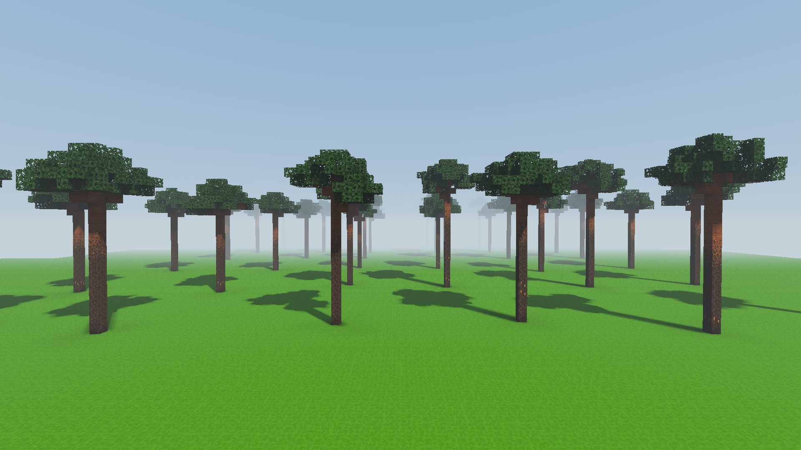

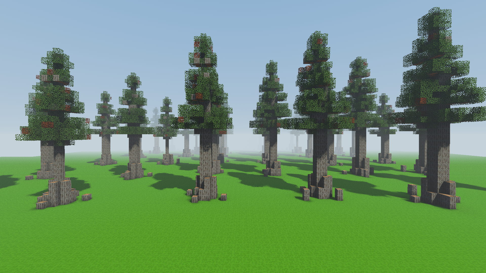

## Odtwarzanie

```powershell
node tools/sprawdz_nowe_drzewa_webgl.mjs
```

Domyślnie uruchamia się Chrome/SwiftShader bez pomiaru sprzętowego.
`VOXEL_QA_ELECTRON` może wskazywać lokalny plik wykonywalny Electron;
`VOXEL_TREE_BENCHMARK=1` dodaje wówczas próbę porównawczą 1080p.
`VOXEL_TEST_OUTPUT` wybiera katalog wyników. Tymczasowy profil jest usuwany
po zamknięciu testu. Skrypt sprawdza, czy kod i zasoby nie zmieniły się
między początkiem i końcem uruchomienia.
