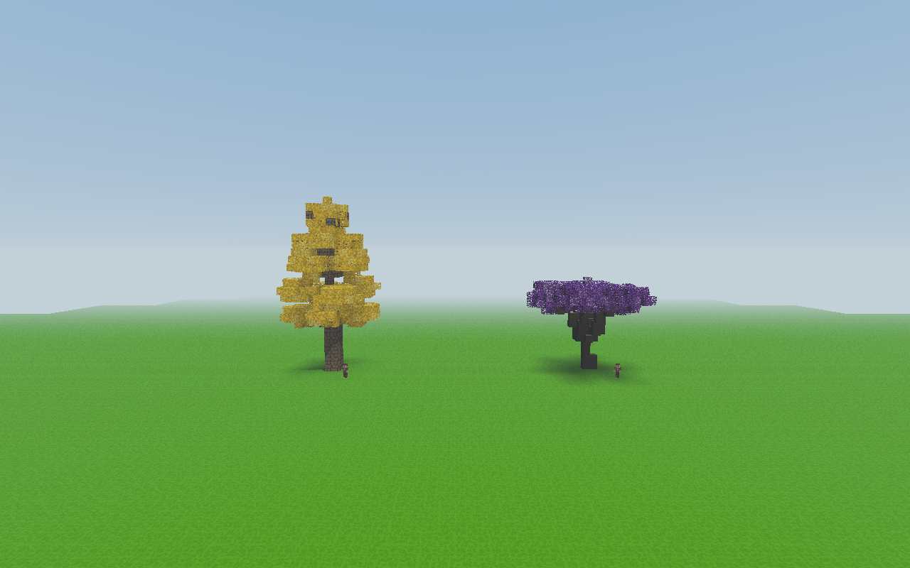
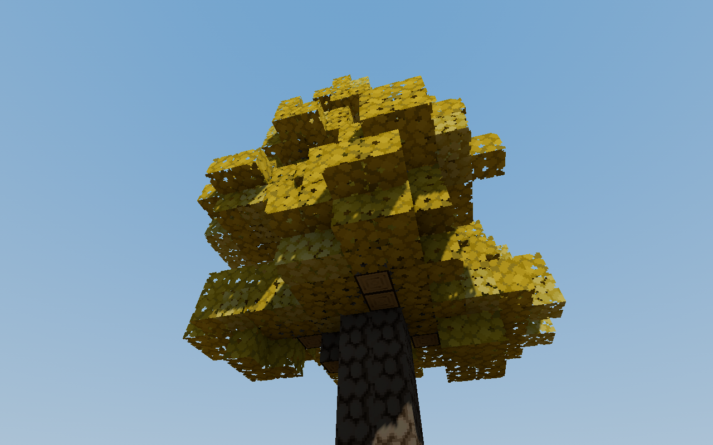
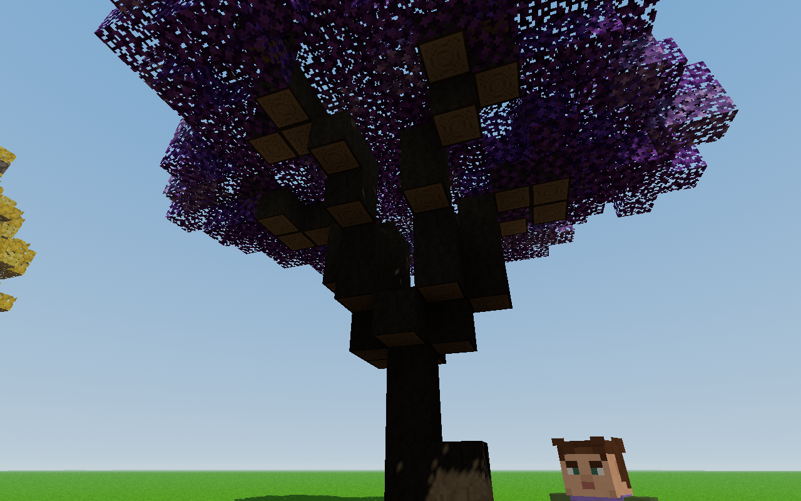
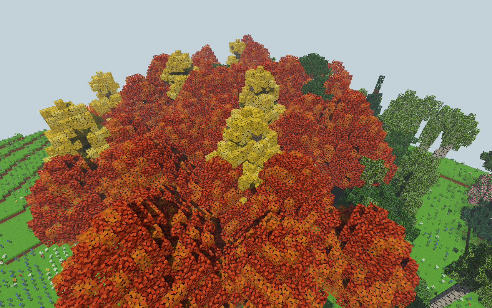
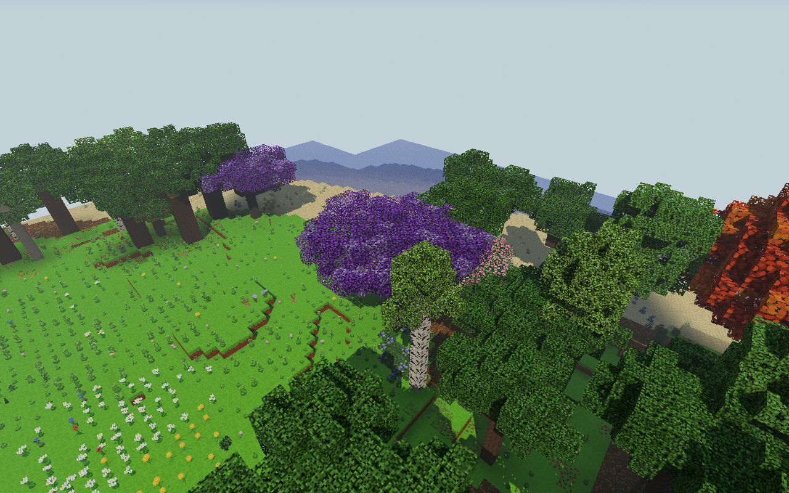
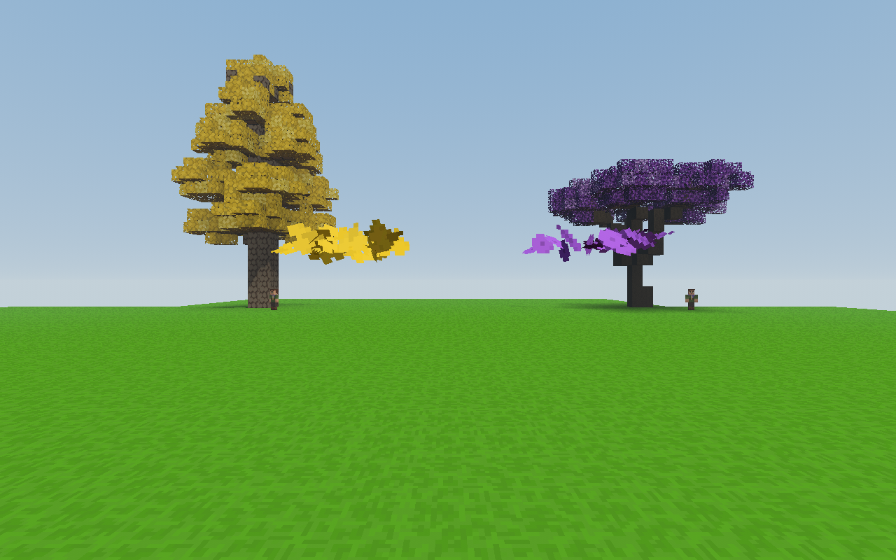
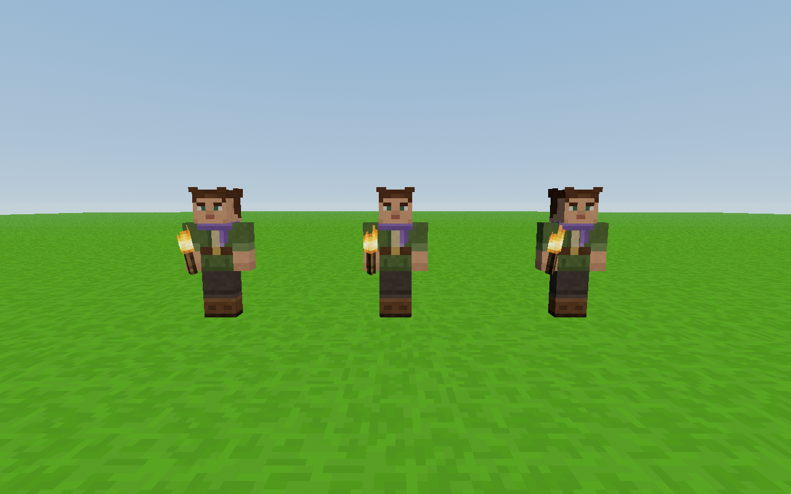
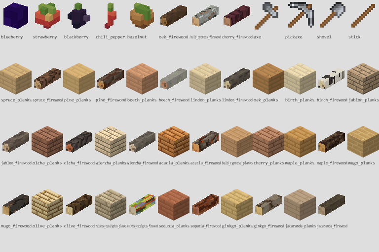

# Miłorząb, jakaranda i poprawki — kontrola 0.85.0

Sprawdzenie z 11 listopada 2026. Testy korzystają z prawdziwej klasy `Game`,
generatora świata, renderera, modeli postaci, komend i interakcji ekwipunku.
Uruchomienia mają osobny profil i nie zapisują zmian w światach użytkownika.
Oba zestawy kadrów obejrzano; nie są to same makiety geometrii.

Badany kod i zasoby: SHA-256
`a33bb072d6ed4ec8becb9a7a10b25b5edb03473adad589644acf98e519e35aa7`
(303 pliki `src`, arkusze tekstur i modele roślin/ognisk). Fingerprint był
sprawdzany również po każdym przebiegu, aby wykryć zmianę kodu w trakcie testu.

## Wyniki

| Sprawdzenie | Wynik |
| --- | --- |
| Test 0.85: dwa gatunki, identyfikatory, oryginalne piksele, crafting, opał, wzrost, granice chunków, LOD i generacja naturalna | 13 982 kontroli, PASS |
| Wcześniejszy test pięciu gatunków 0.83 | 5 238 kontroli, PASS |
| Atlas: regiony, aliasy, stare kafelki i 9 arkuszy | 2 615 kontroli, PASS |
| Prawdziwa gra, RTX 3050 / D3D11 | 140 kontroli i 10 kadrów, PASS |
| Prawdziwa gra, Chrome / SwiftShader | 140 kontroli i 10 kadrów, PASS |
| Atlas i ikony, RTX 3050 / D3D11 | 867 kontroli, dzień/noc/ikony, PASS |
| Atlas i ikony, Chrome / SwiftShader | 867 kontroli, dzień/noc/ikony, PASS z rozróżnieniem rasteryzacji poniżej |

Raporty: [gra natywna](real-game-native.json),
[gra programowa](real-game-software.json), [atlas natywny](atlas-native.json),
[atlas programowy](atlas-software.json).

Niezależna baza pochodzi z czystej wersji 0.84.0,
commit `9b33efebfd190d9f4ec4af421c9fdc2c79336709`.
Test porównuje wszystkie 417 dotychczasowych pól atlasu (położenia i RGBA),
identyfikatory i definicje bloków 17 gatunków oraz 2500 pełnych sylwetek
pięciu gatunków dodanych w 0.83. Starszy test nadal chroni 6000 sylwetek
z 0.79. Dziesięć oryginalnych obrazów nowych drzew jest porównywanych
z hashami pikseli odczytanymi niezależnie z ZIP-ów autora.

## Skala i wygląd

Miłorząb osiąga 18–26 m, jakaranda 8–14 m przy skali bloku 1 m.
Egzemplarze porównawcze (seed 12345, rozmiar 75%) mają odpowiednio
24 m wysokości / koronę 13 × 13 m oraz 13 m / koronę 17 × 15 m.
Przy każdym stoi rzeczywisty model postaci o wysokości 1,8 m.
Perspektywa z ziemi używa kamery 1,6 m nad gruntem i FOV 70°.







Naturalna generacja jest sprawdzona bez sadzenia ani usuwania drzew.
W świecie realistycznym, seed 42: miłorząb znajduje się przy
`4762, 53, -4750`, jakaranda przy `1210, 51, -3247`. Weryfikowany jest
gatunek w deskryptorze generatora, pień w chunku i charakterystyczny kolor
korony w środku rzeczywistego kadru. Kamera ponad sąsiednimi koronami
pozwala zobaczyć drzewa w ich biomie.





Sprawdzono komendy `/drzewa lista`, `warianty` dla obu gatunków,
`porownanie` wszystkich 19 gatunków i `cofnij`. Warianty porównano z pełną
geometrią w świecie, a cofnięcie z blokami sprzed komendy.
Sadzonki mają działającą zmianę jakości: łącznie 32 / 192 / 1360 wierzchołków
w poziomach prostym, półrealistycznym i szczegółowym.

Spadający liść miłorzębu ma pikselowy wachlarz, jakaranda płatki i wąskie
listki. Kadr poniżej używa kontrolowanej emisji po 20 cząsteczek blisko
kamery, z niezmienionymi rozmiarami, paletą i materiałem gry.
Sprawdzono nie tylko dane palety, lecz różnicę obrazu z cząsteczkami i bez:
na RTX 7423 zmienione piksele były złote, 4450 fioletowe, żaden czarny.
Oba gatunki współdzielą jedną instancjonowaną siatkę cząsteczek.



## Dwie poprawki w prawdziwej grze

Test wywołuje oryginalne `InventoryScreen.clickChest`. Po pięciu Shift-klikach
przy 36 pełnych stosach skrzynia nadal zawiera wszystkie pięć przedmiotów,
nie zmienia wersji zapisu i nie tworzy przedmiotów pod kursorem.
Po zwolnieniu dwóch miejsc przenosi dokładnie dwa, pozostawiając trzy;
po opróżnieniu pola przenosi pozostałe trzy bez strat.

Modele postaci trzymają pochodnię kolejno po siekierze, kamieniu i pustej
ręce. Każdy ma identyczną pozycję uchwytu `[0, -0.365625, -0.12375]`.
Obejrzano również wyrenderowany chwyt, nie tylko współrzędne.



## Krótki pomiar GPU

NVIDIA GeForce RTX 3050 Laptop GPU, ANGLE/D3D11. Przed testem Windows
`GetSystemPowerStatus` zwrócił `ACLineStatus=1` (zasilacz), bateria 80%.
1920 × 1080, skala 100%, 36 drzew jednego gatunku, seed 12345,
ten sam kadr i uprzednio wczytany płaski świat. Cienie 3, światło odbite,
promienie światła, wiatr roślin, spadające liście i smugi wiatru włączone.
Zasięg 160 bloków, daleki teren wyłączony — to porównanie kosztu drzew.

Po 40 klatkach rozgrzewki zmierzono 180 wywołań
`Game.update + render + gl.finish` na gatunek. Mierzona jest praca CPU+GPU
w ukrytym oknie, bez narzucania tempa prezentacji.

| 36 drzew | Mediana pracy klatki | p95 | Maksimum | Trójkąty / wywołania |
| --- | ---: | ---: | ---: | ---: |
| Sosna, odniesienie | 2,40 ms | 3,30 ms | 4,30 ms | 125 165 / 230 |
| Miłorząb | 2,40 ms | 3,50 ms | 4,70 ms | 240 965 / 246 |
| Jakaranda | 2,30 ms | 3,10 ms | 4,50 ms | 169 845 / 266 |

Źródło: [performance-native.json](performance-native.json).
W tym krótkim porównaniu nowe drzewa nie przekroczyły budżetu 16,67 ms.
Nie jest to pomiar prezentowanego FPS ani gwarancja 60 FPS podczas
przemieszczania się i generacji świata, przy zasięgu 800 bloków lub na telefonie.
SwiftShader służy wyłącznie sprawdzeniu poprawności.

## Atlas i rasteryzacja ikon

Atlas GPU urósł z 256 × 560 do 256 × 576, zachowując pozycje i źródłowe
RGBA wszystkich 417 dawnych pól. Dodatkowy wiersz chroni sąsiedztwo ikon
desek i opału; nie przenoszono istniejących tekstur. To dodatkowe 16 KiB RGBA.

Na RTX wszystkie rzeczywiste ikony 17 dawnych desek i opałów są identyczne
piksel w piksel z niezależną wersją 0.84. To samo dotyczy wcześniejszych
modeli owoców, narzędzi, skóry oraz tekstur animowanych.

W SwiftShader 12 ikon desek różni się na 1–30 pikselach krawędzi:
świerk, sosna, buk, lipa, dąb, brzoza, akacja, cypryśnik, wiśnia,
oliwka, eukaliptus i sekwoja. Skia wybiera sąsiedni texel tej samej ściany
w zależności od wysokości źródłowego canvasu. Przykład świerka:
piksel ikony `(0,46)` wybiera wiersz 14 albo 15 tej samej tekstury,
z tym samym przyciemnieniem 0,8. Nie jest to domieszka nowego kafelka.

Eksperyment kopiujący ten sam obecny atlas bez skalowania na canvas
o wysokości 560 daje dokładnie stare hashe wszystkich 17 desek;
576 daje różnice w powyższych 12. Wysokości 592 i 640 wybierają inne
zestawy krawędzi, co potwierdza zależność rasteryzacji od rozmiaru źródła.
Nie zmieniono baseline ani kodu rendererów gry, aby maskować te różnice.

Test zachowuje `iconHashes` rzeczywistych ikon. Niezależne pole
`plankIconsAt084SourceHeight` porównuje deski przy źródłowej wysokości 0.84,
z aktualnych pikseli atlasu. Opały i wszystkie inne ikony wciąż muszą być
identyczne w rzeczywistym rozmiarze; natywny test wymaga dokładnej zgodności
wszystkich rzeczywistych ikon. Szczegóły są w obu raportach atlasu.



## Powtórzenie

```powershell
node tools/sprawdz_drzewa_085.mjs
node tools/sprawdz_drzewa_085_webgl.mjs
node tools/sprawdz_atlasy_webgl.mjs
```

Dla natywnego renderera ustaw `VOXEL_QA_ELECTRON` na lokalny plik
`electron.exe`; `VOXEL_TREE_BENCHMARK=1` włącza powyższy krótki pomiar.
`VOXEL_TEST_OUTPUT` wybiera folder raportów. Przebieg software używa
Chrome lub ścieżki `CHROME_BIN`. Testy nie używają profilu normalnej gry.
