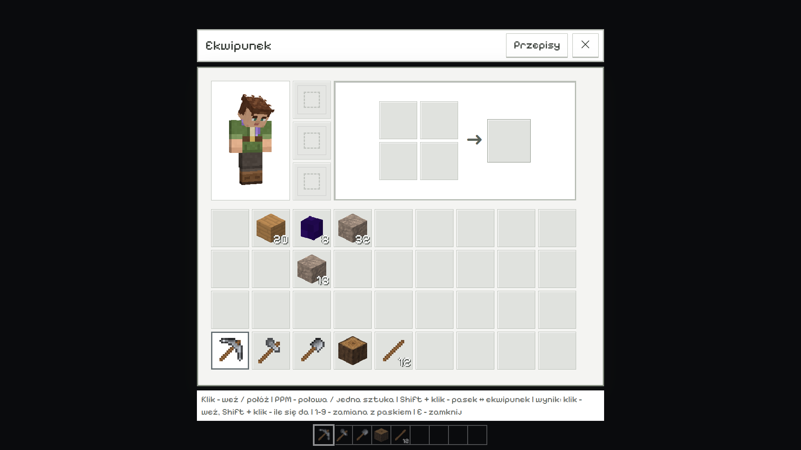
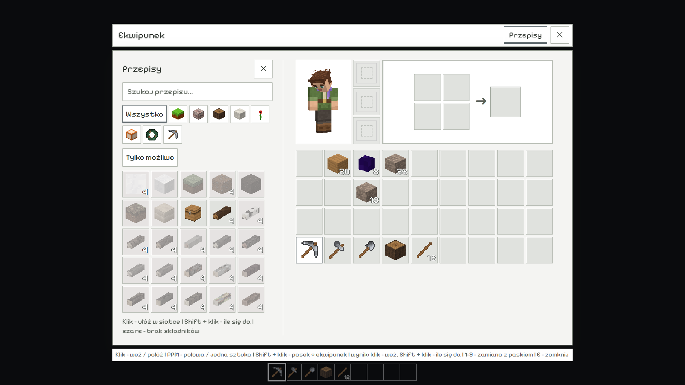
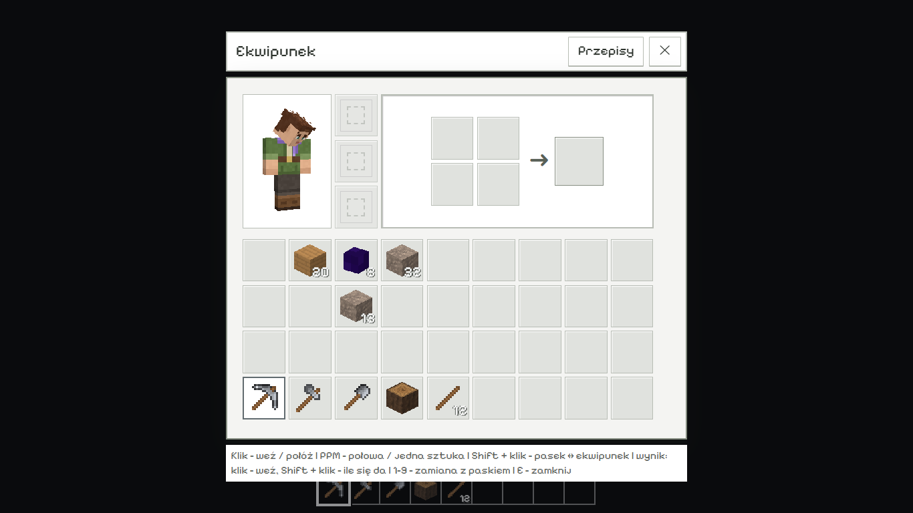
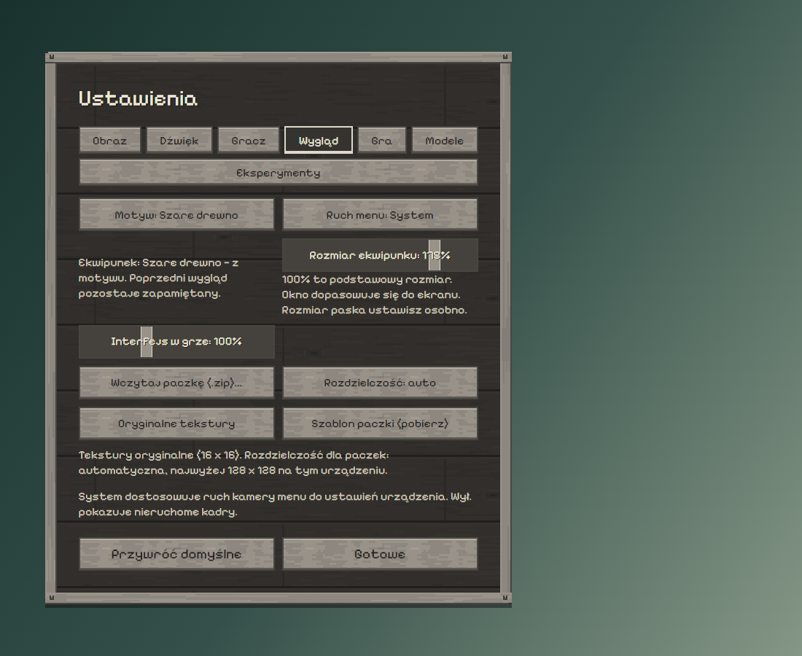
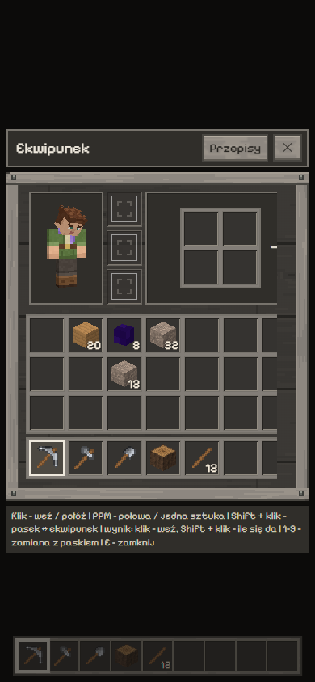
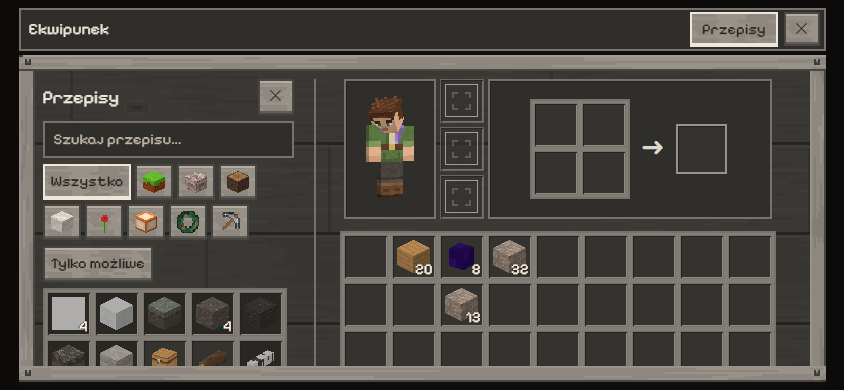

# Większy ekwipunek — próba 0.86.0

11 listopada 2026. Rzeczywiste komponenty `InventoryScreen`, `Menu`,
`Settings`, `PlayerModel` i `ChestView` w izolowanym Chrome/SwiftShader.
Próba GUI nie mierzy wydajności świata ani nie korzysta z zapisów gracza.

Domyślny rozmiar wynosi **175%**, także dla starszego zapisu ustawień,
w którym nie ma nowego klucza. W **Ustawienia → Wygląd → Rozmiar ekwipunku**
można wybrać **75–200%**; 100% oznacza podstawowy rozmiar dotychczasowego
układu. Preferencja pozostaje zapisana i nie zmienia skali HUD.

Okno zachowuje dziewięć kolumn, kwadratowe sloty i proporcje postaci,
craftingu, skrzyni oraz tekstu. Na komputerze jest dopasowane do szerokości
i najwyżej 88% wysokości ekranu. Na małym, niskim lub dotykowym ekranie
pozostają podstawowe kontrolki i przewijanie zamiast ich automatycznego
pomniejszania. Celowo wybrane 75% nadal może zmniejszyć kontrolki.

## Pomiary 1920 × 1080

| Wygląd | Podstawowy rozmiar 100% | Domyślne duże okno | Slot przy dużym oknie | 75% |
| --- | --- | --- | --- | --- |
| Jasny | 558 × 539 px | 977 × 941 px | 91 × 91 px | 419 × 402 px |
| Drewniany | 606 × 623 px | 924 × 946 px | około 79 × 79 px | 455 × 465 px |

W jasnym wyglądzie z otwartą księgą wspólny panel ma około **1290 px
szerokości**. Rozmiary obejmują dopasowanie do ekranu; suwak nie wypycha
przycisku zamknięcia poza widok. Zmiana układu i rozmiaru jest obliczana
przy otwieraniu, zmianie ustawienia, okna lub czcionki, nie w każdej klatce.

## Sprawdzenie

`node tools/sprawdz_wyglad_ekwipunku.mjs` — PASS: domyślna wartość,
stare zapisy, zakres, niepoprawne wartości oraz niezależność od HUD.

`node tools/sprawdz_motyw_gui_webgl.mjs` — PASS: 15 widoków desktop/telefon,
przełączanie motywów, rzeczywiste trafianie przez `elementFromPoint`
w powiększone sloty, podnoszenie i odkładanie stosów, dopasowanie kursora,
crafting, księga, suwak i odczyt jego trwałego zapisu. Sprawdzono trafienia
we wszystkie 12 przegródek powiększonej skrzyni oraz wyjęcie i odłożenie
wierzchniego stosu przez współrzędne ekranowe.

Na 390 × 844 wszystkie dziewięć kolumn pozostaje dostępne przez
wewnętrzne przewijanie; na 844 × 390 nagłówek i przycisk zamknięcia
pozostają w ekranie, a zawartość przewija się w panelu.

Pełne dane: [result.json](result.json). Chrome wybiera `CHROME_BIN` albo
`google-chrome`; raporty trafiają do `test-results/grey-wood/` lub folderu
w `VOXEL_UI_TEST_OUTPUT`. Kadr tła jest neutralny, bo jest to izolowana
próba komponentów interfejsu, a nie zrzut uruchomionej rozgrywki.
