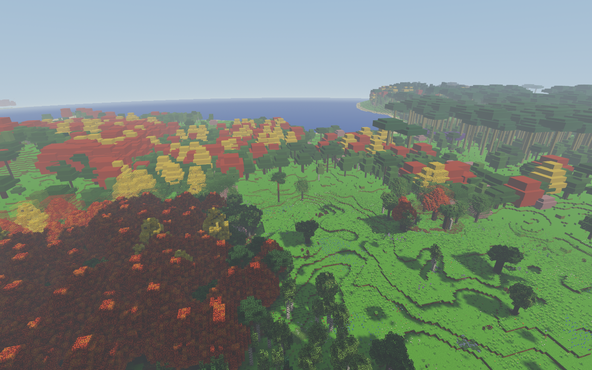
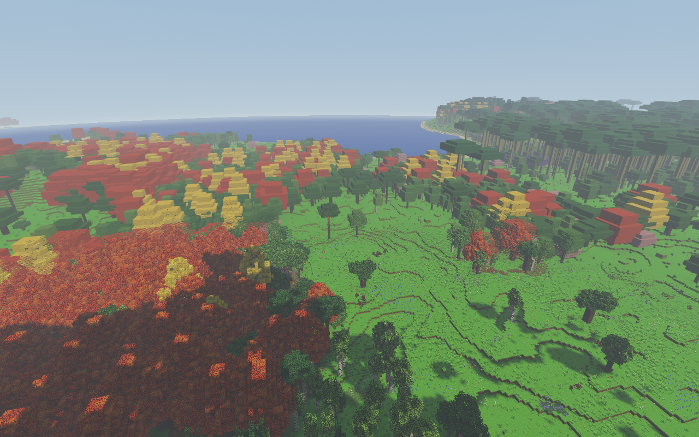

# Las i daleki teren 0.86.0

PR #125 obejmuje prześwity przy przejściach szczegółowości, światło pod
koronami, odświeżenie menu i większy ekwipunek. Ten raport opisuje teren;
[światło i koszt budowania](SWIATLO.md), [menu](../menu-0.86.0/README.md)
oraz [GUI](../ekwipunek-0.86.0/README.md) mają osobne wyniki.

## Prześwity z dużej wysokości

Odtworzenie w rzeczywistym `Game`, naturalny seed 42. Pierwsza kamera:
`4762, 132, -4750`, cel `4810, 47, -4945`; druga: wysokość 148,
cel `4930, 48, -4790`. Są to widoki ponad wysokimi koronami.

Bliski i daleki teren używały dopełniającego szumu ekranowego, lecz
różne powierzchnie pod tym samym pikselem miały różne współrzędne świata
i różną wagę zanikania. Obie reprezentacje potrafiły więc odrzucić piksel.
Teraz daleki podkład narasta w dodatkowym pasie 32 bloków, zanim zacznie
zanikać bliska geometria. Gotowość kafelków i płynne przejścia pozostają.
Koszt: w tej scenie 522 → 542 widoczne kafelki, bez nowego render-passu.

Kontrola framebufferu zastępuje niebo magentą i liczy odkryte piksele
w dolnej połowie kadru, gdzie powinien być wyłącznie krajobraz:

| Kamera | 0.85.0 | 0.86.0 |
| --- | ---: | ---: |
| Wysokość 132 | 41 | 0 |
| Wysokość 148, obrót w bok | 75 | 0 |

To potwierdzenie dwóch rzeczywistych widoków, nie gwarancja braku każdego
artefaktu przy dowolnej wysokości i projekcji. Regresja WebGL przejścia
sprawdza także różne punkty bliskiej/dalekiej powierzchni i fallback bez
czytelnej tekstury głębi: 22 kontrole PASS.




## Natywny koszt klatki

11 listopada 2026, Windows, RTX 3050 Laptop GPU przez ANGLE/D3D11,
zasilacz (`BatteryStatus.PowerOnline=true`, `Discharging=false`). Normalna
gra była zamknięta; testy pozostałych agentów CPU/GPU zatrzymane na czas
obu przebiegów. Własny tymczasowy profil nie dotyka zapisów użytkownika.

1920×1080, skala 100%, zasięg szczegółów 800, horyzont 1024, cienie 3,
liście z części, rośliny `semi`, naturalny model oświetlenia. Wczytane
613 chunków. Każdy profil: 60 klatek rozgrzewki i 300 pomiarowych.
Profil z efektami włącza promienie, odbicie światła, wiatr roślin,
spadające liście i smugi wiatru. Profile i pełne dane są w JSON.

| Profil | 0.85.0 mediana / p95 | 0.86.0 mediana / p95 |
| --- | ---: | ---: |
| Efekty wyłączone | 5,3 / 8,1 ms | 5,8 / 8,1 ms |
| Efekty włączone | 5,9 / 8,5 ms | 8,1 / 9,8 ms |

Nowe światło i podkład mają koszt, lecz w tych próbach pozostaje zapas do
16,67 ms. Pomiary obejmują `Game.update + render + gl.finish`, więc
serializują pracę CPU/GPU. **Nie są pomiarem prezentowanych FPS widocznego
okna ani gwarancją 60 FPS podczas ładowania dowolnego świata.** To jedna
para przebiegów na rozgrzanym, nieruchomym widoku; nie badano telefonu.

Raporty `high-085-native.json` i `high-086-native.json` zapisują hashe źródeł,
ustawienia, geometrię i liczniki prześwitów. Ostateczny runtime 0.86.0:
`6142655460dcff8678615ef94f9cc3a74cadd659a7c5767f3dc7372781bfa9c5`.
Pomiar menu poprzedza optymalizację cache; porównanie hashy geometrii
w raportach CPU potwierdza identyczny obraz przed i po tej optymalizacji.

## Odtworzenie i pozostałe kontrole

```powershell
$env:VOXEL_QA_ELECTRON = 'C:\sciezka\do\electron.exe'
$env:VOXEL_FOREST_BENCHMARK = '1'
$env:VOXEL_TEST_OUTPUT = 'test-results/forest-086-final'
node tools/sprawdz_las_086_webgl.mjs
```

`VOXEL_TEST_ROOT` może wskazać checkout 0.85.0 do identycznej próby bazowej.
Bez Electrona runner używa Chrome/SwiftShader wyłącznie do kontroli obrazu,
bez benchmarku GPU. Pełny naturalny las jest ciężką próbą lokalną;
w CI działają m.in. szybkie regresje światła, LOD i rzeczywiste shadery gry.

`npm test`: 96 skryptów PASS. Nowe sprawdzenia obejmują źródła SKY,
kolor z atlasu, edycję liści/dachów, granice chunków, zgodność z ponownym
przeliczeniem i niezmienione dane cieni dalekiej geometrii. Do tego native
QA lasu, menu oraz test GUI z realnym trafianiem w powiększone miejsca.
