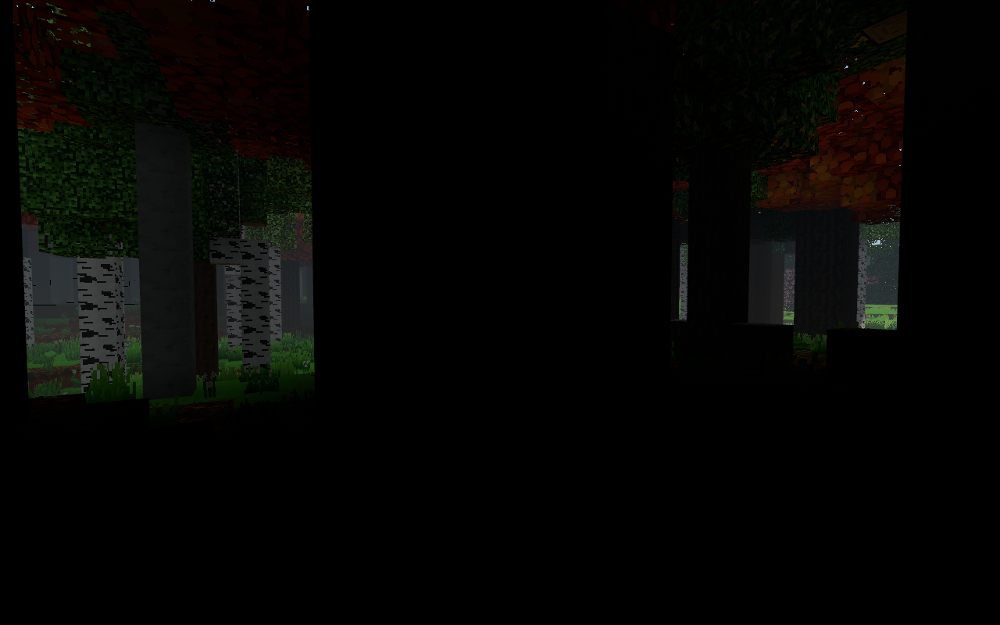
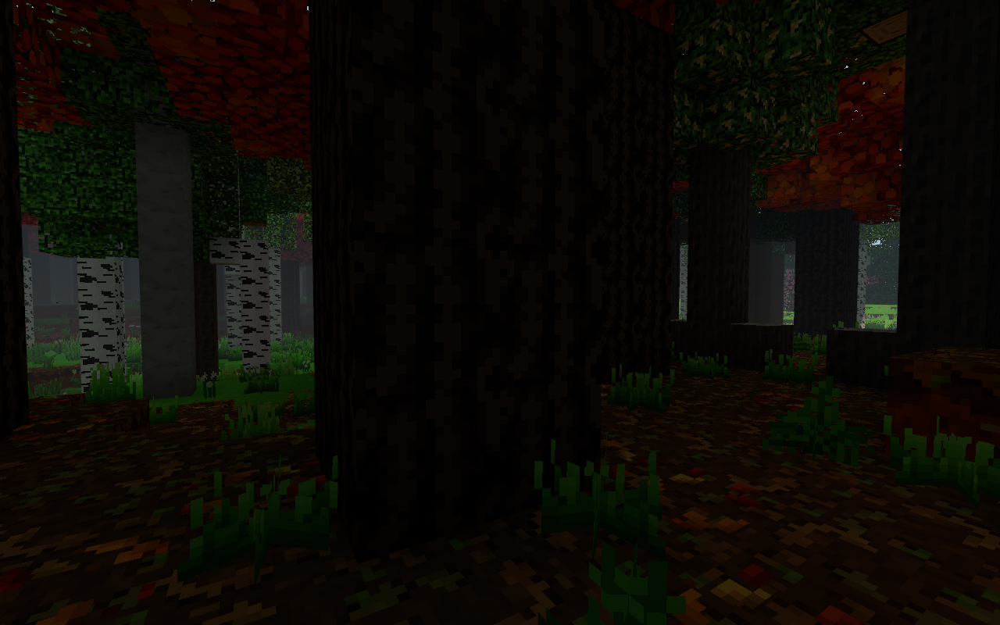
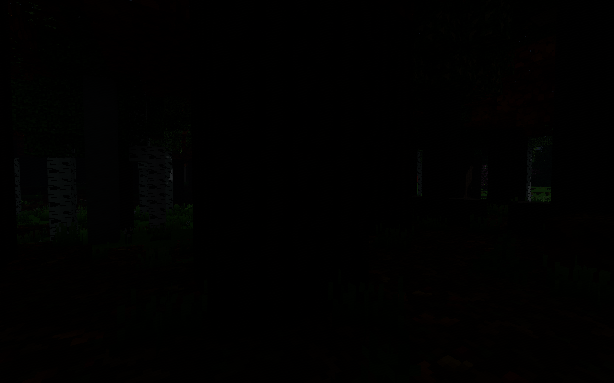

# Światło pod koronami — 0.86.0

## Przyczyna i rozwiązanie

W 0.85.0 pierwszy blok liści kończył pionową kolumnę pełnego SKY.
Dalsze rozlewanie traciło jeden poziom na każdą kratkę, również puste
powietrze pod koroną. Wysokie drzewa mogły więc wyczerpać światło nieba
przed podłożem. Rozjaśnienie samego shadera pozostawiłoby ciemne próbniki
światła używane m.in. przez dłoń i cząstki.

Nowa kolumna bezpośredniego SKY filtruje światło w rzeczywistych warstwach
liści: transmisja liniowa pierwszej warstwy 0,72, kolejnych ×0,90.
Powietrze poniżej nie pochłania dodatkowej energii. Poziomy 0–15 uwzględniają
obecne kodowanie jasności, bez sztucznego minimalnego poziomu światła.
Nieprzezroczysty dach kończy kolumnę; boczne rozchodzenie nadal wygasa
o jeden poziom na blok. Zmiana liścia/dachu przelicza kolumnę i zależne
światło, nie cały świat.

Barwa pochodzi ze średnich liniowych kolorów prawdziwych tekstur atlasu,
z uwzględnieniem istniejącego tintu klimatu. Nie ma ręcznej tabeli gatunków.
Pod koroną powstaje delikatny filtr (maks. 32% udziału barwy), przypisany
wyłącznie do rozproszonego światła nieba. Kolorowe lampy i emisja nie
zmieniają barwy. Ustawienie transmisji liści wyłącza filtr, pozostawiając
naprawiony transport SKY. Brak światła nieba nadal oznacza zero energii
z tego filtra; noc zachowuje nocne natężenie nieba i księżyca.

MenuWorld korzysta z tych samych chunków i shaderów. Dla dalekich modeli
drzew filtr liczymy z już dostępnych brył koron, z uśrednieniem pokrycia
siatki 4×4 i przedziałów wysokości. Nakładające się bryły nie pochłaniają
światła wielokrotnie. Ta sama funkcja transmisji jest używana blisko i
daleko; LOD pozostaje przybliżeniem zasięgu/objętości koron, nie symulacją
wszystkich liści ani śledzeniem promieni światła słonecznego.

## Pamięć i koszt budowy

- `skySources`: **32 KiB na chunk 16×128×16**, bez zapisywania do świata.
- Bliska siatka: RGB Uint8, **3 B/wierzchołek**, tylko gdy geometria
  rzeczywiście potrzebuje filtra korony. Brak tekstury wolumetrycznej
  i dodatkowego przebiegu renderowania.
- LOD: **zero dodatkowych bajtów bufora/transferu**. RGB555 mieści się
  w wolnych `normal.w` i `surfaceAlbedo.a`; `position.w` pozostaje bez
  zmian, ponieważ używa go shader dalekich cieni jako podstawy ściany.
- Cache kolumn jest chwilowy i należy do jednego zadania meshera.
  Ma indeksowe odwołania zamiast tekstowych kluczy, a filtr liczy ponownie
  dopiero po napotkaniu kolejnej warstwy liści. Przetwarzanie wierzchołków
  ustępuje kolejce co 512 wierzchołków. Nie ma skanowania koron co klatkę.
- LOD współdzieli gotowe RGB555 w narożnikach brył i korzysta z numerycznych
  kluczy siatki. Standardowa ścieżka przygotowuje te dane w workerze.

`tools/zmierz_swiatlo_lasu_cpu.mjs`: Node24.22, 4 rozgrzewki i 10 pomiarów.
Wariant `VOXEL_FOREST_BASELINE=1` wczytuje Light/Chunk/ChunkMesher/farVegetation
z commita `6828676` (0.85.0). Pomiary wykonano kolejno na laptopie Kamila.
Są to koszty budowania/edycji danych CPU, **nie FPS ani czas GPU**.
Syntetyczna pełna korona ma sześć warstw w każdej kolumnie i 29 184
wierzchołki, więc jest obciążeniem granicznym względem typowego chunka.

| Operacja — mediana | 0.85.0 | 0.86.0 końcowe |
|---|---:|---:|
| Inicjalizacja SKY, otwarty chunk | 2,02 ms | 2,07 ms |
| Inicjalizacja SKY, gęsta korona | 1,33 ms | 2,74 ms |
| Pojedyncze zakrycie/odkrycie pod koroną | 0,0012 ms | 0,0089 ms |
| Mesher otwartego chunka, 2048 wierzchołków | 0,83 ms | 1,27 ms |
| Mesher gęstej korony, 29 184 wierzchołki | 5,73 ms | 9,52 ms |
| Złożenie kafla LOD, 339 brył/9764 wierzchołki | 0,49 ms | 3,27 ms |

Nowy efekt zwiększa koszt przygotowania danych. Optymalizacja cache
obniżyła koszt gęstego mesha z 15,82 do 9,52 ms (40%), a kafla LOD z
7,10 do 3,27 ms (54%). SHA256 **wszystkich atrybutów i indeksów** jest
identyczny przed/po tej optymalizacji dla otwartej siatki, korony i LOD.
Przykładowa korona alokuje 87 552 B tintu, otwarta siatka 0 B.
Wyniki i hashe: [0.85.0](cpu-085.json), [0.86.0](cpu-086.json),
[wersja przed optymalizacją cache](cpu-before-cache.json).

## Regresje

- 580 kontroli `sprawdz_swiatlo_lasu.mjs`: kolumny, gęstość, usuwanie
  i dodawanie dachów/liści, lampy, skrzyżowanie czterech chunków, porównanie
  przyrostowych edycji z pełnym przeliczeniem, ciemna zamknięta komora,
  barwy rzeczywistych atlasów dębu/miłorzębu/klonu, LOD i RGB555.
- 1195 kontroli dalekiej roślinności, w tym identyczny wynik rzeczywistego
  workera i fallbacku, zachowane XYZ+W pozycji oraz flagi wody/kurtyn.
  Rzeczywisty `FarTerrain.buildMesh` zachowuje wspólny bufor normalnej
  i transmisji oraz czteroskładnikowe `shadowPosition` w geometrii cienia.
- 155 kontroli meshera partiami: zgodność, budżet, przeplatanie, anulowanie.
- Stare testy ciemności i zapisu światła przechodzą; cztery cykle
  zapis/odczyt z otwieraniem/zamykaniem dachu i kolorowym źródłem.
- Niezależny review: 80 losowych edycji w czterech chunkach porównanych
  z pełną inicjalizacją oraz rzeczywisty `World.setBlock` usuwający liść
  nad podłożem. Sąsiednie siatki i kolor po usunięciu korony odświeżają się.

Pomiary klatek na RTX3050 i wysokie ujęcia LOD opisuje osobny raport w tym
katalogu. Wizualny test światła działa w prawdziwym `Game`, na osobnym
profilu Electron, bez odczytu/zapisu światów gracza.

## Sprawdzenie w grze na RTX3050

Native Electron / Direct3D11, 1280×800, ten sam seed42 i kamera
`4743.5, 55.6, -4763.5` pod rzeczywistą dziewięciowarstwową koroną.
Fixture wybiera miejsce na podstawie oddzielnego solvera SKY0.85, aby
nie pomylić wysokiej korony z miejscem już doświetlonym przez pobliską
polanę. Zwykły świat, bloki, modele liści i shadery gry pozostają rzeczywiste.

Stara wersja ma przy kamerze **SKY0**, nowa **SKY10**. Na porównaniu widać
odsłonięty rysunek kory, ściółkę i niską roślinność; światło nadal jest
znacznie słabsze niż poza lasem. Przy wyłączeniu transmisji jasność SKY
pozostaje10, a kolor podłoża traci ciepły filtr korony. Noc w tym samym
kadrze pozostaje ciemna. Wyłączenie wszystkich źródeł daje RGB0 w badanym
fragmencie podłoża, podobnie jak zamknięta komora postawiona prawdziwym
`World.setBlock` (SKY0). Brak błędów konsoli i kompilacji shaderów:
19 kontroli / 5 ujęć końcowych + 4 kontrole / 1 ujęcie baseline.

Raporty zawierają renderer, ustawienia, pozycje, RGB i fingerprint kodu:
[przed](forest-before.json), [po](forest-after.json). Są to testy obrazu
i reguł światła, nie pomiar liczby klatek.

| 0.85.0 | 0.86.0 |
|---|---|
|  |  |

Odtworzenie: uruchom `tools/sprawdz_las_086_webgl.mjs` ze zmiennymi
`VOXEL_FOREST_FIXTURE=forest-light-086.js`,
`VOXEL_FOREST_CASES=day-tint-on,day-tint-off,night,sources-off,cave` oraz
`VOXEL_QA_ELECTRON` wskazującą testowy Electron. `VOXEL_TEST_ROOT` pozwala
uruchomić tę samą scenę na osobnym checkoutcie0.85.0; dla baseline wystarcza
`VOXEL_FOREST_CASES=day-tint-on`.
