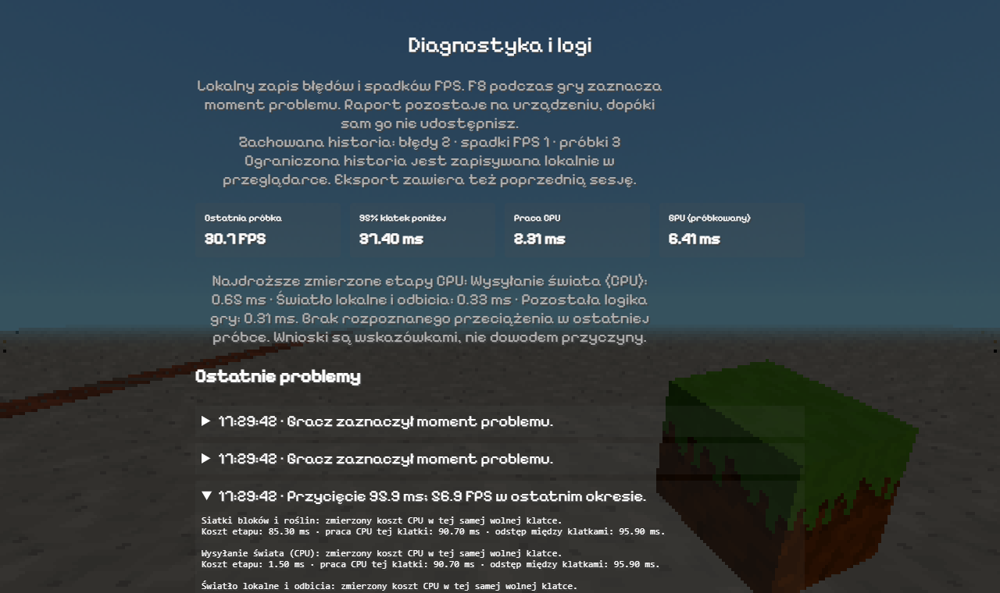
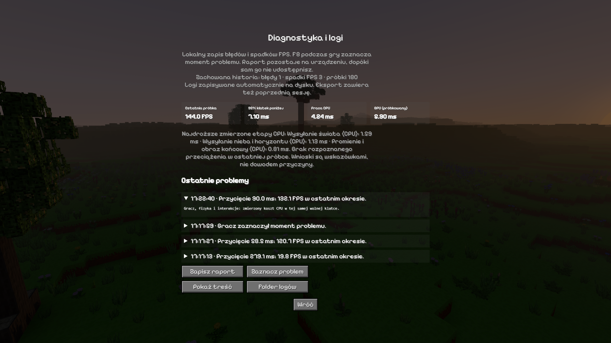

# Logi 0.67.0 — sprawdzenie diagnostyki

Sprawdzono rzeczywisty start gry, zapis i eksport raportu, wykrywanie
kontrolowanych błędów oraz przypisanie kontrolowanego przycięcia do
zmierzonego etapu CPU. Pomiary natywne dotyczą RTX 3050 Laptop na
Windows. Próba przeglądarkowa sprawdza poprawność integracji, nie FPS
tej karty. Skrót danych i hashe plików źródłowych są w
[`evidence.json`](evidence.json).

## Natywna próba kosztu — pierwsza seria

Rzeczywisty `desktop/main.js`, preload, protokół `gra://voxel-game`,
bootstrap i główna pętla gry; osobny profil testowy, bez zapisów gracza.
NVIDIA GeForce RTX 3050 Laptop, ANGLE D3D11 / WebGL2, 1920×1080,
DPR 1. Seed `2138286349`, pozycja `(198,62,-261)`, nieruchoma kamera
nad rzeką. Pełny teren 64, horyzont 1024, naturalne światło i atmosfera,
cienie 3, materiały Standard, model liści `parts`. Limit gry wyłączony;
wynik ogranicza VSync monitora 144 Hz. Wzrost roślin i pora dnia
zatrzymane; wiatr pozostaje aktywny.

Cztery próbki po 20 s, każda po 5 s rozgrzewki; kolejność:
wyłączone/włączone/włączone/wyłączone logi wydajności. Oddzielny
obserwator RAF mierzy odstępy klatek. Kolumny CPU pochodzą z istniejącego
`PerfMonitor` i obejmują `update + render`, czyli wykonywanie gry i
wysyłanie poleceń rysowania. Nie obejmują wszystkich czynności loggera
wokół tych etapów ani czasu wykonania poleceń na GPU.

| Kolejność | Logi wydajności | Klatki | FPS | P95 klatki | Maks. klatka | Mediana CPU | P95 CPU |
| --- | --- | ---: | ---: | ---: | ---: | ---: | ---: |
| 1 | Wyłączone | 2880 | 144,00 | 7,1 ms | 14,1 ms | 4,3 ms | 5,7 ms |
| 2 | Włączone | 2881 | 144,05 | 7,1 ms | 7,7 ms | 4,4 ms | 6,0 ms |
| 3 | Włączone | 2877 | 143,85 | 7,1 ms | 14,1 ms | 4,4 ms | 6,0 ms |
| 4 | Wyłączone | 2881 | 144,05 | 7,1 ms | 8,2 ms | 4,3 ms | 5,6 ms |

We wszystkich próbkach końcowa kolejka doczytywania była pusta.
Różnica mediany czasu `update + render` wyniosła około **0,1 ms**.
FPS i P95 klatki pozostały podobne. Jest to kontrola jednej nieruchomej
sceny przy VSync, więc nie dowodzi zerowego kosztu loggera ani zachowania
we wszystkich światach i podczas szybkiego przemieszczania.

Ostatnia dostępna próbka loggera w obu próbach z logowaniem miała
18/19 ważnych pomiarów GPU, status `ready`, bez `disjoint`, pominięć
lub wygasłych zapytań. Średnia GPU tej ostatniej próbki to
5,783/5,816 ms. To próbka około jednej sekundy, nie średnia całego
20-sekundowego przebiegu. Bez loggera zapytania GPU są wyłączone,
więc ta seria nie mierzy różnicy kosztu GPU między wariantami.

Pole `overheadMs` wynosiło 3,9/5,6 ms **na całe ostatnie okno około
1 sekundy**, zawierające 145 klatek. Nie jest to narzut każdej klatki.
Obejmuje zadeklarowany zakres CPU rejestratora i zapytań GPU; wywołania
zegara znaczników etapów pozostają wewnątrz mierzonego CPU. Nie zastępuje
niezależnego porównania całej aplikacji.

## Kontrolowane przycięcie

W natywnej grze harness jednorazowo dodał około 85 ms pracy do
aktualizacji gracza. Raport wykazał:

- odstęp klatki **90,2 ms**;
- CPU tej samej klatki **89,6 ms**;
- etap „Gracz, fizyka i interakcje”: **86,5 ms**;
- wskazanie `same-frame-measured-cost` dla tego etapu.

Nie przypisano winy do GPU na podstawie samego niskiego FPS. W próbce
P95 CPU wynosiło tylko 7,7 ms, dlatego przechowanie konkretnych wolnych
klatek jest istotne: pojedynczy duży skok może zniknąć w percentylu.
To celowe wymuszenie służące sprawdzeniu diagnostyki, a nie nowy błąd
fizyki. Wcześniejsze incydenty obecne w sesji są oddzielone w skrócie
dowodowym od tego wymuszenia.

Po końcowej serii powtórzono tę samą kontrolę: **90,0 ms odstępu
klatki, 88,6 ms CPU i 85,3 ms etapu gracza**. Ponownie wskazany został
zmierzony koszt gracza w tej samej wolnej klatce. Raport zachował
te konkretne dane mimo niskiego P95 pozostałych klatek.

## Końcowa seria po ponownym uruchomieniu

Powtórzono tę samą metodę 4×20 s i kolejność wyłączone/włączone/
włączone/wyłączone na końcowym kodzie gry, po poprawce obsługi F8.
Kamera, 1920×1080, zakres 64/1024 i ustawienia sceny pozostały takie
jak w pierwszej serii. Każda próbka zaczynała się po 5 s rozgrzewki.

| Kolejność | Logi wydajności | Klatki | FPS | P95 klatki | Maks. klatka | Mediana CPU | P95 CPU |
| --- | --- | ---: | ---: | ---: | ---: | ---: | ---: |
| 1 | Wyłączone | 2878 | 143,90 | 7,1 ms | 13,9 ms | 4,6 ms | 6,0 ms |
| 2 | Włączone | 2881 | 144,05 | 7,1 ms | 7,4 ms | 4,4 ms | 5,7 ms |
| 3 | Włączone | 2880 | 144,00 | 7,1 ms | 13,9 ms | 4,5 ms | 5,8 ms |
| 4 | Wyłączone | 2878 | 143,90 | 7,1 ms | 14,4 ms | 4,3 ms | 5,7 ms |

Wszystkie końcowe kolejki terenu były puste. FPS pozostał ograniczony
odświeżaniem, a mediany CPU zmieniały się między 4,3 a 4,6 ms również
przy wyłączonych logach. Ta seria nie wykazała powtarzalnego wzrostu
mediany CPU; nie interpretujemy jej jako przyspieszenia dzięki logom
ani dowodu zerowego kosztu. Obie serie opisują nieruchomy kadr,
nie wielominutowy lot z doczytywaniem świata.

Ostatnie okna loggera miały po 145 klatek i 18 ważnych próbek GPU.
Średnia GPU tych okien: 5,855/5,833 ms; `disjoint`, `skipped`, `expired`
wynosiły zero. `overheadMs` wynosiło 4,2/4,7 ms **na około sekundę**,
z tymi samymi ograniczeniami zakresu pomiaru co wyżej.

## Błędy, eksport i awaria procesu

Wymuszono trzy rozróżnialne zdarzenia: `console.error`, nieobsłużony
wyjątek i odrzucony Promise. Wszystkie trafiły do raportu z właściwym
rodzajem, komunikatem, stosem i kontekstem. Zapis przez rzeczywisty
systemowy dialog Windows zakończył się plikiem JSON zawierającym
**180 próbek, 71 zdarzeń i 3 oczekiwane błędy**. Czytelne podsumowanie
miało 27 610 znaków. Ostatnia próbka GPU zachowała status `ready`.
Wyeksportowany JSON zawiera również zdarzenia procesu Electrona.

Następnie harness wywołał `webContents.forcefullyCrashRenderer()`.
Natywny dziennik zachował `desktop.renderer-gone`, `reason=crashed`,
`exitCode=2`. To celowa awaria procesu renderera; nie jest dowodem
samoczynnego błędu gry ani awarii całego systemu operacyjnego.

Po ponownym uruchomieniu aplikacji `previousAvailable=true`;
odzyskano **57 rekordów poprzedniej sesji, w tym 49 próbek wydajności**
oraz zdarzenie `desktop.renderer-gone`. Raport oznaczył sesję jako
niezamkniętą prawidłowo (`cleanExit=false`) i historię jako skróconą
(`truncated=true`) zgodnie z limitem odzyskiwania. Osobna próba
zwykłego zamknięcia zachowała kolejno `session.end`, rekord sesji
z `cleanShutdown=true` i `desktop.session.end`; następny start
rozpoznał ją jako zamkniętą prawidłowo.

F8 sprawdzono także natywnie. Narzędzie sterujące klawiaturą przekazało
`key=F8` z pustym `code`; obsługa logicznego klawisza utworzyła
`user.problem` z ostatnim pomiarem wydajności. Cztery dodatkowe
kontrole przeglądarkowe potwierdzają kontekst znacznika oraz brak
zalewu zdarzeń przy trzymaniu klawisza.

Końcowa sesja zawiera jeden błąd **narzędzia QA**: pomocnicza komenda
statusu wywołała `window.diagnosticsQA.status()` przed zakończeniem
inicjalizacji harnessu (`<anonymous>:1:22`). Logger zachował ten
błąd poprawnie. Wystąpił przed pomiarem; nie jest awarią kodu gry.
Launcher dostał później warunek oczekiwania na gotowość przed
obsługą komend. Nie ukrywamy tego wpisu ani nie opisujemy całej
końcowej sesji jako pozbawionej błędów.

Zarejestrowane ostrzeżenia kompilatora ANGLE `X3595` pozostają
ostrzeżeniami. Raport nie zamienia ich w nieudane kompilacje shaderów.

## Integracja przeglądarkowa

Próba zakończyła się **40 sprawdzeniami PASS**. Obejmuje rzeczywisty
bootstrap i obsługę przycisków, wyłączanie/włączanie logów oraz pamięć
ustawienia po ponownym uruchomieniu, oznaczenie problemu, wyjątek i
Promise, brak próbek podczas pauzy i ukrycia strony, cel 30 FPS,
eksport z czytelnym podsumowaniem oraz zachowanie poprzedniej sesji.
Sprawdzono także kontrolowany błąd importu głównego modułu: ekran
awarii pozwolił zapisać raport mimo nieuruchomienia gry.

Panel mieścił się w widokach **1280×760** i **390×844**, bez poziomego
przewijania. Drugi rozmiar jest testem układu mobilnego w przeglądarce,
nie pomiarem na telefonie z Androidem. Renderer SwiftShader tej próby
nie służy do oceny wydajności RTX 3050.

Końcowa kontrola rozwiniętego incydentu potwierdza widoczność trzech
osobnych wartości: kosztu etapu, CPU tej samej klatki i odstępu między
klatkami. Poniższy kadr pokazuje tę końcową wersję opisu.

[Kadr układu 390×844](diagnostyka-mobile.png) pokazuje ten sam panel
w wąskim widoku; dłuższa zawartość przewija się pionowo.

## Testy automatyczne

Końcowe pełne **`npm test` zakończyło się kodem 0**. Obejmuje również
testy rejestratora, pamięci, redakcji danych, rotacji dziennika,
odzyskiwania sesji, IPC/eksportu oraz pomiarów CPU i zapytań GPU.
Hash pełnego logu testów zapisano w `evidence.json`; nie publikujemy
lokalnych ścieżek z ostrzeżeń narzędzi.

## Panel w natywnej grze

Oryginalny kadr 1920×1080 po końcowym kontrolowanym przycięciu.
Widoczny pojedynczy błąd pochodzi z opisanej wyżej komendy QA.
Kadr wykonano przed drobnym dopisaniem wartości milisekund do
rozwiniętego opisu wskazania; pomiar i dane raportu pozostają te same.

## Granice wnioskowania

Logi podają zmierzone koszty oraz powiązane zdarzenia. Pomiar GPU
jest próbkowany i dociera z opóźnieniem; nie wskazuje automatycznie
przyczyny każdej wolnej klatki. Wysokie oczekiwanie na prezentację,
sterownik lub system pozostaje oznaczone jako nierozpoznane, jeśli
nie ma odpowiednich danych. Pamięć i retencja plików są ograniczone;
eksport nie jest nieograniczoną historią aplikacji.
