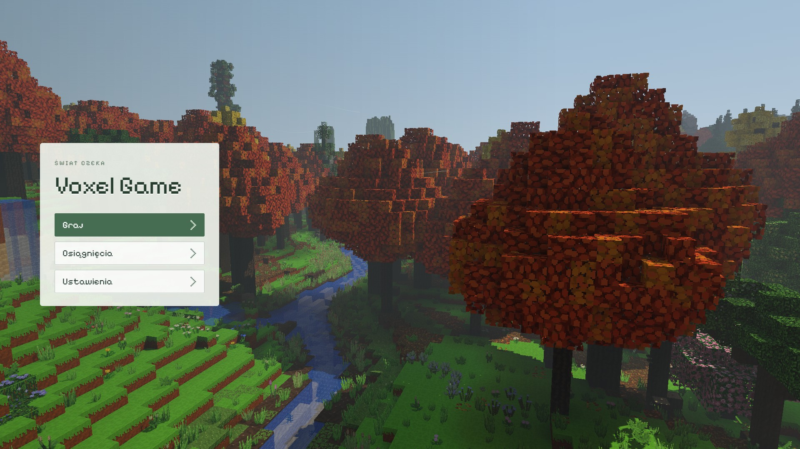
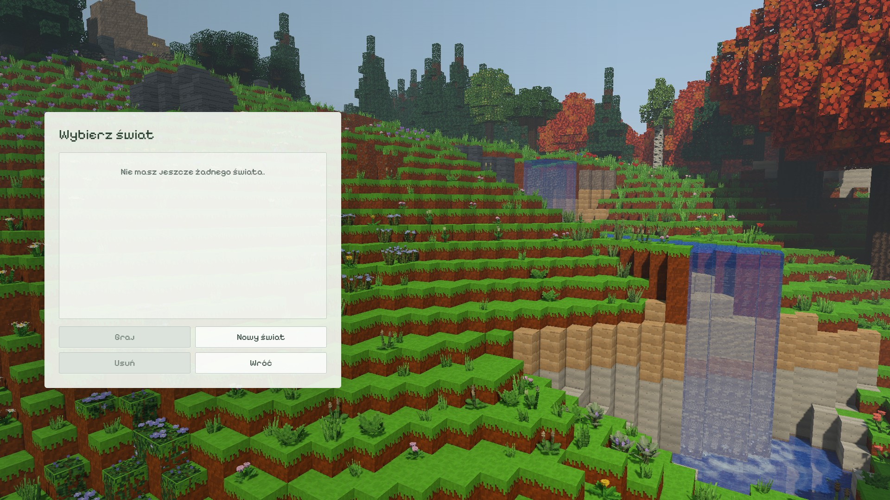
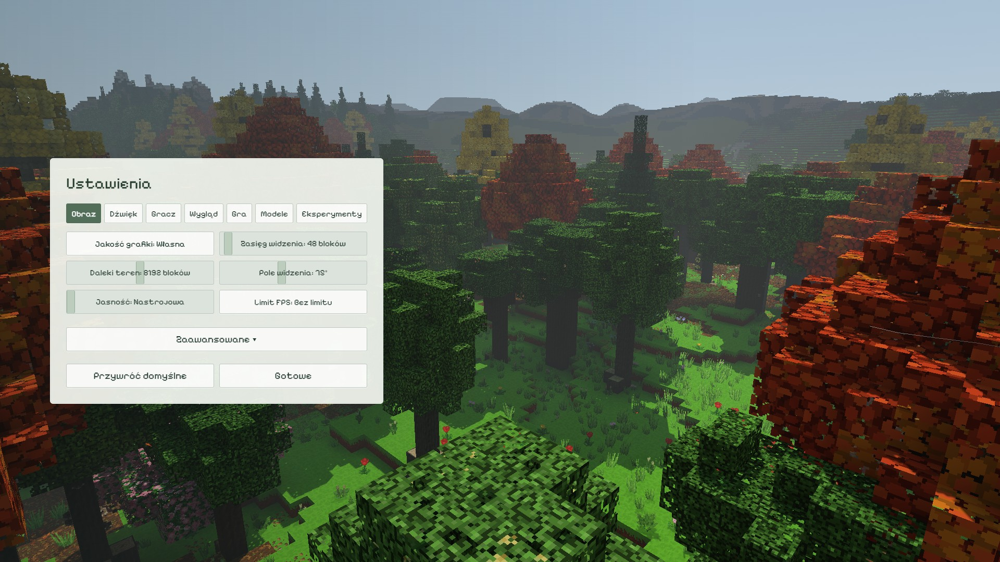
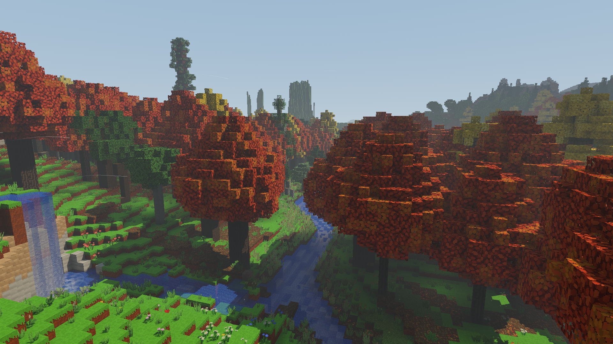

# Żywe menu 0.86.0 — weryfikacja

Scena `autumn-cascades-0.86` to naturalny świat seedu `86`, bez zmiany
generatora ani ręcznej przebudowy terenu. Cztery kadry pokazują ciepły las
z klonami i miłorzębami, neutralny las oraz rzekę z dwiema kaskadami
80 → 73 → 62. Pełne chunki do 256 bloków, szczegółowy horyzont do 1024;
przełączanie zakładek korzysta z tego samego wczytanego obszaru.

## Warunki i metoda

Test lokalny z 11 listopada 2026, Windows, NVIDIA GeForce RTX 3050 Laptop
GPU przez ANGLE/D3D11, Electron, 1920 × 1080, skala renderowania 100%.
Odczyt zasilania przed pomiarem: `PowerOnline: true`, `Discharging: false`.
W czasie końcowego pomiaru pozostałe testy CPU/GPU były zatrzymane;
zwykła aplikacja Voxel Game nie działała.

Cienie 2, rośliny `semi`, szczegółowe liście, naturalny model światła,
światło odbite, promienie, spadające liście i smugi wiatru włączone.
Zachmurzenie 10%, godzina 10:42. Menu respektuje preferencje efektów gracza,
lecz ma własny stały zasięg i nie zmienia suwaków rozgrywki.

Pomiar zawiera po 180 klatek każdego kadru po 30 klatkach rozgrzewki.
`gl.finish()` przed i po aktualizacji/renderowaniu mierzy koszt ukończonej
klatki; osobno zbierany jest `EXT_disjoint_timer_query_webgl2`.
Serializacja usuwa nakładanie pracy CPU/GPU. To koszt renderowania,
**nie pomiar FPS prezentowanych przez widoczne okno**. Ukryty Electron
ograniczał `requestAnimationFrame` do około 1 Hz; ten wynik został odrzucony.
Pomiar nie obejmuje ładowania świata ani eksportu zrzutów.

Raporty zapisują fingerprint plików `src` oraz używanych atlasów i modeli
przed i po przebiegu; skrypt wymaga ich zgodności. Próbki GPU bez gotowego
wyniku lub z flagą disjoint nie są przyjmowane.

## Wyniki

[Pełny raport pomiaru](menu-performance.json) i [raport kadrów oraz UI](menu-ui.json)
mają ten sam fingerprint kodu/zasobów przed i po przebiegu:
`ec34faabff7bc0642e172666e8df5606b6c56f0929bf4176e12274f5f419ab7a`.
To stan po poprawce pakowania danych dalekich cieni, przed późniejszą
optymalizacją cache budowy kolorów koron. Raporty dotyczą tego konkretnego
stanu; nie przedstawiają czasu uruchamiania późniejszego cache.

| Kadr | Ukończona klatka: mediana / p95 / p99 | GPU: mediana / p95 | Klatki > 16,67 ms |
| --- | --- | --- | --- |
| Główny — ciepły las | 11,6 / 16,2 / 17,3 ms | 7,39 / 10,26 ms | 5 / 180 |
| Graj — kaskady | 11,2 / 15,8 / 16,8 ms | 6,56 / 9,35 ms | 5 / 180 |
| Ustawienia — neutralny las | 9,6 / 12,3 / 14,3 ms | 7,44 / 9,61 ms | 2 / 180 |
| Osiągnięcia — ciepły las | 13,9 / 16,9 / 19,6 ms | 8,43 / 10,75 ms | 16 / 180 |

Każdy wiersz zawiera 180 ważnych próbek GPU. CPU zgłaszał pracę w czasie
praktycznie równym całej ukończonej klatce (różnica median < 0,1 ms);
sterownik synchronizował część pracy już podczas wywołań renderera.
Wartości kolumn CPU/ukończonej klatki oraz GPU **nie sumują się**.

GPU mieści się w budżecie 16,67 ms dla 60 FPS, ale sporadyczne dłuższe
klatki CPU i koszt prezentacji pozostają istotne. Widok osiągnięć przekroczył
ten budżet w około 9% próbek. Wynik daje podstawę do utrzymania pełnej
scenerii; nie jest gwarancją idealnie równych 60 FPS w widocznym oknie.

Wczytano 1257 chunków, a przygotowanie menu w przebiegu pomiarowym trwało
19,32 s. To zimny profil testowy i pełne przygotowanie przed odsłonięciem
sceny, nie czas każdego przejścia. Wszystkie zakładki korzystały z tych
samych chunków; kolejka ładowania i kolejka oczekujących zmian wody były
puste przy końcach przejazdów. W tle pozostało 104 → 46 ograniczonych
skanów już wczytanych chunków wody; pomiar uwzględnia również ich pracę.
Test nie odcinał dalszych szczegółów w celu poprawienia liczb.

## Sprawdzone zachowanie

- `sprawdz_menu_kamere.mjs`: 217 kontroli przejazdów, ustawień ruchu,
  gotowości, awarii i zwalniania zasobów.
- `sprawdz_scene_menu_086.mjs`: 100 kontroli tras, generatora i gatunków;
  38 400 próbek przestrzeni kamery oraz 1292 przełączenia w 80 sekwencjach
  przerywania ruchu. Kamera omija bloki i korony drzew.
- `sprawdz_menu_086_webgl.mjs`: 33 kontrole prawdziwego `MenuBackdrop`
  i paneli `Menu`: pełne wczytanie terenu, cztery przejazdy i powrót,
  pozycja wodospadu poza panelem wyboru świata, działające liście/wiatr,
  efekty rzeczywistej symulacji wody, zmiana preferencji oraz cleanup.
- Brak błędów shaderów, WebGL i konsoli; świat menu nie współistnieje
  z rozgrywką i nie odczytuje ani nie zapisuje normalnych światów.

## Kadry

Pliki `*-ui.jpg` pokazują dokładną klatkę natywnego renderera pod prawdziwym
DOM menu. Ukryty compositor Electrona pomijał warstwę WebGL w zrzucie DOM,
więc fixture na czas eksportu prezentuje niezmieniony obraz canvas w tym
samym prostokącie pod panelem. To jawny sposób zapisu podglądu; właściwe
przejazdy, efekty i pomiary działają na żywej scenie. Surowe klatki PNG
pozostają w lokalnym `test-results`, a JPEG 90 ogranicza rozmiar dokumentacji.
Ostatnia ilustracja pokazuje sam kadr osiągnięć; pozostałe obejmują panel UI.






## Odtworzenie

Z katalogu repozytorium, Node.js 24, lokalny Electron z obsługą GPU:

```powershell
$env:VOXEL_QA_ELECTRON = 'C:\sciezka\do\electron.exe'
$env:VOXEL_QA_WIDTH = '1920'
$env:VOXEL_QA_HEIGHT = '1080'
$env:VOXEL_MENU_CAPTURE_UI = '1'
$env:VOXEL_TEST_OUTPUT = 'test-results/menu-086-final-ui'
node tools/sprawdz_menu_086_webgl.mjs
Remove-Item Env:VOXEL_MENU_CAPTURE_UI
$env:VOXEL_QA_PERF = '1'
$env:VOXEL_TEST_OUTPUT = 'test-results/menu-086-final-performance'
node tools/sprawdz_menu_086_webgl.mjs
```

Każdy przebieg używa osobnego tymczasowego profilu i własnego lokalnego
serwera, po czym zwalnia proces oraz profil. Pełna scena nie jest testem
SwiftShader do CI; w CI działają szybkie kontrole kamer i naturalnej geometrii.
