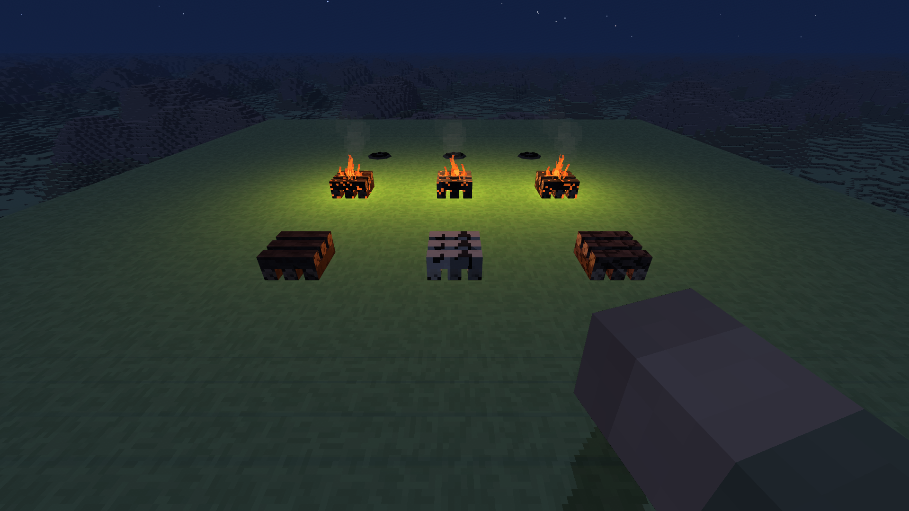
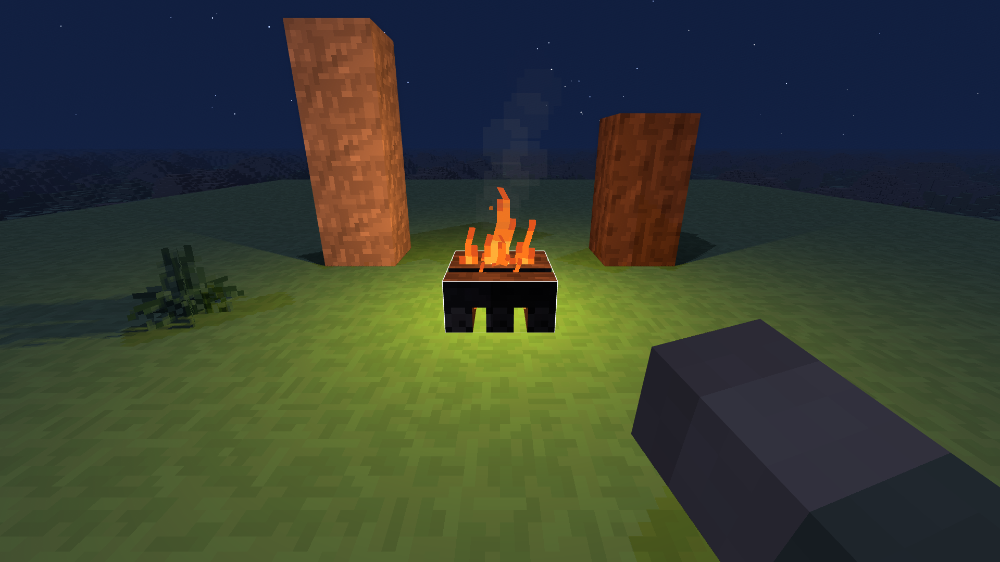
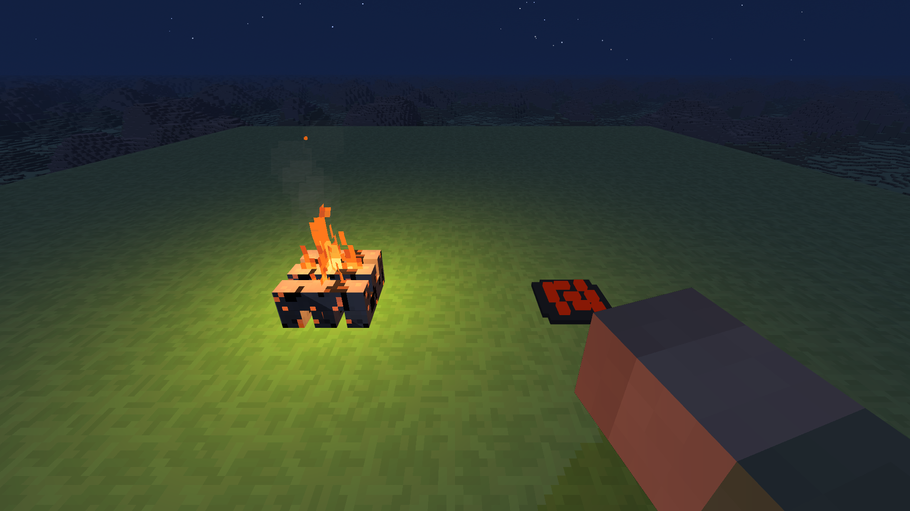

# Ogniska 0.51.0 — test w natywnej aplikacji

2026-11-01, Windows, Electron 44.4.5, RTX 3050 Laptop, 1920 × 1080, zasilacz (BatteryStatus 2).

Świat próbny jest odizolowany od normalnych zapisów użytkownika. Seed 2138286349, teren klasyczny, platforma próbna, noc. Widok 48, horyzont 8192, cienie 3, atmosfera, skala 100%, VSync domyślny, ekran 144 Hz. Każdy pomiar: 10 s rozgrzewki i 30 s pomiaru. GPU: EXT_disjoint_timer_query_webgl2, odrzucone pomiary disjoint. Wyniki dotyczą tej sceny, nie są gwarancją FPS w każdym miejscu świata.

| Scena | FPS średnio | P99 klatki | GPU średnio | Klatki >33,34 ms |
|---|---:|---:|---:|---:|
| Bez ognisk | 143,88 | 8,2 ms | 4,99 ms | 0 |
| Jedno ognisko | 143,98 | 8,2 ms | 5,22 ms | 0 |
| Cztery ogniska | 143,55 | 9,3 ms | 5,63 ms | 0 |

`integration.json`: 15 sprawdzeń w uruchomionej grze, m.in. zużycie sześciu opałów, odmowa siódmego, podpałka, światło, zapis, popiół, dołożenie opału i rozbiórka przy pełnym ekwipunku.
`hold.json`: rzeczywista ścieżka Game.update / InputManager / raycast, przytrzymanie, przerwanie i ponowne rozpalenie; starter nie znika. Stan przycisku ustawia skrypt testowy, a całą resztę wykonuje normalna pętla gry.
`support.json`: pełny ekwipunek blokuje usunięcie podpory, odzyskanie opału po zwolnieniu miejsca, brak budowy w wodzie.
`reload.json`: zapis w IndexedDB, przeładowanie aplikacji i ponowne wejście do świata odtwarzają gatunek, sześć polan i postęp spalania.
W raportach brak błędów JS i shaderów. Obejrzenie przez natywne okno: ruch płomienia, lekki dym, iskry, cienie za kamieniem i drewnem.

Pełne `npm test` przeszło; nowe sprawdzenia obejmują 80 asercji stanu i craftingu oraz 6 asercji obsługi przytrzymania na dotyku. Po końcowej korekcie emisji ponownie obejrzano nocny żar: zachowuje pomarańczowo-czerwony kolor niezależnie od chłodnego światła księżyca.

Poniższe kadry zapisano bezpośrednio z renderera natywnej gry, po końcowej korekcie żaru:

Korekta po ocenie podglądu: główny ruch płomienia przeniesiono na 16 klatek tekstury (12 klatek/s), a przemieszczenie modelu zmniejszono o 50% w obu osiach. Popiół ma kwadratowy, schodkowy obrys, a węgle układ prostokątny. `tekstura-popiol.json` potwierdza w natywnej grze 16 różnych klatek w atlasie 256 × 20, kwadratowy obrys 14 × 14 pikseli i brak błędów shaderów. Ponownie przeszły 86 sprawdzeń ognisk i dotyku. Powyższe pomiary wydajności pochodzą sprzed tej korekty; atlas powstaje jednorazowo, a animacja nie dodaje wywołań rysowania.

Uruchom serwer `node docs/pomiary/ogniska-0.51.0/serve-campfire-qa.cjs`, a następnie zainstalowanym Electronem `campfire-native-launcher.cjs` z tego folderu. Launcher ma osobny profil w katalogu tymczasowym. Przyciski panelu sterują scenami i zapisują wyniki do `wyniki/`. Nie wchodzą do instalatora gry. Przyspieszenie spalania działa wyłącznie w skrypcie prób.
