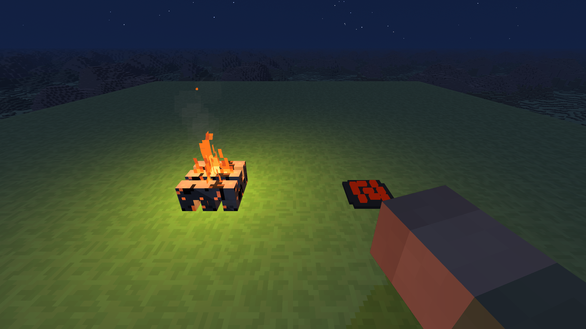

# Ogniska 0.51.1 — korekta wyglądu

2026-11-01, natywna gra w Electronie 44.4.5, RTX 3050 Laptop, 1920 × 1080, osobny świat próbny.

Główny ruch płomienia przeniesiono na 16 klatek tekstury (12 klatek/s), a przemieszczenie modelu zmniejszono o 50% w obu osiach. Popiół ma kwadratowy, schodkowy obrys, a węgle układ prostokątny. Obejrzenie w grze potwierdziło zmianę sylwetki płomienia w czasie i nowy kształt wypalonego ogniska.

`tekstura-popiol.json` potwierdza 16 różnych klatek w atlasie 256 × 20, kwadratowy obrys 14 × 14 pikseli i brak błędów JS/shaderów. Ponownie przeszły 86 sprawdzeń ognisk i dotyku (`node tools/sprawdz_ogniska.mjs`) oraz kontrola składni zmienionych modułów.

Pomiary wydajności w raporcie [0.51.0](../ogniska-0.51.0/README.md) pochodzą sprzed tej korekty. Nowy atlas powstaje jednorazowo, a animacja nie dodaje wywołań rysowania. Scena jest dostępna w istniejącym skrypcie `../ogniska-0.51.0/campfire-qa.js` pod przyciskiem „Tekstura i kwadratowy popiół”.

Kadr zapisany bezpośrednio z renderera gry:

