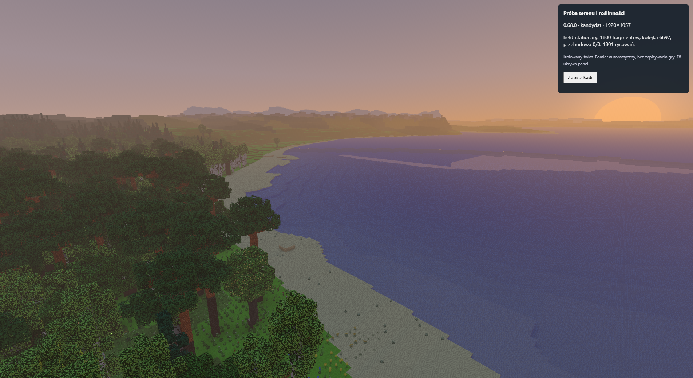
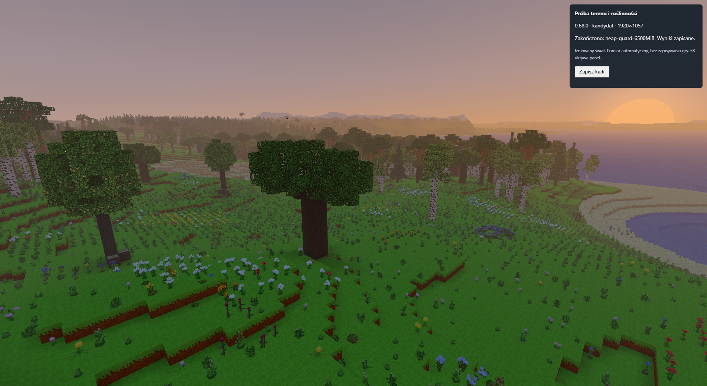

# 0.68.0 — wydajność terenu i roślinności

PR #102. W porównywalnej scenie z 1800 chunkami średnia płynność wzrosła
z **39,92 do 45,53 FPS**, a pamięć geometrii zmalała o **54,9%**.
**Ta aktualizacja nie zapewnia jeszcze 60 FPS na najwyższych ustawieniach.**
Po dalszym wczytywaniu i przejściu do gęstego lasu kandydat osiągał około
14–15 FPS. Obie próby zakończył limit pamięci testu przed wczytaniem pełnego
zasięgu 800 bloków. Zasięg i szczegółowość liści nie zostały zmniejszone.

## Warunki i porównywalność

Pomiar natywny 6 listopada 2026 r., kolejno baza 0.67.0 i kandydat 0.68.0:
NVIDIA GeForce RTX 3050 Laptop przez ANGLE/D3D11, Electron 44.4.5,
Chromium 152.0.7977.130, bufor rysowania **1920×1057**, DPR 1.
Okno pozostało aktywne i widoczne; zapisano zero błędów wykonania.
Kadry okna mają 1904×1041: system ograniczył jego obszar klienta, ale
bufor renderowania w obu próbach pozostał 1920×1057.

Seed `test`, teren realistyczny, pełny teren 800, horyzont 16384,
szczegółowe rośliny, liście z ośmiu części, cienie 3, promienie światła,
AO 45, jasność 50, budżet ładowania 4 ms i limit 120 FPS.
Czas świata i wzrost roślin zatrzymano; dźwięk, meteoryty i rękę wyłączono
w obu wariantach. Pełne ustawienia znajdują się w `evidence.json`.

Przy dokładnie 1800 przyjętych chunkach harness czasowo wstrzymał odbiór
nowego terenu. Pozwolił dokończyć siatki, odczekał dodatkowe 2 s i mierzył
nieruchomą scenę przez 15 s. Po pomiarze przywrócił normalne wczytywanie.
To kontrolowany pomiar tego samego fragmentu świata przy wybranym zasięgu
800, **nie pomiar całego, wczytanego promienia 800 bloków**.

Wszystkie warunki porównania sprawdzone przez `compare.mjs` przeszły:

- identyczny harness, seed, GPU, rozdzielczość i ustawienia;
- dokładnie ta sama lista 1800 chunków, niezmienna przez pomiar;
- puste kolejki terenu i roślin oraz brak aktywnych zadań budowy siatek;
- brak błędów, utraty aktywności i ukrycia okna.

## Wynik tej samej sceny

| Wielkość | 0.67.0 | 0.68.0 | Zmiana |
|---|---:|---:|---:|
| Średnia płynność | 39,92 FPS | 45,53 FPS | +14,1% |
| P95 odstępu klatki | 34,6 ms | 27,8 ms | −19,7% |
| P99 odstępu klatki | 47,8 ms | 31,9 ms | −33,3% |
| Średni czas CPU | 24,43 ms | 21,29 ms | −12,9% |
| Średni próbkowany czas GPU | 22,76 ms | 21,10 ms | −7,3% |
| Średnia liczba poleceń rysowania | 2428 | 1811 | −25,4% |
| Unikalne bufory geometrii CPU | 4870,6 MiB | 2197,6 MiB | −54,9% |
| Sterta JavaScript po pomiarze | 5412,2 MiB | 2718,4 MiB | −49,8% |
| Chunki z przygotowaną geometrią roślin | 965 | 206 | mniej odległych modeli |
| Widoczne chunki roślin | 121 | 121 | bez zmiany |
| Puste grupy materiałów w geometrii | 1487 | 0 | usunięte |

GPU ma odpowiednio 71 i 80 próbek. Średnią obliczono z uwzględnieniem
liczby próbek w każdym oknie; nie wyprowadzano globalnego P95 GPU z P95
poszczególnych okien. CPU i GPU częściowo pracują równolegle, więc ich
czasów nie należy dodawać. Polecenia i trójkąty obejmują wszystkie
przebiegi renderowania. Rozmiar buforów CPU nie jest pomiarem VRAM.

Przegląd obu kadrów nie wykazał utraty pobliskiej roślinności ani zmiany
sylwetki terenu. Różnice fazy wiatru i wody są naturalne przy różnym
czasie dojścia do checkpointu. Osobny kontrolowany test WebGL potwierdził
identyczny obraz po podziale siatek, także dla roślin pod wodą: zero
różniących się kanałów obrazu i zachowana liczba trójkątów.

## Wczytywanie i zmiana jakości

Baza przyjęła 1800 chunków po 53,62 s; kandydat po 30,83 s. W tym momencie
baza miała 10 oczekujących przebudów, a kandydat 578. Dlatego samo przyjęcie
chunków nie oznacza gotowego obrazu i nie jest uczciwą podstawą do
porównania FPS. Po dokończeniu siatek i stałych 2 s stabilizacji pomiar
tej samej sceny mógł rozpocząć się po **55,73 s** w bazie oraz **41,33 s**
w kandydacie. To czasy tego scenariusza, z początkowym przygotowaniem
zasobów w obu wariantach.

Po przełączeniu szczegółowości roślin baza przez następne **35,57 s nie
przyjęła żadnego nowego chunka**: pozostała na 1800, mając jeszcze 767
przebudów, po czym osiągnęła limit sterty testu. Kandydat podczas pełnych
90,04 s tej fazy przyjął **2355 kolejnych chunków**, osiągając 4155.
Rośliny nadal miały 206 przygotowanych siatek i 121 widocznych; kolejka
roślin była opróżniona. To potwierdza postęp odbioru terenu podczas
przebudowy. Tych faz nie należy zestawiać jako czystego A/B renderowania:
kandydat pokazuje w nich coraz więcej gotowego świata.

## Granice wyniku

- Baza zakończyła próbę po 106,31 s na limicie testu 6500 MiB sterty.
  Kandydat po 266,41 s, przy 5890 wczytanych chunkach, 2607 oczekujących
  na wczytanie i 1000 oczekujących na siatkę. Limit jest zabezpieczeniem
  harnessu; nie jest nowym ograniczeniem gry.
- Ruch przez gęstszy las w kandydacie miał średnio 15,43 FPS, a dalsze
  oczekiwanie na teren 14,16 FPS. Na końcu scena wymagała około 28,2 mln
  trójkątów we wszystkich przebiegach. Koszt dalekiego terenu i liści
  nadal wymaga dalszych optymalizacji.
- Żadna próba nie osiągnęła fazy `settled-stationary` pełnego zasięgu.
  Nie ma podstaw, by deklarować stabilne 60 FPS przy wszystkich
  najwyższych ustawieniach ani stały procent zysku w każdej lokalizacji.
- Jest to jedna sekwencyjna para natywnych prób. Nie wyznaczano przedziału
  ufności. W obu próbach wystąpiły ostrzeżenia sterownika X3595 dotyczące
  pochodnych w shaderze, bez błędów kompilacji programów.
- Początkowy etap próby nadal zawierał przycięcie około
  2,2–2,3 s w obu wariantach. Nie zostało zaliczone do pomiaru nieruchomej
  sceny i nie zostało rozwiązane tym zakresem prac.

## Sprawdzenia funkcjonalne i pochodzenie danych

- Pełne `npm test` finalnego kodu: zakończone kodem 0, w tym 155
  sprawdzeń meshera (również migawki stanu kończącej się animacji)
  oraz 2723 sprawdzenia kolejki, zasięgu roślin, pamięci i animacji.
- WebGL podziału terenu i roślin: 8 sprawdzeń, zgodność obrazu,
  brak pustych wywołań, ukrywanie i ponowne pojawienie się roślin.
- Laboratorium światła WebGL: wynik pozytywny, 57 programów shaderów;
  zgodność cieni i animacji roślin również pozytywna.
- Diagnostyka w rzeczywistym Chrome: 40 sprawdzeń, wynik pozytywny.

`evidence.json` zachowuje skróty SHA-256 pełnych lokalnych wyników,
logów testów i kadrów oraz odciski harnessu i źródeł. Surowe tablice
każdej klatki i profile aplikacji pozostają poza repozytorium.
Odcisk aktualnego katalogu `src` i dołączonego Three.js jest zgodny
z odciskiem uruchomionego kandydata. Pomiar poprzedzał commit, dlatego
manifest kandydata może zawierać wcześniejsze SHA `HEAD` i `dirty: true`.
Autorytatywnym sprawdzeniem kodu uruchomionego w próbie jest odcisk źródeł.

Pełne wyniki lokalne mają skróty:

- Baza: `acb05f15bf61cb66baafcdda2c174233cbf96ba4f325e922a51132024860e77a`.
- Kandydat: `39d358df186c130bae2b968e785146cf6072c2c1a080ba494bef5a7995b36e27`.

Instrukcja powtórzenia próby i oddzielny opis pilota znajdują się
w [README.md](README.md). `compare.mjs` sprawdza porównywalność,
a `prepare-evidence.mjs` odbudowuje zwięzły zestaw dowodów.
