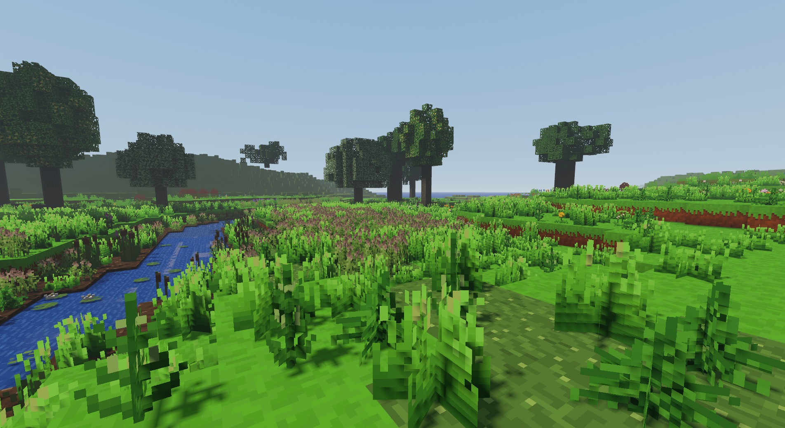
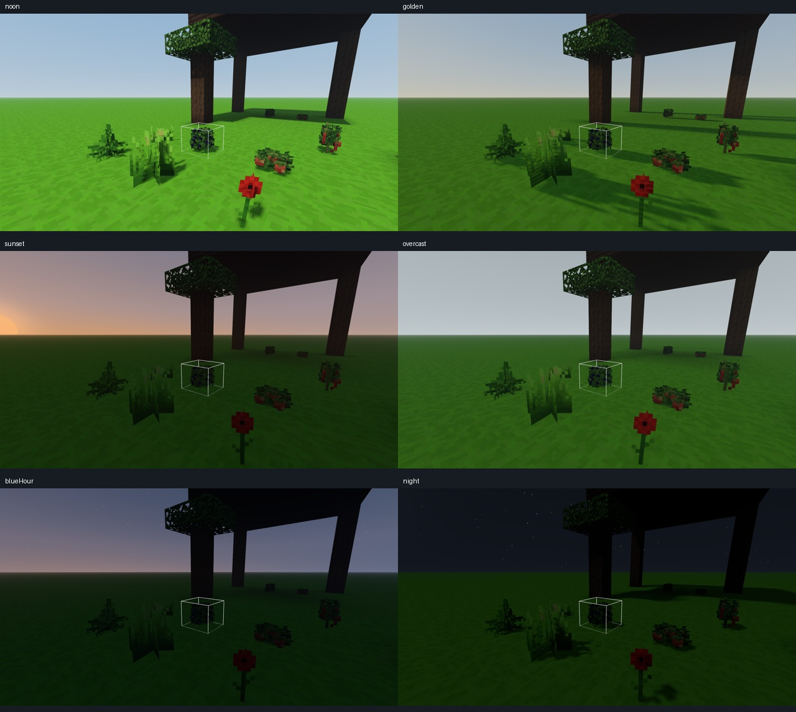
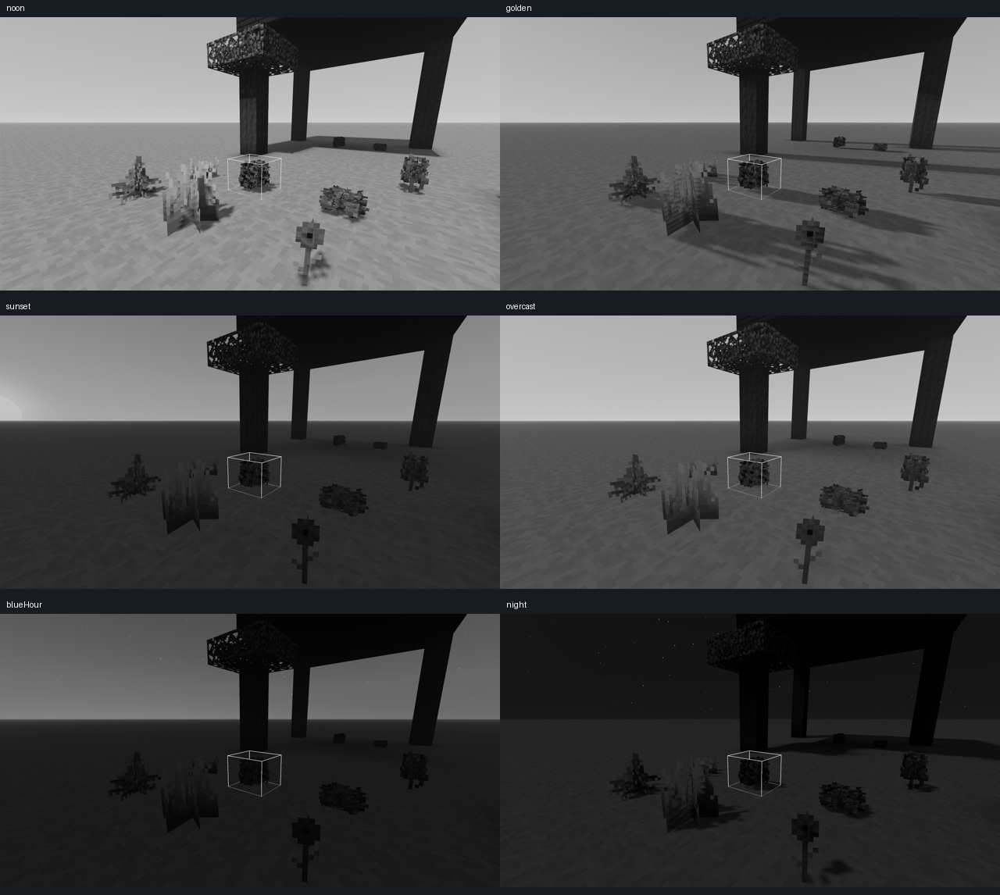

# Oświetlenie 0.57.0 — zapis odbioru

Zapis obejmuje podstawę E00–E04, podstawowy zakres E07 oraz stałą ekspozycję i wspólne wyjście obrazu. Testy automatyczne przeszły. Zapisano bazę wydajności 0.56.1, cztery próby nowej wersji w lesie, 12 kadrów referencyjnych palety i osiem kadrów przejazdów menu. Wyniki nie oznaczają zatwierdzenia wyglądu przez użytkownika ani całego docelowego systemu z PDF.

Pełne wartości, identyfikatory prób i SHA-256 zawiera [wyniki.json](wyniki.json). Sposób powtórzenia prób opisuje [README.md](README.md).

## Warunki pomiaru

Windows, NVIDIA GeForce RTX 3050 Laptop GPU przez ANGLE/D3D11, WebGL 2, Electron 44.4.5 / Chromium 152.0.7977.130. Operator potwierdził zasilacz. Obraz 1920×1080, DPR 1, VSync na ekranie 144 Hz, limit FPS w grze wyłączony. Każdy benchmark obejmuje 10 s rozgrzewki i 30 s próbkowania. Czas GPU pochodzi z zapytań timera GPU, CPU z aktualizacji i renderowania aplikacji, czas klatki z odstępów między klatkami.

Las korzysta z prawdziwego generatora, seed `2138286349`: pełny teren do 64 bloków, horyzont LOD 1024, szczegół LOD 2, cienie 3, docelowe pokrycie szczegółowego horyzontu 800, FOV 75. Nie jest to promień 800 bloków pełnych chunków. Promienie światła i animacje roślin są włączone w tych próbach. Kamera panorama: `[188,132,-252]` → `[216,67,-202]`; kamera brzeg: `[188,54.6,-252]` → `[168,52,-265]`. Kamery stoją nieruchomo.

Nowe wyjście obrazu używa HDR16F, ekspozycji 1 i MSAA 4×. Raportowany koszt dodatkowych celów renderowania w 1080p to 124 416 000 bajtów, około 118,7 MiB. Oryginalna wersja renderuje bez tego dodatkowego wyjścia HDR; jej `worldOutput.samples=0` nie oznacza wyłączenia antyaliasingu kontekstu.

## Zapisana baza 0.56.1

Próba `baseline-2026-11-03T21-30-33-939Z`, południe, bez zachmurzenia, oryginalny renderer:

| Kadr / plik próby | Średni FPS | Klatka mediana / P95 | CPU mediana / P95 | GPU mediana / P95 |
| --- | ---: | ---: | ---: | ---: |
| Panorama / 003 | 142,44 | 6,90 / 7,20 ms | 4,00 / 8,00 ms | 4,368 / 4,565 ms |
| Brzeg / 004 | 142,80 | 6,90 / 7,20 ms | 3,80 / 7,40 ms | 4,012 / 4,212 ms |

Obie próby mają `valid=true`, zero zgłoszonych błędów gry, błędnych shaderów, przerw timera GPU i zmian geometrii w czasie pomiaru. Kolejki chunków, przebudów oraz brakujący LOD wynoszą zero. Panorama: 386 wywołań rysowania i 927 694 trójkąty; brzeg: 336 i 720 532. Pamięć sterty JS wyniosła odpowiednio 226,70 i 219,63 MiB; nie jest to pomiar całej pamięci procesu ani VRAM.

## Nowa wersja

Próba `foundation-2026-11-03T21-47-40-317Z`, te same statyczne kadry i ustawienia sceny. Nowa paleta i wyjście HDR16F/MSAA 4×:

| Kadr / plik próby | Średni FPS | Klatka mediana / P95 | CPU mediana / P95 | GPU mediana / P95 |
| --- | ---: | ---: | ---: | ---: |
| Panorama / 002 | 142,58 | 6,90 / 7,20 ms | 4,60 / 8,30 ms | 6,301 / 6,662 ms |
| Brzeg / 004 | 142,34 | 6,90 / 7,20 ms | 4,20 / 7,70 ms | 6,142 / 6,366 ms |

Obie próby mają `valid=true`, zero zgłoszonych błędów gry, błędnych shaderów, przerw timera GPU, zmian geometrii i oczekujących kolejek terenu. Średnia oraz P95 klatki mieszczą się z zapasem w budżecie 16,67 ms; maksymalne odstępy pojedynczych klatek wyniosły 20,6 i 20,8 ms. Nie oznacza to gwarancji, że każda klatka trwa mniej niż 16,67 ms.

Mediana kosztu GPU wzrosła względem 0.56.1 o 44,2% w panoramie i 53,1% przy brzegu. Porównanie obejmuje nowy tor HDR i MSAA 4×; nie mierzy wyłącznie kosztu obliczeń kolorystyki. Równy FPS obu wersji jest w tym przypadku skutkiem ograniczenia odświeżaniem 144 Hz.

Kontrola 005 powtarza kadr brzegu z wyłączoną wyłącznie dodatkową mapą cieni poruszanych roślin; pozostają statyczne cienie roślin. GPU: mediana 5,843 ms, P95 6,077 ms; CPU: mediana 4,10 ms, P95 7,80 ms; 143,20 FPS. Dodatkowa mapa zwiększa medianę GPU o około 0,299 ms, czyli 5,1% względem wariantu bez niej. Ta kontrola ma `valid=true`, bez zmian geometrii, kolejek i błędów. HDR nadal działa, więc również nie jest to izolowany pomiar samej kolorystyki.

Próba 007 obejmuje 30 s ruchu kamery przy brzegu z doczytywaniem świata i wszystkimi powyższymi efektami. Wynik: 140,95 FPS; klatka mediana 6,90 ms, P95 7,20 ms, P99 14,00 ms, maksimum 28,50 ms. CPU: mediana 5,20 ms/P95 8,90 ms; GPU: 5,463 ms/P95 6,691 ms. Zanotowano 24 zmiany wersji geometrii, wzrost liczby chunków ze 142 do 152 i kafli LOD z 338 do 344; końcowe kolejki są puste. Raport ma `valid=true`, bez błędów gry i przerw timera GPU. Potwierdza to zapas do 60 FPS w krótkiej badanej trasie, z pojedynczymi dłuższymi klatkami. Nie zastępuje długiego spaceru ani porównania z identyczną trasą starej wersji.

Końcowy kadr brzegu 006, paleta Naturalna i promienie światła włączone:

## Sześć profili i kontrola w szarości

Próba `foundation-2026-11-03T21-38-52-478Z`, scena `paleta`, seed 42, kamera `foliage`: `[59,18.6,-89]` → `[56,17.6,-93]`. Zapisano południe, złotą godzinę, zachód, zachmurzone południe, niebieską godzinę i noc, następnie te same sześć profili w diagnostycznej skali szarości. Ekspozycja wynosi 1, jasność ustawień 0; animacje są włączone. Każdy zapis ma pustą listę błędów gry.

Promienie światła były **wyłączone** we wszystkich 12 kadrach. Kadry utrwalają paletę przed ostatnią kalibracją samych promieni; nie stanowią testu tej późniejszej zmiany. To stała kamera, ale niezatrzymane animacje, więc nie należy traktować obrazów jako identycznych klatek do odejmowania pikseli.

## Sceneria i przejazdy menu

Próba `menu-2026-11-03T21-57-07-835Z`, raport końcowy 010 i zdjęcia 002–009, używa prawdziwych `MenuBackdrop`, `MenuWorld` i `MenuCamera` z izolowanym panelem kontrolnym. Odwiedziła główny kadr, rzekę, las i góry, z powrotem do głównego kadru między zakładkami, w obu paletach. Jest to kontrola scenerii i przejazdów, nie test pełnego interfejsu menu. Wariant „baseline” tutaj oznacza poprzednią paletę w kodzie 0.57.0, nadal z HDR; nie jest niezależnym uruchomieniem wersji 0.56.1.

Wszystkie osiem zapisów ma gotowy świat, pustą kolejkę wczytywania, komplet kafli LOD, zero błędów JS i shaderów oraz zero przypadków pozostawienia niewłaściwego celu renderowania. Końcowo: 1257 chunków, 1219/1219 kafli LOD, rzeczywisty horyzont scenerii 1024 z odstępem próbkowania 1 do 512, 2 do 800 i 4 do 1024 bloków. Wyjście HDR16F, ekspozycja 1, MSAA 4×, 1920×1080.

Menu ma osobny limit 60 FPS. W dłuższym zapisie głównego kadru Naturalnego (1800 próbek) średni odstęp klatek wynosi 16,915 ms, czyli 59,12 FPS; P95 odstępu to 21,70 ms, średni czas CPU 14,848 ms i P95 CPU 21,00 ms. To rzeczywiste odstępy między rysowanymi callbackami `requestAnimationFrame`, a nie timer GPU ani chwila prezentacji na monitorze. Pozostałe końcowe zbiory mają tylko 32–37 próbek na kadr: służą diagnostyce, nie porównaniu wydajności obu palet. Próba nie potwierdza osobno budżetu 5% dla menu.

Operator przejrzał wszystkie osiem zdjęć: teren jest kompletny, żaden zapisany kadr nie jest czarny, Naturalna paleta ma mniejsze nasycenie, a pod drzewami pozostają widoczne jasne plamy światła. To ocena zapisanych kadrów, nie każdej klatki przejazdu ani ostateczna akceptacja artystyczna użytkownika.

## Testy automatyczne

- `npm test`: PASS, kompletny zapis `npm-test-final.log`, zakończony 2026-11-03 21:38:01 UTC, przed końcową kalibracją promieni. Ostrzeżenia Node o typie modułów nie przerwały testów.
- Końcowy headless: PASS, `test-results/lighting-foundation/result.json`, 2026-11-03 21:47:03 UTC, po kalibracji promieni. Sprawdzono 62 programy shaderów, cienie roślin i pięć kontrolnych próbek wyjścia HDR/sRGB. Jest to kontrola obrazu pod SwiftShader, niezależna od pomiaru RTX.
- Końcowa kontrola promieni: PASS, `promienie-final.log`, 2026-11-03 21:58:06 UTC. Sprawdza liniową moc i kolor, czarne źródło, słabe rozproszenie, niezmienioną bazę oraz przywracanie celu renderowania.
- Regresja zapisu i wczytania używa rzeczywistych `World`, `LightEngine`, `WorldSaver` i `WorldStorage` z izolowanym magazynem w pamięci: otwarcie i zamknięcie dachu, usunięcie lampy, cztery odtworzenia chunków w różnych kolejnościach oraz porównanie całego pola światła. Nie korzysta z zapisów użytkownika ani nie sprawdza fizycznego dysku.

Historyczny nieudany wynik z `test-results/sceny` nie jest wynikiem końcowym i nie jest podstawą powyższego PASS.

## Identyfikacja kodu i artefaktów

| Zestaw | Wersja / commit | Stan | SHA-256 źródeł |
| --- | --- | --- | --- |
| Baza wydajności | 0.56.1 / `253d9c3c278b3bb062a5ba1ad096aa053c58f9c3` | czysty | `d9d0f496c061faf5bf90f106d7e0ce72fd9614ce6667e8695efa2da3936b8975` |
| 12 kadrów palety | 0.57.0 / baza `40903ebebbaa5e67bf7d1e4a4d2900b1efacd085` | zmodyfikowany | `29adf516f00cd2b49f4b717ebfd0df683c3a8c6478cbd4a0a4a9f7a5340dc6eb` |
| Nowe próby lasu | 0.57.0 / `c187eaeff447fd1c3602e02d024bdf8e8b1d8d57` | zmienione dokumenty, pusty diff śledzonych źródeł | `d3c1f0b6be1ef69eb3399b41dcea8fab5769fde2673de87ee4add23a25426847` |
| Osiem kadrów menu | 0.57.0 / `c187eaeff447fd1c3602e02d024bdf8e8b1d8d57` | zmienione dokumenty, pusty diff śledzonych źródeł | `d3c1f0b6be1ef69eb3399b41dcea8fab5769fde2673de87ee4add23a25426847` |

Zdjęcia nowej palety nie są przedstawiane jako zdjęcia czystego commita bazowego: właściwą tożsamość określa fingerprint źródeł i różnic. `wyniki.json` zachowuje także hashe sceny referencyjnej, harnessu, inwentarza assetów, raportów i obrazów. Surowe raporty pozostają w lokalnym archiwum pomiarów; ich nazwy zapisano bez ścieżek do profilu użytkownika.

## Granice wniosków

- VSync 144 Hz spłaszcza porównanie FPS. Podobny FPS nie dowodzi identycznego kosztu renderowania; potrzebne są osobne czasy CPU i GPU.
- Budżet wzrostu kosztu samej kolorystyki o najwyżej 5% **nie został odseparowany od kosztu nowego HDR**. Nie jest tu oznaczony jako spełniony.
- Dotychczas zapisano po jednej próbie bazowej na kamerę, a nie trzy przeplatane pary. Osobna próba ruchu trwa 30 s i nie ma pary ruchowej w starej wersji; nie obejmuje długotrwałej eksploracji.
- Brak testu na fizycznym Androidzie. Użytkownik wybrał ocenę na PC; wnioski dotyczą podanej karty i konfiguracji.
- Pole startowe `gpuFeatures` może pochodzić sprzed inicjalizacji GPU. O przypisaniu pomiarów do RTX decyduje rzeczywisty renderer WebGL i działający timer GPU zapisany w każdym raporcie.
