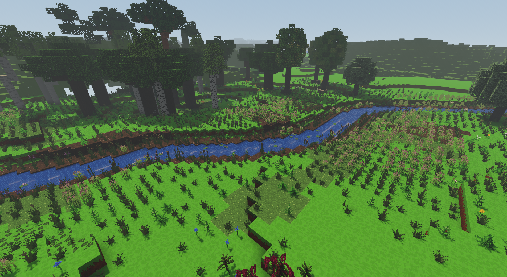
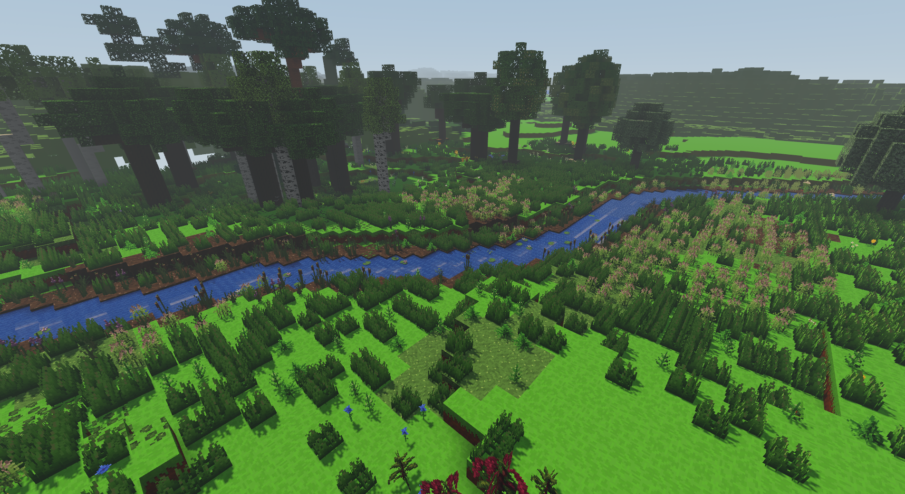
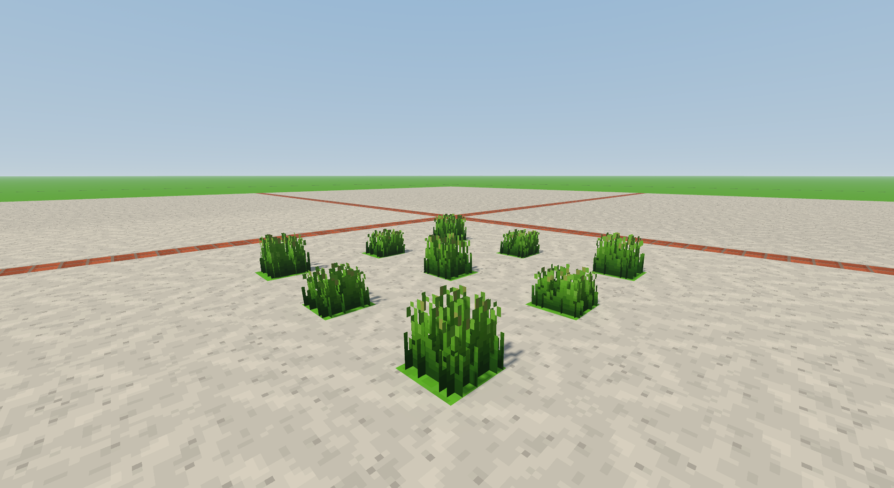
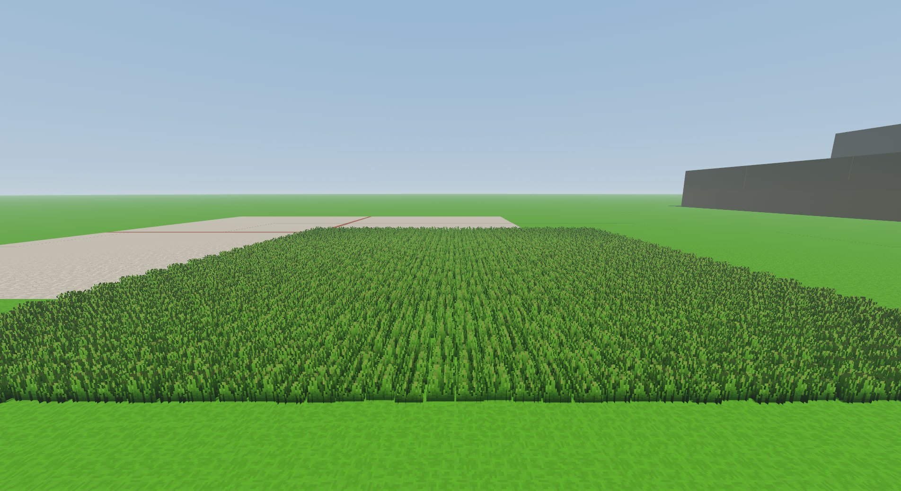
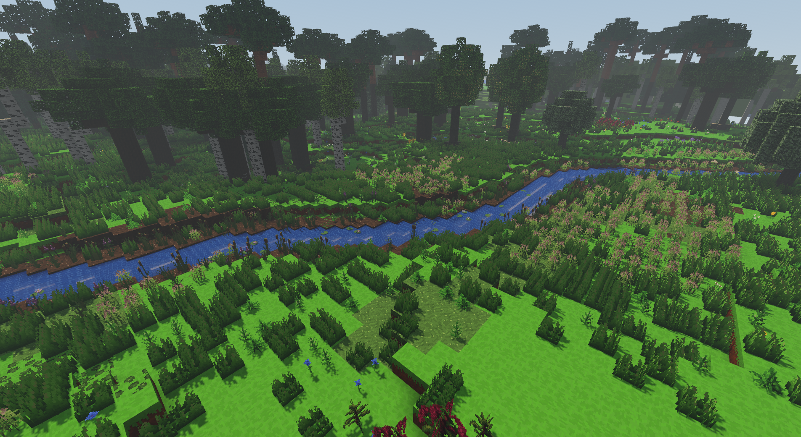

# Odbiór koncepcyjnej trawy 0.62.0

Harness porównuje poprzedni eksperyment z wydania 0.61.0 (commit
`2ac97b885f124c95b1866df1f141200021e0e4e2`) z nowym modelem. Oba źródła
uruchamia ten sam kod pomiaru, z prawdziwym `Game.update` i `Game.render`.
Każdy start otrzymuje osobny profil Chromium, bez odczytu ustawień lub
światów gracza. Próba nie zapisuje świata.

## Wyniki na RTX 3050 Laptop — 5 listopada 2026

Przy zasilaniu z sieci, buforze WebGL 1920×1080 i monitorze 144 Hz nowy
model utrzymał duży zapas względem 60 FPS w badanych kadrach. Nad rzeką
wynik pozostał blisko limitu odświeżania. W celowo gęstej łące nowy model
był nieco droższy na GPU; mniejsza liczba trójkątów sama w sobie nie
oznacza przyspieszenia.

Każdy wiersz to osobny pomiar 30 s po rozgrzewce. „Ponad 16,67 ms”
oznacza liczbę klatek, które przekroczyły budżet 60 FPS.

| Model i kadr | Pełny teren | Średnie FPS | P99 klatki | Ponad 16,67 ms | Średni czas GPU |
| --- | ---: | ---: | ---: | ---: | ---: |
| 0.61.0, rzeka | 64 | 143,80 | 7,2 ms | 0 | 6,556 ms |
| 0.62.0, rzeka — próba 1 | 64 | 144,01 | 7,2 ms | 0 | 6,526 ms |
| 0.62.0, rzeka — próba 2 | 64 | 143,00 | 7,4 ms | 3 | 6,556 ms |
| 0.61.0, 2304 kępki | 64 | 143,98 | 7,3 ms | 1 | 6,045 ms |
| 0.62.0, 2304 kępki | 64 | 138,02 | 14,0 ms | 0 | 6,882 ms |
| 0.62.0, rzeka — kontrola dalszego LOD | 128 | 112,29 | 14,6 ms | 14 | 8,375 ms |

W żadnej z sześciu prób nie było klatki ponad 33,33 ms, błędu JavaScript,
nieudanego programu shaderowego ani niepustej kolejki świata. Wszystkie
zapytania GPU były ważne, bez przerw `disjoint` i pominiętych próbek.
Sterownik ANGLE zgłaszał w obu wersjach te same ostrzeżenia kompilatora
`X3595` dotyczące pochodnych w pętli; nie są one błędami wykonania.

Przy zasięgu 64 oba modele miały identyczne ustawienia, kamerę i liczbę
załadowanych kępek: rzeka 1887/3689/0, łąka 1536/768/0 dla LOD 0/1/2.
Próba 128 sprawdziła również ostatni poziom: 1887/7123/11276 kępek.
Dla 128 nie wykonano porównania z bazą. Horyzont we wszystkich próbach
wynosił 1024 bloki, z profilem szczegółów terenu i cieni do około 800.

W łące średni czas GPU wzrósł o około 14%, przy spadku obserwowanych FPS
o około 4%. Nakładające się karty tekstury są prawdopodobnym wyjaśnieniem
tego kosztu, ale pomiar nie izolował jego przyczyny. Nad rzeką różnica
czasu GPU była pomijalna. Limit VSync 144 Hz ogranicza wnioski o możliwym
maksymalnym FPS. To odbiór nieruchomych, wczytanych scen, nie gwarancja
płynności podczas dowolnej eksploracji, doczytywania czy na telefonie.
Wykonano jeden proces bazowy i jeden kandydata; nie jest to seria
niezależnych powtórzeń kontrolujących temperaturę i kolejność prób.

Skrót dowodów bez lokalnych ścieżek i surowych tablic klatek znajduje się
w [evidence.json](evidence.json). Zawiera hashe oryginalnych raportów,
kodów źródłowych, harnessu i PNG. Hash 170 plików `src` z testu jest równy
hashowi roboczych plików po commicie `0e3e7e7e614f70feb8d99e3351faa96dd783b772`:
`b56cefaad2a507261e774e9fff20ad96012aa0187658600a1f2365627647acaa`.
Porównanie wykonano na surowych bajtach tą samą procedurą co launcher,
bez normalizowania CRLF. Nie jest to hash obiektów Git.

## Oryginalne kadry

Pliki poniżej skopiowano bez obróbki. `capturePage` zapisał kadr
1904×1041, podczas gdy raportowany i mierzony bufor WebGL miał 1920×1080.
Wczesne `gpuFeatures` w pełnym manifeście zostało odczytane przed
utworzeniem WebGL; kartę używaną w próbach potwierdzają późniejszy
`WEBGL_debug_renderer_info` (NVIDIA RTX 3050 Laptop) i ważne czasy GPU.

Rzeka, poprzedni model 0.61.0, pełny teren 64:



Ten sam kadr, model koncepcyjny 0.62.0:



Krótka i wysoka trawa z bliska:



Syntetyczna łąka z 2304 kępkami:



Kontrola dalszych poziomów szczegółowości przy pełnym terenie 128:



## Uruchomienie

Z katalogu repozytorium, na zasilaczu i przy zamkniętej zwykłej grze:

```powershell
& ..\shadow-native-tools\node_modules\electron\dist\electron.exe .\docs\pomiary\trawa-koncept-0.62.0\native-launcher.cjs --size=1920x1080
```

Dla starego modelu dodaj `--baseline ..\voxel-grass-baseline`.
Ten katalog musi być czystym checkoutem wskazanego commita (launcher
sprawdza HEAD i status) albo jego niezmienionym `git archive`.
Manifest zapisuje hash źródeł, stan
bieżącego checkoutu, rozdzielczość i parametry GPU. Nie porównuj różnych
rozdzielczości, kadrów, zasięgów ani VSync z opcją `--uncapped`.

Raporty JSON i kadry PNG trafiają do sąsiedniego `grass-concept-proof/native`.
F8 przełącza panel; Ctrl+Shift+Q zamyka próbę. Kolejne uruchomienia wykonuj
sekwencyjnie, bez drugiego aktywnego procesu gry ani testów CPU w tle.

## Kadry i ustawienia

- **Naturalny brzeg:** realistyczny świat z seedem `2138286349`, pozycja
  gracza `(198,62,-261)`, yaw `2.297439`, pitch `-0.4827`. To kadr używany
  przy poprzednim odbiorze trawy nad rzeką. Przyciskiem obrotu można
  obejrzeć otoczenie; do porównania A/B przywróć identyczny kadr.
- **Kępki z bliska:** plac testowy, dziewięć roślin co trzy bloki, naprzemiennie
  trawa krótka i wysoka. Osobno widać objętość, prześwity i zakorzenienie.
- **Łąka 2304 kępek:** plac testowy z trawą w każdej komórce pola 48×48,
  naprzemiennie krótka i wysoka. To celowo gęsty test nakładania się kart
  tekstury, nie średnia liczba roślin w generowanym świecie.

Wspólne parametry: DPR 1, 1920×1080, render scale 100%, pełny teren 64,
horyzont 1024, szczegół 2, cienie 3, naturalne oświetlenie, materiały
Standard i promienie światła włączone. Czas świata to południe,
wzrost roślin i dźwięk są zatrzymane. Przycisk zasięgu 128 służy
dodatkowej kontroli przejść LOD; taki wynik porównuj tylko z bazą 128.
Przełącznik trawy wywołuje zwykłe ustawienie `bushyGrass` i pozwala
wizualnie sprawdzić przywracanie standardowej trawy bez zmian świata.

## Pomiar

Po opróżnieniu kolejek terenu, meshowania i dalekiego terenu harness
czeka jeszcze dwie sekundy, wykonuje dziesięć sekund rozgrzewki oraz
trzydzieści sekund pomiaru nieruchomego kadru. Utrata aktywności okna,
błąd renderowania lub niepusta kolejka podczas próbki unieważnia wynik.
Kadry można zapisać osobno przy ukrytym panelu, włącznie z pozą kamery.

Raport zawiera wszystkie odstępy między klatkami, medianę, P95, P99,
liczbę klatek ponad 16,67/33,33/50 ms, czas aktualizacji i renderowania
na CPU oraz niezależne zapytania czasu GPU. FPS gry to wyłącznie
`frame.averageFps`, a nie odwrotność czasu samego CPU lub GPU.
`grassByDetail` podaje liczbę kępek w załadowanych meshach dla LOD 0/1/2;
obejmuje również chunki poza aktualnym kadrem. Liczniki draw calls i
trójkątów obejmują cały rendering, także cienie i pozostałe przebiegi.

Dla oceny różnicy najlepiej zrobić sąsiadujące próby baza/kandydat/baza.
Pojedyncza para nie wyklucza zmian taktowania, temperatury lub obciążenia
systemu. Pierwszy kadr służy kontroli wyglądu; syntetyczna łąka ujawnia
koszt nakładania tekstur, którego sama liczba trójkątów nie przewiduje.
