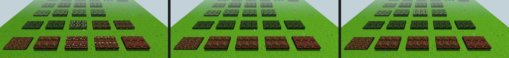

# Owocowanie w porach roku i suszenie (1.21.0)

Druga część „kuchni i spiżarni": rośliny owocują w swojej porze roku,
zimą nie rośnie nic, a owoce da się ususzyć na zapas. Następny krok
(zimowy rozwój roślin - większe plony i rozrastanie) dopiero powstanie.

Na zrzucie ta sama galeria roślin niskich (od dołu: żurawina, brusznica,
truskawki, poziomka...) jesienią, zimą i wiosną: jesienią owocują
żurawina i brusznica, zimą owoce ma tylko żurawina, wiosną kwitną
truskawki.

## Kalendarz

Rok ma cztery pory po 8 dni ([pory-roku.md](pory-roku.md)).

| Pora | Co owocuje |
|---|---|
| **Wiosna** | truskawki (krzak i kępa), poziomki |
| **Lato** | truskawki, poziomki, maliny, porzeczki, agrest, borówki (krzak i wysoka), jeżyny, chili, dzika róża, bez czarny, brusznica, cukinia, dynia (kwitnie i zawiązuje), jabłka; kwitnie lipa |
| **Jesień** | jeżyny, chili, borówka wysoka, dzika róża, bez czarny, aronia, rokitnik, leszczyna (krzak i krzew), brusznica, żurawina, cukinia, dynia, jabłka, oliwki |
| **Zima** | **nic nie rośnie**; do zebrania zostają owoce dzikiej róży, rokitnika i żurawiny |

Cały rok, bez względu na porę: palma kokosowa, baobab, figowiec, dracena,
jukka, araukaria, namorzyn, puchowiec, szyszki, żywica. W grze kalendarz
pokazuje `/kalendarz`.

## Jak to działa dla gracza

- **Poza swoją porą roślina wygląda jak bez owoców** i nie da się z niej
  nic zebrać. Dotyczy też dzikich roślin: latem krzew maliny w lesie ma
  owoce, jesienią ten sam krzew jest pusty.
- **Początek pory**: każda roślina budzi się we własnej chwili (w ciągu
  pierwszych 1,5 doby pory), przez pół doby pokazuje kwiaty albo pierwsze
  owoce, potem owocuje. Zasypia w ciągu ostatnich 1,5 doby swojej
  ostatniej pory.
- **Wzrost**: posadzona roślina przechodzi przez etapy (kwiaty →
  zawiązki → owoce) tylko w swojej porze; poza nią czeka. Po zbiorze
  odrasta, dopóki trwa jej pora - więc w sezonie zbiera się kilka razy.
- **Zimą nie rośnie nic**: ani sadzonki drzew, ani krzaki, ani młode
  dynie; puste pole też nie zarasta. Wyjątek to kwiaty z paczek, które
  mają zimę wśród swoich pór.
- **Zimujące owoce**: dzika róża, rokitnik i żurawina trzymają dojrzałe
  owoce przez zimę. Można je zebrać raz - nowe urosną dopiero
  w następnej porze.
- Gdy nadchodzi zima, gra pisze: *Nadeszła zima - rośliny zasypiają*.

## Suszenie owoców

Każdy świeży owoc da się ususzyć tak jak glinę: **wyrzucony w dzień pod
gołe niebo, po 2 minutach** cały stos zamienia się w **suszone owoce**
(energia 9, syci na 90 s - mniej więcej dwa razy tyle co świeża jagoda).

- Wszystkie owoce dają te same suszone owoce: jeden stos w plecaku
  zamiast dziesięciu.
- Susz nadaje się do garnka (dwie porcje - kompot, także zimą).
- Nie suszy się warzyw, orzechów, kwiatów ani chili.

Zapasy na zimę: suszone owoce, orzechy, żołędzie, dynie, pestki. Nic
się w grze nie psuje - leżą w skrzyni bez końca.

## Osiągnięcia i komendy

*Na czarną godzinę* - ususz owoce. `/kalendarz` - co owocuje teraz
i w każdej porze. `/pora ustaw <pora> [dzień]` przenosi czas (do testów).

## Dla programisty

- `src/blocks/fruitSeasons.js` - kalendarz: `BUSH_SEASONS`,
  `SHRUB_SEASONS`, `LOW_SEASONS`, `TREE_SEASONS`, `WINTER_KEEPERS`.
  Nowa roślina owocująca = wpis tutaj (pilnuje tego
  `tools/sprawdz_pory_owocowania.mjs`: blok ze zbiorem musi mieć pory
  albo być na liście „cały rok").
- Wpisy trafiają do `src/blocks/plantSeasons.js` - tego samego
  mechanizmu co kwiaty z paczek: **blok w świecie i w zapisie się nie
  zmienia**, `shownPlantId` mówi, co widać (rysowanie, celownik, zbiór).
  Etapy owoców nie mają numerów po kolei, więc wpis niesie `shown` - co
  pokazać na niższym poziomie (0 - bez owoców, 1 - kwiaty).
- `plantGrowthFactor`: w porze 1, poza nią 0; roślina bez pór - zimą 0.
- Owocujące bloki są w geometrii terenu (liście krzewów i drzew, płyty),
  więc zmiana ich wyglądu przebudowuje cały chunk:
  `chunk.seasonTerrainNext` (ChunkMesher) i `World.updateSeasons`.
- `src/items/drying.js` - `driesInto` dla gliny i owoców.

## Czego nie ma (luki)

- **Pierwsza wiosna jest chuda**: nowy świat zaczyna się w środku wiosny,
  gdy owocują tylko truskawki i poziomki (oraz tropiki). Są jeszcze
  żołędzie i orzeszki bukowe z liści. Do oceny, czy to nie za trudny
  początek.
- **Nic się nie psuje** - świeże owoce leżą w skrzyni tak samo długo jak
  suszone, więc suszenie daje sytość i porządek w plecaku, nie trwałość.
- (Od 1.22.0 owoc niezebrany w porze opada na ziemię - [sad.md](sad.md);
  dotyczy roślin w chunkach zmienionych przez gracza. Dzika roślina
  w nietkniętym terenie za rok znów pokazuje ten sam owoc.)
- Sen przez kilka pór: wzrost przespanego czasu liczy się według pory,
  w której gracz się obudził.
- Drzewa: pory mają tylko jabłoń, oliwka i lipa. Żołędzie, orzeszki
  bukowe i szyszki (łupy z liści) wypadają cały rok.
- Jeżyk je owoce cały rok (z ręki), a zimą śpi.
- W oddali (daleki teren) pór owocowania nie widać.
- Chunk z owocującymi roślinami przebudowuje się przy każdej pobudce
  i zaśnięciu rośliny (rozłożone na 1,5 doby gry); nie mierzyłem tego na
  prawdziwej karcie.
