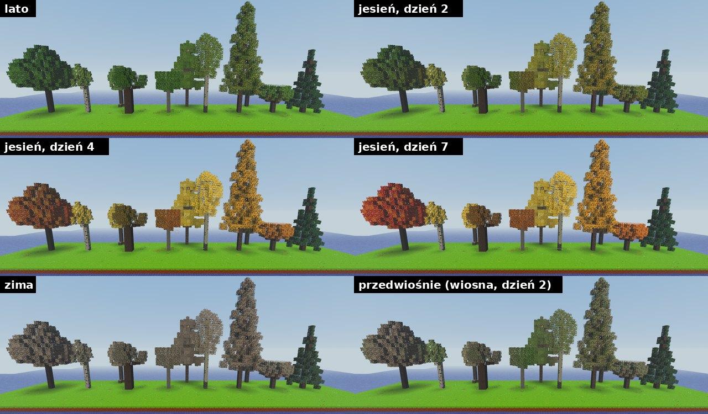
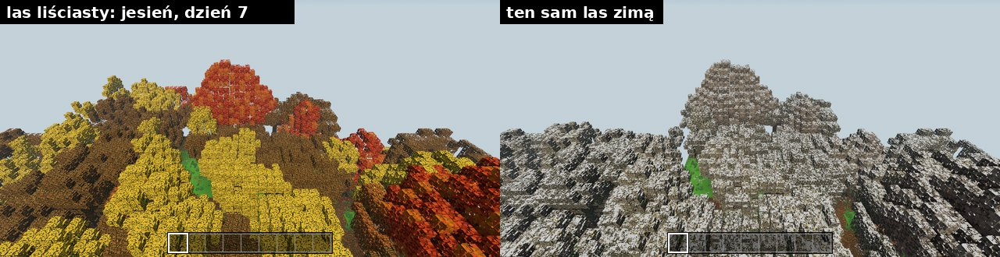
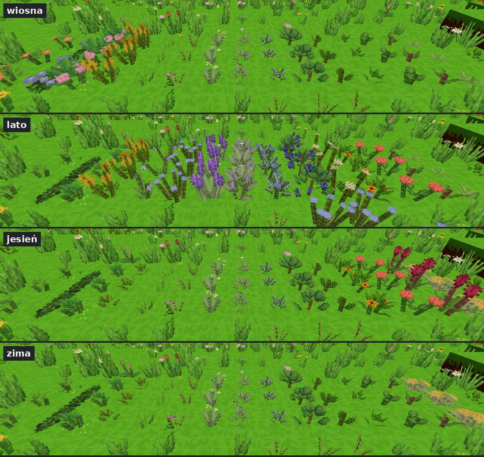
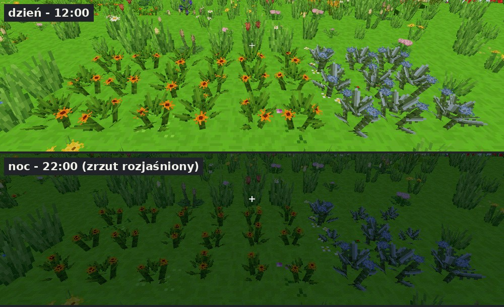

# Pory roku

Od wersji 1.4.0 (pomysł Kamila); od 1.5.0 także kwiaty zamykane na noc
i kłujące. Na razie od pory roku zależą **kwiaty**;
ten opis jest też instrukcją, jak podpiąć pod pory kolejne rzeczy (kolory
liści, śnieg, pogodę).

## Zasada działania

Wszystko wynika z jednej liczby: **czasu gry w dobach** (`game.time.days`).
Z tej samej liczby gra liczy już słońce, księżyc i zaćmienia, więc pory
roku same się z nimi zgadzają.

| Jednostka | Ile trwa | Skąd |
|---|---|---|
| doba | 20 minut gry | `DAY_LENGTH_MINUTES` |
| miesiąc | 8 dób - jeden cykl księżyca, od nowiu do nowiu | `MOON_CYCLE_DAYS` |
| pora roku | 1 miesiąc = 8 dób (2 h 40 min gry) | `SEASON_MOONS` |
| rok | 4 pory = 32 doby (ok. 10 h 40 min gry) | - |

- **Pora zaczyna się w nowiu, a pełnia wypada w jej środku.** Patrząc na
  księżyc, widać, ile pory zostało: rośnie - pierwsza połowa, maleje -
  druga, znika - idzie zmiana.
- Kolejność: **wiosna, lato, jesień, zima**. Rok zaczyna się wiosną.
- Nowy świat zaczyna się tuż przed pełnią, czyli **w środku wiosny**
  (4. dzień z 8).
- Pora nie jest nigdzie zapisana - liczy się z czasu gry. Dlatego
  istniejące światy mają porę od razu, a w grze ze znajomymi wszyscy mają
  tę samą (czas podaje gospodarz).
- Sen, `/czas` i utrata przytomności przesuwają czas, więc przesuwają też
  porę.

Wszystkie liczby są w `src/config.js` (sekcja *DZIEŃ I NOC*):
`MOON_CYCLE_DAYS`, `MOON_START_PHASE`, `SEASON_MOONS`, `FIRST_SEASON`.
Zmiana `SEASON_MOONS` na 2 wydłuża porę do dwóch cykli księżyca - reszta
gry dopasuje się sama.

## Co widać w grze

- Komunikat nad paskiem przy zmianie pory („Nadeszło lato”).
- Ekran F3: `Pora roku: wiosna, dzień 4 z 8`.
- `/pora` - pora, dzień, rok, faza księżyca i co teraz kwitnie.
- `/pora ustaw lato` - przenosi czas do przodu, na początek lata;
  `/pora ustaw jesien 5` - na piąty dzień jesieni (od 1.10.0, do oglądania
  kolorów liści).
- `/pora kwiaty` - co kwitnie w której porze.
- Osiągnięcia: *Coś wisi w powietrzu* (doczekaj zmiany pory), *Cztery
  pory roku* (bądź w świecie we wszystkich czterech), od 1.10.0 *Złota
  jesień* i *Pierwszy szron* (doczekaj jesieni i zimy).
- Od 1.10.0 liście drzew zmieniają kolor z porą roku - niżej.

## Liście drzew w porach roku (1.10.0)

Prośba Kamila: „im bardziej jesień, tym bardziej kolorowe, a zimą
szarawe"; zimą liście „delikatnie zajdą białą warstwą śniegu"
(przygotowanie pod pogodę). Dotyczy bloków liści, opadłych liści i liści
spadających z drzew.



*Od lewej: klon, brzoza, dąb (za nim lipa), buk, miłorząb, osika, modrzew,
jabłoń (za nią olcha), świerk.*



| pora | liście na drzewie | opadłe liście |
|---|---|---|
| wiosna, lato | jak w teksturze, zabarwione klimatem biomu | zbrązowiałe |
| jesień | zielone piksele przechodzą w kolor gatunku; pełny kolor około 5. dnia | kolor gatunku |
| zima | szarobrązowe; cienki śnieg na wierzchu, gdy śnieg leży na ziemi (od 1.14.0 decyduje pogoda - `docs/pogoda.md`; w ciepłych stronach nie leży) | szare |
| przedwiośnie (pierwsze 3 dni wiosny) | szarość schodzi, wraca zieleń | brązowieją |

Kolory jesieni (`LEAF_PALETTES` w `src/rendering/LeafSeasons.js`):

| paleta | gatunki |
|---|---|
| żółty | brzoza, lipa, wierzba, osika |
| złoty | modrzew |
| pomarańczowy | jabłoń, wiśnia |
| własna tekstura (czerwień, złoto) | klon, miłorząb, złote odmiany modrzewia i osiki |
| miedziany | buk |
| brązowy | dąb, olcha |
| rdzawy | cypryśnik błotny |
| płowy (połowa zmiany, zimą nie szarzeje) | akacja, baobab |
| iglaste (bez jesieni, zimą lekko przygaszone) | świerk, sosna, kosodrzewina, sekwoja, jodła, araukaria, cedr, sosna oścista |
| zimozielone (bez zmian) | oliwka, eukaliptus, jakaranda, palma, namorzyn, puchowiec, jukka, figowiec, dracena |

Nowy gatunek dopisuje się w `SPECIES_PALETTE`; gatunek bez wpisu dostaje
żółty.

**Liście z jesienną teksturą.** Klon i miłorząb z paczek Kamila mają
tekstury w kolorze jesieni (czerwoną i złotą), tak samo złote odmiany
igliwia modrzewia i liści osiki. Do 1.9.0 były takie cały rok. Od 1.10.0
jesienią widać samą teksturę (z jej rysunkiem), a wiosną i latem liść jest
zielony - paleta z polem `light` trzyma kolor lata i średnią jasność
tekstury; zmieniają się wtedy wszystkie piksele. Odmianę oznacza pole
`"autumn": true` w katalogu drzew. Opadłe liście klonu mają zwykłą,
czerwoną paletę.

**Jak to działa (bez przebudowy świata).** Blok liści się nie zmienia -
zmienia się tylko kolor, który liczy shader bloków z jednej liczby,
„fazy roku" (0 = początek wiosny, 1 = lata, 2 = jesieni, 3 = zimy).
Siatka chunka zapisuje przy liściach tylko *który to gatunek* (kod
palety w atrybucie `tint`, `ChunkMesher.writeLeafTint`), więc zmiana pory
nie przebudowuje żadnego chunka i nic nie trafia do zapisu.

- Każde miejsce ma własne przesunięcie terminu (gładki szum po świecie,
  ±0,15 pory) - las nie zmienia się cały naraz, a korony mienią się.
- Zmieniają się tylko zielone piksele tekstury: gałązki, owoce i kwiaty
  w liściach zostają. Opadłe liście zmieniają się całe.
- Śnieg: drobne płaty pikseli na ścianach zwróconych do góry, najwyżej
  połowa wierzchu - „cienka warstwa", liść spod niej prześwituje. Od
  1.14.0 leży wtedy, gdy śnieg leży na ziemi pod graczem (pokrywa śnieżna
  z pogody - `docs/pogoda.md`), a nie przez całą zimę. Tylko tam, gdzie
  jest chłodno: klimat miejsca zapisany jest
  w `chunk.tint` (czwarty bajt na róg - `Biomes.tintGrid`); na sawannie,
  półpustyni i w tropikach śniegu nie ma.
- Spadające liście (`TreeParticles`) mają kolor pory swojego gatunku,
  a jesienią spada ich do 3,5 raza więcej (zimą i na przedwiośniu -
  jedna trzecia).
- Daleki teren ma kolory koron zapisane w siatkach; `FarTerrain.
  setLeafSeason` zmienia je skokami (po cztery kroki na jesień, szarzenie
  i przedwiośnie - kilkanaście razy na rok gry): nowa paleta idzie do
  workerów, a kafelki przebudowują siatki od gracza w dal, w zwykłym
  budżecie klatki (stara siatka zostaje do podmiany).
- Wymaga WebGL 2 (dwa dodatkowe varyingi) - od 1.10.1 wymaga go cała gra
  (`docs/logi.md`), więc nie ma już osobnego wyłącznika.
- Świat bez pór roku (`setLeafSeason(null)`): bez zmian.

**Kolor liści z biomu.** Ten sam kolor klimatu, który barwi trawę
([trawa.md](trawa.md#kolory-trawy-w-biomach)), barwi też liście - słabiej
(`LEAF_TINT_SOFTNESS = 0,35`): na sawannie i półpustyni korony płowieją,
w mokrych biomach ciemnieją. Liść spadający z drzewa ma kolor tekstury.

Sprawdzenie: `node tools/sprawdz_liscie_pory.mjs`.

## Kwiaty i pory roku

Kwiaty rosną w świecie **cały rok**, ale pąki i kwiaty pokazują tylko
w swojej porze. Poza nią widać sam pierwszy etap - kępę liści.

| Pora | Kwitną |
|---|---|
| wiosna | zawilec (rośnie 4 × szybciej), barwinek, piwonia, gorczyca |
| lato | gorczyca, dzwonek, len, lawenda, szałwia, mikołajek, indygowiec, marzanna, nagietek, cynia |
| jesień | nagietek, cynia, amarantus, kocanka |
| zima | kocanka |
| cały rok | huba, porosty, ochra oraz rośliny spoza paczek (mak, chaber, mniszek, rumianek, trawy, krzaki owocowe) |

Te same rośliny (wszystkie w etapie „kwitnie”) w czterech porach roku:



Jak to działa:

- **Blok się nie zmienia.** W świecie i w zapisie dalej stoi np. „zawilec
  (kwitnie)”. Zmienia się tylko to, co gra pokazuje: zimą ten sam blok
  wygląda jak młody zawilec. Dzięki temu nic nie trzeba zapisywać ani
  przeliczać w całym świecie, a wiosną kwiaty wracają tam, gdzie były.
- **Celownik, nazwa i zbiór widzą to samo co oko.** Poza porą nie da się
  ściąć kwiatu, którego nie widać - barwniki i zioła z kwiatów są więc
  sezonowe.
- **Wzrost.** W swojej porze roślina rośnie szybciej (domyślnie 3 ×,
  zawilec 4 ×); poza porą odpoczywa i nie rośnie. Roślina posadzona poza
  porą poczeka jako liście.
- **Nie cała łąka naraz.** Każda roślina ma własny termin, zależny od
  miejsca: budzi się w ciągu pierwszych 1,5 doby pory, przez pół doby
  pokazuje pąki, potem kwitnie. Zasypia w ciągu ostatnich 1,5 doby.
  Roślina na dwie pory (nagietek) kwitnie bez przerwy.
- **Poziomy modeli, dalekie chunki, animacje** - wszędzie ten sam
  widoczny etap.

## Kwiaty zamykane na noc i kłujące (1.5.0)

**Nagietek zamyka koronę na noc.** Kwitnący nagietek o zmierzchu wraca
do pąków, a rano znów się otwiera. Każda roślina we własnej chwili:
zamyka się między 18:00 a 19:00, otwiera między 5:30 a 6:30.



- Działa ten sam mechanizm co pory roku: blok się nie zmienia, gra
  pokazuje etap z pąkami; chunk przebudowuje rośliny tylko o zmierzchu
  i o świcie (a poza porą roku nagietka - wcale).
- Zamkniętego kwiatu nie da się ściąć - nagietki zbiera się za dnia.
- W `roslina.json`: `"zamykaNaNoc": true` (etap 2 rośliny to pąki).

**Mikołajek kłuje.** Wejście w mikołajka z pąkami albo kwiatami daje
lekkie ukłucie: komunikat, cichy dźwięk, drgnięcie serca i przez 2,5
sekundy chód i bieg wolniejsze o ok. 30%. Kolejne ukłucie najwcześniej
po 4 sekundach.

- Młody mikołajek i mikołajek poza swoją porą (same liście) nie kłują.
- Stojąc w miejscu, gracz się nie kłuje; w trybie kreatywnym też nie.
- Nic się nie zapisuje - ukłucie mija samo. W oknie stanu: „Ukłucie”.
- Osiągnięcie: *Nie dotykać*.
- W `roslina.json`: `"kluje": true`.

### Nowa roślina z porą

W `assets/rosliny/<roślina>/roslina.json`:

```json
"pory": ["wiosna"],
"wzrostWPorze": 4,
```

- `pory` - od 1 do 3 pór (`wiosna`, `lato`, `jesien`, `zima`); bez tego
  pola roślina wygląda i rośnie tak samo cały rok,
- `wzrostWPorze` - ile razy szybciej rośnie w porze (domyślnie 3),
- pierwszy etap rośliny to jej wygląd poza porą - ma być samymi liśćmi.

## Wydajność

- Rysowanie: bez zmian (te same siatki i materiały).
- Budowanie chunka: jedno sprawdzenie w tablicy na blok; liczenie terminu
  tylko dla kwiatów z porami.
- Zmiana pory **nie przebudowuje świata naraz**. Chunk pamięta chwilę,
  w której zmieni się jego pierwszy kwiat (`chunk.seasonNext`), i tylko
  wtedy przebudowuje swoje rośliny - zwykłą kolejką, po trochu. Co 6
  sekund gra przegląda listę chunków (samo porównanie liczb).
- Zimą jest mniej trójkątów niż dotąd (liście zamiast kwiatów).

## Jak podpiąć coś nowego pod pory roku

`src/sky/Seasons.js` niczego nie rysuje - tylko odpowiada na pytania:

| Funkcja | Co daje | Do czego |
|---|---|---|
| `seasonAt(days)` | `index` 0-3, `key`, `name`, `progress` 0..1, `day`, `year`, `start`, `end` | wszystko, co ma się zmieniać skokiem (co rośnie, co pada) |
| `seasonWeights(days, blendDays)` | cztery udziały pór, suma 1; przez `blendDays` dób wokół granicy mieszają się dwie pory | kolory liści i trawy, światło - płynnie, bez skoku |
| `yearPosition(days)` | miejsce w roku w dobach (0 = początek wiosny) | własne terminy w roku |
| `nextSeasonStart(index, days)` | kiedy zacznie się dana pora | odliczanie, komendy |

Trzy sposoby, zależnie od tego, co się zmienia:

1. **Kolor** (liście jesienią, trawa): policz kolor z `seasonWeights`
   i podaj go shaderowi jako uniform - bez przebudowy chunków. Tak już
   działa kolor nieba i światła.
2. **Wygląd bloku** (kwiat, śnieg na świerku): zrób jak kwiaty -
   `src/blocks/plantSeasons.js`: funkcja „co widać w tym miejscu teraz”
   i „kiedy to się zmieni”, a `ChunkMesher` pyta o nie przy budowaniu
   (`world.seasonDays`, `chunk.seasonNext`). Blok w zapisie zostaje.
3. **Zasada gry** (tempo wzrostu, pogoda): zapytaj `seasonAt` tam, gdzie
   zasada działa. Wspólne miejsce na co-klatkowe rzeczy to
   `Game.updateSeason()`; zdarzenie `season` (`game.achieve('season',
   { key, changed })`) leci przy wejściu do świata i przy każdej zmianie.

Zasady, których warto się trzymać:

- nic nie zapisuj - licz z czasu gry (wtedy działa w starych światach
  i w grze ze znajomymi),
- nie zmieniaj całego świata w jednej klatce - własny termin z miejsca
  (jak kwiaty) albo płynny uniform,
- świat bez pór roku (`world.seasonDays === null`: podglądy, sceny,
  testy) ma wyglądać jak dawniej.

## Owocowanie (1.21.0)

Od 1.21.0 w porach roku owocują też krzaki, krzewy jagodowe, rośliny
niskie, jabłoń, oliwka i lipa, a zimą nic nie rośnie - osobna strona:
[pory-owocowania.md](pory-owocowania.md).

## Znane ograniczenia

- Rośliny spoza paczek (mak, chaber, mniszek, rumianek, trawy z kwiatami)
  nie mają jeszcze pór - kwitną cały rok.
- Zmiana wyglądu z porą nie ma animacji (roślina po prostu się zmienia
  przy przebudowie chunka).
- Daleka roślinność (plamy koloru daleko od gracza) nie zna pór
  kwiatów; korony drzew w dalekim terenie zmieniają kolor skokami i bez
  przesunięcia terminu z miejsca (z bliska przejście jest płynne).
- Liście nie opadają z drzew (zimą korona jest szara, nie goła), trawa
  nie żółknie. Śnieg na ziemi jest od 1.14.0 (`docs/pogoda.md`).
- Kwitnąca jakaranda i wiśnia mają kwiaty w teksturze liści cały rok.
- Kolor liści z biomu w dalekim terenie - jeszcze nie. Dalekie korony
  mają od 1.14.0 białe wierzchy, gdy leży śnieg.

## Dla programisty

- `src/sky/Seasons.js` - kalendarz.
- `src/blocks/plantSeasons.js` - `shownPlantId`, `nextPlantChange`,
  `plantGrowthFactor`, terminy pobudki i snu.
- `src/blocks/plantPacks.js` - pola `pory`, `wzrostWPorze`.
- `src/world/World.js` - `seasonDays`, `shownBlockId`, `updateSeasons`.
- `src/rendering/ChunkMesher.js` - widoczny etap i `chunk.seasonNext`.
- `src/interaction/VoxelRaycast.js`, `src/rendering/PlantAnimations.js` -
  celownik i animacje na widocznym etapie.
- `src/game/PlantGrowth.js` - tempo wzrostu; `src/game/Game.js` -
  `updateSeason`.
- `src/game/Wellbeing.js` (`prick`), `src/game/GameInteraction.js`
  (`updatePrick`) - ukłucie.
- Test: `node tools/sprawdz_pory_roku.mjs`.
