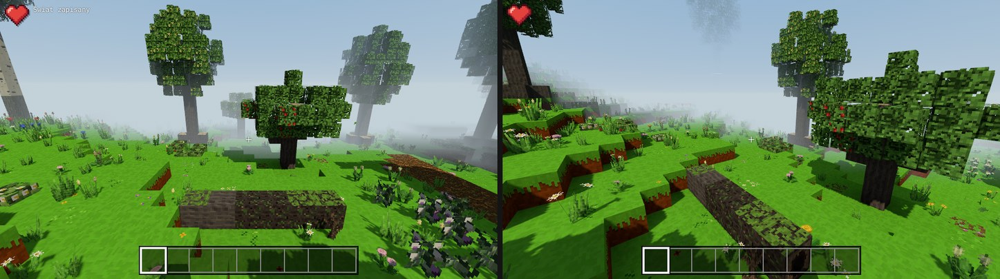

# Powalone drzewa

Druga wersja części B projektu [drewno.md](drewno.md) (rozdział 9),
pomysł Kamila. **W grze od 1.37.0.** Poprzednia wersja:
[scinanie.md](scinanie.md).

## Po co

Od 1.37.0 **gołą ręką żywego drzewa się nie zetnie** - potrzeba
siekiery. Pierwsze drewno bierze się więc ze **starego pnia, który
kiedyś sam upadł i leży w lesie**:

| Czym | Co z niego masz |
|---|---|
| gołą ręką | **patyki** z suchych gałęzi obok, **korę** (PPM w pień - podpałka) i **spróchniałe drewno** z ciemnych, dziurawych kawałków |
| siekierą | **zdrowe pnie** z reszty - każdy metr to jeden pień |

To wystarcza na pierwsze ognisko (bez siekiery) i na siekierę (patyk).
Potem pień tnie się siekierą (bez kozłów - wolno, [kozly.md](kozly.md)),
a po więcej trzeba już ściąć drzewo.

## Gdzie leżą

- **W lasach, co jakiś czas**: generator terenu ma dla nich własną,
  rzadką siatkę (kratka 20 × 20 bloków, w gęstym lesie pień w co drugiej).
  Gatunek jest miejscowy. Leżą tylko na trawie, nie w wodzie i nie na
  stromiźnie; po łagodnym stoku pień idzie z terenem.
- **Przy miejscu startu nowego świata zawsze jeden**: kilka kroków przed
  graczem, w poprzek jego spojrzenia. Gatunek najbliższego drzewa.
  Kładzie go gra, raz, gdy wczytają się chunki (stare światy go nie
  dostają - tam gracz ma już narzędzia).
- W chunkach wygenerowanych przed 1.37.0 powalonych pni nie ma - pojawią
  się w nowo odkrytym terenie.

## Jak wygląda

Pień ma 4-8 bloków (przy starcie 6). Każdy metr to jeden blok:

- **zdrowy leżący pień** gatunku (te same bloki, co po ścięciu drzewa),
- **spróchniały pień** (`rotten_log_x`, `rotten_log_z`) - ciemny,
  z mchem i dziurami, na końcu widać, że jest pusty w środku. Około
  jednej trzeciej metrów.

Na grzbiecie rosną **kępki mchu**, obok sterczą **suche gałęzie**
(`dead_branch`). Każdy pień ma przynajmniej jeden kawałek spróchniały,
dwa zdrowe i jedną suchą gałąź.

## Co z niego jest

- **Sucha gałąź**: łamie się szybko, daje 2 patyki.
- **Kora**: PPM w leżący pień pustą ręką (albo siekierą) - zostaje
  okorowany leżący pień, a w ręce kora gatunku. Kora jest podpałką.
  Okorowany leżący pień wykopany siekierą daje okorowany pień.
- **Spróchniałe drewno** (`rotten_wood`) - z każdego spróchniałego bloku
  jedno. To **polano na start**:

  | | Spróchniałe | Świerk | Dąb |
  |---|---|---|---|
  | zapłon | 200° | 240° | 320° |
  | żar | 450° | 700° | 920° |
  | polano pali się | 30 s | 55 s | 150 s |

  Zajmuje się od byle czego (także od trawy, 260°), ale grzeje słabo
  i mocno kopci. **Położone na wierzchu stosu rozpala resztę** - tak
  rozpali się dąb bez patyków na rozpałkę. Zawsze suche. Układa się też
  na stosie drewna.
- **Próchno** (`prochno`): spróchniałe drewno w siatce wytwarzania
  kruszy się na 2 próchna.
  - **Podpałka** (280°), która długo się tli - puszczone rozpalanie
    stygnie trzy razy wolniej (jak huba).
  - **Nawóz**: PPM na rozgrzebanej ziemi działa jak kompost.
  - **Niesie żar**: PPM próchnem na **płonącym ognisku albo żarze** daje
    **tlące się próchno** (`prochno_zar`). Tli się **4 minuty**
    (czerwony pasek na ikonce), potem gaśnie i znika. Położone zamiast
    podpałki na ułożonym stosie (6 polan) **rozpala go samo, bez
    startera ognia** - w 5 sekund. Ma 280°, więc twarde drewno
    potrzebuje patyka na rozpałkę albo spróchniałego polana na wierzchu.

## Bez siekiery

- **Żywe drzewo**: nie da się kopać pnia. Gra podpowiada, żeby poszukać
  powalonego pnia.
- **Zdrowy leżący pień** (także okorowany): tylko siekierą.
- Ręką dalej kopie się: spróchniały pień, suche gałęzie, pień postawiony
  ręką i pniak (nie mają korony), kosodrzewinę i baobab.
- W trybie twórczym bez zmian.

## Samouczek

Nowe kroki: *Znajdź powalone drzewo* (sucha gałąź) → *Zedrzyj korę,
wyłam próchno* → *Zrób siekierę* → *Potnij pień* → *Zetnij drzewo* →
*Zrób deski*; dalej jak dotąd (jedzenie, samopoczucie, ognisko, sen).
Samouczek zaczęty przed 1.37.0 może po aktualizacji stać o krok dalej
albo bliżej - kroki da się pomijać.

## Komenda

`/powalone` ([komendy.md](komendy.md)): gdzie leży najbliższy pień,
`tp`, `postaw [gatunek] [długość]`, `daj`.

## Kod

| Plik | Co robi |
|---|---|
| `src/world/trees/FallenTrees.js` | układ pnia, generator terenu, kładzenie w gotowym świecie |
| `src/game/StarterLog.js` | pień przy miejscu startu |
| `src/blocks/lyingLogs.js` | bloki: spróchniały pień, okorowany leżący pień, sucha gałąź |
| `src/items/prochno.js` | próchno i tlące się próchno |
| `src/game/CampfireState.js`, `Campfires.js` | spróchniałe drewno jako opał, żar z ogniska, rozpalanie próchnem |
| `src/game/Felling.js` (`needsAxe`) | czego nie ruszy się bez siekiery |
| `src/game/Tutorial.js` | nowe kroki |
| `tools/sprawdz_powalonych.mjs` | testy |
| `tools/powalone_tekstury.py` | tekstury |

## Luki

- **Pusta kłoda jako blok** (kryjówka dla jeży, koryto na kwiaty)
  i **wichura**, która powala drzewa w trakcie gry - później.
- ~~Kozłów dalej nie ma~~ - są od 1.38.0 ([kozly.md](kozly.md)).
- **Sucha gałąź** ma jeden wygląd (skrzyżowane obrazki) na wszystkich
  poziomach „Modeli roślin" - bez wersji półrealistycznej i szczegółowej.
- Pień z generatora nie ma **pniaka** ani **hub**; gatunków nie da się
  rozpoznać po spróchniałych kawałkach (są wspólne dla wszystkich).
- **Tlące się próchno gaśnie tylko w ekwipunku gracza**: w skrzyni i na
  ziemi czas stoi. Deszcz go nie gasi.
- Na **bardzo stromym terenie i w górach** powalonych pni nie ma; przy
  starcie na piasku albo skale gra nie znajdzie miejsca na pień (wtedy
  trzeba dojść do lasu).
- W **terenie klasycznym** generator pni nie kładzie - jest tylko ten
  przy starcie.
- **Baobab i kosodrzewinę** nadal da się kopać gołą ręką.
- **Stary świat bez siekiery**: jeśli ktoś ma zapisany świat, w którym
  nie zdążył zrobić siekiery, musi znaleźć powalony pień w nowo
  odkrytym terenie (`/powalone` pokazuje najbliższy).
