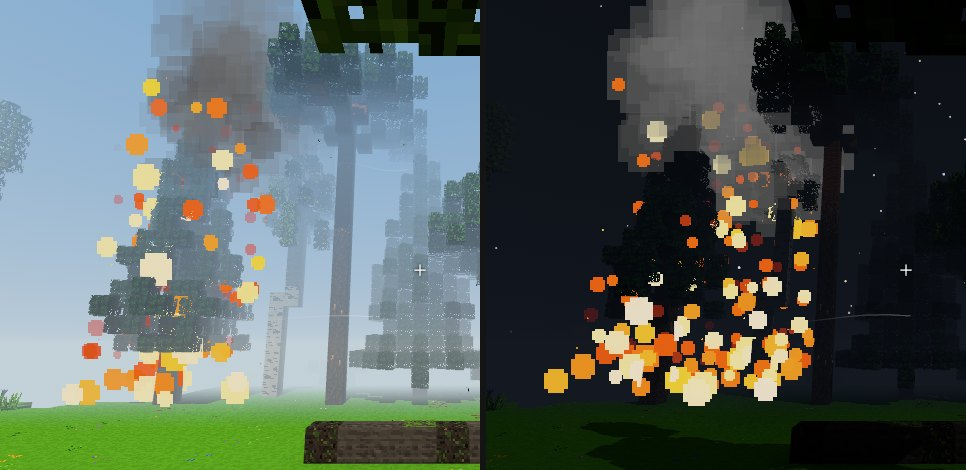

# Pożar (1.43.0)

Pierwsza wersja części E projektu drewna ([drewno.md](drewno.md),
rozdział 7): **płonące drzewa**. Sucha trawa, piorun, iskry z ogniska,
meteoryt i odrastanie lasu po pożarze - w następnej wersji.

## Zasada

Ogień **nie chodzi po pojedynczych blokach, tylko po drzewach**. Drzewo
się zajmuje, przez 20-60 sekund płonie mu korona (liście znikają od
dołu do góry), potem zostaje po nim jedno z trzech.

| Wynik | Kiedy | Drzewa |
|---|---|---|
| **Popiół** - drzewo znika, na ziemi zostaje warstwa popiołu | cienki pień, żywica; każde młode drzewko (do 5 kłód) | kosodrzewina, jukka, brzoza, osika, wierzba |
| **Zwęglony kikut** - liście spalone, stoi czarny pień | średnie drzewa | świerk, jodła, sosna oścista, buk, lipa, klon, jabłoń, wiśnia, olcha, jakaranda |
| **Przeżywa** - traci dolną trzecią część liści, pień cały | gruba kora; każde drzewo z pniem 2 × 2 i grubszym | sosna, modrzew, cedr, araukaria, eukaliptus, dąb, akacja, oliwka, palma, miłorząb, dracena, sekwoja, cypryśnik, namorzyn, puchowiec, banian |

**Baobab** jest nasiąknięty wodą - nie zapali się nigdy.

## Skąd ogień

- **Gracz**: starter ognia trzymany **5 sekund** (PPM) na pniu albo
  liściach żywego drzewa. Gdy się nie da (deszcz, mokro, baobab), gra
  mówi to od razu.
- Komenda `/pozar podpal`.
- Piorun, iskry z ogniska, sucha trawa, meteoryt - następna wersja.

## Jak się szerzy

Co sekundę płonące drzewo może zapalić sąsiada: pień do 5 bloków plus
promień płonącej korony (najwyżej 5), z wiatrem jeszcze 3 bloki dalej. Szansa zależy od:

- **gatunku sąsiada**: iglaste i eukaliptus łatwo (×1,2-1,8), zwykłe
  liściaste ×0,7-1, drzewa mokradeł i lasu deszczowego ×0,25-0,5,
- **pory roku**: lato ×1,3, jesień ×1, wiosna ×0,9, zima ×0,4,
- **wiatru**: z wiatrem do 2,5 raza łatwiej i dalej, pod mocny wiatr
  prawie wcale,
- **wody**: w deszczu nic się nie zajmuje, a **płonące drzewa gasną**
  (zostają takie, jakie były w tej chwili); na mokrej ziemi po deszczu
  ogień ledwo się trzyma,
- **odległości**: im dalej, tym trudniej. Pas bez drzew go zatrzymuje.

Liczby: `src/blocks/fireTraits.js`.

## Bezpieczniki

- **Budowle nie płoną.** Ogień bierze tylko żywe drzewa (pień z koroną,
  stojący na ziemi - to samo rozpoznanie, co przy ścinaniu). Ściana z
  pni, deski, płoty, leżące pnie, skrzynie - nic z tego.
- **Ustawienie świata**: `/pozar ustaw wylaczone | gracz | pelne`.
  Nowy świat ma „tylko od gracza". „Pełne" doda pożary z natury, gdy te
  wejdą do gry - na razie działa tak samo.
- **Najwyżej 40 płonących drzew naraz.**
- Spalone drzewo nie zajmie się ponownie przez 3 doby.
- Zwierzętom nic się nie dzieje. Graczowi też - przy ogniu jest tylko
  gorąco (grzeje jak ognisko).

## Po pożarze

- **Zwęglony pień** jest kruchy: wyłamuje się go ręką, daje **węgiel
  drzewny**. Węgiel → 2 × czarny barwnik (do czego jeszcze - część F).
- **Popiół** leży na ziemi płaską warstwą. Zebrany jest **nawozem jak
  kompost** (PPM na rozgrzebanej ziemi albo na ziemi i trawie).
- Nacięcia w pniu (dary pnia) znikają razem z drzewem; kubek spada.

## Obraz i wydajność

- Płomienie, iskry i dym to **jedna siatka cząsteczek** na cały pożar
  (najwyżej 1400 sztuk) - bez świateł i bez przebudowy chunków poza
  znikającymi liśćmi. Im więcej drzew płonie i im dalej są, tym mniej
  cząsteczek na drzewo: koszt jest stały. Pożar widać do 160 bloków.
- Świat zmienia się po kawałku: **najwyżej 90 bloków na krok** (4 kroki
  na sekundę), razem dla wszystkich drzew.
- Drzewo rozpoznaje się raz, przy zapłonie; sąsiadów szuka się raz na
  drzewo.
- Gra ze znajomymi: pożarem rządzi gospodarz; goście dostają bloki
  zwykłą drogą i listę płomieni przez `StateSync`.

## Osiągnięcia

Czarne złoto (węgiel ze zwęglonego pnia), Z popiołów (popiół na polu),
Niebo posprzątało (deszcz gasi drzewo) i dwa sekretne.

## Komenda

`/pozar` - ustawienie, ile drzew płonie, co sprzyja ogniowi, co stałoby
się z drzewem pod celownikiem; `/pozar podpal`, `/pozar zgas`,
`/pozar ustaw ...`, `/pozar daj`.

## Pliki

- `src/blocks/fireTraits.js` - zasady i liczby,
- `src/game/Wildfire.js` - stan pożaru,
- `src/rendering/WildfireRenderer.js` - cząsteczki,
- `src/blocks/burnt.js` - zwęglony pień i popiół,
- `tools/pozar_tekstury.py` - tekstury,
- `tools/sprawdz_pozaru.mjs` - test.

## Luki

- **Źródła ognia z natury** (piorun, iskry z ogniska, meteoryt) i
  **sucha trawa** - jeszcze nie ma. Ogień bierze się tylko od gracza.
- **Po pożarze nic nie odrasta**: drzewo, które przeżyło, nie odzyskuje
  liści wiosną; spalona ziemia nie zarasta; sosna, sekwoja i eukaliptus
  nie wysiewają się na pogorzelisku.
- **Brak osmalonej kory** na drzewach, które przeżyły - widać po nich
  tylko brak dolnych liści.
- **Brak łuny i światła**: płomienie świecą same, ale nie oświetlają
  ziemi ani sąsiednich drzew. Nocą pożar widać, lecz otoczenie zostaje
  ciemne.
- **Brak dźwięku ognia** (jest tylko syk przy zapłonie i gaszeniu).
- **Pożar nie jest w zapisie**: po wyjściu ze świata w trakcie pożaru
  drzewa zostają takie, jakie były (np. w połowie bez liści), a ogień
  jest zgaszony. Zapisuje się samo ustawienie.
- **Ustawienia świata nie ma w menu** tworzenia świata - tylko komenda.
- **Biom się nie liczy wprost**: „las deszczowy", „sawanna latem" to na
  razie tylko gatunki drzew, pora roku i mokra ziemia. Od 1.43.1
  deszcz i mokra ziemia są brane z miejsca drzewa (do 1.43.0 - z miejsca,
  gdzie stał gracz: deszcz nad graczem gasił wszystkie pożary naraz).
  Mokra ziemia pochodzi z mapy pogody o oczkach 128 bloków, więc jest
  zgrubna. Udział śniegu w opadzie liczy się jak przy graczu.
- **Daleko od gracza ogień czeka** (od 1.43.1): drzewo, którego teren nie
  jest wczytany, nie płonie dalej, nie przeskakuje i nie gaśnie, aż
  gracz wróci; sąsiad przy granicy wczytanego terenu (12 bloków) się
  nie zajmuje. Do 1.43.0 ogień płonął tam „na niby" i drzewo zostawało
  nietknięte. Płomienie takiego drzewa wiszą w miejscu bez zmian.
- **Zwęglonego pnia nie ścina się jak drzewa** - wyłamuje się go kłoda
  po kłodzie. Wysoki kikut zostaje w powietrzu, jeśli wyłamać dół.
- **Zwęglone gałęzie**: cały szkielet drzewa (także konary) zostaje
  czarny.
- **Liście między dwoma drzewami** (w równej odległości) płoną z tym,
  które zajęło się pierwsze - sąsiad może stracić skraj korony, choć
  sam się nie palił.
- Shader cząsteczek kompiluje się przy pierwszym pożarze (możliwe
  krótkie przycięcie raz na sesję).
- Nie sprawdzone na prawdziwym sprzęcie ani w prawdziwej grze dwóch osób.
