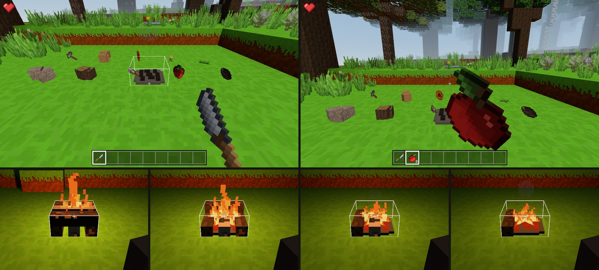

# Wyrzucanie, nóż, kora, ognisko etapami, jedzenie (0.100.0)

Sześć rzeczy, które Kamil zauważył w trakcie gry - ostatnie zmiany
zasad przed 1.0.

## Wyrzucanie przedmiotów

Do tej pory zebraną rzecz dało się tylko postawić albo schować do
skrzyni. Teraz można ją **wyrzucić**:

| Jak | Co się dzieje |
|---|---|
| **Q** | jedna sztuka z ręki leci przed gracza |
| **kucanie + Q** | cały stos |
| w ekwipunku: **Q** nad miejscem | jedna sztuka (z Shiftem - cały stos) |
| w ekwipunku: rzecz na kursorze i **klik obok okna** | cały stos (prawy przycisk - jedna sztuka); tak wyrzuca się na telefonie |

Wyrzucony przedmiot leży w świecie jako **pomniejszony model** (ten sam
co w dłoni), powoli się obraca i lekko unosi. **Podnosi się go, wchodząc
na niego** - tyle, ile zmieści się w ekwipunku. Ten, kto wyrzucił, przez
półtorej sekundy go nie podniesie (żeby nie wracał do ręki).

- Przedmiot **nie znika z czasem** i zapisuje się ze światem.
- Takie same przedmioty leżące obok siebie łączą się w jeden stos.
- Spada, gdy ktoś wykopie spod niego blok; w wodzie opada powoli.
- W świecie leży najwyżej 400 przedmiotów - potem znikają najstarsze.
- W grze ze znajomymi wszyscy widzą leżące przedmioty i każdy może je
  podnieść.
- Klawisz można zmienić: *Ustawienia → Gracz → Klawisze → Wyrzuć
  przedmiot*.

W trybie kreatywnym klik obok okna dalej usuwa rzecz (jak kosz);
klawisz Q wyrzuca tak samo jak w przygodzie.

## Nóż

Czwarte narzędzie: **skała i patyk na ukos** (skała w prawym górnym
rogu siatki, patyk w lewym dolnym). Jak siekiera, kilof i łopata - z
każdej z sześciu skał, ostrze ma jej wygląd.

**Trawę, kwiaty i zioła ścina się nożem.** Zniszczone gołą ręką (albo
innym narzędziem) po prostu znikają:

| Roślina | Gołą ręką | Z nożem w ręce |
|---|---|---|
| trawa krótka, wysoka, wydmowa, trzcina, paproć | nic | roślina trafia do ekwipunku |
| mak, chaber, rumianek, mniszek, krokus, wrzos, koniczyna, pokrzywa, babka | nic | kwiat trafia do ekwipunku |
| kwitnące rośliny etapowe (nagietek, lawenda, piwonia, zawilec, dzwonek, cynia, mikołajek, barwinek, kocanka, amarantus, szałwia, len, gorczyca, indygowiec) | PPM: „ścina się nożem"; zniszczona: sama sadzonka | **PPM: kwiaty do ekwipunku, łodyga zostaje** i kwitnie od nowa |

Bez zmian (ręką): owoce z krzaków i drzew, żywica, kwiat lipy, huba,
porosty, ochra, korzeń marzanny, rośliny wodne.

Po pierwszej zerwanej ręką trawie gra podpowiada, że potrzebny jest nóż
(najwyżej raz na pół minuty).

## Kora

Okorowanie pnia siekierą (PPM) daje teraz **korę każdego drzewa**, nie
tylko brzozy - 32 rodzaje (każde drzewo ma swoją). Każda jest **podpałką** do ogniska:

| Kora | Rozpalanie |
|---|---|
| brzozowa | 1,5 raza szybciej niż trawą |
| sosny, świerka, kosodrzewiny, eukaliptusa | 1,25 raza szybciej (żywica, olejki) |
| pozostałe | jak trawą (5 sekund) |

Kora brzozowa dalej służy też do lampy. Ponieważ trawa wymaga teraz
noża, **samouczek uczy rozpalać ognisko korą** (siekierę gracz już ma).

## Ognisko etapami

- Polana spalają się **po kolei**, od wierzchu stosu. Wypalone polano
  znika, ogień przechodzi na następne - ognisko **przygasa sześcioma
  etapami** (mniejszy płomień i słabsze światło, im mniej opału).
- Pełny stos pali się tyle co dotąd: 8 minut (80 sekund na polano).
- **Do płonącego ogniska można dokładać opał** (do 6 polan) - pali się
  dłużej. Dołożone polano zajmuje się pierwsze.
- PPM pustą ręką na ognisku mówi, ile polan zostało i na jak długo.
- Rozpalenie dalej wymaga sześciu polan, podpałki i startera.

## Jedzenie trwa

Jedzenie i picie zajmuje chwilę: przekąska 1,4 s, porządny posiłek
2,2 s, napar 1,8 s. W tym czasie ręka podnosi jedzenie do ust (w widoku
z oczu, zza pleców i u innych graczy), słychać kęsy. Sztuka znika
dopiero na końcu. **Przerywa je** kopanie, zmiana miejsca na pasku,
wyrzucenie jedzenia i sen - wtedy nic nie ubywa.

## Sen przesuwa cały świat

Przespana noc (i utrata przytomności pod wodą) przesuwa zegar - a teraz
razem z nim **wszystko, co w świecie trwa**: ogniska dopalają się,
rośliny rosną, owoce odrastają, puste pola zarastają. Po obudzeniu
ognisko rozpalone wieczorem jest popiołem, a posadzone krzaki są
większe.

W grze ze znajomymi noc przesuwa gospodarz (gdy śpią wszyscy) - za cały
wczytany świat.

## Pomysły na później (nie w tej wersji)

Zapisane na prośbę Kamila:

- ~~**Pory roku dla kwiatów.**~~ Zrobione w 1.4.0 -
  [`pory-roku.md`](pory-roku.md).
- ~~**Kwiaty reagujące na porę dnia**~~ i ~~**kłujące rośliny**~~ -
  zrobione w 1.5.0 ([`pory-roku.md`](pory-roku.md)).
- ~~**Rzadki tryb przesady w generatorze**~~ - zrobione w 1.6.0
  ([`przesada.md`](przesada.md)).

## Do testów

- `/daj knife`, `/daj knife_granite`, `/daj oak_bark 3`, `/daj axe`,
- `/daj oak_firewood 12`, `/daj fire_starter` - ognisko i dokładanie,
- `/daj jablon_jablko 5`, `/daj roasted_apple 2`, `/daj tea_calm` -
  jedzenie i picie,
- `/czas ustaw noc` i sen - świat nadrabia noc.

## Dla programisty

- `src/game/Drops.js` - leżące przedmioty: rzut, fizyka, podnoszenie,
  łączenie, zapis (`worldInfo.drops`); `src/rendering/DropRenderer.js` -
  modele (ta sama geometria co w dłoni: `buildBlockGeometry`).
  Gra ze znajomymi: system `drops` w `src/net/StateSync.js` (wpis po
  nazwie - `entryKey`).
- `src/items/stoneTools.js` - `knife` w `STONE_TOOL_KINDS`;
  `src/blocks/BlockRegistry.js` - pole `cut` i `needsKnife`;
  paczki roślin: `"zbior": { "narzedzie": "noz" }` → `harvest.tool`;
  `GameInteraction.breakDrops(type, pozycja, narzędzie)` i
  `harvestTarget`.
- `src/items/bark.js` - `barkType`, `BARK_TINDER`; przedmioty kory
  robi `ItemRegistry.js` dla każdego pnia z polem `strip`.
- `src/game/CampfireState.js` - `CAMPFIRE_LOG_SECONDS`, spalanie po
  kolei w `updateCampfire`, `fireStage`, `burnSecondsLeft`,
  `fireIntensity` zależne od ilości opału.
- `src/game/GameInteraction.js` - `eat` (start), `updateEating`,
  `finishEating`; czasy: `EAT_SECONDS` w `src/config.js`; animacja:
  `FirstPersonHand.setEating`, `A.eat` w `src/player/animations.js`,
  znacznik w `net/protocol.js`.
- `Game.advanceWorld(sekundy)` - **nowy system zależny od czasu dopisz
  tutaj**; wołają go `Sleep.js` (przeskok nocy) i `Blackout.js`.
- Tekstury: `python3 tools/tekstury_noza_i_kory.py`, potem
  `node tools/tekstury_noza_skaly.mjs`.
- Testy: `node tools/sprawdz_wyrzucanie.mjs`,
  `node tools/sprawdz_noz_kora_jedzenie.mjs`,
  `node tools/sprawdz_ogniska.mjs`.
