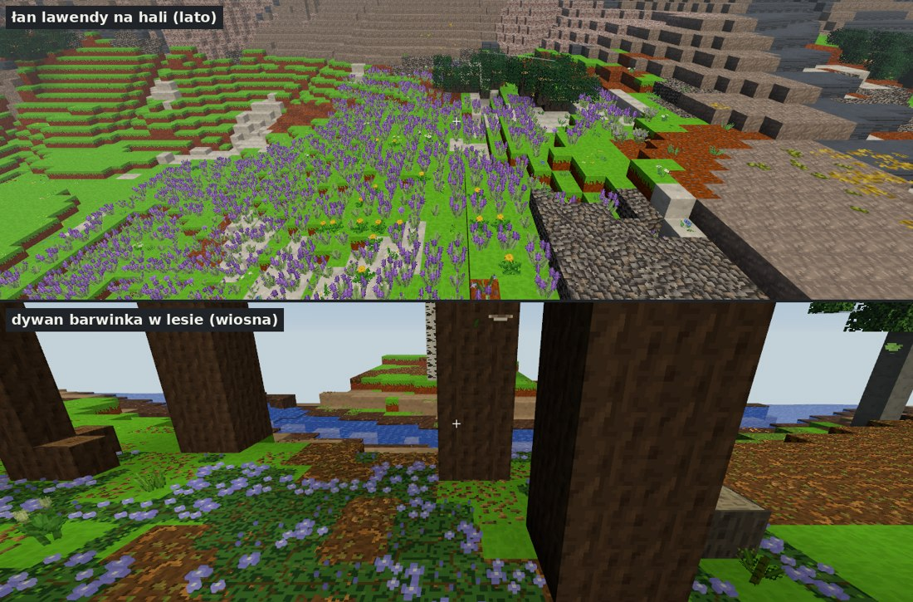

# Tryb przesady

Od wersji 1.6.0 (pomysł Kamila).

Rzadko w świecie trafia się miejsce, w którym **jedna roślina opanowała
całą okolicę**: około 80% trawiastego podłoża to jej dywan - barwinek pod
całym lasem, łan lawendy na łące, polana zawilców w buczynie.

## Zasady

- Świat jest podzielony na kwadraty 320 × 320 bloków. W mniej więcej co
  dziesiątym leży jedno takie miejsce: koło o promieniu od 36 do 84
  bloków z nierównym brzegiem.
- **Roślina pasuje do biomu.** Losujemy ją spośród roślin, które i tak
  rosną w biomie na środku miejsca (wagi niżej). Gdy żadna nie pasuje
  (morze, skały, plaża), miejsca nie ma.
- **W środku 80% trawy** zajmuje ta roślina; w ostatniej ćwiartce
  promienia coraz mniej, aż do zwykłej łąki. Na pozostałych 20% rośnie
  to, co zwykle (trawa, inne kwiaty, krzaki); drzewa stoją jak stały.
- Dywan kończy się tam, gdzie roślina i tak by nie rosła - np. barwinek
  nie wchodzi na plażę.
- Etapy jak zwykle u tej rośliny (większość kwitnie), więc działają pory
  roku: łan lawendy wiosną to morze liści, latem - fioletu.
- Ten sam świat (ziarno) ma zawsze te same miejsca.

| Roślina | Waga |
|---|---|
| barwinek | 3 |
| zawilec, lawenda | 2 |
| dzwonek, len, gorczyca | 1,5 |
| nagietek, szałwia, piwonia, cynia | 1 |

Waga jest w `assets/rosliny/<roślina>/roslina.json`:
`"gdzieRosnie": { "przesada": 3, ... }` (0 albo brak - roślina nigdy nie
przesadza). Mikołajek (kłuje), indygowiec (wielki) i rośliny z pni nie
biorą udziału.

## W grze

- `/przesada` - gdzie jest najbliższe takie miejsce i jaka roślina;
  `/przesada tp` - przenosi na środek.
- Osiągnięcie *Morze kwiatów* (rzadkie): stań w środku takiego miejsca.

## Istniejące światy

Miejsca pojawią się także w istniejących światach - w chunkach, których
gracz nie zmienił (te generują się od nowa przy każdym wczytaniu). Chunki
zmienione przez gracza są w zapisie i zostają takie, jakie były, więc
dywan może się urywać na granicy takiego chunka.

## Wydajność

- Rysowanie i liczba poleceń rysowania: bez zmian. W samym miejscu jest
  więcej roślin niż na zwykłej łące (o to chodzi), ale to mały obszar.
- Generowanie: poza miejscami sprawdzenie kolumny to ok. 0,1 mikrosekundy
  (kilka odczytów z pamięci); biom środka miejsca liczy się raz na
  kwadrat i jest pamiętany.

## Dla programisty

- `src/world/terrain/PlantExcess.js` - miejsca (`zoneOfCell`, `zoneAt`,
  `plantAt`, `nearest`) i stałe (`EXCESS_CELL`, `EXCESS_CHANCE`,
  `EXCESS_RADIUS`, `EXCESS_COVER`, `EXCESS_EDGE`).
- `src/world/terrain/RealisticGenerator.js` - `plantAt` pyta najpierw
  o przesadę.
- `src/blocks/plantPacks.js` - pole `gdzieRosnie.przesada`.
- Test: `node tools/sprawdz_przesada.mjs`.
