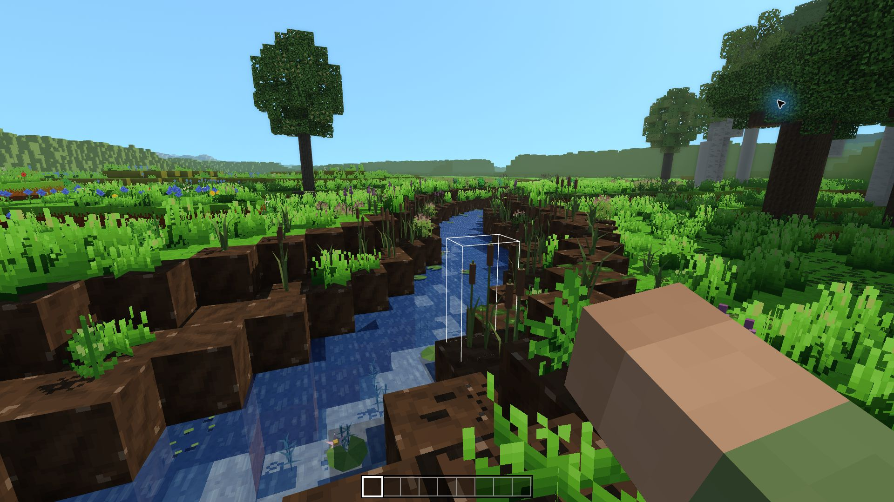
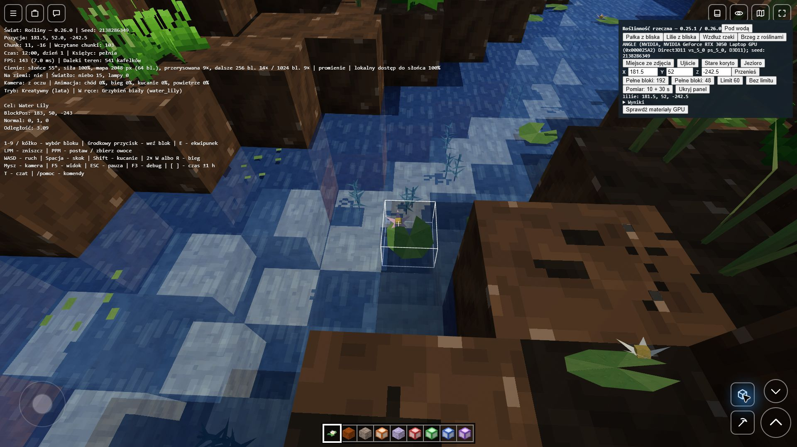

# Roślinność rzek — 0.26.0 (PR #53)

Sześć nowych form uzupełnia istniejącą trzcinę. Nie zmieniamy koryt,
poziomów wody, nurtu ani zasad oświetlenia z wersji 0.25.1.

| Roślina | Wygląd i siedlisko |
| --- | --- |
| Turzyca rzeczna | Niskie wachlarze wąskich liści w kępach na brzegu |
| Pałka wodna | Długie liście, łodygi i brązowe kolby; brzeg lub woda głęboka na jeden blok |
| Krwawnica pospolita | Fioletowe piętra kwiatów między zielonymi kępami |
| Wywłócznik | Pędy z okółkami wąskich liści, zakorzenione i delikatnie poruszające się pod wodą |
| Grzybień biały | Pływający liść z wcięciem, w części wariantów jasny kwiat |
| Rzęsa wodna | Drobne skupiska listków na spokojnej, płytkiej tafli |

Skupiska zależą od seeda, odległości od brzegu, głębokości i prędkości
wody. Nie ma szwu na granicy chunków. Rośliny wodne omijają morze,
głęboką wodę i szybki nurt; trzymają się płytkiej strefy przybrzeżnej. Luki między kępami ułatwiają
dojście do wody. Wysokie, zimne i skaliste stanowiska nie są obsadzane.

## Rozgrywka i zapis

- LPM zbiera roślinę, pozostawiając wodę. Pełny ekwipunek nie usuwa
  ani rośliny, ani dna, gdy nie mieści się komplet łupów.
- PPM z grzybieniem, rzęsą lub pałką pozwala wskazać taflę. Wywłócznik
  sadzi się na dnie. Pałka automatycznie dobiera formę lądową lub wodną.
- Wodne formy wymagają istniejącej wody; sadzenie w powietrzu jej nie tworzy.
  Nie blokują ruchu, pływania ani ciągłości renderowanej tafli.
- Zniszczenie podpory lub przykrycie liści usuwa roślinę i zachowuje wodę.
  Tak samo zachowują się generowane drzewa i drzewa wyrosłe z sadzonek.
- Celownik i ramka obejmują rzeczywisty zasięg modelu, również górę pałki.
- Komendy usuwające cały teren i wnętrze krateru usuwają również wodę;
  zwykłe zbieranie roślin pozostawia ją na miejscu.
- Nowe ID 246–252 nie zmieniają istniejących bloków ani zakresu paczek drzew.
  Zapis zachowuje gatunek i wodę. Odległy widok zapisanej rośliny wodnej
  nadal ma materiał i wysokość wody.

Roślinność generuje się w nowych i niemodyfikowanych chunkach świata
realistycznego. Fragmenty zapisane po zmianach gracza nie są nadpisywane;
można je obsadzić ręcznie. Rośliny są dostępne w ekwipunku kreatywnym
także w pozostałych typach świata.

## Koszt i sprawdzenia

Każda forma ma osiem deterministycznych wariantów. Pojedynczy model
zawiera 12–50 czworokątów i trafia do istniejącej partii roślin w chunku;
nie tworzy osobnego obiektu ani wywołania rysowania. Ruch jest liczony
przez shader. Przy generacji korzystamy z gotowej próbki hydrologii,
bez obliczania dodatkowych sąsiednich kolumn.

`npm test` obejmuje generację i skupiska, podłoże, nurt, zapis, łupy,
wodne rośliny, wysokie modele, drzewa oraz geometrię i ciągłość tafli.
Test WebGL sprawdza prawdziwe materiały w dzień, w nocy i w ciemności,
warianty jakości, ruch roślin oraz wygląd dawnych przedmiotów w ręce.

Stanowisko ręczne: seed **2138286349**, okolice **188, 132, -252**,
z porównawczym kadrem **198, 62, -261**, yaw **2.297439**, pitch **-0.4827**.
Pomiar: osobny profil Electron, RTX 3050 Laptop, zasilacz, 1920×1080,
skala 100%, pełne bloki 48, daleki teren 8192, detal 2, cienie 3,
model atmosferyczny, nieruchoma kamera w południe. 10 sekund rozgrzewki
i 30 sekund pomiaru; czas GPU z zapytań WebGL. Osobny profil nie zmienia
zapisów ani ustawień zainstalowanej gry.

### Kontrola w grze

W natywnym oknie Electron na RTX 3050 sprawdzono brzeg z sześcioma
gatunkami, zanurzenie i wygląd modeli w ręce. Grzybień w `(183,50,-243)`
oraz pałkę wodną w `(175,50,-251)` zebrano przyciskiem kopania, po czym
ponownie posadzono na tej samej tafli. Woda pozostała ciągła, a celownik
ponownie wykrył właściwą roślinę. Wysoka pałka została trafiona w część
wystającą ponad jej komórkę. Testy używały osobnego świata kreatywnego.

Dalsze dowody: [woda po zebraniu grzybienia](pomiary/roslinnosc-rzek-0.26.0/lily-removed-water.png),
[posadzona pałka](pomiary/roslinnosc-rzek-0.26.0/cattail-replanted.png),
[widok pod wodą](pomiary/roslinnosc-rzek-0.26.0/underwater.png).

Pełne `npm test` (22 zestawy, w tym 27 przypadków wodnych roślin i 9
przypadków czyszczenia terenu) przeszło. [Log](pomiary/roslinnosc-rzek-0.26.0/tests-final.log).
Test rzeczywistych materiałów WebGL na RTX 3050 przeszedł dla 34 programów
shaderów; dane zawiera `surfaceChecks` w
[raporcie GPU i limitu 60 FPS](pomiary/roslinnosc-rzek-0.26.0/after-benchmark.json).

### Wyniki wydajności

Porównanie z bazą `ce0a240` (0.25.1), ten sam start, 82 wczytane chunki,
515 kafelków dalekiego terenu, ekran 144 Hz. Pomiar wykonany 30.10.2026
na zasilaczu, z domyślnym VSync i bez limitu klatek w grze:

| Pomiar | 0.25.1 | 0.26.0 |
| --- | ---: | ---: |
| Średni FPS | 142,28 | 143,01 |
| Średni czas GPU | 3,624 ms | 3,701 ms |
| 99. percentyl odstępu między klatkami | 11,2 ms | 9,9 ms |
| 1% najwolniejszych klatek | 75,74 FPS | 86,41 FPS |
| Najdłuższy odstęp | 20,6 ms | 18,0 ms |
| Wywołania rysowania | 348 | 348 |
| Trójkąty | 606 718 | 655 558 |

Więcej modeli zwiększa geometrię o około 8%, bez dodatkowych wywołań
rysowania w tym kadrze. Różnica czasu GPU to około 0,08 ms; różnicy
FPS przy limicie ekranu nie należy interpretować jako przyspieszenia.
Surowe raporty: [baza](pomiary/roslinnosc-rzek-0.26.0/before.json),
[nowa wersja](pomiary/roslinnosc-rzek-0.26.0/after.json).
W drugim raporcie porównywalny jest `results[1]`; `results[0]` zbierano
podczas równoległych testów CPU, więc nie służy do porównania regresji.

Oddzielna próba z limitem 60 FPS dała **60,00 FPS**, GPU **3,706 ms**,
99. percentyl **21,7 ms**. Wśród 1799 odstępów wystąpił jeden trwający
40 ms. Jest zapas wydajności, ale nie jest to gwarancja równych 16,67 ms
każdej klatki ani pomiar wszystkich biomów i lotu podczas doczytywania.
Ten wynik i dodatkową próbę bez limitu (143,60 FPS) zachowano w
[after-benchmark.json](pomiary/roslinnosc-rzek-0.26.0/after-benchmark.json).

Zasięg dalekiego terenu pozostaje 8192, a jego detal około 800 bloków.
Drobne modele roślin korzystają z istniejącego zakresu pełnych chunków;
nie są osobnymi obiektami dodawanymi na całym horyzoncie.
Archiwum [lokalnego panelu pomiarowego](pomiary/roslinnosc-rzek-0.26.0/river-plants-qa.js)
opisuje stałe ustawienia, kadry i sposób zbierania czasów; panel nie jest
częścią wydawanej gry.

## Wydanie

PR przygotowuje wersję **0.26.0** dla Windowsa i Androida. Publikację
w `voxel-game-wydania` wykonuje workflow dopiero po scaleniu do `main`.
