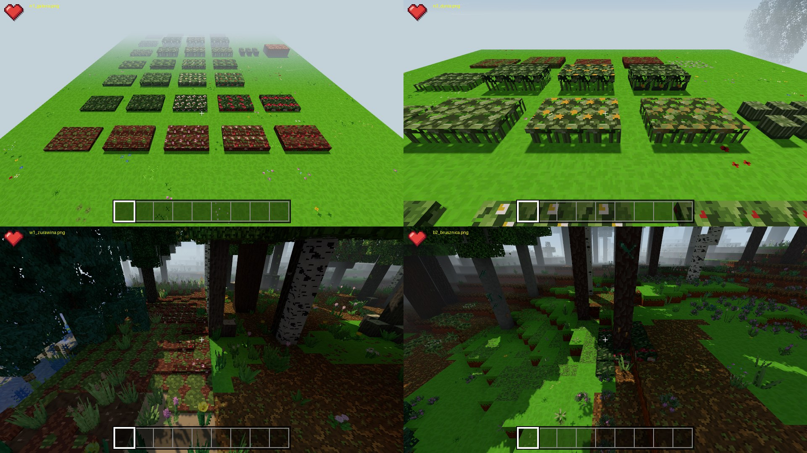

# Rośliny niskie (1.19.0)

Druga część roślin jadalnych z paczki Kamila `food_pack_all` (tekstury
16 × 16 - materiały autorskie Kamila): **żurawina, borówka brusznica,
truskawki, poziomka, dynia i cukinia**, a z nimi torfowiec i chrobotek.
Pierwszą częścią były [krzewy jagodowe](krzewy.md); pnącza (winorośl,
chmiel, kiwi, marakuja, fasola i groch) czekają na kolejne wydanie.

Na zrzutach (renderer programowy): galeria `/niskie galeria` - od dołu
żurawina, brusznica, truskawki, poziomka, pnącze dyni i cukinia, w każdym
rzędzie kolejne etapy; pnącza dyni z bliska (zielone, kwitnące, żółknące
i młode dynie); dzika żurawina z torfowcem na mokradłach; brusznica pod
sosną w borze.

## Niska płyta

Roślina niska to **blok niższy niż komórka** - płyta z rysunkiem na
wierzchu i na bokach, tak jak na podglądach z paczki. Po płytach się
chodzi (nie zatrzymują gracza ani jeżyka), rosną tylko na ziemi i znikają,
gdy zabraknie jej pod spodem.

| Roślina | Wysokość (sadzonka / dorosła) | Etapy | Zbiór | Gdzie rośnie dziko |
| --- | --- | --- | --- | --- |
| Żurawina | 3 / 6 px | roślina → kwiaty → niedojrzałe → owoce | 2-4 żurawiny | mokradła |
| Borówka brusznica | 3 / 5 px | roślina → kwiaty → niedojrzałe → owoce | 2-4 brusznice | bory sosnowe, świerczyny, kosodrzewina, brzeziny |
| Truskawki | 4 / 8 px | roślina → kwiaty → owoce | 2-4 truskawki | łąki, gaje oliwne (rzadko) |
| Poziomka | 3 / 6 px | roślina → kwiaty → owoce | 1-3 poziomki | lasy liściaste, buczyny, brzeziny, lasy klonowe, łąki |
| Pnącze dyni | 4 / 10 px | pnącze → kwiaty → (dynia obok) → żółknie → pnącze | dynia | łąki (rzadko), sawanna |
| Cukinia | 5 / 14 px | roślina → kwiaty → owoce | 1-2 cukinie | gaje oliwne, sawanna |

- **PPM na roślinie z owocami** zbiera je; roślina wraca do etapu bez
  owoców i owocuje od nowa. Etap trwa średnio 200 s (sadzonka - 150 s).
- **Zniszczona roślina daje sadzonkę**, którą można posadzić gdzie indziej.
- **Sadzenie**: owoc (żurawina, brusznica, poziomki, cukinia) albo pestki
  dyni na rozgrzebanej ziemi dają sadzonkę. Truskawki-płytę sadzi się
  z sadzonki - sam owoc truskawki sadzi krzak z 0.50.0 (oba zostają).
- Rośliny rosną tylko w chunkach zmienionych przez gracza - dzikie
  czekają w etapie, w którym wygenerował je świat (jak krzaki i krzewy).

## Dynia

Pnącze dyni nie owocuje na sobie. **Kwitnące pnącze zawiązuje młodą
dynię w wolnej komórce obok** (na tym samym poziomie, na stałym gruncie),
po czym żółknie; młoda dynia dorasta do dyni, a pnącze po jakimś czasie
zielenieje i kwitnie od nowa. Obok leżącej już dyni pnącze drugiej nie
zawiąże - trzeba ją zebrać. Bez wolnego miejsca obok pnącze czeka.

- **Dynia** to pełny blok: można ją postawić albo pokroić -
  w wytwarzaniu jedna dynia daje **4 kawałki dyni**, a kawałek
  **2 pestki dyni** (do zjedzenia albo do posadzenia).
- Młoda dynia zerwana za wcześnie daje tylko pestki.
- Dziko między pnączami leżą gotowe dynie - stąd pierwsze pestki.

## Jedzenie

| Przedmiot | Energia | Sytość | |
| --- | --- | --- | --- |
| Żurawina | 4 | 35 | przekąska |
| Borówki brusznice | 5 | 40 | przekąska |
| Poziomki | 6 | 40 | przekąska |
| Kawałek dyni | 8 | 80 | przekąska |
| Pestki dyni | 6 | 60 | przekąska |
| Cukinia | 6 | 70 | przekąska |
| Pieczona dynia | 20 | 170 | posiłek (kawałek dyni nad ogniskiem) |
| Pieczona cukinia | 18 | 150 | posiłek (cukinia nad ogniskiem) |

Żurawinę, brusznice i poziomki je też [jeżyk](zwierzeta.md).

## Torfowiec i chrobotek

- **Torfowiec** zielony i czerwony, niski (3 px) i kępa (6 px) - płyty
  na mokradłach, między nimi rośnie żurawina.
- **Chrobotek** - płaski, jasny porost na ziemi w borach sosnowych,
  kosodrzewinie i na halach.

To bloki ozdobne: nie rosną i nic nie dają poza sobą.

## Osiągnięcia i komendy

*Runo leśne* (zbierz żurawinę, brusznice i poziomki), *Grządka* (posadź
roślinę niską), *Dyniowe żniwa* (pokrój dynię).

`/niskie` - lista roślin i biomów, `/niskie galeria` - wszystkie etapy
obok siebie, `/niskie znajdz [roślina]` - najbliższa we wczytanym
terenie. `/krzaki tempo` i `/krzaki rosnij` działają też na rośliny niskie.

## Jak to działa

- `src/blocks/lowPlants.js` - katalog (`LOW_PLANTS`), bloki, siedliska.
  Numery 15000-15199, po 8 na roślinę (`docs/numery-blokow.md`).
- Model `'flat'` z polem `flat.height` (wysokość w blokach):
  `ChunkMesher.addPlate` rysuje wierzch i boki w grupie liści (prześwity),
  bok bierze dolne wiersze rysunku. Bok przy pełnym bloku albo przy
  płycie co najmniej tak wysokiej jest pomijany.
- Celowanie i obrys: `interaction/BlockBounds.js` (pudełko do wysokości
  płyty).
- Dynia obok pnącza: `grows.fruit` w `game/PlantGrowth.js` (`setFruit`).
  Młoda dynia to kształt `gourd` (`world/ShapeBoxes.js`).
- Świat: plamy w biomach jak wrzos czy kępki mchu
  (`RealisticGenerator.resolveBiome` - `lowPatches`), dopisane na końcu
  listy plam z własnym numerem losowania, więc dotychczasowe rośliny
  zostały na swoich miejscach. W starych światach rośliny niskie pojawią
  się w nowo odkrywanym terenie.
- Tekstury: `python3 tools/niskie_tekstury.py` (wzorce w
  `tools/wzorce/niskie/`). Dorysowane: bok krzaka cukinii bez owocu
  i ikonki pieczonej dyni i cukinii.

## Czego nie ma (luki)

- **Dwie truskawki**: krzak truskawki z 0.50.0 (model 3D) i nowe
  truskawki-płyty rosną obok siebie i dają ten sam owoc. Do decyzji
  Kamila, czy stary krzak ma zniknąć z generatora.
- Z paczki nie weszły: wełnianka, pływające owoce żurawiny i zbiór „na
  mokro", woda bagienna, mech z igliwiem, borówka czarna jako płyta (w grze
  jest krzak borówki), rozłogi i wiszące owoce truskawki, słoma pod
  truskawki, skrzynia-grządka, rozłogi i zwisy pnącza dyni, kompostownik.
- Płyty nie kołyszą się na wietrze, nie zmieniają koloru jesienią i nie
  przykrywa ich śnieg (zimą wyglądają jak latem).
- Płyta nie spowalnia gracza (liście krzewów spowalniają).
- Dzikie rośliny nie rosną w nietkniętych chunkach - dzika dynia nie
  przybywa sama.
- Nie ma pór roku dla owocowania (owocują cały rok).
- Z daleka (daleki teren) plam roślin niskich nie widać.
- Boki płyt widać tylko z zewnątrz - przez prześwity wierzchu nie widać
  spodu sąsiedniej ściany.
